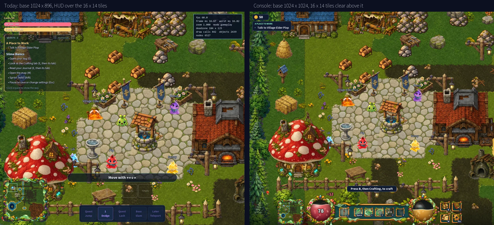
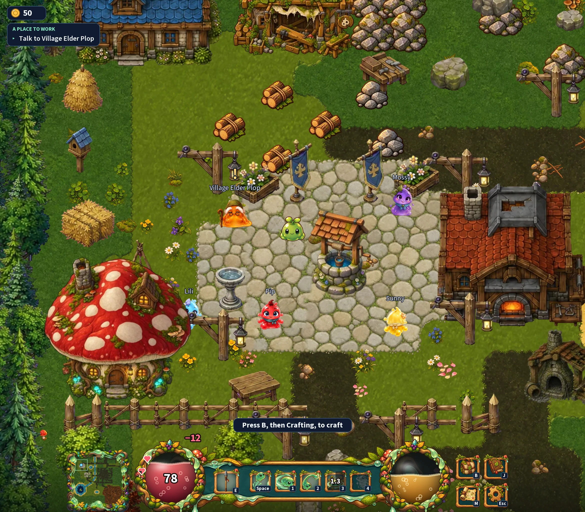
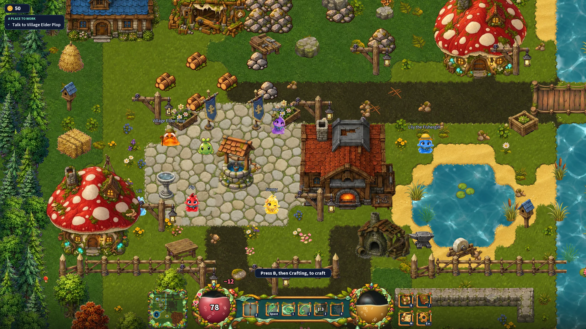
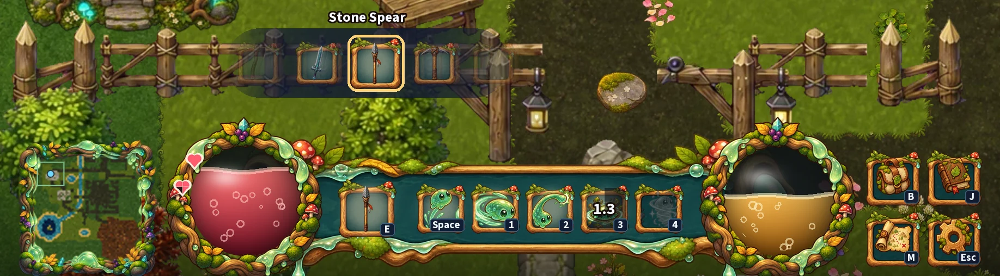
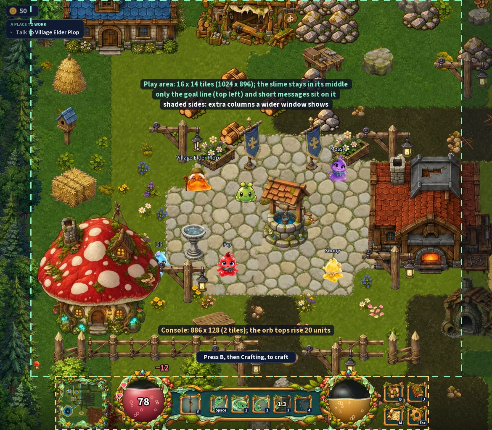

# The HUD console (mockup)

Mockup, 2026-10-07. **The owner approved the direction on 2026-10-08** and
answered its questions ([below](#the-owners-answers-2026-10-08)); the images
show those answers. It settles two things at once: the HUD that crowds the
screen since the 16 × 14 tile view
([World size and screen](../story/03-world.md#world-size-and-screen)), and the
goo-orb life and energy display decided on 2026-10-02
([Direction](../story/01-direction.md), "Life and energy display": "a mockup
comes before the build"). The build is roadmap 4.12, built on 2026-10-08 and
waiting for the owner's playtest.

## Why the screen feels crowded

Since 2026-10-07 the view is a fixed 1024 × 896 (16 × 14 tiles) that Godot
scales to the window, and the HUD scales with it. Every HUD piece was sized
under the old rule (1 game px = 1 CSS px, windows of 1280 × 720 and up), so on
the small base each one takes about twice the share of the screen it used to:
the HP card and the quest tracker are 284 units wide (28 % of the width), and
the hint, the weapon belt and the ability bar stack up to about a quarter of
the height in the middle of the bottom edge. The FPS panel is also on by
default.

## The console

One console along the bottom edge, in the style of Diablo's, holding
everything the player glances at. **The 16 × 14 tiles stay whole above it.**
The images show the moment just after a hit: the life orb shows its number and
the damage, the energy orb (unchanged) shows none.

On a 16:9 window the console stays the same size and centred, and the world
fills the rest of the screen:

A scroll (the mouse wheel, or E) opens the weapon carousel over the weapon
slot:

### Screen rules

1. **The base view grows from 1024 × 896 to 1024 × 1024**: the 16 × 14 tile
   play area plus a 128-unit (2-tile) console strip under it. A wider window
   still shows more columns (8:7 → 1170 × 1024, 16:9 → 1820 × 1024), as today.
2. **The camera works on the play area, not the whole view**: the slime stays
   in the middle of the 1024 × 896 area above the console, the deadzone is
   measured on it, and at a map's south edge the last row of tiles stops at
   the console's top edge (nothing of the map hides under it). In
   `world_camera.gd` this is `_viewport_size()` returning the play area and the
   centre shifting down by half the console.
3. **Tiles get 12.5 % smaller on the same window** (896 / 1024): the cost of
   keeping 16 × 14 tiles clear.
4. **Only short things sit on the play area**: the goal line (top left), the
   weapon carousel while it is open, and a message above the console that fades
   (today's hints, such as "Press B, then Crafting, to craft"). The boss bar
   moves to the top centre (decided on 2026-10-02).

### The console, left to right

The console is about 890 × 128 units.

| Piece | Size (units) | What it shows | Today |
|---|---|---|---|
| Minimap | 128 × 128, never bigger than the orbs | The minimap in its organic frame; M opens the world map | 180 × 180, bottom left |
| Life orb | 144 ring | Red goo at the HP level. The number shows only when HP changes (a hit, a heal), with the change beside it, then fades. Heart pips on the ring (below) | HP bar, top left |
| Weapon in hand | 1 slot of 54 | The weapon in hand. A scroll (the wheel, or E) opens the carousel | 4 belt slots of 64, above the ability bar |
| Abilities | 1 slot of 46 per ability | The abilities of `ability_definitions.gd` BAR_SLOTS with their key (Dodge, Lash, Slam, Teleport since Jump left the interface on 2026-10-08; with the Gulp rework the Roll replaces the Dodge on 1 and Swallow joins on R, W in the keys-only scheme); a cooldown darkens the slot and counts down; a locked ability is grey | 5 text buttons of 64, bottom centre |
| Energy orb | 144 ring | Gold goo at the energy level; its number shows only when energy changes, like the life orb's | Energy bar, top left |
| Menu buttons | 2 × 2 of 52 | Bag (B), Journal (J), Map (M), Menu (Esc). Kept for now; whether they move or go is not decided | Keys only |

The weapon slot and the abilities sit on one wooden bar whose ends tuck behind
the orbs; the orb tops rise 20 units above the console strip, as in Diablo.
Everything sits on a solid band across the whole width (2026-10-14, replacing
the soft shade): the bar's own frame, darkened so the bar stands out, its rim
on the console's top. The map ends at the rim, so nothing past a chunk's south
edge shows under the console, as in Link's Awakening ([render](hud-band/built.png)).

**Heart pips.** The run starts with none. Each heart quarter found shows on the
ring as a quarter of a pip (a quarter, then a half, then three quarters); the
fourth quarter completes the heart, and only a whole heart adds max life
(+20). The images show one whole heart and three quarters of the next.

**The weapon carousel.** The belt keeps its four weapons, but the console shows
only the one in hand. Each scroll slides the belt by one weapon: the carousel
appears above the slot with the weapon now in hand in full, its name above
it, and its neighbours fading out to the sides; it slides with each scroll and
fades away a moment after the last one, as weapon and item scrolls do in many
action games.

### What moves elsewhere

| Today | With the console |
|---|---|
| Coins on the HP card | A small coin chip, top left |
| Quest tracker (up to four quests, 284 wide) | One goal line, top left: the tracked quest's title and its next step. Clicking it shows the way, as today; the full list is in the Journal |
| "Slime Basics" checklist in the tracker | Each step is a short message above the console when it is due, then the Journal |
| The four belt slots | One slot for the weapon in hand, and the carousel |
| FPS panel, on by default | Off by default; F3 still shows it |
| Boss bar, bottom centre | Top centre (decided 2026-10-02) |

### Keys

Every console action has a key in every control scheme (owner, 2026-10-08;
built the same day): **E scrolls the weapon** (it will open the carousel; the
mouse wheel does too, except in the keys-only scheme, where only E cycles the
belt), **B opens the bag** (it was E), **J the Journal**, M the map and Esc
the menu ([MOUSE_CONTROLS](../godot/MOUSE_CONTROLS.md#the-keys-only-scheme)).
The images show these letters.

## The owner's answers (2026-10-08)

1. **Direction:** approved (the Diablo console, the play area kept whole).
2. **Orb numbers:** only when the value changes, by damage or a heal.
3. **Heart pips on the ring:** could work. The player starts with no hearts; a
   quarter heart shows as a quarter on the ring, then a half, and so on; only
   a whole heart gives extra life.
4. **Minimap:** never bigger than the orbs.
5. **Menu buttons:** not decided whether they go somewhere else or disappear.
6. **Weapon keys:** no number keys. One slot for the weapon in hand, and a
   momentary weapon scroll that shows the other weapons at low opacity, with a
   scroll animation. In the mouse-less controls every action needs a letter: E
   for the weapon scroll, and the bag moves to B.

Then, the same day: B opens the bag in every control scheme; in the keys-only
scheme only E cycles the belt; the Journal gets J. All three are built.

### Still open

- The menu buttons: keep, move or remove (answer 5).

## How the mockup was made

- The world frames are the game itself: `godot/tools/render_hud_mockup.gd`
  plays level-1 at the plaza at 2x, with today's HUD and without it.
- The console is drawn over them by `scripts/art/build-hud-console-mockup.py`
  ([TOOLING](../TOOLING.md#art-pipelines)). The ring, the bar, the slot, the
  ability icons and the menu icons were generated with Magnific GPT 2.5
  (9 images, 900 credits; the chosen ones are in
  `asset/Originals/ui/hud-console/`). The goo in the orbs, the heart pips, the
  coin, the carousel and the text are drawn by the script; the weapon icons
  and the minimap come from the game; the font is the game's (Source Sans 3).
- Not final art: the ability and menu icons are not packed into the game, and
  the goo will be a shader or an animated sheet in the build.

## What the build touches

`project.godot` (base height 1024), `world_camera.gd` (rule 2), `hud.gd`,
`ability_bar.gd`, `weapon_hotbar.gd` (one slot and the carousel),
`map/minimap.gd`, `quest_tracker.gd`, `boss_health_bar.gd`, `fps_readout.gd`,
the hints, `player/mouse/key_bindings.gd`, and the docs and tests that measure
them (`docs/story/03-world.md` rule 2, `docs/godot/specs/world.md` 1.2,
`docs/godot/specs/map.md`, `test_map.gd`).
