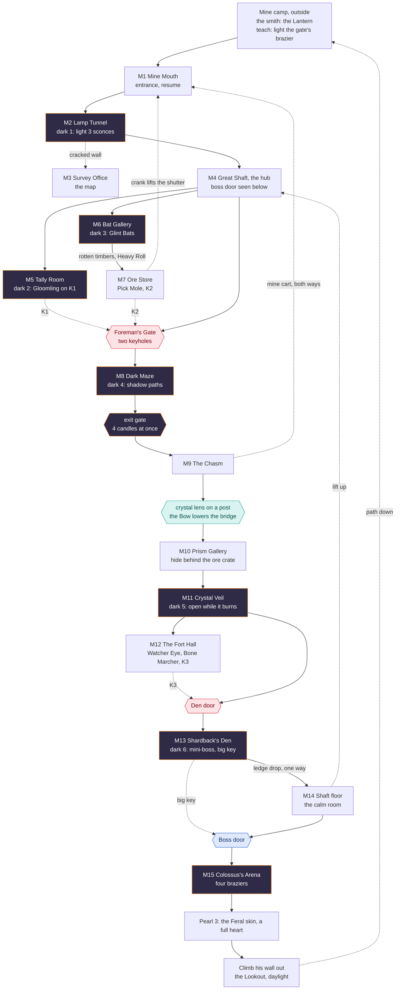

# Dungeon 3: the Crystal Mine (the Crystal Caverns), up to the Crystal Colossus

*Status: phase 2, **built 2026-10-17** from this design with the owner's OK (its open points took
their proposals): `world.crystal-mine`, the camp (G4), the Lookout (H4) and the cave road (G5); what
was built is in [DUNGEONS.md "The Crystal Mine (built)"](../godot/DUNGEONS.md#the-crystal-mine-built).
The owner then decided the skeletons (2026-10-17): the Lair introduces the Bone Marcher, the Weaver
Hollow the Bone Thrower, and **the mine introduces the Bone Leaper**, alone in a lit room (M7's
west half); the lines below say so. Moved in the build: the Tally Room (M5) lies west of M2 at A4
and the Survey Office (M3) north of it at A3, behind the cracked wall in the Tally Room's north
wall (not in M2's), so the hub has no west door; the Great Shaft's floor and the arena are at level
-2 (not -1); the Dark Maze's exit gate stands in a nook at its north-east (the mine's own lantern
gate); the Chasm's bridge crosses at rows 8 and 9, below the chasm's far wall, with its lens beside
the raised bridge; S1 and S5 hold coins until heart quarters and the war journal's pages exist. Not
built: the Bow (the lenses take its arrow's hook), the cave road's dark side cave, the Feral hill
from the Wilds and the smith in Slimeshire. The Feral skin is built (2026-10-17, SKINS.md), and the
mine was reworked the same day for the Pearl inside it (below).*

*Phase 1 (2026-10-16): a design for the owner. The owner asked to start on the three dungeons,
apply the map design investigations, change maps where it is for the better, and add dark rooms
for the Lantern. This design follows the [level design guide](2026-10-16-level-design.md) and the
decided docs; where it needs a choice it lists it under [Open points](#open-points), each with a
proposal.*

> **Superseded in part (2026-10-17).** The owner moved each Pearl inside its dungeon, before the
> boss ([decisions archive](../story/07-decisions-archive.md#decisions-by-date)): Pearl 3 lies in
> the mine before the Colossus, taking it seals the mine's exits until he falls, the second half
> teaches the Feral skin, and his fight is its exam. Where this design has the Pearl after him (the
> arena, M15) and the Feral skin's first lock on the way out (the climb to the Lookout), the rework
> plan replaces it: [2026-10-17-pearl-mid-dungeon.md](2026-10-17-pearl-mid-dungeon.md) (roadmap
> 12.8).
>
> **Reworked and built the same day (2026-10-17)** as that plan lays it out
> ([DUNGEONS.md](../godot/DUNGEONS.md#the-crystal-mine-built) has the mine as built): M9's door to
> M10 is bricked and a stair from the Chasm's far side leads down into the Den (now one level below
> the Chasm); Pearl 3 rises in the Den when the Shardback falls (the big chest moved to M12's new
> balcony, K3 and the Den's key door went); its take seals M1's mouth and the climb-out until the
> Colossus falls. The Feral second half: the Den's ledge door (teach, one level), M11's rift (test:
> down the west landing's face, across, up the east landing's), M12's balcony under the Watcher Eye
> and the Bone Marcher (twist, the big key), the roots down the shaft's north wall from the Den's
> broken rim (four cells wide, two shutters, so the rim walks) to the calm floor. M10 and M11's veil
> are an optional Lantern wing (the veil moved to the mouth of M10's doorway; M10's new chest holds
> the war journal page that lay on M12's stand). The Colossus: roots beside his three climb spots on
> the north wall; three Spear hits on his claws from a climbing slime and he crashes down, stunned
> 2.5 s with his back open to any Spear hit; his "enraged" phase is his second phase
> (`phaseTwoShare`); once beaten he shrinks into a small golem that wanders off. Lines below that
> describe the old order are history.

*Two pictures go with it, sent to the owner and not in the repo yet: the plan
(`crystal-caverns-plan.png`, the rooms on a grid of screens with the main path, the locks in their
powers' colours, the dark rooms, the braziers, keys, secrets and enemies) and the key graph
(`crystal-caverns-keygraph.png`, in Boss Keys colours).*

## What it is

| | |
|---|---|
| **Place** | The smith's crystal mine, Chapter 3's dungeon, under the mountain in the Crystal Caverns (a dungeon world of its own, working id `crystal-mine`). Its mouth opens at his mine camp (G4); its climb-out comes up at the Lookout in H4 |
| **Theme** | A working mine taken over by the Colossus: mine rails that lead the way, crystal veins glowing in the walls, dark shafts. The Colossus's smoky black crystal walls the deep shafts, and it shrinks from fire light, which is why his armour, the Shardback's shell and his crystal veils all fear the Lantern. The deep workings broke into an old Thorn Guard fort, where the raised dead stand guard (question 125) |
| **Its tool** | The **Lantern**, given by the smith at the camp just before the gate (question 59). Every lock it owns appears here: dark rooms, candles, sconces and braziers, dry growth, and the light-shy and light-woken enemies |
| **What it teaches** | Light, in six dark rooms on the main path, one lesson each ([Dark rooms](#the-six-dark-rooms)): teach at the camp, test in the first half, twist in the second, and the Colossus's four braziers as the exam |
| **Second power** | The **Bow** (Burr's) on the main path once, at the Chasm (question 102). The first half never needs it (question 134) |
| **Reward** | Pearl 3, the **Feral** skin, and a full heart; the way out is the climb up the wall the Colossus climbed (question 132) |
| **Size** | 14 rooms (13 and the arena; the camp and the Lookout are outside), on a 5 x 5 grid of screens |
| **Length** | About 35 to 40 minutes on a first play, not counting the camp or a trip to Burr |

## Where it sits in the world

- **The approach (G5, the chunk work's, a proposal here):** the web-wall maze leaves Gloop
  Forest's east edge (the Silk skin's test, question 81) into a cave road through G5's outer caves.
  They are crystal-lit, never a `DarkRoom`: no dark room lies on the path before the Lantern
  (guide). Crystal Crawlers circle pillars by the road, the first one alone. The mine's rails
  appear and lead north to the camp: a leading line. A dark side cave by the road is a soft gate
  with nothing in it but a deadthorn plug at its end (the Lantern's lock), a come-back for the
  walk home.
- **The mine camp (G4), outside:** the smith, the Lantern and its first lock (below). The camp is
  a rest spot: a campfire (question 104) and the smith's cot (a full refill). It lies outside the
  dungeon, so the slime can save there (question 62).
- **The Lookout (H4), outside:** where the climb out of the arena comes up into daylight: a path
  down to the camp, and the top of the hill from the Wilds that only the Feral skin climbs
  (question 87), so the climb-out and the hill are one Feral route.

## The key graph

The main path in gold; small keys and their doors red, the Lantern's locks orange, the big key
and the boss door blue, the Bow teal, shortcuts dashed. Fainting resumes at M1 (question 109).

- **Short and wide in the first half:** from the hub two wings open at once, each holds a small
  key, and the Foreman's Gate takes both (two keyholes: "show how much a lock needs", guide §3).
  The wings work in either order.
- **A lock and key cycle in the second half:** the Den door stands on the short way; its key lies
  in the Fort Hall, one room off it.
- **Loops back:** the east wing returns to the entrance (the crank in M7 lifts M1's shutter, seen
  barred from M1 on the way in); the mine cart joins the Chasm to M1 both ways; the big key comes
  back by a ledge drop onto the hub's shaft floor, whose lift rises to the gallery. From then on
  the boss door is M1, M2, the hub, the lift and the floor: a short walk from the entrance.
- **The boss door is in sight from the first look at the hub**, below the gallery, and the Den's
  broken rim high in the same shaft shows where the big key will come back from.

## The six dark rooms

Here the dark rooms are the main path and the dungeon's heart: six of them, each pitch dark but
the slime's own glow, and each teaching one thing about light. What the Lantern does, as built
([DARKNESS.md](../godot/DARKNESS.md), [BODY_SHAPES.md](../godot/BODY_SHAPES.md#the-lantern-2026-10-14)):
in a dark room the slime's ember lights 160 px round it for free; a flame (F) costs 10 energy and
reaches about one tile; a candle burns 60 s and a brazier 20 s unless set to burn for good; a room
whose candles all burn fades to lit, and can stay lit for good.

| # | Room | The one thing it teaches | How it is shown (the tell) | Step |
|---|---|---|---|---|
| — | The camp (outside, lit) | A flame lights a brazier, and a lit brazier opens a door | The gate's brazier is the only cold lamp at the camp | Teach (safe: no enemy, no fall, no timer) |
| D1 | M2 Lamp Tunnel | The dark hides the floor; your glow is free and shows it; light every lamp and the room stays lit for good | Pit rims glint with crystal flecks in the ember's light; three cold sconces | Test |
| D2 | M5 Tally Room | Light drives a Gloomling off what it guards (weapons pass through it) | Two lilac eyes in the dark, seen from the hub's doorway, over the key | Test, a new enemy alone |
| D3 | M6 Bat Gallery | Light wakes Glint Bats; a puff as one dives burns it out of the air | Gold eye-slits glinting on the ceiling over the rails | Test, a new enemy, first alone |
| D4 | M8 Dark Maze | Glow-moss ledges over the void show only in your light (the shadow path); candles go out after a minute | The path's moss glows at the slime's feet as it enters; the goal's brazier glows far off | Develop: the first half's set piece |
| D5 | M11 Crystal Veil | A brazier holds the Colossus's dark crystal back, but only while it burns | The crystal shrinks a little as the slime's flame flares near it | Twist |
| D6 | M13 Shardback's Den | Fire light makes crystal brittle (never the ember's light) | The shell glows hot orange inside a lit brazier's ring | Twist, the mini-boss |
| Exam | M15 Colossus's Arena | All four braziers at once bare his weak spot; his stomps put them out | Four cold braziers and a dark arena; the room lights when all four burn | Conclude |

### Energy: refills and rest

The Lantern costs 10 a flame and energy refills by itself at 1 a second; the plan is costed for the
starting 100 (bosses raise max energy by an amount not decided yet, question 19). No puzzle asks for
more than 40 at once.

| Where | What it costs | Refills |
|---|---|---|
| The camp | 10 (the gate's brazier, once) | The campfire, the smith's cot (a full refill) |
| M2 Lamp Tunnel | 30 (three sconces, once: lit for good) | An energy pot that grows back by the north door |
| M5 Tally Room | 0 (the ember is free); a puff 10 | — |
| M6 Bat Gallery | 0 needed; 10 a bat puffed; 20 for its two sconces (optional) | Bats drop shards now and then |
| M7 Ore Store | 20 a Goo Bomb, or nothing with the Spear | — |
| M8 Dark Maze | 40 for the four candles in one round, 10 a relit candle | 60 by itself over the minute, a pot at the middle crossing, S4's shards |
| M9 The Chasm | One arrow (the Bow's cost is not set yet) | — |
| M11 Crystal Veil | 10 the brazier, 10 the far one to come back, puffs | A pot on the far side |
| M13 Shardback's Den | 20 a round of both braziers, 10 a puff on him | Its own refill by itself (a fight of two minutes gives back about 120); M11's pot just outside |
| M14 Shaft floor | — | The calm room's refill, which grows back |
| M15 Colossus's Arena | 40 to light all four, 10 a relight | By itself, and the Crystal Mites' shards: the only refill inside (question 40) |

## Room by room

One room is one screen (a camera room, 16 x 14 tiles, 1024 x 896 units); bigger rooms are 2 x 1 or
2 x 2 screens, and the camera follows inside them. Grid cells A1 to E5, A1 in the north-west, as on
the plan picture. Doors are two tiles wide.

### Outside: the smith's mine camp (G4, daylight)

- **Idea:** rest, and the Lantern's teach.
- **What is there:** the smith (Pip's dad) at his anvil by the mine's iron gate, his tents, a
  campfire, his cot, the rails running into the mountain, and every lamp of the camp lit.
- **The gift:** the Lantern, the Forge's ember, with the full ceremony (question 59, roadmap
  12.3).
- **The first lock:** the gate is shut, and the one cold brazier stands beside it. The smith: "The
  lamp by the gate. Give it a flame." One puff lights it; it burns for good, and the gate rolls up.
- **He sends the slime to Burr** (question 134), naming no key: "The Colossus walled my deep
  shafts with his crystal. Past the dark is my chasm. The bridge winch answers to a lens on the
  far side, and nobody can reach it from here. Burr, the gatekeeper in the West village, is
  building something that might. He has been asking after you."
- **Enemies:** none.

### M1 Mine Mouth (B5, 1 x 1, lit)

- **Idea:** the threshold, and where a fainted slime wakes.
- **What is there:** the smith's lamps, always lit, and pots to throw. The rails run north to M2. A
  spur ends at an empty cart station with a buffer stop on the west side: "The cart is at the far
  end of the line." (the tell for the cart shortcut).
- **Locks:** in the east wall an iron shutter, "Barred from the other side." (the east wing's
  shortcut, lifted by the crank in M7). In the west wall thick, living roots and rocky handholds
  under a crack of daylight, up to a ledge with a chest (S5, the Feral skin's, after the Colossus).
  The two stand on opposite walls.
- **Enemies:** none.

### M2 Lamp Tunnel (B4, 1 x 1, dark 1)

- **Idea:** the dark, and that the slime's glow is free.
- **What is there:** the rails run straight north along the east side, three tiles wide (the
  plainest ground). West of them two pits of the void (Fatty's Lair's hazard: a fall costs a little
  and puts the slime back at the room's south door) whose rims glint in the ember's light. Three
  cold sconces, the miners' lamps: lit, all three light the room for good.
- **Locks:** none on the way; in the west wall a crack with a dust puff every 4 s, seen in the
  ember's light (the Goo Bomb's mark, to M3).
- **Energy:** 30 for the sconces; a pot that grows back by the north door.
- **Enemies:** none: the dark itself is the lesson (high tension, no threat).

### M3 Survey Office (A4, 1 x 1, lit, optional)

- **Idea:** the map, one room off the path in the first third, behind a small tell.
- **What is there:** the map chest on the surveyor's table, and on the wall the smith's survey of
  the mine: the chasm, and below it "old stonework. We sealed it." (the fort, ahead).
- **Enemies:** one Crystal Crawler round the room's crystal pillar, known from the cave road.
- **Way back:** the blown wall stays a door.

### M4 The Great Shaft, the hub (B3 to C3, 2 x 1, lit)

- **Idea:** where the slime keeps coming back, and sees the whole job.
- **What is there:** a gallery (level 0) round a deep shaft whose floor is level -1 (M14). The rim
  is fenced, so there is no drop. Two great braziers already burn here. From the gallery the slime
  sees, on its first visit:
  - the boss door on the shaft floor's east wall, with four cold braziers carved round it;
  - the ore lift down on the floor, its crank below: "The lift is down. Its crank is down there.";
  - the Den's broken rim high in the shaft's north wall, scratched by a shell;
  - a rock spire in the shaft with a lens on a post and a chest (S1).
- **Doors:** south from M2; west to M5 and south-east to M6, both open; north, the **Foreman's
  Gate**: two keyholes, "Two locks. Two keys."
- **Enemies:** none, since the slime passes it often.

### M5 Tally Room (A3, 1 x 1, dark 2)

- **Idea:** a Gloomling, the shadow nothing hurts, sits on **small key 1** on the tally desk;
  light drives it off.
- **What is there:** the desk in the middle and four crystal pillars round it, so the Gloomling
  flees round them in a loop, and creeps back to the key when the slime's light leaves it. Walk at
  it glowing: it shrinks and runs, slower than the slime (150 px/s against 200). Cornered in the
  light it breaks into wisps; a puff makes it bolt. A jab passes through it with a whiff.
- **Enemies:** one Gloomling, a new enemy alone, its lesson the room's only one.

### M6 Bat Gallery (C4 to D4, 2 x 1, dark 3)

- **Idea:** Glint Bats sleep on the ceiling and wake when light reaches the ground under them,
  then swoop in a wave; a puff as one dives is its kill hit, and a jab works at its low point.
- **What is there:** the rails run east along the middle under three roosts: the first alone near
  the door, where the slime can watch one wake and dive, then two further on. A narrower side
  walkway along the north wall keeps three tiles from the roosts, so a slime that walks it lets
  them sleep: the dark is a choice. Two cold sconces would light the gallery for good, and wake
  every bat at once.
- **Locks:** at the east end the drift south is choked by **rotten mine timbers**: grey, cracked
  and sagging, unlike the mine's sound dark props. A Heavy Roll breaks them (question 93), the
  earlier skin on the main path; a jab: "Rotten, but too heavy to hit apart." At the walkway's far
  end, on the north wall, a web wall (S3), far from the timbers.
- **Enemies:** three Glint Bats.

### M7 Ore Store (C5 to D5, 2 x 1, lit)

- **Idea:** the Pick Mole: it sidesteps behind its crates onto the slime's row, column or diagonal
  and lobs three pickaxes along it (eight ways), their landing spots darkening first.
- **What is there:** the slime comes down from the timber drift in the north-east. The mole's loft
  of big stacked crates (no Gulp prompt: not the Gulp's light things) stands across the store; ore
  carts on the floor give cover and break its lines; the loft's stair is at its south end. **Small
  key 2** waits in a chest behind the loft. A lit room after two dark ones: a breath.
- **Right tools:** a Goo Bomb thrown over the crates, the Spear from beside them while it is up,
  or the Bow if Burr already gave it.
- **The shortcut:** at the west end a crank (W) lifts the iron shutter into M1.
- **The west half** (the owner's skeleton decision, 2026-10-17; as built): past a divider of ore
  carts, crates and an ore heap with a gap in the middle, the **Bone Leaper** is met here first,
  alone in the light: it leaps at where the slime stood, its landing shadow darkening first, and
  sticks fast where it lands (Roll out of the shadow, then the Spear); ore carts stand about for
  cover. The crank stands in this half.
- **Enemies:** one Pick Mole in the east half and one Bone Leaper in the west half, each a new
  enemy alone in its own half.

### M8 The Dark Maze (A1 to B2, 2 x 2, dark 4)

- **Idea:** the first half's set piece, through the Foreman's Gate. Its one new thing is the
  **shadow path**: glow-moss on narrow ledges over the void, seen only within the ember's light.
- **The goal, seen early:** the exit gate in the far north-east has a brazier burning behind it,
  the only light in the maze, seen from the entrance as a glow (the landmark in the dark).
- **The lock:** the exit gate rises for good when the maze's four corner candles burn at once.
  Each burns 60 s and gutters in its last 5 s, so the slime lights all four in one round.
- **Two ways between the corners (the loop):** the long safe way round the corridors, where Glint
  Bats roost over two crossings, and the short shadow path across the middle, where a fall costs a
  little and puts the slime back at the path's start.
- **The twist, from known things:** a Gloomling curls round the north-west candle and smothers it
  ("The shadow smothers the wick."); drive it off with your light, then light the candle.
- **In four steps:** introduce (the shadow path glows at the slime's feet by the door), develop
  (the corners, the long way and its bats), twist (the smothered candle), conclude (four flames,
  and the gate rises).
- **Enemies:** two Gloomlings (one on the north-west candle, one on S4's chest) and three Glint
  Bats: two kinds.
- **Energy:** 40 for the round; a pot that grows back at the middle crossing.

### M9 The Chasm (C1, 1 x 1, dim)

- **Idea:** the Bow's lock on the main path (question 102). The crystal veins in the chasm walls
  glow blue, so the room is dim but never dark.
- **The lock:** the plank drawbridge stands raised on the far side, and beside it a crystal lens on
  a post, in a straight line across the chasm (6 tiles, 384 px) from the near edge. An arrow in the
  lens lowers the bridge for good. A thrown pot falls short into the chasm; at the edge: "The lens
  is across the chasm. Something that flies far and straight would reach it."
- **The cart:** it waits here at its station. W rides it to M1 and it runs both ways from then on:
  the first half's shortcut back, and a Bow-less slime's quick way out to Burr and back in.
- **Far side, where the deep workings begin:** a **Bone Thrower** keeps its post on the far ledge,
  set back so its bone (220 px) never reaches the near edge. It sidesteps onto the slime's row,
  column or diagonal and throws a bone that comes back like a boomerang; the slime steps off its
  line, closes in while the bone is out, or catches the bone with the Gulp (question 124). Two rock
  stumps on the ledge give cover. The Thrower is met first in the Weaver Hollow (the owner,
  2026-10-17); here it comes back alone on the far ledge.
- **Enemies:** one Bone Thrower.

### M10 Prism Gallery (D1, 1 x 1, lit)

- **Idea:** the Prism Eye, a crystal orb on a banded rock tower in the middle, whose gaze sweeps
  (45° a second) and beams 200 ms after it meets the slime.
- **What is there:** an iron-banded ore crate (a heavy block) on rails from the west door toward
  the south door. The Heavy skin pushes it along as cover in the eye's line (its twist, from the
  lock table). The rails end a cell short of the doorway at a sill, so the crate can never plug it.
  When the eye looks away, the Spear from behind (two jabs), or an arrow in its eye.
- **Enemies:** one Prism Eye, a new enemy alone. No climbable wall here.

### M11 Crystal Veil (D2, 1 x 1, dark 5)

- **Idea:** the Lantern's twist. A **veil** of the Colossus's smoky black crystal, with a cold
  violet sheen, walls the room across, and a brazier stands beside it. Lit, the crystal shrinks
  back from its light while it burns (20 s) and grows back when it goes out: light it and cross.
  A hit on the veil clinks: "Cold, dark crystal. It shrinks from fire."
- **The twist, from a known thing:** two Glint Bats roost over the veil, inside the brazier's
  light, so lighting it wakes them, and the run is made under swooping bats.
- **The Bow's twist:** an arrow brings a Glint Bat down from any height, so a slime with the Bow
  can shoot the glinting eyes on the ceiling before it lights the brazier.
- **Far side:** a second brazier for the way back, an energy pot that grows back, the **Den door**
  (a small-key lock, scratched by a shell) in the west wall and the open way to the Fort Hall in
  the east wall.
- **Never trapped:** the crystal grows back from both ends toward the middle over a second and
  pushes a slime standing in it out to the nearer side.
- **Enemies:** two Glint Bats.

### M12 The Fort Hall (E2, 1 x 1, lit)

- **Idea:** the deep room: the mine broke into a Thorn Guard fort under the mountain, and its
  fallen garrison stirs (question 125). Its old watch-fires still burn, so its tells are easy to
  read. A twist from known things: the skeletons and the Watcher Eye (met in Fatty's Lair and the
  Weaver Hollow) and the Heavy skin.
- **What is there:** **small key 3** lies in a chest on a dais, and a **Bone Marcher** walks a loop
  round the dais, never stopping; touching it hurts. Five armour statues stand in the hall; they
  are heavy blocks (the look book's, and Fatty's Lair's proposal that a dungeon's armour statues
  always are). A **Watcher Eye** drifts among them, and its beam stops at a statue. Pushed into the
  Marcher's path, a statue turns it back (as built: blocked for 600 ms, it turns round), which
  opens a stretch of its loop for the slime to reach the dais; any hit drops the Marcher for a few
  seconds too. The statues are the eye's cover and the Marcher's wall: one idea. A page of the
  Thorn Guard's war journal lies on a stand by the dais (question 108).
- **Never trapped:** the dais is reached from two sides, so no statue can seal it, and the statues
  go back to their places when the world is entered again.
- **Enemies:** one Watcher Eye and one Bone Marcher: two kinds.

### M13 Shardback's Den (C2, 1 x 1, dark 6)

- **Idea:** the mini-boss, and the lesson the Colossus needs: fire light makes crystal brittle.
- **What is there:** the shutters close behind the slime (the way out is certain). Two braziers
  (20 s each) stand at the den's sides. The Shardback plods at the slime; unlit, a jab does a third
  of its damage and clinks; in a lit brazier's light, or for 4 s after a puff on it, its shell
  glows hot orange and cracks under the Spear. The slime leads it into the light.
- **The rehearsal:** its slam puts out a brazier inside its ring, as the Colossus's stomps will.
- **Beaten:** the shutters open, and the big chest with the **big key** appears. The den's south
  rim breaks open over the shaft: a **ledge drop** onto the hub's floor (one way; the lift there is
  the way back up).

### M14 The shaft floor (the hub's lower level)

- **Idea:** the calm room before the boss door: pots (two hold hearts), an energy refill that
  grows back, and the lift's crank. Raised once, the lift runs both ways between the floor and the
  gallery: the shortcut that puts the boss door a short walk from the entrance.
- **The boss door:** the big key opens it.

### M15 The Colossus's Arena (D3, 1 x 1, dark until all four braziers burn)

See [The Colossus's arena](#the-colossuss-arena).

## The Colossus's arena

- **The room:** one screen, a round crystal cavern, with the camera eased out a little so the wall
  he climbs stays in view ([Open points](#open-points)). It is a `DarkRoom` whose four candles are
  the four braziers: dark while any is out, fading to lit when all four burn (the Lamp Tunnel's
  lesson). The braziers stand at the corners of the floor, about five tiles from the middle. They
  burn until a stomp puts them out (no timer). The north wall is the tallest face, scarred by
  crystal claws: thick living roots hang through a crack of daylight in the roof over rocky
  handholds (the Feral skin's look, question 86). Once the slime is in, the boss door stays shut
  until he falls (question 59 and roadmap 5.9).
- **His cycle** (a proposal for roadmap 12.4's spec):
  1. **The stomp walk.** He plods at the slime. Before a stomp he lifts a crystal foot (600 ms) and
     a ring darkens under it; the stomp hurts inside the ring and puts out the lit brazier nearest
     to it, one at a time (question 59). The Shardback rehearsed it.
  2. **Four fires.** When the fourth brazier catches, the room fades to lit, and one plate of his
     armour cracks open, glowing, at a random place: his front, his back or one of his sides. The
     Spear hurts him only there. It stays open until a stomp puts a brazier out (the Den's lesson).
  3. **The climb.** After a few stomps, or when hurt, he leaps to the north wall and climbs it on
     crystal claws, out of reach (question 69), and throws Crystal Mites down: each falls behind
     a darkening shadow, dies to one hit and can drop an energy shard, the chamber's only refill
     (question 40). While he climbs, the slime relights what he put out. He drops back with a
     landing stomp that puts out one brazier.
  4. **Below half his health:** faster stomps, more mites, and a landing that puts out two.
- **What it tests:** all four lit at once (the Lamp Tunnel and the Maze), light kept up under
  pressure (the Veil), fire light breaking crystal and the stomp that puts it out (the Den), and
  dodging what falls from above behind a shadow (the bats' dive, the mites). He needs no Bow
  (question 102), and the Spear is the only shape (question 94).
- **His fall:** Pearl 3 rises from his chest; the ceremony gives the **Feral** skin; he leaves a
  full heart (+20 max HP), and max energy grows (questions 17 and 19).
- **The way out (question 132):** the boss door stays shut. The only way out is up the north wall
  he climbed: hold W and climb (a fall costs nothing, no enemy is left). It is the Feral skin's
  first lock, safe, and right where it is won. Two levels up a ledge leads into a short tunnel and
  out into daylight on the mountain: the Lookout (H4), where a path leads down to the camp and the
  Feral hill on into the Wilds. Proposal: Release 1's exploration message (roadmap 12.5) shows as
  the slime steps into the daylight.

## Secrets

At least three were asked; there are five, one for each lock kind the mine can show. Each opens with
the secret jingle. The mine holds one of the Crystal Caverns' four heart quarters (S1); the other
three belong to the region's chunks.

| | S1 The spire's lens | S2 The Survey Office | S3 The walkway's web wall | S4 The maze's hoard | S5 The Mine Mouth's roots |
|---|---|---|---|---|---|
| **Tell** | From the gallery, a rock spire in the shaft with a lens on a post facing the gallery and a chest glinting beside it | A crack in the Lamp Tunnel's west wall, puffing dust every 4 s in the ember's light | At the end of the Bat Gallery's dark walkway, silver threads catch the ember's light, and behind them a small flat parcel glints | In a dead end of the maze, two lilac eyes over a chest, seen from the shadow path | Thick living roots and rocky handholds under a crack of daylight, a chest on the ledge above |
| **Lock** | The Bow (an arrow north across the shaft). A pot falls into the shaft: "Too far across." | The Goo Bomb (a Spear hit knocks hollow) | The Silk skin: pass the web wall, cut it for good with the Spear, and the parcel is cut free | The Lantern: drive the Gloomling off the chest | The Feral skin. Before it: "Too steep to climb." |
| **Prize** | A heart quarter | The map, and the smith's survey of the mine | Coins and an energy potion | Three energy shards and coins, a refuel mid-maze | A page of the Thorn Guard's war journal, about the fort under the mountain |
| **Seen from** | M4's gallery, on the first visit. It opens at once for a slime that saw Burr first, or on the way back with the Bow | M2, on the first visit; opens at once | M6, on the first visit; opens at once | M8, on the first visit; opens at once | M1, on every visit; opens after the Colossus, on the walk back from the Lookout to the camp |
| **Way back** | A plank bridge swings from the gallery to the spire and stays | The blown wall is a door | The cut web stays open | The dead end leads back to the long way | Climb down; a fall costs nothing |

## Enemies

Every enemy is placed by hand in its room and comes back when the room is entered again
([specs/enemy.md](../godot/specs/enemy.md) §3.3); beaten bosses never do. How they behave:
[BESTIARY.md](../godot/BESTIARY.md).

| Enemy | Where | First met | Taught by |
|---|---|---|---|
| Crystal Crawler | The cave road (G5), alone round a pillar; M3 (1) | Before the camp, in the open | The Spear at its turn |
| Gloomling | M5 (1, its lesson), M8 (2) | M5, alone | The Lantern's light |
| Glint Bat | M6 (3, the first alone), M8 (3), M11 (2) | M6 | A puff as it dives |
| Pick Mole | M7 (1, its lesson) | M7, alone, in a lit room | A Goo Bomb over its crates |
| Prism Eye | M10 (1) | M10, alone | The pushed ore crate (the Heavy skin) |
| Bone Leaper | M7 (1, the Ore Store's west half, lit) | M7, alone (the mine introduces it; the owner, 2026-10-17) | Roll out of its landing shadow, then the Spear while it is stuck |
| Bone Thrower | M9 (1, the Chasm's far ledge) | The Weaver Hollow | Off its line, close in while its bone is out, or catch the bone |
| Watcher Eye | M12 (1) | Fatty's Lair | The statues |
| Bone Marcher | M12 (1) | Fatty's Lair | A statue pushed into its path; any hit drops it |
| Shardback | M13, the mini-boss | M13 | A lit brazier, then the Spear |
| Crystal Colossus, Crystal Mites | M15 | M15 | The four braziers; any hit for a mite |

- Only the Gloomling, the Glint Bat and the Shardback stand in dark rooms: their tells are made for
  the dark (eyes that glint, a shell whose crystals glow as it rears). Everything else stands in a
  lit room, so its wind-up can be read.
- No room holds more than two kinds; no new enemy arrives with a new power (the Lantern is no
  longer new after the camp and M2).
- Ranged enemies get cover and diagonals: the ore carts in M7, the rock stumps in M9, the crate in
  M10, the statues in M12.
- No enemy waits within three tiles of a door the slime comes in by.

## Pacing

Tension by step (the plan picture draws it as bars): the camp and M1 calm; M2 tense with no threat;
the hub calm; M5 and M6 rising; M7 a lit fight; M8 a peak; the Chasm a breath and a view; M10 to
M12 rising; the Den a peak; the shaft floor calm before the door; the Colossus the climax; then the
climb into daylight, the release.

| Stretch | First play |
|---|---|
| M1 to the hub (with the Lamp Tunnel) | 3 min |
| The two wings (M5; M6 and M7; back by the shutter) | 8 min |
| The Dark Maze | 6 min |
| The Chasm, the Prism Gallery, the Veil, the Fort Hall | 9 min |
| The Shardback | 3 to 4 min |
| The shaft floor, the boss door | 1 min |
| The Colossus and the climb out | 7 min |
| The map (optional) | 1 to 2 min |
| **In all** | **about 35 to 40 min** |

## What must be built

**Shared with Fatty's Lair and the Weaver Hollow (the dungeon kit, built once):** a dungeon world
in rooms mode, small keys, the big key and the map, chests, shutters, the boss door, one-way doors,
the resume at the entrance and the dungeon's saved state (question 109), the minimap's rooms, the
void hazard of the Lair's slabs (question 70), and enemies placed in dungeon rooms.

**New for this dungeon (for the roadmap):**

1. **A door with two keyholes** (the kit's small-key door, needing two keys).
2. **The mine cart:** two stations and a cart; W rides it (the slime held, a fade); the cart's
   place is saved, and it runs both ways once found.
3. **The ore lift:** a two-level lift on the shaft floor, raised by its crank (W) from below the
   first time, both ways after; saved.
4. **The crystal lens on a post** (with roadmap 12.6): an arrow opens what it is tied to; a
   **drawbridge** that lowers for good (the Chasm), and a plank bridge that swings to the spire
   (S1).
5. **The crystal veil:** a gate tied to a brazier that opens while it burns and shuts when it goes
   out, growing back without trapping the slime. Today a candle group only opens a gate
   (`candle.gd`); this one also shuts it. Its own look and its refusal line.
6. **Braziers a slam or a stomp puts out** (a `put_out` on the candle), called by the Shardback's
   slam and the Colossus's stomps inside their rings; shared with roadmap 12.4.
7. **Braziers that burn until put out** (no timer, not saved), for the arena.
8. **A Gloomling that smothers a candle:** the candle refuses fire while a Gloomling sits on it.
9. **Glow-moss** floor art over the void for the shadow path (the `DarkRoom` already hides it
   outside the light).
10. **Rotten mine timbers,** the Heavy Roll's lock (roadmap 7.8's family of old built things).
11. **The iron-banded ore crate** look on the heavy block, with rails and a sill.
12. **Energy refills that grow back** (Direction's plan) in M2, M8, M11 and M14.
13. **The smith's camp** (roadmap 12.3): the smith, the ceremony, the gate's brazier lit for good
    that opens the gate, the campfire, the cot, and his line to Burr.
14. **The arena** (roadmap 12.4): the Colossus, a `DarkRoom` with the four braziers as its candles,
    the mites from the wall, the climbable root wall (roadmap 7.8) under a daylight crack, Pearl 3
    and the heart, and the way up to the Lookout; the exploration message (roadmap 12.5).
15. **The Lookout** on the `crystal-caverns-h4` chunk: the climb's exit, a path to the camp, the
    Feral hill's top.
16. **Placed enemies** (roadmap 12.7) as in [Enemies](#enemies); the Gloomling, the Glint Bat and
    the Shardback already read light (`light_sense.gd`).
17. **Art:** the mine's pieces (rails and a buffer stop, ore carts, the big crates, the tally desk,
    the survey table, the Foreman's Gate with two keyholes, the boss door with four carved
    braziers, the lift, the cart, the drawbridge), the lens, the veil, glow-moss, rotten timbers,
    the root wall in a crystal cave, the arena, the old fort's stonework and watch-fires.
18. **Data:** `crystal-mine` in the Caverns' interiors (`world-map.json`), a `scene_index.json`
    line, and the area title "The Crystal Mine".

## Checklist

The guide's checklists, run on this design. What failed in the first draft was changed:

- **Fixed:** the Feral roots first stood in the hub beside the Foreman's Gate (two locks of
  different powers side by side): they moved to M1's west wall, opposite its shutter.
- **Fixed:** a bell secret at the Chasm could read as the bridge's lock: it was dropped.
- **Fixed:** the Prism Gallery's crate could have been pushed into the doorway: its rails end a
  cell short, at a sill.
- **Fixed:** with one key door at the hub and a second later, a slime that spent its first key at
  the hub could reach the second door with no key and a maze between it and the other wing: the
  hub's gate now takes both keys.
- **Fixed:** skeletons first stood in a dark room, where their wind-up cannot be read: they moved to
  lit rooms.
- **Fixed, against the other two designs:** the deep room first held a Watcher Eye and two Bone
  Leapers among cover, the same fight as the Weaver Hollow's deep room. It became the Fort Hall,
  where statues pushed into a Bone Marcher's path open the way, and the Bone Thrower guards the
  Chasm's far side. A Pick Mole there went: a new enemy stands alone. *(Since the owner's skeleton
  decision of 2026-10-17 the Thrower is the Hollow's to introduce, and the mine's new skeleton is
  the Bone Leaper, alone in M7's west half.)*

| Check | Result |
|---|---|
| The main path reads at a glance | Yes: the rails lead from the camp through M1 and M2 to the hub; the maze's goal glows; each room's way on is its widest ground |
| Every lock in the look book with one power | Yes, but two looks are new and need a row: the crystal veil (the Lantern's) and the lens's frame (below) |
| No lock looks like scenery | The mine's scenery lamps are always lit, so a cold brazier or sconce is always the Lantern's; scenery crystal is the Caverns' blue, the veil smoky black; mine props are sound and dark, the rotten timbers grey and sagging; the mole's big crates show no Gulp prompt |
| Bells; eyes and lenses | No bells here. The Prism and Watcher Eyes are enemies; the lens is the Bow's, a flat faceted lens in a brass ring on a wooden post, unlike the Prism Eye's orb on a banded rock tower |
| No two locks of different powers side by side; no climbable wall beside a heavy block | Yes (M1: roots west, shutter east; M2: the crack alone on the west wall; M6: the web wall on the north wall, the timbers at the south-east drift; the heavy blocks in M10 and M12, the climbable walls in M1 and M15) |
| Every wrong tool refused with a sound and a line | Lines are given for the gate, the timbers, the lens, the veil, the smothered candle, the lift, the shutter and the roots; the kit's lines for its doors |
| Each power won before its lock; the first lock safe where it is won | Yes: the Lantern at the camp; the Bow only at M9 and S1; the Feral skin only at S5 and the arena's climb, after Pearl 3 |
| The main path needs no combo, no secret, no later power | Yes; the first half needs no Bow (question 134) |
| Every drop, hole and one-way door has a way back | The void puts the slime back at the path's start; the Den's drop lands by the lift, which works from below; the shutter and the cart run both ways once opened |
| Keys equal keyholes, each reachable before its door | 3 small keys (K1, K2, K3), 3 keyholes; the wings in either order; K3 is one room from its door |
| Heavy blocks never block the only way | The crate's rails end at a sill; the Fort Hall's dais is reached from two sides, and its statues go back when the world is entered again |
| Timed things can be tried again | The maze's candles relight; the Veil has a brazier on each side; the Den's braziers relight |
| No puzzle costs more than 100 energy | 40 at most at once, with refills near (see [Energy](#energy-refills-and-rest)) |
| Story-critical things cannot be skipped | The smith's line to Burr is at the camp, on the main path; Burr is on the main path to the Bow |
| Every Release 1 heart quarter reached with Release 1's powers | S1 needs the Bow, which is Release 1's |
| Every secret has a card; tells visible from where the slime stands | Yes, five cards |
| A come-back secret shown on the first visit | S1 (the Bow, for a slime without it) and S5 (the Feral skin) |
| Prizes spread | One heart quarter in the mine |
| Enemy tells readable; a new enemy first alone, never with a new power | Yes (see [Enemies](#enemies)) |
| Ranged enemies have cover and diagonals; eyes have cover | Ore carts, the rock stumps, the crate, the statues |
| A rest spot; a calm room before the boss door | The camp (campfire and cot); M14 |
| One set piece | The four braziers, with the Dark Maze and the climb into daylight as the other two moments |
| Resume at the entrance, with a shortcut to the boss door | M1; then M2, the hub, the lift, the floor |
| The dungeon template | The first half uses what the slime brings; the Lantern is used in 8 of its 16 places (the camp, M2, M5, M6, M8, M11, M13, M15), and the others are its breathers: the entrance, the hub, the map, the shaft floor, the Pick Mole's lit store, the Bow's Chasm, the Heavy skin's two rooms; the boss door seen early; two loops; the map in the first third; its own enemies and mini-boss teach its tool; one ambush (the Den); the way out uses the new skin; two come-back secrets; every room a new question; 14 rooms |

## How it fits the other two dungeons

Fatty's Lair (the Roll, Chapter 1) and the Weaver Hollow (the Goo Bomb, Chapter 2) are designed at
the same time by others. All three share the dungeon kit, the skeletons and the Watcher Eye with
statues to hide behind in their deep rooms, a calm room before the boss door, and resume at the
entrance. This one keeps its own enemies (the Gloomling, the Glint Bat, the Pick Mole and the Prism
Eye, with the Shardback; the Crystal Crawler from the region) and its own power.

- **The skeletons across the three** (the owner, 2026-10-17): Fatty's Lair meets the Bone Marcher
  and the Watcher Eye first; the Weaver Hollow the Bone Thrower; this mine brings the Bone Leaper,
  alone in the Ore Store's lit west half, has the Thrower back at the Chasm, and mixes the Marcher
  and the Watcher Eye with the Heavy skin in the Fort Hall, so each dungeon adds one piece of the
  family (the Lair's open point 6).
- **Armour statues are heavy blocks** in the Fort Hall, as the Lair proposes for every dungeon
  (its open point 7).
- **Doors with two keyholes:** all three use one (Burr's cell, the Hollow's double door, the
  Foreman's Gate), so it is one kit item.
- **The pictures' colours:** each dungeon's own tool is orange (the guide's rule), so the Lantern
  is orange here and the Goo Bomb lime, while the Hollow's picture has the bomb orange and the
  Lantern purple.

## Open points

1. **The Foreman's Gate with two keyholes.** It lets the two wings be done in either order without
   a slime stuck behind a maze with no key. *Proposal:* yes, a kit door that needs two keys.
2. **Where the mine's mouth sits on the world map.** The map has the dungeon marker in G5 and the
   mine camp in G4. *Proposal:* the camp and the mine's mouth together in G4; G5 holds the cave road
   from the web-wall maze; the Colossus's marker in H4 becomes the Lookout, where his arena's
   climb comes out.
3. **The cart ride.** A ride with a fade (cheap) or a ride seen through a tunnel (a set piece,
   more work). *Proposal:* the fade first.
4. **The Shardback puts braziers out.** Its slam putting out a brazier rehearses the Colossus's
   stomp. *Proposal:* yes, one hook shared with the Colossus.
5. **The arena's size.** One screen with the camera eased out (about 0.85), or a 2 x 1 room.
   *Proposal:* one screen, as a Zelda boss room.
6. **The weak spot's "random place"** (question 59). *Proposal:* one of four sides of his body
   (front, back, left, right), glowing, open until a stomp puts a brazier out.
7. **Skeletons.** *Decided by the owner (2026-10-17):* the Lair introduces the Bone Marcher, the
   Weaver Hollow the Bone Thrower, and the mine the **Bone Leaper**, first met alone in a lit room
   (built in M7's west half, past the Ore Store's divider). The Fort Hall keeps its Bone Marcher
   and Watcher Eye; the Chasm keeps its Bone Thrower. *(Phase 1 proposed the Thrower as new here
   and the Leaper as the Hollow's.)*
8. **A slime that reaches the Chasm without the Bow.** *Proposal:* the smith's line at the camp,
   and once the slime has stood at the Chasm without the Bow, the journal's main quest points to
   Burr (a hint close by, guide §8).
9. **The exploration message.** *Proposal:* it shows when the slime steps into daylight at the
   Lookout, not in the arena.
10. **The name.** *Proposal:* "the Crystal Mine" as the area title (the 2026-10-11 power curve had
    "the Gloam Mine").
11. **Max energy in Chapter 3.** Bosses raise it, by an amount not decided (question 19).
    *Proposal:* keep this dungeon costed for 100, so it works whatever the raise.

## Changes the shared docs would need

Not made here (the design edits only this file); for when the owner accepts it:

- **The level design guide:** "Applied: the Crystal Caverns and the mine" links here; the look book
  gains the crystal veil (the Lantern: smoky black crystal across a passage with a cold brazier
  beside it; never like the Caverns' blue crystal clusters) and the lens's frame (never like the
  Prism Eye's orb on its tower); a note that the mine's scenery lamps are always lit and its sound
  props never look like rotten timbers; the dungeon template's keys rule allows a door with two
  keyholes.
- **The world** (`03-world.md`, and `world-map.json` through the map tool): the mine as the
  Caverns' dungeon interior `crystal-mine`; the dungeon marker at the camp (G4); the Lookout in H4.
- **The Chapter 3 sketch:** beats 3, 4, 6 and 7 point to this layout; the Chasm's lock is the
  bridge winch's lens; the climb comes out at the Lookout.
- **Characters:** the smith's line that sends the slime to Burr.
- **The roadmap:** 12.1 points here; 12.3 gains the camp's gate brazier as the Lantern's first lock;
  12.4 gains the one-screen dark arena with the four braziers as its candles, the stomp that puts a
  brazier out, the root wall under a daylight crack and the Lookout; 12.6 gains the two lenses, the
  drawbridge and the spire's bridge; 12.7 gains the placements; a new task builds the mine itself
  (as 8.14 builds the Weaver Hollow), with [What must be built](#what-must-be-built).
- **The bestiary** (design and `BESTIARY.md`): the placements, the Gloomling that smothers a candle,
  and the Shardback's slam that puts out a brazier.
- **`DARKNESS.md`,** once built: the veil, braziers put out by a slam, braziers that burn until put
  out, and the smothered candle.
