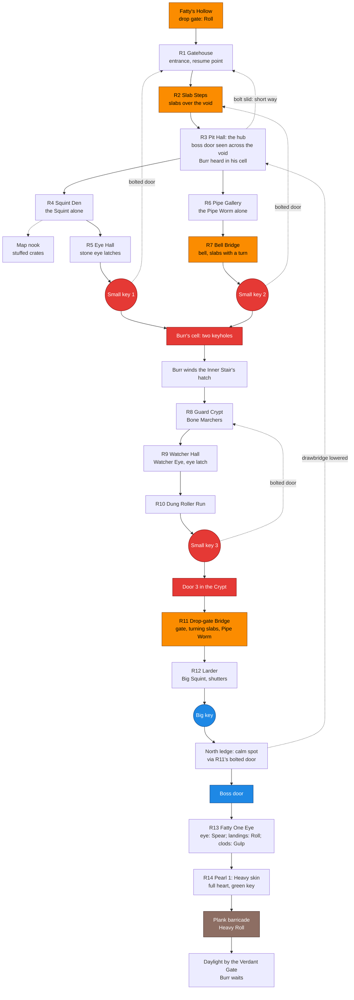

# Fatty's Lair: Chapter 1's Dungeon

*Status: built 2026-10-17 (the owner approved building the dungeons from their designs; the open
points below took their proposals): the Lair as built is [DUNGEONS.md "Fatty's Lair (built)"](../godot/DUNGEONS.md#fattys-lair-built).
What moved in the build: R2's north arm is two slabs and a landing against its rim (a Roll crosses
two slabs; two Rolls in a row with a landing come in R7 and R11); R11's gate stays up 500 ms with
its lever a cell and a half below it; Burr's cell is the west gallery's north end with its door at
its foot, the hub's west door below it and the Inner Stair at the gallery's south end; the outer
gate stood at the clearing's north-west edge in `level-1-d4` (192, 1012) and moved the same day
into the face of a hill in `level-1-d5` (1408, 768), past a field maze and a slab bridge (owner,
2026-10-17; [Chapter 1](../story/chapters/chapter-1-the-clearing.md#slimeshires-places-built-2026-10-17)),
the bolt-hole's mouth at (1408, 960) in `level-1-d4`; the Deep's earth floors are rust-brown earth, the arena (the old drill hall) is
cobble; R13's clods are the liftable mud balls; the Armoury's prize is coins until the war journal
exists, the Burrow's a goo heart until heart quarters exist; no compass is placed. Not built: the
worm mural, Burr's homecoming quest step (5.17).
Before the build this was a design for the owner (2026-10-16), phase 1: the plan and its pictures.
It applies the
[level design guide](2026-10-16-level-design.md) (its rules, look book, lock-and-key table, dungeon
template and checklists) to the decided story: [Chapter 1](../story/chapters/chapter-1-the-clearing.md#fattys-lair-the-gate-the-slabs-and-burrs-cell-planned-owner-2026-10-16),
the [decisions archive](../story/07-decisions-archive.md) (questions 17, 70, 71, 103, 109, 115, 125,
127, 132, 134 and 136), roadmap [5.14 and 5.15](../GAME_ROADMAP.md#--514--falling-slabs-and-their-hazards)
and the [bestiary](2026-10-16-bestiary.md). It replaces the map in section 6 of the
[2026-10-11 dungeons plan](2026-10-11-release-1-dungeons-plan.md#6-dungeon-1-fattys-lair-chapter-1),
which predates the Roll, the skins and the owner's later answers. Where a choice was still open it
is made here as a proposal and listed in [Open points](#open-points).*

> **Superseded in part (2026-10-17).** The owner moved each Pearl inside its dungeon, before the
> boss ([decisions archive](../story/07-decisions-archive.md#decisions-by-date)): Pearl 1 lies in
> the Lair before Fatty, taking it seals the Lair's exits until he falls, the second half teaches
> the Heavy skin, and Fatty's fight is its exam. Where this design has the Pearl after Fatty (R14,
> the Pearl Shrine) and the Heavy skin's first lock on the way out (the bolt-hole's barricade), the
> rework plan replaces it: [2026-10-17-pearl-mid-dungeon.md](2026-10-17-pearl-mid-dungeon.md)
> (roadmap 12.8). **The rework is built (2026-10-17)**, as that plan's proposals: Pearl 1 in R12 the
> Larder behind the Big Squint, door 3 open and key 3 gone, the new Weigh House in C2, R10 and R9
> reworked for the Heavy skin (the big key in R9), the hub's counterweight plate in place of the
> ledge's winch (since 2026-10-19 two plates that are not heavy, the freed Burr holding one), the seals in R1's and R13's doorways, Fatty's Heavy Roll topple; R14 is the
> Postern. The Lair as built is [DUNGEONS.md](../godot/DUNGEONS.md#fattys-lair-built); this design's
> R9, R10, R12, R14 and the Pearl's place describe the first build.

The plan pictures go with this doc: `fattys-lair-plan.png` (the rooms, the main path, the locks,
keys, enemies and secrets) and `fattys-lair-key-graph.png` (the key graph below, drawn).

## Purpose

- **What it teaches:**
  - the **Roll's timing**: a gate that drops shut, falling slabs over the void and spikes, slabs
    with a turn, the gap in a patrol; the dungeon's tool, used in nearly every room;
  - the **Spear in the eye**: the Squint's eye after its slam, stone eye latches, an eye open for a
    few seconds, an eye only a diagonal thrust reaches, then the Big Squint and Fatty;
  - the **Gulp's throw**, turned on the enemy: the Pipe Worm's glob caught and thrown back, a bell
    rung by a pot, which Fatty's falling clods test at the end.
- **Its theme:** the worms' burrow under the old **Thorn Guard fort**, used by Gorge's army as its
  barracks. The upper rooms are the fort's cellars made into worm barracks (bunks, red scarves on
  hooks, mean war banners, clay pipes in the walls). The Deep, one floor down, is the fort's crypt
  and armoury, where the fallen Thorn Guard lie and their raised bones still stand guard
  (question 125). Fatty One Eye lairs in the old drill hall, his hoard in the worms' larder.
- **Length:** about 25 minutes on a first play (20 to 30): 14 rooms on the main path, two of them
  two screens wide.
- **What the slime brings:** the Gulp and the throw, the Spear (prologue) and the quick Roll (young
  Burr, with its first lock, the plank over the dry ditch). Nothing in the Lair costs energy. It
  wins Pearl 1 (the **Heavy skin**), a full heart (question 17), the green key, and it frees Burr.
- **Rules it keeps:** no saving inside; quitting or fainting resumes at the entrance with the keys,
  opened doors, the map and the big key kept (question 109); ordinary room enemies come back when
  a room is entered again; the Big Squint's shutters close once; the boss never comes back.

## The main path in twelve steps

1. **Fatty's Hollow** (D4, where Fatty's camp stands today): pull the worm lever and **Roll**
   through the old gate before it drops.
2. **The Gatehouse:** turn the gate's inner winch (the gate stays up for good), on to the slabs.
3. **Slab Steps:** roll two bridges of falling slabs over the void.
4. **The Pit Hall (hub):** the boss door is in sight across the void; Burr calls from his cell
   ("two keys, east and west"); slide the bolt of the short way back to the Gatehouse.
5. **West wing** (either order with 6): Squints, then the stone eye latches: **small key 1**. A
   bolted door leads back into the Gatehouse.
6. **East wing:** Pipe Worms, then a bell and a bridge with a turn: **small key 2**. A bolted door
   leads back into Slab Steps.
7. **Burr's cell** takes both keys. Freed, Burr winds up the hatch over the Inner Stair and goes
   to wait outside by the fort's old bolt-hole.
8. **The Deep:** the Guard Crypt (Bone Marchers), the Watcher Hall (the Watcher Eye, an eye
   latch), the Dung Roller Run: **small key 3**, and a bolted door back into the Crypt.
9. **Door 3**, then the Drop-gate Bridge (the gate, a turning bridge, a Pipe Worm) and the Larder:
   the **Big Squint**, then the **big key**.
10. Out through the bridge room's far door onto the hub's **north ledge**: lower the drawbridge
    (the short way from the entrance to the boss door), a calm spot with pots and a refill.
11. The **boss door:** Fatty One Eye.
12. The **Pearl** (Heavy skin), the full heart and the green-key chest; a **Heavy Roll** smashes the
    plank barricade, and the bolt-hole climbs to daylight by the Verdant Gate, where Burr waits.

## The key graph

In Mark Brown's colours (the guide's dungeon template): small keys and their doors red, the
dungeon's tool (the Roll) and the locks it opens orange, the big key and the boss door blue. The new
skin's lock is brown; dashed lines are loops and shortcuts; dotted lines are optional.

**Why this shape.** The guide asks for a short, wide graph: the hub opens two wings at once, each
ends in a key, and Burr's door shows both keyholes, so the player sees what a lock needs and picks
the order (Brown's *Link's Awakening* over *Ocarina*). Burr is the gatekeeper, so the way to the
Deep opens only through him: his cell cannot be skipped (question 134). The Deep is a lock-and-key
cycle (door 3 by the stair, key 3 at the end of the long way round). Every wing loops back: the west
wing into the Gatehouse, the east wing into Slab Steps, the Deep into the Crypt, the big key onto
the north ledge, whose drawbridge makes the boss door two rooms from the entrance.

## The map

One interior world, `world.fatty-lair`, off the overworld grid (`fatty-lair` in Slimeshire
Meadow's `interiors`). Every room is a camera room (`game/world/camera_room.gd`): one screen is
16 x 14 tiles (1024 x 896 units), and walking from room to room slides the view as Zelda's screens
do ([PROLOGUE.md](../godot/PROLOGUE.md#camera-rooms)). The grid below is in screens; the Deep is
one floor down, laid beside the upper fort in the same scene and joined by stairs.

|   | A | B | C | D | E |
|---|---|---|---|---|---|
| **top** | | | | daylight (level-1-d4, by the Verdant Gate) | |
| **2** | R10 Dung Roller Run (Deep) | R10 (east half, key 3) | | the bolt-hole (a short climb) | |
| **3** | R9 Watcher Hall (Deep) | R8 Guard Crypt, north half (Deep) | R12 Larder (Deep) | R14 Pearl Shrine | |
| **4** | Old Armoury, dark (Deep) | R8 Guard Crypt, south half (Deep) | R11 Drop-gate Bridge (Deep) | R13 Fatty's Arena | Glow-moss Burrow, dark |
| **5** | map nook | R4 Squint Den | R3 Pit Hall (hub), west | R3 Pit Hall (hub), east | R6 Pipe Gallery |
| **6** | sally port | R5 Eye Hall | R1 Gatehouse | R2 Slab Steps | R7 Bell Bridge |
| **outside** | | | Fatty's Hollow (level-1-d4), the drop gate | | |

- **Walls:** the fort's masonry (the `masonry` wall style where elevation draws a wall) in the
  upper rooms, cave rock and root rock where the worms dug, `cave-rock` in the Deep.
- **The void** is a hole painted on the `elevation` layer (question 70: "the void works like the
  elevation's holes"); falling in hurts and puts the slime back at the bridge's start (5.14).
- **No bars anywhere in the Lair.** Every gate here is solid wood, iron or stone, so a thrust
  through bars (the prologue's lock) is never the answer here and never looks like one.

## Room by room

Each room's idea is its step in a power's arc: **teach** (safe, alone), **test** (again, harder),
**twist** (with an enemy, a timer, a turn or a second known thing), **conclude** (a last test).
Enemies are placed by hand ([specs/enemy.md](../godot/specs/enemy.md) §3.3) and come back when the
room is entered again.

### Outside: Fatty's Hollow (level-1-d4)

- **Where:** the old boss camp at (480, 1472) in D4's own units; Fatty's camp encounter and its
  guarded chest leave the chunk (the chest moves into the Pearl Shrine). The tree maze stays.
- **Idea:** the Roll's **test** (its teach was the plank in Burr's yard). The gate race is the
  Lair's set piece at the door.
- **Lock:** the old Thorn Guard gate in a rock mound, iron-banded oak with no bars, and a worm
  lever on a post in the open, four cells to its side. W pulls the lever; the gate rises with a
  chain rattle and drops shut a moment later: walking from the lever never makes it, a quick Roll
  does (tuned in the playground, as the slabs are, question 71). A shut gate bonks the slime back,
  with no damage: try again.
- **Tell:** the lever's chain runs to the gate; Plop's tip and young Burr told of the trick.
- **Enemies:** none at the gate (D4's worm camps stay where they are).

### R1 The Gatehouse (C6, 1 x 1): the entrance

- **Idea:** the quiet opening after the race, and the place a faint or a quit resumes.
- **What is here:** the gate's inner winch (W: the outer gate stays up for good, so leaving and
  coming back never needs the race again); worm bunks; pots that come back.
- **Doors:** south, the drop gate; east, open to R2; north, a solid door to the hub, "Bolted from
  the other side." (the bolt is on the hub's side); west, a second bolted door (its bolt in R5).
- **Secret:** the **Quartermaster's store**, a plank barricade across an alcove in the south-west
  corner, a chest glinting through the gaps ([card](#secrets)). Its refusal line teaches the way
  out's lock before the Pearl.
- **Enemies:** none.

### R2 Slab Steps (D6, 1 x 1)

- **Idea:** the slabs' **teach** in the Lair. First a bridge of two slabs over a shallow void (one
  quick roll is 165 units, two cells), then a bridge of four slabs over a wider one (two quick
  rolls in a row). Walking drops through; the void hurts a little and puts the slime back at the
  bridge's start; a fallen slab comes back after 10 s (5.14).
- **Lock:** falling slabs (Roll): loose, cracked slabs that wobble and shed dust when touched,
  beside plain flagstones that hold.
- **Doors:** west from R1; north to the hub; east, the bolted door from R7 (it comes out past the
  bridges, so the east wing's way back never crosses them).
- **Enemies:** none. Nothing else is in the room: one new thing at a time.

### R3 The Pit Hall (C5 to D5, 2 x 1): the hub

- **Idea:** the room the slime keeps coming back to, and the foreshadowing loop: the **boss door**
  stands across the void from the first step in.
- **Layout:** a U-shaped walk (the south balcony and a gallery up each side) round a void chasm.
  Across it, the **north ledge**, which touches no gallery: the boss door (a great door with a blue
  lock; no eye on it), a second door (bolted from R11's side), the raised **drawbridge** with its
  winch, pots and a worm mural (worm soldiers bowing to a huge shadow over heaped stores).
- **What is here:**
  - the bolt of the door to R1: slide it on the first visit (the short way to the entrance);
  - **Burr's cell** in the west gallery's wall: a solid door with **two keyholes** and a food hatch
    where his hand waves ([below](#burrs-cell));
  - beside it the **Inner Stair**, a stairwell under an iron-banded hatch that only his winch lifts.
    Refusal: "An old hatch. Its winch is behind the cell door.";
  - the drawbridge, seen from the wrong side: its chains and winch are on the far ledge.
- **Doors:** south-west to R1 (the bolted short way), south-east from R2, west to R4, east to R6,
  north (ledge) to the arena and from R11, and the Inner Stair down to R8.
- **Enemies:** none: the hub is the safe room.
- **The calm spot:** once the north ledge is reached (step 10), it is the calm room before the boss
  door: two of its pots hold hearts, and an energy flower grows back.

### R4 Squint Den (B5, 1 x 1): west wing

- **Idea:** the **Squint, taught alone**: a wide den, the first Squint near the door with room to
  watch its rear, its ring and its slam, then its eye open after the slam, where only the Spear
  hurts it (the Spear's test from the lock-and-key table). A second Squint deeper in.
- **Its lesson for later:** the ring telegraph is Fatty's landing in small, and the Roll's
  i-frames or a step out of the ring dodge both.
- **Secret:** the **map nook** in the west wall ([card](#secrets)).
- **Doors:** east from the hub, south to R5, west to the map nook.
- **Enemies:** Squint x2.

### R5 Eye Hall (B6, 1 x 1): west wing, small key 1

- **Idea:** the **stone eye latch** (a Spear lock, a stone pupil over a door): **teach**, one plain
  latch over the door into the hall's inner half, open for good when thrust; then **twist**: key 1
  lies in an alcove behind a stone shutter with two latches over it, each open for 3 s once
  thrust, and the second screened by a pillar so only a diagonal thrust from one spot reaches it.
  With both open at once the shutter lifts for good. The Squint next door just taught that an eye
  wants the Spear.
- **Wrong tools:** a thrown pot, a Roll or a hit elsewhere clinks off a latch, "Only a sharp point
  would reach the pupil."
- **Way back:** the east door's bolt: slide it and step into R1 (the west wing's loop).
- **Secret:** the **sally port**, a crack in the west wall, on another wall than the latches
  ([card](#secrets)).
- **Enemies:** none: the latches carry their own timer.

### R6 Pipe Gallery (E5, 1 x 1): east wing

- **Idea:** the **Pipe Worm, taught alone**: a clay pipe low in the east wall spits mud globs along
  a line the slime must cross to reach the south door. Catch a glob with the Gulp and throw it back
  into the pipe (one hit), or roll into the wall under the pipe to jolt the worm out, dazed, for
  the Spear. A second pipe in the north wall further on (two of it). The pipe's line never crosses
  the doorway the slime comes in by: it sees the gallery before the first glob.
- **Secret:** the **Glow-moss Burrow**, a black tunnel mouth in the north wall
  ([dark rooms](#dark-rooms-for-the-lantern)).
- **Doors:** west from the hub, south to R7, north to the burrow.
- **Enemies:** Pipe Worm x2.

### R7 Bell Bridge (E6, 1 x 1): east wing, small key 2

- **Idea:** the slabs' first **twist**, a turn, and a bell for the Gulp's throw (its **test**: the
  first bell stood by the town's edge, question 132). The slime comes in on a rim along the north
  wall; a sunken **spike pit** fills the rest of the room (question 70: Chapter 1's bridges cross
  the void and spikes), and across it, against the west wall, a platform holds key 2's chest in an
  alcove behind a wooden gate.
  - On a rock in the pit's east part, a bell on a post, about 200 units from the rim, in reach of
    a thrown pot (280); pots on the rim come back. Rung, it opens the alcove's gate for good
    (question 136). The bridge can be crossed before or after: the gate guards the chest, not the
    bridge's end, so a Roll never ends against a shut gate.
  - The bridge, from the rim's west end: two slabs south, a solid stone landing, two slabs west to
    the platform. Rolls go straight, so the slime stops on the landing, turns and rolls on.
  - In the spikes the slime is hurt each time its invulnerability ends, until it walks out by the
    stair up to the rim (5.14).
- **Clarity:** the bell's rock (east), the bridge (middle) and the gate (west) stand apart.
- **Way back:** the bolted door on the platform's west wall, into R2's far strip, past its bridges.
- **Enemies:** none: a puzzle room after a fight room.

### Midpoint: Burr freed (in the hub)

Both keys turn in his door. Burr thanks the slime and asks it to visit him at home; he winds the
Inner Stair's hatch up ("The worms never learned the trick of it"); he warns of the bones below,
his old comrades in their Thorn Guard helmets; and he leaves to wait outside "by the fort's old
bolt-hole, if it still opens". His tip goes in the journal. See [Burr's cell](#burrs-cell).

### R8 Guard Crypt (B3 to B4, 1 x 2): the Deep's hub

- **Idea:** the second half begins: colder light, bones, quieter music. The **Bone Marcher, taught
  alone**: one marches a square loop round the bier in the south half, where the stair comes down;
  time the gap. A second marches a wider loop round the north half's bier (two of it). Any hit
  drops a Marcher into its bone pile; scatter the pile or take its skull with the Gulp (a pile is
  not a live enemy), or it stands up again.
- **Doors:** the Inner Stair (up, south-east corner); west of the north half to R9 (open); north,
  a door "Bolted from the other side." (R10's way back); east of the south half, **door 3** (a
  small-key door) to R11; west of the south half, the **Old Armoury**'s black doorway.
- **Tell:** from the stair the slime sees all four ways out at once: the open one, the keyhole, the
  bolted door and the dark one.
- **Enemies:** Bone Marcher x2.

### R9 Watcher Hall (A3, 1 x 1)

- **Idea:** the **Watcher Eye, taught alone**, with cover: four armour statues in two rows (they
  are heavy blocks, which the plain slime cannot move: "Too heavy... I need to be stone."). The eye
  drifts round the middle; its beam stops at a statue. The way on, the north door, is shut by a
  stone eye latch (known from R5): cross from statue to statue and thrust the latch while the eye
  looks away, or Spear the eye from behind.
- **Doors:** east from R8, north to R10 (the latch).
- **Enemies:** Watcher Eye x1.

### R10 Dung Roller Run (A2 to B2, 2 x 1): small key 3

- **Idea:** the Roll's second **twist**: the gap in a patrol. A long hall; the **Dung Roller,
  taught alone** in the west half, rolls its mud ball along the middle lane from end to end, with
  niches in the north wall to wait in. Roll into the lane behind the ball as it passes, or past it
  while it turns (the beetle shows its back, soft from behind). In the east half a Squint guards
  key 3's chest (a patroller and a known chaser together: "then mixed with a known one").
- **Way back:** the bolted door in the east half's south wall, down into R8 (the Deep's loop).
- **Enemies:** Dung Roller x1, Squint x1.

### R11 Drop-gate Bridge (C4, 1 x 1): the slabs' conclusion

- **Idea:** **conclude** the Roll's arc with three known things at once: behind door 3, the same
  old gate as outside (a worm lever on each side); roll through, and right behind it a bridge over
  the void: three slabs east, a landing, three slabs north to the far platform. A Pipe Worm in the
  east wall spits west along the first leg, at the slime coming off the gate: on the landing (a
  stone that holds, about 170 units from the pipe), catch a glob and throw it back, or roll through
  the globs (the Roll's i-frames pass a glob).
- **The fall:** the void puts the slime back at the bridge's start, past the gate, so a miss never
  costs a second race.
- **Doors:** west, door 3 from R8; north, from the far platform, to R12; south, reached from the
  far platform along the east wall and up a short stair, a door onto the hub's north ledge, bolted
  on this side (the big key's way back, which never recrosses the slabs; opening it before the
  Larder is harmless).
- **Enemies:** Pipe Worm x1.

### R12 The Larder (C3, 1 x 1): the mini-boss and the big key

- **Idea:** the **Big Squint** (the Squint's conclusion: two stomps, a bigger ring, a longer daze,
  the Spear in the eye after the second stomp). Fatty's hoard, the army's winter stores, heaped
  round the walls. The shutters close on entry (the Lair's one ambush) and open when it falls; the
  big chest rises: the **big key**.
- **Way back:** out to R11's far side, its south door, the north ledge.
- **Enemies:** Big Squint.

### The north ledge (in R3): the calm room

Reached through R11's south door. Lower the drawbridge (its winch; it stays down for good), and the
boss door is two rooms from the entrance for every retry. Pots (two with hearts), an energy flower
that grows back, the mural.

### R13 Fatty's Arena (D4, 1 x 1)

See [The boss room](#the-boss-room-and-the-way-out).

### R14 The Pearl Shrine (D3, 1 x 1) and the bolt-hole (D2)

See [The way out](#the-way-out-the-heavy-skins-first-lock).

## The arcs

| Power | Teach | Test | Twist | Conclude |
|---|---|---|---|---|
| **Roll** (the dungeon's tool) | The plank in Burr's yard (before); R2's slabs, in the Lair | The drop gate outside; R2's long bridge; dodging the Squint's ring (R4) | R7's turn over spikes; R6's bonk under the pipe; R8's and R10's patrol gaps | R11: gate, turning bridge and Pipe Worm; Fatty's landings (R13) |
| **Spear** | The barred gate (prologue); R5's first latch | R4's Squints | R5's timed and screened latches; R9's latch under the Watcher Eye | The Big Squint (R12); Fatty's eye (R13) |
| **Gulp's throw** | The prologue; R6's Pipe Worm | R7's bell | R8's skull taken from a bone pile; R11's glob caught on the landing | Fatty's clods (R13) |
| **Heavy skin** (won here) | The way out: the plank barricade (Heavy Roll) | The Quartermaster's store on the way home; the walk home with Pearl 1 (proposal: a heavy plate there) | Later chapters (Tom's maze, the Prism Eyes) | Its come-back secrets in Slimeshire |

## Enemies

| Room | Enemies | Why there |
|---|---|---|
| R4 Squint Den | Squint x2 | The Lair's own enemy, first alone with room to read it, then two |
| R6 Pipe Gallery | Pipe Worm x2 | Alone, its line seen before it fires; then two |
| R8 Guard Crypt | Bone Marcher x2 | The first skeleton, alone, where the Deep begins (question 125) |
| R9 Watcher Hall | Watcher Eye x1 | Alone, with statues to hide behind (bestiary row 33) |
| R10 Dung Roller Run | Dung Roller x1, Squint x1 | Alone in the west half, then with a known chaser |
| R11 Drop-gate Bridge | Pipe Worm x1 | A known turret over a known bridge: the conclusion |
| R12 Larder | Big Squint | The mini-boss |
| R13 Arena | Fatty One Eye | The boss |

Seven new kinds over fourteen rooms, each first met alone and never with a new power. The Lair
introduces the **Bone Marcher** and the **Watcher Eye**; the Bone Leaper and the Bone Thrower wait
for the two later dungeons, one each (proposal, [open point 6](#open-points)), so each dungeon
brings its share of the shared family.

## Burr's cell

- **On the main path** (question 134): the Inner Stair to the Deep opens only from Burr's winch,
  inside his cell, so no way through the Lair skips him. He is the gatekeeper; this is his trick.
- **Seen early:** his door is in the hub, on the slime's first visit. His hand waves through the
  food hatch and he calls out (draft): "Is someone there? ... A slime? The worms took my keys to
  their dens, east and west. Two locks: they wanted me to stay." The two keyholes show how much the
  lock needs. No eyes show at the hatch (an eye is always the Spear's or an enemy's).
- **Freed** (both keys, either order): he thanks the slime and asks it to visit him at home; he
  winds the hatch up; he warns of the old guard's bones; he leaves "to wait by the fort's old
  bolt-hole". The journal keeps his tip.
- **After Fatty** he is waiting where the bolt-hole comes out in daylight, and says the town must
  see the Pearl, so the journal's main quest points home (question 103).
- **His thanks, the Bow,** waits for Chapter 3, as decided (questions 102 and 106).

## Dark rooms for the Lantern

The Lantern comes from the smith at his mine camp in Chapter 3, so in Chapter 1 a dark room can
only be a **come-back secret**, never on the main path, and no Gloomling or Glint Bat lives in
them (they appear only after the Lantern). Both are `DarkRoom`s
([DARKNESS.md](../godot/DARKNESS.md)) whose doorway reads black from the lit room next door. Before
the Lantern the slime can walk in, see almost nothing (the darkness is 0.92) and find nothing it
can open: a soft gate with a prize in sight.

| | The Old Armoury (A4, off R8) | The Glow-moss Burrow (E4, off R6) |
|---|---|---|
| **What it was** | The Thorn Guard's armoury, sealed when the fort fell | A worm tunnel that broke into a cave over the void |
| **Tell** | A black doorway in the Crypt flanked by two cold iron sconces; a glint far inside, drawn over the dark | A black tunnel mouth in the gallery's north wall; a few specks of glow-moss at its lip; a heart's glint across the dark |
| **Lantern use** | **Candles:** four iron sconces round the walls (the interiors' `sconce-iron` lit and unlit looks); lit, the room stays lit for good (`lit_for_good_when_all_lit`) and the gate before the chest opens (a candle group's `gate_id`). Broken floor tiles over the void show only in the ember's light | **Shadow path:** faint glow-moss on a hidden ledge winding over the void to an islet, seen only in the ember's 160-unit light (the secrets table's Lantern lock) |
| **Prize** | A **war journal page** (a manuscript, question 108): the fort's last night, and what Gorge's vassals did with the fallen. It explains the skeletons the slime has fought | A **heart quarter**: proposal, one of Slimeshire's four, its Chapter 3 lock ([open point 5](#open-points)) |
| **Before the Lantern** | The sconces refuse a hit ("Cold iron. It wants a flame."); the gate stays shut; a fall through the floor hurts a little and puts the slime back at the doorway | The ledge cannot be seen; a step off it hurts a little and puts the slime back at the mouth. A player who crosses blind by memory may: nothing traps it |
| **Way back** | The doorway | The ledge back, or the void's return to the mouth |
| **Comes back** | Chapter 3: R1, the hub, the Inner Stair, the Crypt: three rooms from the entrance | Chapter 3: R1, the hub, R6: two rooms from the entrance |

## The boss room and the way out

### R13 Fatty's Arena (D4, 1 x 1)

- **The room:** the fort's old drill hall, one screen, a flat floor (his leap ignores collision),
  walls in reach, no pillars and no corners that trap. Roots hang from the ceiling where his clods
  will fall. The shutters close behind the slime (a trap gate: the way out is certain) and open
  when he falls. No refill grows inside: Fatty makes no minions (Direction).
- **Phase 1** (as built today, [boss spec](../godot/specs/boss.md)): he chases (42 units/s) and
  hops on contact; every 5 s three small hops, then a 1 s leap behind a shadow telegraph, landing
  for 29; then 700 ms of recovery with his eye open. **What the Lair taught:** the Squint's ring is
  his landing in small (a Roll's i-frames or a step out of the shadow), and the Squint's opened eye
  is his (the Spear only).
- **Phase 2** (below half his health; the 2026-10-11 plan's second phase, not built): two leaps in a
  row; after each landing his eye squints shut (a hit clinks). Light mud clods fall from the roots
  behind a 600 ms shadow (12 damage; at most four on the floor). Suck a clod and throw it at him: he
  is dizzy for 1.6 s with his eye wide open, then the Spear. **What the Lair taught:** the Pipe
  Worm's glob, caught and thrown back.
- **Proposal, the Roll's exam** ([open point 4](#open-points)): his second landing in phase 2 sends
  a low ripple of mud across the floor from where he lands (a ring with a raised crest, 18
  damage). From far away walking outruns it; near him, a Roll through the crest passes it (its
  i-frames): the patrol gaps of R8 and R10 in one move.
- **Defeat:** the boss burst; he shrinks into a small, calm one-eyed slime and is never fought
  again; the Pearl pops from his eye and drifts north into the shrine; the **full heart** (+20)
  appears and max energy rises (questions 17 and 19).

### The way out: the Heavy skin's first lock

**R14 The Pearl Shrine (D3):** Pearl 1 on a worm altar (the full ceremony: the Heavy skin); the
green-key chest (it leaves Fatty's camp in D4; the green key opens the Verdant Gate); and in the
north wall the fort's old bolt-hole, nailed shut by the worms with a **plank barricade**: grey old
planks across the opening, daylight through the cracks.

- **The lock: the plank barricade (a Heavy Roll), not a heavy plate.** Why:
  1. The Lair is the Roll's dungeon. The skin changes the Roll, so the first thing the slime does
     with its new power is the move it has practised in every room, with a new result: the planks
     burst, the screen shakes hard, daylight pours in. That is the Lair's last set piece.
  2. It is shown before the key: the same barricade stands in the Gatehouse (the Quartermaster's
     store), where the plain Roll bonked off it on the way in: "Old planks, nailed fast. Something
     heavier could smash through." The player has the answer before the question.
  3. It can never trap: the Roll is free, there is no timer, nothing to fall into, and the Pearl
     card says it ("Your Roll smashes old, broken things").
  4. The skin's other half, the heavy plate, gets its own safe teach on the walk home with Pearl 1,
     where the guide's plan for the Wellspring path already puts a Pearl 1 lock (proposal: a heavy
     plate there, [open point 1](#open-points)), and its test at Gloop Forest's iron hollow plate.
- **The bolt-hole (D2):** a short climb of stairs from the shrine to daylight in level-1-d4, near
  the Verdant Gate (proposal: about (1500, 900) in D4's units), where Burr waits. The way out is
  one-way only in that nothing leads back down it; the Gatehouse stays open for come-backs.
- **Before the Pearl** a Roll into the barricade only bonks, with the line above.

## Secrets

Five secrets, written as the guide's cards. One opens on the first visit; four wait for later
powers, one for each that comes after the Lair (the Heavy skin, the Goo Bomb, the Lantern twice),
and each of those is seen on the first visit.

| Field | **Map nook** (first visit) | **Quartermaster's store** (Heavy) | **Sally port** (Goo Bomb) | **Old Armoury** (Lantern) | **Glow-moss Burrow** (Lantern) |
|---|---|---|---|---|---|
| **Tell** | A gap in R4's west wall stuffed with small crates and a sack that twitch and puff dust every 4 s (the 2026-10-11 plan's breathing heap) | A plank barricade across an alcove in R1, a chest glinting through the gaps | A crack in R5's west wall (the universal mark); a Spear hit knocks hollow | A black doorway in R8 between two cold sconces, a glint far in | A black tunnel mouth in R6, glow-moss specks at its lip, a heart's glint across the dark |
| **Lock** | Gulp: suck the crates away (they are light things with the Gulp's prompt; no bricks, which read as rubble, question 128) | Heavy Roll; before the skin a Roll bonks off: "Old planks, nailed fast. Something heavier could smash through." | Goo Bomb; "Too deep for a hammer. It needs a blast." (`cracked_wall.gd`'s line) | Lantern: light the four sconces | Lantern: the ember shows the shadow path |
| **Prize** | The **map** (every room on the minimap) | **Gorge's pay chest**: 100 coins (the West village shop) | A **campfire recipe** (a manuscript, question 108) | A **war journal page** (the fort's last night) | A **heart quarter** (proposal) |
| **Seen from** | R4, first visit; opens at once | R1, first visit; opens on the way home with Pearl 1 (Fatty's Hollow lies on the road west) | R5, first visit; opens in Chapter 2 | R8, first visit; opens in Chapter 3 | R6, first visit; opens in Chapter 3 |
| **Way back** | The nook opens onto R4 | The alcove opens onto R1 | The blown wall is a door back | The doorway | The ledge, or the void's return to the mouth |

The map nook is one room off the path in the first third, as the template asks. Prizes match their
effort: the one-roll store holds coins, the harder dark rooms a manuscript and a quarter.

## Pacing

| Beat | Rooms | Feel |
|---|---|---|
| Arrival | Fatty's Hollow, R1 | A race, then quiet |
| First puzzle | R2 | Slow, safe, alone |
| The view | R3 | Rest; the boss door across the void; Burr's voice (story) |
| West | R4, R5 | A fight, then a puzzle |
| East | R6, R7 | A fight, then a puzzle |
| Release | R3, Burr freed | Story, a breath |
| The Deep | R8, R9, R10 | Tension rises: bones, a beam, a patrol |
| The climb | R11, R12 | The hardest skill room, then the mini-boss |
| Calm | The north ledge | Hearts, a refill, the drawbridge |
| Peak | R13 | Fatty |
| Reward | R14, the barricade, daylight | Ceremony, a bang, sunlight, Burr |

## What must be built

New objects and mechanics for the roadmap (5.14, 5.15 and the dungeon kit); the built pieces it
reuses are named.

1. **The dungeon kit** (planned in the 2026-10-11 plan §5, not built), shared by all three
   dungeons:
   - the world `world.fatty-lair` with a `CameraRoom` per room (reuse `camera_room.gd`), a dungeon
     controller (room entered and left, visited rooms) and a `scene_index.json` line;
   - the dungeon's state in RunState (small keys as a counter, opened doors, the map, the big key)
     and the resume at the entrance on a faint or a quit; no saving and no autosave inside
     (`saving_blocked_reason`, as the prologue does, question 109);
   - **small-key doors**, one of them with **two keyholes**; a key counter on the HUD;
   - the **big key** and the **boss door**; dungeon chests, small and big;
   - **the map** and the minimap's room fog (visited rooms; with the map, every room);
   - **bolted doors** (one-way: the bolt shows on the far side, "Bolted from the other side.");
   - **winches** that open a gate for good from one side (reuse `gate.gd`'s `open_for_good`);
   - **shutters** and room fights (placed enemies per room, back on re-entry; one `once` ambush);
   - dev launch options (`?map=fatty-lair`, a room and the keys).
2. **Falling slabs, the void and the spike pit** (5.14): the slab's fall time after a touch, its
   return after 10 s, the void's damage and its return to the bridge's start, the spikes' damage
   each time the invulnerability ends, with a stair out.
3. **The drop gate** (5.15): the old Thorn Guard gate with a worm lever (W), dropping shut a tuned
   moment later; levers on both sides inside; the inner winch that holds the outer gate up for good.
4. **Stone eye latches** (Spear only): open for good, or open for a few seconds in a group that
   opens its gate while all are open; a screened one that only a diagonal thrust reaches; the
   clink and line for anything else.
5. **The plank barricade** (a Heavy Roll breaks it) and the **Heavy skin's Roll** (7.8); its
   refusal line for a plain Roll.
6. **The drawbridge** over the void: lowered for good from its winch, opening the void cells under
   it (as `bridge_deck.gd` opens water cells).
7. **The Inner Stair's hatch**, lifted by Burr's winch (a story gate).
8. **Burr in his cell:** NPC art, the cell door with its food hatch, his lines in the cell, freed
   and at the bolt-hole, his walk out, and his wait in daylight after Fatty (5.15, 5.17).
9. **Fatty in his dungeon:** the boss camp as a room arena (shutters, `once`), phase 2 (the clods,
   the shut eye after landings, the dizzy throw) and, if the owner takes it, the mud ripple; the
   Pearl (5.9) and the full heart (5.3); the green-key chest moved into the shrine.
10. **Lantern side rooms:** the **shadow path** (glow-moss that shows only in a light), **glints
    drawn over the dark** (as `dark_eyes.gd` draws eyes), and the Armoury's sconce group; the
    `DarkRoom`, the sconces and the candle group's gate exist.
11. **Small tells:** twitching crates that puff dust; a hollow knock when the Spear hits a cracked
    wall (the guide's proposal); pots that come back on room re-entry and sometimes hold a heart or
    coins (a small loot table); an energy flower that grows back.
12. **Level-1-d4:** Fatty's camp and its chest go; Fatty's Hollow gets the gate and the lever; the
    bolt-hole's mouth near the Verdant Gate; `world-map.json` gains `fatty-lair` in Slimeshire's
    `interiors` and its Fatty marker becomes a dungeon marker.
13. **Art:** the fort's masonry rooms and the worms' burrow walls, the void and the spike pit, the
    slabs, the drop gate and its lever, the plank barricade, the drawbridge, Burr's cell door, the
    hatch, worm bunks and war banners (bright: scenery), the Larder's stores, the Pearl's altar, the
    mural. The Lair's seven enemies are built (in the playground's Bestiary corner) and placed with
    this work (12.7).

## Checklist run

The guide's checklists, run on this design. Each line that failed in the first draft says what was
changed.

**Readability**
- [x] The main path reads at a glance: one way on from each early room; at the hub's fork Burr
      names both wings, and both lead to his keys.
- [x] The hub's landmark (the boss door across the void) is seen from its first step.
- [x] Both exits lead back into level-1-d4 (the drop gate and the bolt-hole).

**The clarity rule**
- [x] Every lock is in the look book with its one power: the drop gate and the slabs (Roll), stone
      eye latches (Spear), the bell and the light crates (Gulp), the plank barricade and the
      armour statues (Heavy), the crack (Goo Bomb), dark rooms, sconces and the shadow path
      (Lantern). The kit's doors (keyholes, the big key, bolts, winches) are new looks of their own
      ([changes elsewhere](#what-this-changes-elsewhere)).
- [x] *Fixed:* the first draft had grates over the key alcove and the short-way door; bars with a
      thing behind them read as the Spear's barred gate. **No bars anywhere in the Lair** now.
- [x] *Fixed:* the map nook was "loose bricks", which read as the Heavy Roll's rubble
      (question 128); it is small crates and a sack.
- [x] *Fixed:* the boss door and the mural carry no eye, and Burr's hatch shows a hand: an eye is
      always the Spear's or an enemy's.
- [x] Every armour statue in the Lair is a heavy block (R9's cover); there are no decorative ones
      ([open point 7](#open-points)). Bright banners are scenery; nothing grey-black and dry stands
      in the Lair, so nothing looks like it burns.
- [x] R7's bell sits about 200 units from the rim, in a pot's reach (280); no bell waits for the
      Spear.
- [x] *Fixed:* R7's bell rock and its bridge are apart; R5's crack is on another wall than its
      latches; R1's store is in the corner away from the bolted door.
- [x] Every wrong tool has a line: the gate (a bonk), the latches, the sconces, the barricade, the
      hatch, the bolted doors, the crack.

**Every lock taught**
- [x] The Roll, the Spear and the Gulp are won before the Lair; the slabs' first lock was Burr's
      plank; the Heavy skin's first lock is right after the Pearl, safe.
- [x] The main path needs no combo, no secret and no later power.

**No softlock, the slime never trapped**
- [x] Every one-way door (R5 to R1, R7 to R2, R10 to R8, R11 to the ledge) leads to a room joined
      back to the hub; the void returns the slime to the bridge's start; the spike pit has a stair;
      the inner drop gate has a lever on both sides; the outer one has its winch.
- [x] Keys equal keyholes: keys 1 and 2 for Burr's two keyholes, key 3 for door 3. Door 3 lies past
      Burr's door, so no key can be spent on the wrong door, and the wings work in either order.
- [x] The heavy statues cannot move before the skin and reset with the room after it.
- [x] The latches, the gates and the slabs can be tried again; R7's pots come back; the bell stays
      rung.
- [x] Nothing in the Lair costs energy.
- [x] Burr's cell cannot be skipped: the Deep opens only from his winch.
- [x] The Lair's heart quarter needs only the Lantern, a Release 1 power.

**Secrets fair**
- [x] Every secret has a card; every tell is in its room's own screen; four come-back secrets are
      shown on the first visit; one heart quarter in the whole Lair.

**Enemies**
- [x] Every room with enemies is lit (the dark rooms have none); each tell has room to be read.
- [x] Each new enemy comes alone first, and never with a new power.
- [x] *Fixed:* R6's pipe first faced the doorway; its line now crosses the gallery away from the
      door, so the slime sees it before it fires. R11's pipe fires along a bridge leg, but the
      landing holds and the glob is slow (150 units/s): catch it or roll through.
- [x] *Fixed (found while drawing the plan):* R7's gate stood at the bridge's end, where a Roll
      would end against it and drop the slime; it now guards the chest's alcove. R2's and R7's
      way-back doors were on the near side of their bridges; both now come out on the far side.
- [x] The Watcher Eye has four statues to hide behind.

**Pacing**
- [x] A calm spot before the boss door (the north ledge); one set piece at each end (the gate race,
      the barricade into daylight).
- [x] The short way from the entrance to the boss door: R1, the bolt to the hub, the drawbridge.

## Open points

Each with its proposal; the build keeps to the proposals unless the owner changes them.

1. **The way out's Heavy lock** (question 132 left it open). *Proposal:* the plank barricade, a
   Heavy Roll, for the reasons [above](#the-way-out-the-heavy-skins-first-lock); the heavy plate's
   own safe teach is the Pearl 1 lock on the forest path to the Wellspring, walked right after
   (the guide's plan for that path, made a plate).
2. **Burr's door with two keyholes**, one key from each wing, and Burr's winch opening the Deep.
   *Proposal:* as written. The other way: one keyhole, and the second key's door in the Deep, which
   forces a walk back when the east wing is left for later.
3. **Where Burr waits after Fatty.** *Proposal:* in daylight at the bolt-hole's mouth, where he says
   the town must see the Pearl (question 103).
4. **Fatty's phase 2.** *Proposal:* the 2026-10-11 plan's falling clods thrown back (the Pipe Worm's
   lesson), plus a mud ripple from his second landing that a Roll passes, so the Lair's tool is in
   his exam too.
5. **A heart quarter in the Lair.** *Proposal:* the Glow-moss Burrow holds one of Slimeshire's four,
   the one behind a Chapter 3 lock (the guide's plan for Slimeshire). The other way: a manuscript
   there, and all four quarters in the open chunks.
6. **The skeletons across the three dungeons.** *Proposal:* the Lair introduces the Bone Marcher
   (with the Watcher Eye); the Weaver Hollow and the Caverns each introduce one of the other two,
   the Bone Thrower and the Bone Leaper (their designs choose which). Each dungeon then brings one
   new piece of the shared family.
7. **Armour statues are always heavy blocks** (the look book's heavy block). *Proposal:* in every
   dungeon an armour statue is a heavy block, cover for a Watcher Eye before the skin and moved
   with it after; no decorative armour statues in dungeons (the Bestiary's pen 33 uses decorative
   ones to show cover).
8. **The bolt-hole's mouth near the Verdant Gate** in level-1-d4, so the green key's lock is in
   sight as the slime comes up. *Proposal:* as written; the road home west passes Fatty's Hollow,
   where the Quartermaster's store waits.
9. **The outer gate stays up for good** once the inner winch is turned, so the race is played once.
   *Proposal:* as written.

## What this changes elsewhere

Not written in those docs yet; for the owner's OK first.

- The [level design guide](2026-10-16-level-design.md#fattys-lair)'s "Applied: Fatty's Lair":
  this layout (the wings, Burr's two keyholes and winch, the barricade as the way out, the dark
  rooms), and its look book: small-key doors, the boss door, bolted doors, winches, the drawbridge,
  the spike pit, and the armour-statue rule.
- [Chapter 1](../story/chapters/chapter-1-the-clearing.md#fattys-lair-the-gate-the-slabs-and-burrs-cell-planned-owner-2026-10-16)
  and [Characters](../story/04-characters.md#burr-the-gatekeeper-planned): Burr's two locks, his
  winch, his wait at the bolt-hole; the way out decided.
- [Roadmap](../GAME_ROADMAP.md) 5.15 ("Not decided yet: which Heavy lock"), 5.14 (spikes in R7),
  a task for the dungeon kit, 12.7 (the Lair's placements).
- [World](../story/03-world.md) and `world-map.json`: Fatty's camp leaves D4; the Lair as an
  interior; the bolt-hole's mouth.
- The [bestiary](2026-10-16-bestiary.md): which dungeon introduces which skeleton.
