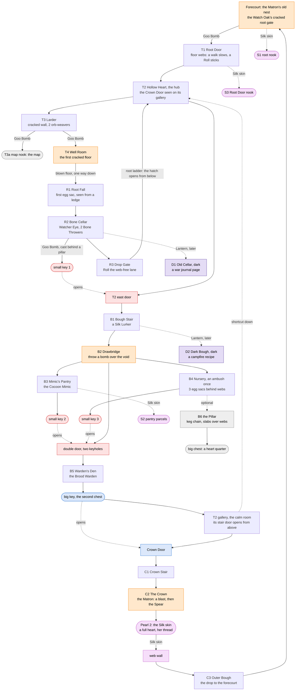

# The Weaver Hollow: Chapter 2's Dungeon

*Status: a proposal for the owner, phase 1 of the dungeon work (written 2026-10-17 for his request
of 2026-10-16: "start redesigning maps so they look more like the type of maps we want with the
story we have; for sure we need to start working on the 3 dungeons. Apply all we learned in the map
design investigations. Maps are not static and can change if it is for the better. Introduce some
dark rooms for the Lantern."). **Built 2026-10-17** (the owner approved building the dungeons
from their designs the same day; the open points took this doc's proposals): as built in
[DUNGEONS.md "The Weaver Hollow (built)"](../godot/DUNGEONS.md#the-weaver-hollow-built), not yet
played by the owner, its tests written and not run. What moved in the build: four floor worlds
(the Trunk, the Roots, the Boughs, the Crown); the map nook is a sealed pocket in the Well Room's
camera room; T4 lies north of the Larder, through its second crack; every wall is root rock;
R3 is built round Fatty's Lair's north-facing drop gate, with its gate winch beyond; the hub's
hatch is a hatch latched from below (`latched_hatch.gd`); the gallery's stair door is a stone block
at the stair's foot that a winch on the gallery lowers for good; B6 is a chain of blast kegs and a
second drawbridge (no slabs over webs), its prize a Goo Heart until heart quarters exist; D2's
candles light it for good and bring its chest; the war journal page and the Silkspun Stew recipe
are not items yet (coins and a potion stand in); Mossy's tip and the three-way lash are not
built. It applies the [level design guide](2026-10-16-level-design.md) (its rules,
look book, lock-and-key table, dungeon template and checklists) and replaces the Weaver Hollow map
of the [2026-10-11 dungeons plan](2026-10-11-release-1-dungeons-plan.md#7-dungeon-2-the-weaver-hollow-chapter-2),
whose War Axe, Swallow forms and Silk Reel are gone. Where this doc needs an answer it says
**Proposal** and lists it in [Open points](#open-points).*

> **Superseded in part (2026-10-17).** The owner moved each Pearl inside its dungeon, before the
> boss ([decisions archive](../story/07-decisions-archive.md#decisions-by-date)): Pearl 2 lies in
> the Hollow before the Matron, taking it seals the Hollow's exits until she falls, the second half
> teaches the Silk skin, and her fight is its exam, so the slime meets her with the skin. Where
> this design has the Pearl after her (the Crown) and the Silk skin's use on the way out (the Outer
> Bough's web wall), the rework plan replaces it:
> [2026-10-17-pearl-mid-dungeon.md](2026-10-17-pearl-mid-dungeon.md) (roadmap 12.8). **Reworked
> 2026-10-17** (the owner approved building the plan's proposals): as built in
> [DUNGEONS.md "The Weaver Hollow (built)"](../godot/DUNGEONS.md#the-weaver-hollow-built). Pearl 2
> lies in the Hoard beside the big key, guarded by the Brood Warden's fight; B4 and B6 are an
> optional wing (the Nursery's chest holds coins and a potion) and the Warden's door takes one key;
> the Hoard's stair is a web wall; C1 is webbed from wall to wall with a web wall on its straight
> way and the K3 door at its top; C4 the Spinning Loft (the Crown's empty screen) holds rows of web
> walls under two Slime Spiders and small key 3 in a silk parcel; the seals stand in T1's way out and
> C2's east doorway; the Matron's round 2 is a cage of web walls and round 3 a webbed floor. Not yet
> played by the owner. The rooms below keep this design's first order where the rework did not
> touch them.

*Plan pictures, drawn with Pillow and sent with this doc: `dungeons/weaver-hollow-plan.png` (the
four floors, top-down) and `dungeons/weaver-hollow-keygraph.png` (the key graph). They go under
`docs/design/dungeons/` once approved.*

## Status and purpose

- **What it is:** Chapter 2's dungeon (questions 25 and 133). Its entrance is the Matron's old nest
  in Gloop Forest's north-east (`gloop-forest-f4`), and the Matron lives at its top. Its big chest
  holds a heart quarter (question 113), and its big key lies in a second chest behind the mini-boss,
  the Brood Warden (**designed with question 116's proposal**: the big key is not decided yet).
- **What it teaches: the Goo Bomb.** Tom teaches it at the end of his maze, where its first, safe
  lock is the cracked wall by him (questions 95, 113 and 132). The Hollow is the rest of its arc:
  - **test:** the Hollow's root gate, a cracked wall with enemies, the first cracked floor;
  - **twist:** a bomb cast in cover from a Watcher Eye, a bomb sucked and thrown over a void, a bomb
    on an egg sac, a bomb on a breathing cocoon, egg sacs behind floor webs, a chain of kegs
    (optional);
  - **conclude:** the Matron, who shields herself in a web cocoon that only a blast tears open,
    then the Spear (question 133).
- **What it shows for later:** the Silk skin's locks everywhere, uncut (floor webs and web walls,
  question 131), so the Matron's Pearl opens many things at once; two dark rooms whose prizes wait
  for the Lantern (Chapter 3), off the main path (owner, 2026-10-16).
- **Theme: the Watch Oak** (**Proposal**). A giant oak grew round one of the Thorn Guard's old
  forts, a watch tower (the dungeons were the old forts, question 125). When the war was lost the
  fort fell, and the Matron's brood took the hollow and filled it with silk. The slime climbs it from
  bottom to top:
  - **the Roots** (below ground; rooms R1 to R3): the fort's cellars among the roots, where the fallen Thorn Guard stir;
  - **the Trunk** (the ground floor; rooms T1 to T4): the tower's hall in the hollow, the hub;
  - **the Boughs** (the upper floor; rooms B1 to B6): galleries in the upper trunk, broken by the hollow's dark inner void;
  - **the Crown** (the top; rooms C1 to C3): the canopy, where her great orb web hangs.
- **Length:** about 30 minutes on a first play (the guide's 20 to 35): 14 rooms on the main path
  (the guide's 8 to 14), 1 optional room, 2 dark come-back rooms and 2 small nooks; about 20 camera
  rooms of floor on the main path.
- **Built in one world scene** (`world.weaver-hollow`), the four floors side by side, joined by
  stairs, a ladder, a blown floor and doors inside the scene, as the 2026-10-11 plan's dungeon
  framework has it. Each room is a camera room (`game/world/camera_room.gd`): one screen is 16 × 14
  tiles (1024 × 896 units), doors are two tiles wide in the middle of a wall.

## What the slime has when it arrives

The Gulp (suck, throw, catch shots), the Spear, the Roll, the Heavy skin (Pearl 1) and the
**Goo Bomb** (Tom). The Silk skin is the reward; the Lantern and the Bow come in Chapter 3.

The bomb as built (rework mode, `abilities.gooBomb`): 20 energy; a 2 s cast standing still (a hit
cancels it); the spit hops 64 px ahead; a 3 s fuse from the moment it leaves the mouth; Q sucks it
and a Q tap throws it (a throw flies about 280 px); the blast is an ellipse about 176 × 120 that
also hurts the slime; a blast sets off other bombs about 120 ms later; bombs and blasts are light
sources (40 px, and 220 px for a quarter second when one blows). Energy refills by itself at 1 a
second, and kills drop energy shards.

The webs' rules (question 131), which make Rolls risky in here:

| | Floor web | Web wall |
|---|---|---|
| **Without the Silk skin** | A walk slows by half; **a Roll sticks** (it stops and the slime is rooted) | Blocks |
| **With the Silk skin** | Full speed, a Roll crosses | Passed at half speed, or cut for good by the Spear |

**A blast never clears a web** (one lock, one power): webs and web walls are the Silk skin's. The
one web a blast tears is the Matron's own cocoon (question 133), which breathes like the Cocoon
Mimic, so the dungeon's rule reads: **a cocoon that breathes wants a blast.**

## The key graph

In the guide's colours: small keys and their doors red, the tool's locks orange, the big key and the
boss door blue; here also the Silk skin's locks pink, the Lantern's purple and the optional grey.

**How it reads:**
- **The first half uses only what the slime brings:** the bomb, the Roll and the Spear take it to
  the Roots and back up with small key 1. The second half (the Boughs) twists the bomb.
- **Loops** (the guide's cycles):
  1. *Unknown return:* the Well Room's blown floor drops into the Roots (one way), and the Roots'
     ladder climbs back to the hub through a hatch that opens only from below.
  2. *Foreshadowing loop:* the Crown Door is seen on the hub's gallery from the hub's floor, and
     reached at the end of the Boughs: the big key's room opens onto the gallery.
  3. *Hidden shortcut:* the gallery's stair door opens from above, so after the big key the boss
     door is a short walk from the entrance (where fainting resumes, question 109).
  4. *Two alternative paths:* in the Boughs, the Mimic's Pantry and the Nursery each hold one of
     the double door's two keys, in either order.
- **Small keys:** three keys and three keyholes. Key 1 can only open the hub's east door (nothing
  else locked is in reach), and keys 2 and 3 open the Warden's double door in any order, so no key
  can be spent wrong.
- **The Silk skin's first lock** is in the boss room's exit: her thread in her web, then a web wall
  (rule 6). Its next one (S1) waits where the way out lands, seen on the way in.

## The floors at a glance

| Floor | Rooms (camera rooms) | What it is about |
|---|---|---|
| Forecourt (open world, F4) | the old nest | the Hollow's own lock: the cracked root gate |
| **The Trunk** (ground floor) | T1 Root Door (1×1), **T2 Hollow Heart** (hub, 2×2), T3 Larder (1×1) with T3a map nook, T4 Well Room (1×1) | webs, the hub, bomb tests, the first cracked floor |
| **The Roots** (below ground) | R1 Root Fall (1×1), R2 Bone Cellar (2×1), R3 Drop Gate (1×1), D1 Old Cellar (dark, 1×1) | the Broodling, the deep room, the Roll and the webs |
| **The Boughs** (upper floor) | B1 Bough Stair (1×1), B2 Drawbridge (2×1), B3 Mimic's Pantry (1×1), B4 Nursery (1×1), B5 Warden's Den (1×1, with the Hoard), B6 the Pillar (optional, 1×1), D2 Dark Bough (dark, 1×1) | the bomb's twists, the Mimic, the mini-boss |
| **The Crown** (top) | C1 Crown Stair (1×1), C2 the Crown (1×1), C3 Outer Bough (1×1) | the climb, the Matron, the way out |

## Room by room

Each room asks one new question, and only one new thing at a time: a new enemy never shares a room
with a new use of the bomb. Every enemy is placed by hand and comes back when its room is entered
again, except in the ambush and the boss rooms (rule 8). Camps keep their distance from doors.

### The forecourt (the open world, `gloop-forest-f4`)

- **Idea:** the threshold. The Matron's old nest ring stays as the forecourt's walls (no web wall
  blocks the way, as decided). At its north end stands the **Watch Oak**, a trunk too big for the
  screen, its roots split round an old Thorn Guard arch the fort's soldiers bricked up. The bricks
  carry the crack decal: **the Hollow opens with the Goo Bomb** (its second lock after Tom's wall,
  and the reason the Hollow comes after Tom).
- **Enemies:** two orb-weavers in the ring (known).
- **Secret:** S1, a web wall over a hollow between two roots east of the gate, with a parcel that
  glints behind it ([Secrets](#secrets)).
- **Tell:** the crack on the arch; Mossy waits at the ring's south gap with a tip (**Proposal**):
  "The old oak's hollow, all the way up. The Guard bricked its root door before the war ended, and
  the bricks are cracked now."
- **Changes there:** the boss camp `gloop-ch2-matron-nest`, its guarded chest and the Goo Heart
  leave the open world; the blown arch becomes a door into `world.weaver-hollow` (a blown wall can
  be a door, as built).

### T1 Root Door (the Trunk, 1×1)

- **Idea:** feel the webs where nothing can go wrong. A band of floor webs crosses the room between
  the door and the way north, with one clear lane at its west end. Walking through the band is
  slow; a Roll into it sticks. Pots by the door.
- **Enemies:** none.
- **Locks:** a web wall in the east wall (the Silk skin's, seen from the first room).
- **Secret:** S3 behind that web wall.
- **Fainting or quitting** inside the Hollow resumes here, with keys, doors, the map and the big
  key kept (question 109).

### T2 The Hollow Heart (the Trunk, the hub, 2×2)

- **Idea:** the tower's great hall in the hollow trunk, the room the slime keeps coming back to.
  - Its south half is the floor (level 0).
  - Its north half is a high **gallery** (level 2) along the back wall, with the **Crown Door** (the
    boss door, big key) in the middle of it and silk threads running up into the dark above.
  - The hub is four screens; the camera follows the slime inside it (a camera room larger than
    the view), so the gallery comes into view as soon as the slime walks north from T1's door. From
    the floor it sees:
    - the Crown Door on the gallery;
    - the gallery's **stair** up the east side, shut at its top by a one-way door ("Barred from the
      other side.");
    - a **hatch** in the floor's west part ("Latched from below.");
    - the east door with a **small-key lock**.
  - The way on is the open west door.
- **Enemies:** one orb-weaver, which lays new webs across the floor's paths, so the hub's floor
  changes between visits. Floor webs in patches; pots along the walls.
- **Locks:** the east door (small key 1); the Crown Door (big key); the stair's one-way door
  (opened from the gallery); the hatch (opened from the Roots).
- **The gallery is the calm room** before the boss door (guide, pacing): pots that drop hearts and
  energy and come back, nothing hostile. It is reached from the Boughs, then opened to the floor.

### T3 The Larder (the Trunk, 1×1)

- **Idea:** the bomb's test with enemies. The brood's larder: silk drapes, floor webs in bands. The
  way on is a **cracked wall** in the west wall; a second **cracked wall** in the north wall hides
  the map nook. The 2 s cast must be timed between the orb-weavers' webs.
- **Enemies:** two orb-weavers (known from the forest).
- **Locks:** two cracked walls (Goo Bomb). The choice is the player's.
- **Tell:** the crack decal, the bomb's universal mark (taught at Tom's wall).

### T3a The map nook (the Trunk, a half room off T3)

A stone alcove behind T3's north cracked wall: the **map** chest. The minimap then shows every
room. It lies in the dungeon's first third, one room off the path, behind a small tell (template
rule 6).

### T4 The Well Room (the Trunk, 1×1)

- **Idea:** the first cracked floor, taught safely. The old fort's well room: flagstones round a
  capped well, quiet. A patch of the floor beside the well carries the crack decal, and dust puffs
  from it every few seconds. Walking on it creaks ("It creaks under you..."; the line should then
  name a blast, not the old Slam). A bomb on it: "The ground gives way!", and a hole opens.
- **Enemies:** none.
- **Locks:** the cracked floor (Goo Bomb, roadmap 7.10).
- **The drop:** the hole is a one-way way down into the Roots (R1). The slime does not need to come
  back this way: the Roots climb back up to the hub (R3).

### R1 Root Fall (the Roots, 1×1)

- **Idea:** meet the Broodling where it cannot hurt the slime yet. The slime lands on a heap of old
  silk on a root ledge (level 1) in the cellar's north-west corner. On the cellar floor below the
  ledge sits the **first egg sac**, alone. From the ledge the slime watches it swell (a pod splits,
  legs poke out) and hatch two Broodlings, which hop toward it, cannot climb, and go back.
  *A Link to the Past*'s first soldier below a ledge, in our terms.
- **The lesson:** the egg sac's right tool. From the ledge a bomb can be sucked and thrown down onto
  the sac (a spit stops at the ledge's rim, a throw flies over); the blast ends the swarm. A slime
  that takes the stair down instead can pop the Broodlings and tear the sac with the Spear (45
  health).
- **Enemies:** one egg sac (Broodlings).
- **Way on:** the ledge's stair down, and the cellar's east door to R2.
- **Clarity:** the only egg sacs in the Hollow are the enemy; no decorative egg sacs (the
  `web-egg-sacs` ambient props) are used in it.

### R2 The Bone Cellar (the Roots, 2×1, the deep room)

- **Idea:** cast in cover. The fort's old barracks under the roots: rows of stone pillars and tomb
  slabs, old Thorn Guard helmets on the floor (Yoi knows them). A **Watcher Eye** drifts over the
  middle, and its beam is stopped by the pillars. **Small key 1** lies in a chest in an alcove
  behind a **cracked wall** in the north wall, inside the Eye's wandering area. One pillar stands
  two tiles in front of the crack: behind it the slime can stand still for the bomb's 2 s cast out
  of the Eye's sight.
- **Enemies:** the Watcher Eye and two **Bone Throwers** at posts among the pillars of the east
  end, a few tiles from the door. A Thrower throws its bone along a row, a column or a diagonal and
  the bone comes back to its hand like a boomerang; the pillars break its lines too. The Gulp can
  catch a bone in flight (the Thrower stands unarmed for 10 s) and throw it back. Two kinds. They
  are the fallen Thorn Guard and their old fort's eye (question 125); the Watcher Eye is met first
  in Fatty's Lair.
- **Why the Thrower:** each dungeon features one skeleton beside the Watcher Eye, so none repeats
  another's deep room: Fatty's Lair the Bone Marcher, the Hollow the Bone Thrower, the Caverns' mine
  the Bone Leaper. The Thrower also gives the Gulp's catch a place in the Hollow.
- **Locks:** the cracked wall (Goo Bomb). South wall: a black doorway to D1 (the dark, Lantern).
- **Tell:** the crack; a pillar placed oddly close to it, the cast's cover.
- **Clarity:** the cover is pillars and tomb slabs, never armour statues: an armour statue is a
  heavy block in the look book.

### R3 The Drop Gate (the Roots, 1×1)

- **Idea:** the Roll, made risky by webs. The cellar's old Thorn Guard gate, the same look as
  Fatty's Lair's: a worm lever lifts it and it drops shut a moment later, too fast to walk through.
  The floor before it is patched with floor webs, and a Roll sticks in a web: the slime must find the
  straight lane between them from the lever to the gate (rolls go straight). Trying again is free.
- **Enemies:** none (one idea).
- **Locks:** the drop gate (Roll). Once the slime is through, the gate's old chain jams and it stays
  up for good, so a later trip to D1 is short.
- **Way on:** beyond the gate a root ladder climbs to the hub's hatch. Climbing it opens the hatch
  for good: the Roots loop closes (template rule 4).

### B1 The Bough Stair (the Boughs, 1×1)

- **Idea:** a known enemy in a new place. Through the hub's east door (small key 1) a stair climbs
  inside the trunk wall to a broad branch landing, webbed in patches. A **Silk Lurker** hangs over
  the landing's middle; its shadow on the floor is the tell, and the webs make stepping out of the
  shadow slow. Pots to throw (a thrown thing cuts its thread).
- **Enemies:** one Silk Lurker (known from Tom's maze).
- **Locks:** west wall: a dark tunnel to D2 (the Lantern, later).

### B2 The Drawbridge (the Boughs, 2×1)

- **Idea:** throw the bomb over a gap; the fuse is the timer. A long branch gallery is cut by the
  hollow's dark inner **void**, four tiles wide, running north to south across the room. On the far
  rim the fort's old drawbridge stands raised, its chain fixed to a stone **winch post** with the
  crack decal. The slime casts, spits, sucks the bomb up and throws it over the void at the post
  before the fuse ends (about 3 s from the spit). The blast breaks the post, and the drawbridge
  drops across for good (the secret jingle). A miss costs only energy.
- **Enemies:** none (one new idea).
- **Locks:** the winch post (Goo Bomb). The chain is iron, not silk, so the lock is the bomb's alone.
- **The void:** a fall costs a little and puts the slime back on the rim it fell from, as the void
  does in Fatty's Lair.
- **Far side, three doors:** north, the Warden's **double door** with two empty keyholes (seen as
  soon as the bridge is down: "how much a lock needs"); east, the Nursery; south, the Mimic's
  Pantry.

### B3 The Mimic's Pantry (the Boughs, 1×1)

- **Idea:** meet the Cocoon Mimic, alone, and learn the dungeon's rule. The brood's pantry. In a
  west alcove behind a **web wall** lie three flat silk parcels that glint (the Silk skin's, S2). In
  the open floor stands one upright cocoon with a gold glint inside, and **it breathes**: it swells
  and sinks slowly. Near it, it bursts, grabs the slime and drinks its energy until shaken off.
- **The lesson:** a bomb cast about two tiles away (out of its waking range), spat toward it, and a
  step back: the blast is its kill hit. Without a bomb: let it grab, shake it off with the move
  keys, two Spear jabs while it is dazed. It rehearses the Matron's cocoon.
- **Enemies:** one Cocoon Mimic.
- **Key:** beaten, it spits out **small key 2**, which it had swallowed (**Proposal**).
- **Clarity:** the parcels lie flat and glint and never breathe; the Mimic stands upright and
  breathes (question 129). The bestiary pen's real cocoon (`object.cocoon-prize`) uses the Mimic's
  own picture, so it is never used as a real prize in here.

### B4 The Nursery (the Boughs, 1×1, an ambush once)

- **Idea:** stop a swarm from behind webs. Shutters close when the slime reaches the room's middle.
  Three egg sacs sit on root islands in three corners, each ringed by a band of floor webs; an
  orb-weaver lays more. Wading in is slow and a Roll sticks, so the bomb is sucked and thrown over
  the webs onto each sac (the Drawbridge's throw, with a swarm now). A slime without energy can still
  wade in and tear the sacs with the Spear. With the sacs and the brood gone, the shutters open and a
  chest appears with **small key 3**. The ambush never repeats (template rule 8).
- **Enemies:** three egg sacs (Broodlings) and one orb-weaver: two kinds. Broodlings drop energy
  shards.
- **Energy:** three bombs, 60 energy, under the starting 100.
- **Way on:** west to B2; north to B6 (optional), the Nursery's one door that leads nowhere on the
  main path (an exit not yet taken is its own tell).

### B5 The Warden's Den (the Boughs, 1×1, with the Hoard)

- **Idea:** the mini-boss, which guards the big key (question 116's proposal). Through the double
  door (keys 2 and 3) a room-sized floor of old flagstones, walls in reach, four pots, nothing to
  corner the slime. Shutters close.
- **Enemies:** the **Brood Warden**: it stalks, sweeps twice (a glowing half-ring on the floor is
  the tell), then stands planted 1.2 s with its back plates open, the only time the Spear hurts it
  (120 health, three windows). One egg sac by the back wall hatches only once the Warden is hurt;
  its Broodlings feed energy shards, and a bomb ends it.
- **Proposal (open point):** a Goo Bomb blast that catches the Warden knocks it down planted for
  2 s, plates open, so the mini-boss rehearses the Matron: a blast, then the Spear.
- **The Hoard:** beaten, the west shutter opens on a small vault with the **second chest: the big
  key**. Its back stair goes down onto the west end of the hub's gallery: the wing ends in a way back
  to the hub (rule 7).
- **The gallery:** from it the slime opens the stair's one-way door (it stays open), and the Crown
  Door is a few steps away. Refills in its pots, a breath before the boss.

### B6 The Pillar (the Boughs, 1×1, optional: the big chest)

- **Idea:** the hardest bomb puzzle, on an optional prize. The hollow's void fills most of the
  room. Out of it rises the top of the old tower's last **pillar**, an islet with a niche sealed by
  cracked stone, the big chest's glint inside, seen from the room's doorway (sight before reach).
- **The chain** (**Proposal**, new object): four **blast kegs** stand along the tower's broken
  parapet, which runs from the near rim out to the pillar. A bomb thrown onto the first keg sets it
  off; each keg sets off the next (the bomb's chain rule), and the last blows the pillar's cracked
  stone.
- **The reach:** falling slabs (the Roll's, as in Fatty's Lair) cross the void to the pillar in two
  straight legs with a turn on one fixed slab. Floor webs lie on some slabs: a Roll that sticks on a
  slab falls with it, back to the near rim. The slabs come back after 10 s.
- **Prize:** the **big chest: a heart quarter**, one of Gloop Forest's four (question 116's
  proposal).
- **Way back:** the slabs again.
- **Without kegs** (if the owner says no): the pillar's crack stands within a throw of the rim, and
  the room's twist is the slabs over webs.

### C1 The Crown Stair (the Crown, 1×1)

- **Idea:** the set piece, the climb. Behind the Crown Door a spiral of root steps climbs the last of
  the trunk toward daylight. The silk thickens; above, through the threads, a huge cocoon heaves in
  a web: her, before the fight (show before use). No enemies.

### C2 The Crown (the Crown, 1×1, the boss)

The Matron's arena; see [The Matron's room](#the-matrons-room).

### C3 The Outer Bough (the Crown, 1×1, the way out)

- **Idea:** the way out uses the new skin (rule 6). Beyond the Crown's east **web wall** (only the
  Silk skin passes, at half speed; the Spear can cut it for good), a high branch outside the oak in
  daylight, the forest below. Her dragline hangs from the bough's end. Stepping off the end is a
  one-way drop that lands in the forecourt by the root gate, beside S1 (**Proposal**).

## Dark rooms for the Lantern

The Lantern is Chapter 3's (the smith gives it at his mine camp), so here a dark room is only a
**come-back secret**: optional, off the main path, harmless to walk into, and its prize waits for
the Lantern behind one of the Lantern's own locks. The dark itself is a soft gate (the guide: "a
dark tunnel walked before the Lantern"); the hard lock inside is dry roots or candles. Both rooms are
built from existing pieces: a `DarkRoom`, a burnable, candles and a gate ([DARKNESS.md](../godot/DARKNESS.md)).

| | D1 The Old Cellar (Roots) | D2 The Dark Bough (Boughs) |
|---|---|---|
| **Where** | Off R2's south wall: a black doorway | Off B1's west wall: a black tunnel into a great branch |
| **Inside** | A short winding root passage, pitch dark (no pits, no enemies), ending at a plug of grey-black **dry roots** before a niche | A dark branch tunnel ending at three unlit **candles** round a small gate before a chest |
| **Lock** | Lantern: the flame burns the dry roots ("Too dry and hard. Fire would take it.", as built) | Lantern: all three candles lit open the gate, for good |
| **Prize** | A page of the Thorn Guard's war journal: how the fort in the Watch Oak fell | A campfire recipe (a manuscript) |
| **Tell** | The doorway's dark; cold dust drifting out; **a bomb's flash**: a blast lights 220 px for a quarter second, and shows the dry roots and the chest's glint | The tunnel's dark; a bomb's flash shows three cold candles |
| **Seen / opened** | Seen in Chapter 2; opened in Chapter 3 | Seen in Chapter 2; opened in Chapter 3 |
| **The way there later** | Hub, hatch, ladder, the jammed gate, R2 | Hub, east door, B1 |

- A bomb's light lets a curious slime peek into the dark, but no bomb lights a candle or burns a
  root (the bomb blows only on its fuse and is not a flame), so both prizes wait for the Lantern.
- No Gloomling or Glint Bat is placed in them: those come only after the Lantern (bestiary).
- **Clarity:** the Hollow is full of living roots, brown and thick, which are scenery; the only dry
  roots are D1's plug, grey-black and thorny (question 129). The Hollow has no climbable wall, so
  the Feral skin's roots never meet them.

## The Matron's room

**The arena (C2, 1×1):** the Crown, the canopy's floor of woven branches and silk, open from wall
to wall. Her great orb web hangs across the north half like a backdrop. Four pots in the corners,
low branch walls in reach, nothing to corner the slime. Through C1's door the shutters close: the
slime cannot leave until she is beaten (a trap gate), and she never comes back.

**Her fight** keeps what is planned (the three-way lash that pulls and traps, the web volley that
marks four circles and leaves floor webs, the rest after each volley) and adds the cocoon
(question 133). **Proposal** for what roadmap 8.7 leaves open:
- **Cocooned:** she fights from inside a web cocoon hung by a thread from her web, its shadow on the
  floor. **It breathes** (the Mimic's tell), and her red eyes glow through the silk. Every hit on it
  clinks: "Woven too thick. It would take a blast." She lashes and volleys from inside it.
- **Torn:** a Goo Bomb blast whose ellipse holds the cocoon's shadow tears it open. She drops to the
  floor dazed, open for about **4 s**: the Spear hurts her (about one Spear chain and a jab). Then
  she scuttles up her thread and spins a new cocoon (about 1.5 s, threads whirling: the tell).
- **Three rounds**, about 100 of her 300 health each, each the exam of a room the slime has passed:

  | Round | Her cocoon | The slime's answer | Taught in |
  |---|---|---|---|
  | 1 | Hangs low near the web's middle, the floor round it clear | Cast two tiles away, spit, step back | B3, the Mimic |
  | 2 (under 200) | Hangs higher; she webs a ring of floor round its shadow | Suck the bomb and throw it over the webs; a Roll would stick | B2 and B4 |
  | 3 (under 100) | She drops two egg sacs by her shadow; Broodlings swarm | Bomb a sac or throw so one blast holds a sac and her shadow; the Spear in her window | R1, B4, B5 |

- **Energy:** a bomb a round is 60 energy, plus misses. The slime arrives full (the gallery's pots),
  energy refills at 1 a second, and her Broodlings drop shards: a boss that makes minions may refill
  the slime (the guide, pacing).
- **Beaten:** she shrinks into an ordinary big orb-weaver and scuttles off through her web. Her
  cocoon unravels; **Pearl 2** lies in the silk at the web's heart. The Pearl's card gives the
  **Silk skin** (ceremony); a **full heart** appears (question 17) and max energy rises
  (question 19).
- **Her thread** (question 106): a spool caught in a strand of her web. With the Silk skin the Spear
  cuts the strand, the spool drops, and the slime takes it (a story item). It is the Silk skin's
  first lock; the east web wall to C3 is its second, and S1 below its third.

## Secrets

Seven, by the guide's card. Most are small and seen at once; the big ones are the heart quarter and
the two manuscripts.

| Secret | Tell | Lock | Prize | Seen from | Way back |
|---|---|---|---|---|---|
| **T3a the map nook** | The crack decal in the Larder's north wall | Goo Bomb ("It needs a blast.") | The dungeon map | T3, first visit; opens at once | The blown wall is a door back |
| **B6 the Pillar** | B4's north door, the one exit off the main path; inside, the big chest's glint on a pillar across the void, seen from the doorway | Goo Bomb (the keg chain), then the Roll (slabs over webs) | The big chest: a heart quarter | B4, first visit; opens at once (the hardest puzzle) | The slabs come back after 10 s |
| **S1 the root nook** (forecourt) | A parcel glinting behind a web wall between two roots, by the root gate | Silk skin (pass or cut the web wall; the Spear frees the parcel) | 50 coins and an energy potion | The forecourt on arrival; opens on the way out (C3 lands beside it) | Open ground |
| **S2 the pantry parcels** | Three flat parcels glinting behind a web wall in B3 | Silk skin (the wall, then the Spear on each parcel) | A health potion, an energy potion, 40 coins | B3, first visit; opens after the Matron | The cut web wall |
| **S3 the Root Door nook** | A web wall in T1's east wall with a glint behind | Silk skin | 30 coins | T1, the first room; opens after the Matron | The cut web wall |
| **D1 the Old Cellar** | A black doorway in R2; cold dust; a bomb's flash shows dry roots and a glint | Lantern (dry roots) | A war journal page: the fall of the Watch Oak | R2 in Chapter 2; opens in Chapter 3 | The same passage |
| **D2 the Dark Bough** | A black tunnel off B1; a bomb's flash shows three cold candles | Lantern (candles open a gate for good) | A campfire recipe | B1 in Chapter 2; opens in Chapter 3 | The same tunnel |

The web walls inside the Hollow are many on purpose: the Silk skin's locks shown early and in
numbers, as the guide asks, so that the Pearl opens a handful at once on the way out. The secret
jingle (`SecretFound`) plays at each.

## Pacing

| Beat | Room | Feel |
|---|---|---|
| Quiet start | Forecourt, T1 | Low: the gate, the webs |
| The picture of the place | T2 | Low: the Crown Door seen |
| Test | T3, T3a | Mid, then a small reward |
| Curiosity | T4 | Low: a floor that breathes dust |
| A new enemy, safely | R1 | Mid |
| The deep room | R2 | High: the eye and the throwers, small key 1 |
| Skill, no threat | R3 | Mid, then release as the hatch opens |
| Tension | B1 | Mid: a shadow on the landing |
| The bomb's twist | B2 | Mid, release as the bridge falls |
| Surprise | B3 | Mid-high: the cocoon breathes |
| Ambush | B4 | High |
| Optional skill | B6 | Mid |
| Mini-boss | B5 | High |
| Release | The Hoard, the gallery | Low: the big key, the shortcut, refills |
| Set piece | C1 | Low threat, high tension: the climb |
| Peak | C2 | The Matron |
| Release | Pearl, C3, S1 | Daylight, the new skin |

## Enemies in the Hollow, and the other two dungeons

| Enemy | First placed alone | Then | Right tool here |
|---|---|---|---|
| Broodling and egg sac (the Hollow's own) | R1, below a ledge | B4 (three sacs), B5 (one), the Matron's round 3 | A bomb on the sac |
| Cocoon Mimic (the Hollow's own) | B3 | The Matron's cocoon breathes the same way | A bomb next to it |
| Brood Warden (mini-boss) | B5 | | The Spear while planted; proposal: a blast plants it |
| Watcher Eye (every dungeon) | R2, the deep room (met first in Fatty's Lair) | | Pillars for cover; the Spear from behind |
| Bone Thrower (every dungeon's skeletons) | R2, at its posts, beside the Eye | | Close in while its bone is out, or catch the bone with the Gulp and throw it back |
| Orb-weaver, Silk Lurker (Gloop Forest) | The forecourt, T2, T3, B1, B4 | | Known from the forest and Tom's maze |

- **Kept for the other dungeons:** the Pipe Worm, the Dung Roller and the Squints are Fatty's
  Lair's; the Gloomling, the Prism Eye, the Pick Mole and the Shardback are the Caverns'. All three
  dungeons share the skeletons and the Watcher Eye, and each features one skeleton in its deep
  room: the Bone Marcher in Fatty's Lair, the **Bone Thrower** here, the Bone Leaper in the
  Caverns' mine (as their designs of 2026-10-16 have it). No Slime Spider or Thornball inside: the
  Hollow keeps to two kinds a room.
- **Shared pieces with Fatty's Lair** (built there first): the worm-lever drop gate (R3), the falling
  slabs and the void (B2, B6), the dungeon kit (keys, doors, shutters, chests, the map).

## What must be built

For the roadmap (8.14 and the items it depends on). *Shared* marks what Fatty's Lair builds first.

**The dungeon kit** (*shared*; the 2026-10-11 plan's framework)
- [ ] A dungeon world and its definition; a camera room per room; the minimap's room fog (visited
      rooms; with the map, all) and a key readout.
- [ ] Dungeon doors: small-key, **double-keyhole** (two small keys, B5), boss (big key), one-way
      (opens from one side: the gallery stair, the hatch), shutters (ambush and boss rooms).
- [ ] Small keys (a counter), the big key, the map; small and big chests, each opened once.
- [ ] Room encounters: ambushes once (B4); the boss room as a trap gate.
- [ ] Resume at the entrance after fainting or quitting, with keys, doors, map and big key kept
      (question 109).
- [ ] Pots that drop hearts, energy or coins and come back when the room is entered again (the
      gallery's calm room).
- [ ] The worm-lever drop gate (R3) and the falling slabs with the void (B2's void, B6) from Fatty's
      Lair; here the drop gate also jams open for good once passed.

**Webs** (roadmap 7.8 and 7.9)
- [ ] **Floor webs as painted cells**: a web layer painted on the 64-unit grid, like the PropLayers
      (**Proposal**), each cell a floor web: half speed without the Silk skin, and a Roll sticks;
      full speed and no stick with it. The Matron's volley patches follow the same rule.
- [ ] **Web walls** that fill a door slot or a nook's mouth: block without the Silk skin; with it,
      pass at half speed or cut for good with the Spear (today's web barrier, `object.spider-web`,
      catches and sets back).
- [x] The Silk skin itself (`player.crosses_webs()` from the Pearl, not the Silk form; built
  2026-10-17, [SKINS.md](../godot/SKINS.md)).
- [ ] **Silk parcels**: a small flat parcel that glints (new art and object), freed by the Spear
      with the Silk skin, dropping what it holds. `object.cocoon-prize` stays the Mimic's look only.

**The Goo Bomb's locks**
- [ ] **A blast breaks cracked ground** (roadmap 7.10), its hole a door to a marker in the same
      scene (T4 to R1), and its creak line names a blast.
- [ ] **The drawbridge:** a cracked winch post (a cracked wall on a post) whose blast drops a bridge
      deck across a void for good (story flag; B2).
- [ ] **Blast kegs** (**Proposal**, B6 only): fixed Thorn Guard kegs carrying the crack mark; a blast
      sets one off, and it sets off the next; weapons and throws clink ("It needs a blast."), the
      Gulp cannot lift them.

**Enemies and the boss**
- [ ] Egg sacs and the Cocoon Mimic placed in rooms (their arena is the room); the Mimic drops small
      key 2 (**Proposal**).
- [ ] The Brood Warden planted by a blast (**Proposal**, open point).
- [ ] **The Matron at the top** (roadmap 8.7): her chamber; the cocoon phase (its breath, its
      clink line, a blast that tears it, the open window, the re-spin), the three rounds, her egg
      sacs in round 3; numbers in `game-constants.json`; Pearl 2 and the Silk skin; the full heart;
      the max-energy raise; her thread in her web, taken once with the Silk skin.

**The world**
- [ ] The forecourt in `gloop-forest-f4`: the boss camp, its chest and the Goo Heart leave; the
      Watch Oak (a big prop: the trunk's base, its root split and the bricked arch) with a cracked
      wall that is a door into the Hollow; S1's web wall and parcel; Mossy's tip (**Proposal**).
- [ ] The Outer Bough's drop: a one-way exit from C3 to the forecourt, landing by S1.
- [ ] `world.weaver-hollow` in `scene_index.json`; `weaver-hollow` in Gloop Forest's `interiors`
      in `world-map.json`; the area title "Weaver Hollow".
- [ ] D1 and D2 from existing pieces (`DarkRoom`, a burnable of dry roots, candles with a gate that
      opens for good).

**Art** (Magnific, by the art guides)
- [ ] The Hollow's look: heartwood walls (a wall style), the old fort's flagstones and stone, silk
      drapes as flat decals, floor web cells, the Crown's canopy floor, the boss door.
- [ ] The Watch Oak's exterior, the drawbridge and its winch post, blast kegs, silk parcels, the
      Matron's cocoon (boss size, breathing, eyes through the silk), her thread's spool.
- [ ] **Not used in the Hollow:** the ambient web cocoons and web egg sacs (`web-cocoon-ground`,
      `web-cocoon-hanging`, `web-egg-sacs`), which read as the Mimic, Tom's cocoon or a live egg
      sac; armour statues as scenery (an armour statue is a heavy block).

## The guide's checklists, run on this design

**Readability**
- [x] The main path reads at a glance: each room has one open way on, and locked doors show their
      lock. *Fixed while designing:* the hub's west door is the only open one at first.
- [x] A landmark: the Watch Oak outside; inside, the hub's gallery and its Crown Door.
- [x] The forecourt's exit back to the forest is the nest ring's gap, with the forest path outside.

**The clarity rule**
- [x] Every lock is in the look book with one power: cracked walls, the cracked floor, the winch post
      and the kegs (Goo Bomb); the drop gate and the slabs (Roll); web walls, floor webs, parcels
      (Silk skin); dry roots, candles, the dark (Lantern); keys and doors (the kit). *New in the look
      book:* the blast keg, the winch post and the Matron's cocoon (open points).
- [x] No lock looks like scenery. *Fixed:* no decorative cocoons or egg sacs in the Hollow; no armour
      statues as cover; the Hollow's living roots never grey-black; no climbable wall.
- [x] No bell in the Hollow; the only eye is an enemy's (the Watcher Eye).
- [x] No two locks of different powers side by side. *Fixed:* B2's drawbridge hangs on an iron
      chain, not silk, so it is not a Silk lock beside a bomb lock; T3's two cracked walls are the
      same power. B6's slabs carry floor webs on purpose: the webs shape the Roll's line, and both
      were taught (T1, R3).
- [x] Every wrong tool is refused with a sound and a line: the cracked wall's (as built "Too deep for
      a hammer. It needs a blast."; the Hammer comes after Release 1, so "It needs a blast." alone
      would do), the dry roots' line, "Barred from the other side.", "Latched from below.", the
      cocoon's "Woven too thick. It would take a blast."; the web barrier's built line names the old
      Sticky form and must change ("Thick silk. It will not give." is a proposal).

**Every lock taught**
- [x] Each lock's power is won before its lock on the main path: the bomb at Tom's (the Hollow's
      gate needs it, so Tom comes first), the Roll in Chapter 1.
- [x] The bomb's first lock is Tom's wall; inside, each new use of it comes first in a room with no
      enemy (T4's floor, B2's throw).
- [x] The main path needs no combo, no secret and no later power: the bomb, the Roll, the Spear and
      the Gulp's throw, one at a time.

**No softlock**
- [x] The one drop (T4) leads to the Roots, whose ladder climbs back; every void returns the slime to
      the rim it fell from. *Fixed:* the Boughs' voids first dropped into the hub, which made a
      failed roll a long walk back.
- [x] Three keys, three keyholes; key 1 has only one door in reach, keys 2 and 3 open one door in any
      order.
- [x] No heavy blocks in the Hollow.
- [x] Every timed thing can be tried again: the drop gate, the slabs (10 s), the drawbridge throw,
      the kegs (one throw), the Matron's windows. Pots in the gallery come back.
- [x] No puzzle costs more than 100 energy: the Nursery's three bombs are 60; the Matron's 60 plus
      misses, with shards from her brood.
- [x] Story-critical things cannot be skipped: Pearl 2 and her thread lie in the boss room; the way
      back down through C1 stays open after her fall, so a slime that leaves without the Pearl is not
      trapped.
- [x] The heart quarter (B6) is reached with Release 1's powers it has (bomb and Roll).

**Secrets fair**
- [x] Every secret has a card (above).
- [x] Each tell is seen from where the slime stands in one screen: the cracks, the glints, the black
      doorways. *Fixed:* B6's chest was first meant to be seen from the Nursery, but the camera shows
      one room at a time; it is now seen from B6's own doorway, and B4's open north door is the tell
      that leads there. The hub's Crown Door comes into view as the slime walks north in the hub.
- [x] Come-back secrets are shown on the first visit: S1 to S3 (Silk), D1 and D2 (Lantern).
- [x] Prizes are spread: one heart quarter in the Hollow; the manuscripts behind the later power.

**Enemies**
- [x] Each tell is readable: R1's sac seen from a ledge; the Lurker's shadow on a landing with no
      prop over it; the Warden's half-ring; the Mimic's breath in an open floor.
- [x] A new enemy first appears alone (R1, B3, B5), never with a new power.
- [x] The Watcher Eye has pillars; the Bone Throwers throw on eight lines, so the same pillars give
      cover from them, and the orb-weavers' four lines leave diagonals.
- [x] *Fixed after reading the other two dungeon designs:* R2 had the Watcher Eye and two Bone
      Leapers, the same deep room as the Caverns' mine; it now has Bone Throwers, the skeleton
      neither of the others uses.
- [x] Placed enemies keep away from doors; T1, T4, R3, B2 and C1 hold none.

**Pacing**
- [x] A calm room before the boss door: the gallery.
- [x] One set piece: the climb up the Crown Stair into her web (with the drawbridge's fall as a
      smaller one).
- [x] Resume at the entrance (T1); the shortcut from it to the boss door is T1, the hub, the gallery
      stair, the Crown Door.

## Open points

Each with a proposal; the build keeps to the proposal until the owner answers.

1. **The big key (question 116).** *Proposal (designed so):* the big key lies in a second chest
   behind the Brood Warden (the Hoard), and the big chest's heart quarter counts as one of Gloop
   Forest's four.
2. **The Watch Oak.** *Proposal:* the Hollow is the Thorn Guard's old watch fort inside a giant oak,
   so it is one of the old forts (question 125), and D1's war journal page tells how it fell.
3. **The Matron's cocoon numbers** (roadmap 8.7's "not decided yet"). *Proposal:* she fights from
   inside it; a blast tears it and she is open about 4 s; she re-spins it in about 1.5 s; three
   rounds of about 100 health (low and clear; higher over a ring of webs; with two egg sacs). Tuned
   in the playground.
4. **The Brood Warden and the bomb.** As built, the mini-boss never meets the dungeon's tool.
   *Proposal:* a blast that catches it knocks it down planted for 2 s, plates open, so it rehearses
   the Matron (a blast, then the Spear). It stays beatable the built way.
5. **Blast kegs.** *Proposal:* a new Goo Bomb object for chains, only in B6: fixed Thorn Guard kegs
   with the crack mark, which a blast sets off one after another. Without them, B6's crack stands in
   a throw's reach.
6. **The Mimic's key.** *Proposal:* the Cocoon Mimic in B3 has swallowed small key 2 and spits it
   out when beaten.
7. **The double door.** *Proposal:* one door with two keyholes (keys 2 and 3), seen from the
   drawbridge, so the Boughs' two rooms can be done in either order.
8. **Floor webs as painted cells.** *Proposal:* a web layer painted on the 64-unit grid, so a room's
   webs are drawn like the props, rather than placed one patch at a time.
9. **The way out.** *Proposal:* after the web wall, a drop from the Outer Bough lands in the
   forecourt beside S1, so the slime walks out into daylight with the new skin's next lock in front
   of it.
10. **Mossy at the forecourt.** *Proposal:* Mossy waits by the old nest with a tip about the cracked
    root door, the hint close to the dungeon that the guide asks for.
11. **The web barrier's line.** Its built line, "Caught in the web! (something sticky could cross)",
    names the old Sticky form. *Proposal:* "Thick silk. It will not give."
12. **Decor that reads as an enemy.** *Proposal:* the ambient web cocoons and web egg sacs stay out
    of the Hollow and Tom's maze, where the Mimic, Tom's cocoon and live egg sacs are.
13. **Size.** 14 rooms on the main path is the guide's upper bound. *Proposal:* keep it, and if the
    first play runs long, cut the optional first (B6), then merge T4 into T3.

## Changes the shared docs would need (once approved)

Listed here, not made, since three dungeon designs are in work at once:
- The [level design guide](2026-10-16-level-design.md)'s "Applied: the Weaver Hollow" section: point
  to this doc; the look book gains the blast keg, the winch post and the Matron's cocoon ("a cocoon
  that breathes wants a blast").
- [Roadmap](../GAME_ROADMAP.md) 8.14 (the build list above), 8.7 (the cocoon proposal), 7.9 (floor
  webs as painted cells, web walls in door slots, silk parcels) and 7.10 (the cracked floor as a
  door inside a scene).
- [Chapter 2](../story/chapters/chapter-2-gloop-forest.md) Beats 8 and 9, [the world](../story/03-world.md)
  (the Matron's nest as the forecourt, the Watch Oak), [the unlock map](../story/05-unlock-map.md)
  (the big chest's place, the two manuscripts), and question 116 in
  [open questions](../story/06-open-questions.md) if the owner takes its proposal.
- [The bestiary](2026-10-16-bestiary.md) and [BESTIARY.md](../godot/BESTIARY.md): the Brood Warden's
  blast proposal; the Mimic's key.
- [specs/matron.md](../godot/specs/matron.md) once the cocoon is built.
- The [2026-10-11 dungeons plan](2026-10-11-release-1-dungeons-plan.md)'s banner: its Weaver Hollow
  section is replaced by this doc.
