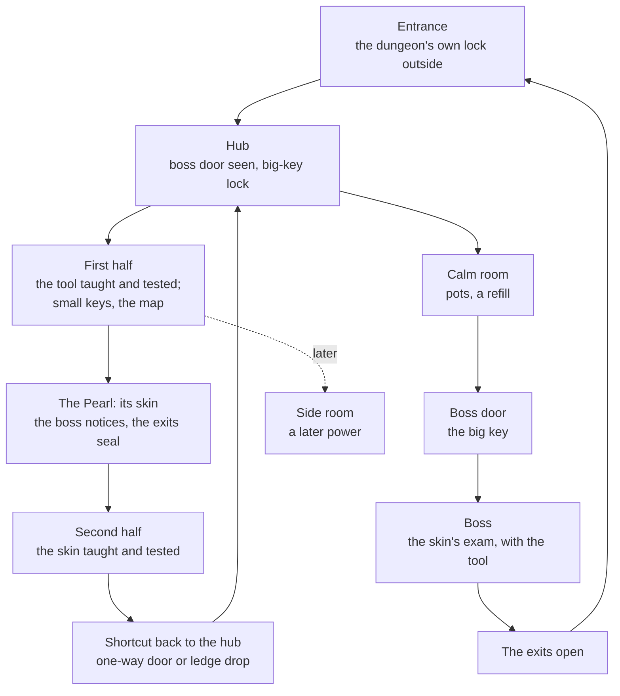

# Level Design: Maps, Locks and Secrets

*Status: the guide every agent follows when it builds a map (2026-10-16). Written from research on
Zelda-like level design ([Sources](#sources)) and from the docs as they stand after the seventh
round of questions. It decides nothing about the story or the powers: where it found a gap or a
conflict in our locks, it lists it in [Open points](#open-points) for the owner, and the maps keep
to the decided docs until he answers.* *Since the eighth round (2026-10-16) the owner has answered
every open point (questions 115 and 127 to 135 in the
[decisions archive](../story/07-decisions-archive.md#open-from-the-level-design-guide-2026-10-16)):
he took the proposals with two changes, every bell rings to a thrown pot or an arrow, and a Roll
sticks in a floor web. The answers are written under each point and in the tables below. What a
bell opens stays open for good, so a bell is a lock solved once
([question 136](../story/07-decisions-archive.md#open-after-the-eighth-round-2026-10-16), the
ninth round).* *Changed 2026-10-17 (the owner's idea,
[decisions archive](../story/07-decisions-archive.md#decisions-by-date)): each dungeon's Pearl is
found inside it, before its boss, as Zelda's dungeon item. Taking it seals the dungeon's exits
until the boss falls; the second half teaches the Pearl's skin, and the boss fight is its exam
(rule 6, [the dungeon template](#a-dungeon)). The three built dungeons are reworked by
[their plan](2026-10-17-pearl-mid-dungeon.md) (roadmap 12.8).*

## Why this exists

The owner asked for levels that are good, interesting, and make sense with our secrets and powers
(2026-10-16). The next maps are the prologue, then Slimeshire's chunks, Fatty's Lair, Tom's maze,
the Weaver Hollow, the Crystal Caverns and the mine. Our powers and their locks are decided across
many files; this guide turns them into rules for a map.

Read it with:
- [Direction](../story/01-direction.md): the clarity rule ("each thing is told apart"), the skins,
  the powers, and what each power owns;
- the [unlock map](../story/05-unlock-map.md): every permanent item, where it is won, what it opens;
- the [secrets table](2026-10-14-bomb-lantern-and-secrets.md#3-secrets-one-kind-of-lock-per-power);
- the [bestiary](2026-10-16-bestiary.md): each enemy's tell and right tool;
- for building: [WORLD_ATLAS.md](../godot/WORLD_ATLAS.md) (chunk worlds),
  [ELEVATION.md](../godot/ELEVATION.md) (hills, holes, stairs, ledge drops),
  [PROPS.md](../godot/PROPS.md) (scenery and placed enemies), [WALLS.md](../godot/WALLS.md),
  [FORESTS.md](../godot/FORESTS.md), [FENCES.md](../godot/FENCES.md), the water rules
  ([specs/water.md](../godot/specs/water.md)) and placed enemies
  ([specs/enemy.md](../godot/specs/enemy.md) §3.3).

## The rules that matter most

1. **One lock, one power, one look.** Before placing a lock, find it in the
   [look book](#the-look-book). If it looks like scenery or like another power's lock, change it.
2. **Show the lock before the key.** The slime sees most locks before it has their power, and
   every power's first lock stands where the power is won.
3. **Teach, test, twist.** Each power gets a safe first use, then a test on the way on, then a
   twist (with enemies, timing or a second known thing), then its boss or its come-back secrets.
4. **The main path never needs a combo, a secret or a later power.** The optional asks for
   curiosity, never for luck.
5. **Every secret has a tell the slime can see from where it stands.** Most secrets show their
   prize before they open (sight before reach).
6. **Each dungeon's second half teaches its Pearl's skin, and the boss is its exam.** The Pearl
   lies inside the dungeon, before the boss; the new skin's first lock stands where it is won, its
   locks fill the way on to the boss, and the boss fight needs it. Its come-back secrets wait,
   already seen, in places the slime has been. *Until 2026-10-17 the rule was "each boss's way out
   uses the skin it gives": the new skin's first lock was in the boss room's exit.*
7. **Loop back.** Every dungeon wing, every maze and every far corner of a chunk opens a short way
   back toward its start. Fainting in a dungeon resumes at its entrance. *Since 2026-10-17: after
   the Pearl it resumes there, inside, with the doors to the outside sealed until the boss falls.*
8. **One landmark per chunk; the road is the main path.** The way through is the widest, plainest
   ground; optional ways are narrower and less trodden.
9. **Enemies teach.** A new enemy first stands alone with room to read its tell. Never a new
   enemy and a new power in one room.
10. **The slime is never trapped.** No drop without a way back it already has; no lock that can
    eat its own key; no puzzle that costs more than the starting max energy.
11. **Chunks meet only at their crossings** (owner, 2026-11-01). Terrain closes every chunk line:
    cliffs, water and canals, forest bands, walls. Two chunks meet at one to three crossings, each
    joining those two chunks only (never at a chunk corner) and no wider than a road, marked so the
    slime sees it is leaving: a bridge, a ford, stairs, a gate, a trail gap between lantern posts.
    Walking about must never flip between chunks: no open ground along a line, no road along one
    ([§9](#9-landmarks-and-guidance-per-chunk)).

## Principles

### 1. The main path and the optional

The main path (the critical path) is what every player must walk: from the Wellspring to the Spear,
the Roll, Fatty's Lair, the Verdant Gate, Tom, the Weaver Hollow, the web-wall maze, the mine camp,
the chasm and the Colossus. Everything else is optional: heart quarters, manuscripts, coins,
potions, Yoi's home, come-back secrets.

- The main path uses only powers the slime already has, never a combo
  ([question 84](../story/07-decisions-archive.md#contradictions-left-after-the-review-2026-10-15)),
  never a secret.
- It is close to linear, and that is fine. Mike Stout's study of the first Zelda found its
  required route almost always a line, with optional rooms branching off it and hidden shortcuts
  across it: the world feels open, and nobody gets lost.
- It is easy to read: a road, a river, a line of torches, a gap in the trees. The optional hides a
  little off it, with a tell.
- Build the main path for a player of basic skill, and put the harder optional places off it,
  with their risk and reward plain to see (Dan Taylor). A fight a newcomer survives by walking, an
  expert clears with the Roll and the Spear's reach.
- A side branch is short and pays: no long dead end with nothing in it. In Zelda's dungeons a dead
  end usually holds a chest, a key or a view of something to come.
- When a map runs long, cut the optional first, never the main path's teaching.

### 2. Teach, test, twist (a power's arc)

Nintendo's four steps (Koichi Hayashida, *Super Mario 3D Land*; the four-part *kishōtenketsu* of
Japanese storytelling, which he credits to Miyamoto): pick **one core idea** for a place, then **introduce** it where failure is
cheap, **develop** it without the safety net, **twist** it with one new element, and
**conclude** with a last test. In *3D World*'s flip-panel level the first panels sit low, so a
fall costs nothing; later they climb; then enemies send shockwaves across them. Zelda's dungeons
do the same with their item: the obstacle is shown before the item, the item opens simple locks,
then harder ones, and the boss is the final exam (Mark Brown on *Link's Awakening*, where almost
every boss and mini-boss needs its dungeon's item).

For each of our powers:
- **Teach:** the first lock stands right where the power is won, in a safe place: no enemy, no
  fall, no timer. The player uses the power at once, because nothing else is in the room. In
  *Super Mario Bros.* 1-1 the first Goomba is slow and dying to it costs nothing; the same here.
- **Show before use:** let the world show a danger or a power on something else first. *Half-Life
  2* shows a new threat behind a fence or glass; our prologue's camera pan shows Yoi's thrust
  dropping two worms on one line before the slime has the Spear.
- **Test:** on the way on, the same lock again, a little harder or with a choice.
- **Twist:** the lock with an enemy, a timer, distance or a known power from before. One new idea
  at a time, and only once the rules are firm: a twist too early breaks the lesson (Celia Wagar).
- **Conclude:** the boss (for the region's tool) or the come-back secrets (for a skin).
- **Hint by weight:** a minor idea gets a passing hint, a vital one a clear lesson (*Tunic* keeps
  its full manual pages for what the player must know).

The [lock-and-key table](#our-lock-and-key-table) gives the teach, test and twist place of each
power.

### 3. Show the lock before the key (sight before reach)

- The slime sees most locks before it can open them: a cracked wall in Chapter 1, a web wall by
  the Webwood, a climbable wall by the Wellspring. When the power comes, the player remembers.
- A lock says what it needs in its refusal line ("Barred from the other side.", "Too heavy..."),
  without naming a key (quest text never names keys). A player coming back knows what to bring.
- A prize in sight and out of reach is the strongest pull a map has: a chest on a ledge, a chest
  across water, a glint behind bars. Show it, then make the way to it the puzzle.
- **Hearts are the exception (owner, 2026-10-17): almost never in sight.** In Zelda only a few heart
  pieces can be seen; most hide in chests, caves and odd corners, so finding one is a surprise.
  Show the chest, not the heart: at most one heart in plain sight per map, and a heart quarter
  usually waits in a chest. The player finds things by being curious, and some players will miss
  some secrets; that is fine. Hearts in pots and grass (refills) do not count.
- In a dungeon, show the boss door early, from a balcony or across a pit. The player then reads
  every room as "the way to that door".
- **Teach a power where it is won.** *Hollow Knight* puts a gap only the dash crosses right after
  the dash is found; *Super Metroid* shows locked doors and items in sight but out of reach from
  the first rooms. Where the slime wins a power, place the power's lock in view, so the first use
  is obvious.
- **Show the locks of a coming power early and in numbers.** Dormans reads Twilight Princess's
  Forest Temple this way: the boomerang's locks are seen from the start, so many rooms open at
  once when it comes. The Weaver Hollow full of web walls before the Matron does the same for the
  Silk skin.
- **Show how much a lock needs:** four braziers round the Colossus, three keyholes on a door.
- **A one-way door shows its lever from the wrong side**, styled like the door, so the player
  knows to come round and open it (Hollow Knight).

### 4. One power per lock, one look per lock (the clarity rule)

"Each thing must be told apart" (owner, question 77). Each lock has one power and a look of its own,
by what the thing is (questions 92 and 93):
- the **Spear** owns a lever behind bars ("through bars"; bars stop arrows, question 131) and
  eyes: an eye is always the Spear's, or an enemy's (question 127);
- the **Gulp's throw** owns bells: a thrown pot rings one (question 115);
- the **Roll** owns falling slabs and gates that shut too fast to walk through;
- the **Heavy skin** owns heavy plates and heavy blocks, and its Roll owns old dead or built
  things lying or leaning in the way;
- the **Goo Bomb** owns cracked walls and cracked ground;
- the **Silk skin** owns web walls, floor webs (without it they slow a walk and stick a Roll,
  question 131) and things wrapped in silk;
- the **Lantern** owns the dark, candles and braziers, and dry plant growth;
- the **Feral skin** owns walls with thick roots and rocky handholds;
- the **Bow** owns far targets in a straight line (a crystal lens on a post, question 127) and
  bells out of a throw's reach (question 115).

*Until the eighth round the Spear also owned Spear-only bells (question 114); since question 115 a
bell is a ranged lock that the Spear and the Stretch Lash never ring, and the Lash's posts are posts
it pulls on, not bells.* *Since the tenth round (2026-10-16) the wooden clappers are no lock at
all: they are the worm army's alarms. Anything that hits one (a pot, an arrow, a Spear jab, the
slime bumping it) sets it off and calls the nearby camp, a trap to avoid or use; bells are the
locks.*

Rules that follow:
- A lock never looks like scenery. If decorative hay stands beside a hatch, the player will try to
  burn it. The [look book](#the-look-book) lists the clashes we know of.
- A wrong tool is refused at once, with a sound and a short line, never silently. In the 2026-10-11
  plan: "a wrong hit clinks".
- Two locks that need different powers never stand side by side, and a climbable wall never stands
  beside a heavy block (question 91).
- A few optional secrets may combine a skin and an ability (question 84): the grey leaning tree a
  Heavy Roll knocks down and the Lantern then burns. Keep them rare, at most one per region.

### 5. Every secret has a tell

A fair secret is found by looking, not by luck. The first Zelda left some bombable walls with no
mark at all, and players bombed every wall and burned every bush; *Doom*'s designers gave every
secret a clue for the same reason. "A good secret is found because the player notices something"
(the *Little Nemo* developers), and there are four kinds of hint:
- **a universal mark**, taught once and then used everywhere: our crack decal always means the Goo
  Bomb, our thick roots always mean the Feral skin;
- **a shape in the land** that implies a hidden space: a wall too thick for the room behind it, a
  ledge with no way up, an alcove with no reason to be there;
- **a one-off cue**: a dust puff, a sound, coins scattered by a wall;
- **a gap on the map**: a blank on the minimap or the M map where a room should be.

Teach each universal mark once, in plain view, where the slime cannot miss it (Hollow Knight's
first breakable wall). Our tells:
- **A crack** (the Goo Bomb's decal on a real wall), a dust puff from a heap (the 2026-10-11 plan's
  Yoi heap breathed a puff every 4 s), twitching bricks;
- **a sound**: a Spear hit on a cracked wall could knock hollow, as a sword tap does in the 2D
  Zeldas (*Link's Awakening* tells the player outright that a hollow clank means a bomb breaks the
  wall);
- **an odd shape**: a gap in a tree band, a path that runs into a wall, a stair with nothing at its
  top, a pool with a dark square under the water;
- **a glint or a prize in sight**: the chest across water, a glint on a ledge (rarely a heart:
  hearts hide, [section 3](#3-show-the-lock-before-the-key-sight-before-reach));
- **a hint from an NPC** (Lili's tip for Yoi's home) or a lore page.

Every secret also has a **lock it belongs to** (one power, the clarity rule) and a **prize**: a
heart quarter, a manuscript (a campfire recipe or a page of the Thorn Guard's war journal), coins,
potions, or a shortcut. The opening plays the secret jingle (`SecretFound`).

How many, and how spread (from *Tunic*'s designers and studies of the first Zelda):
- **Many small, a few big.** Nearly half of the first Zelda's overworld screens hid something,
  which made the world feel alive. Most of ours are small (coins, a potion); the big ones are the
  four heart quarters per map and the manuscripts.
- **Mix the easy and the hard:** most secrets most players find, a few that few find.
- **No pattern to farm:** not one secret in every corner, not every cracked wall in the same
  place in each room. Never show a count of what is left.
- **One or two big early secrets** that open the player's eyes: Yoi's home in Slimeshire, found
  from Lili's tip in the first minutes of Chapter 1.
- **A come-back trip pays more than a small pickup.** A later power should open a heart quarter, a
  manuscript or a new way, not five coins.
- **Never needed to finish.** No secret is on the main path, and the main path never asks the
  player to find one without a hint.

### 6. Come-back secrets

A skin "opens the next region and secrets in old ones" ([Direction](../story/01-direction.md)).
Super Metroid and Hollow Knight make going back worth it: the old place changes, a new route opens,
something is waiting. In *Silksong* the main quest rarely forces a trip back, but a trip back with
a new power always pays.
- Going back is the player's choice, and always worth it. The main path asks for as little
  backtracking as it can; a loop that returns to an old place by a new way does not count as
  backtracking (Mark Brown).
- Put each come-back secret where the slime passes anyway: on the main road, by a campfire, on
  the forest path to the Wellspring. Never at the end of a long empty walk.
- Show it the first time. The player should think "I will come back here".
- A hidden way is always optional. Players read the map for exits they have not taken; a hidden
  way on the main path defeats that (Brown, on *Silksong*'s map).
- Pair it with a trip the story already asks for. Every Pearl goes home to the Wellspring
  (question 110): the forest path there is walked after each boss, so it can hold one lock per
  skin, seen from the first walk and opened one per Pearl.
- The War Axe, Stretch Lash, the Hammer and Swim wait for later releases (questions 94 and 75).
  Their locks in Release 1 are come-back secrets for later; show only a few, each with a line
  that says it needs something not found yet, and every Release 1 heart quarter can be reached
  with Release 1's powers (question 135, [open point 20](#open-points)).

### 7. Loops and shortcuts

Joris Dormans builds *Unexplored*'s dungeons from **cycles**: two arcs from a start to a goal, so
the map loops instead of branching like a tree, with smaller cycles hung off the arcs. Hand-made,
the same idea gives a dungeon that folds back on itself. The cycles we can use (from his catalogue,
as Boris the Brave lays it out), with our pieces:

| Cycle | What it is | Ours |
|---|---|---|
| Two alternative paths | Two long ways to the goal, each with its own danger | A web field that slows the slime, or a longer way round past a camp (Tom's maze) |
| Lock and key cycle | The lock on the short way, its key at the end of the long way | A small-key door by the hub; the key at the end of a wing |
| Hidden shortcut | A secret short way to the goal | A cracked wall by the boss door, blown from the far side |
| Dangerous route | The short way is the dangerous one | A slab bridge over spikes (the Roll) beside a long safe corridor |
| Unknown return | The short way works one way only | A cracked floor blown open (a drop to the floor below); a ledge drop |
| Patrolled cycle | A loop an enemy patrols | A Bone Marcher's drawn route; a Dung Roller's track |
| Gambit | A prize in sight, perhaps guarded | A chest across the pit with a Pipe Worm above it |
| Foreshadowing loop | The goal seen first, reached later | The boss door seen from the hub's balcony |

Rules that follow:
- **Every wing ends in a shortcut back** toward the hub or the entrance: a one-way door opened
  from the far side, a ledge drop, a gate that lifts from inside, a web wall cut on the way back.
  The shortcut is seen on the way in (from the wrong side) and opened on the way out.
- **Give real choices.** Mark Brown asks of every dungeon: does it branch, does the player choose,
  is backtracking forced or chosen? A short, wide key graph makes the player find the path; a tall,
  thin one makes him follow it. Prefer short and wide: two doors open at once, two keys to spend
  (*Link's Awakening* lets the player carry several keys; *Ocarina of Time* only ever offers one
  locked door, and Brown faults it for that).
- **Keep unsafe locks off the main path.** A lock that could become unsolvable (a block pushed
  into a corner, a key spent on the wrong door when doors are not interchangeable) belongs to an
  optional room, or is made safe.
- **In dungeons this matters twice:** quitting or fainting resumes at the entrance, and the
  dungeon keeps its keys, opened doors, map and big key (question 109). A shortcut from the boss
  door back to the entrance makes a retry short.
- **Overworld:** a chunk's far corner opens back onto the road (a ledge drop, a stair, a cut web),
  so the slime never walks the same long way twice.
- **Ledge drops are one-way doors.** A rim holds the slime, then drops it
  ([ELEVATION.md](../godot/ELEVATION.md)). A drop is a fine shortcut down, as long as the place
  below has a way back.

### 8. Hard gates, soft gates and sequence breaks

- **A hard gate** must be opened: a lock and its power, a key and its door. **A soft gate** only
  discourages: a strong camp, a long dangerous way, a costly puzzle. *Hollow Knight* is full of
  them (a dark cave before the lantern, tough guards); skilled players pass.
- Our hard gates are the region gates (the green key and the Verdant Gate, the web-wall maze, the
  Feral hill) and the dungeon locks. Soft gates are welcome in the optional: a camp that guards a
  quarter, a dark tunnel walked before the Lantern with nothing in it.
- **Sequence breaks are fine unless they trap.** Team Cherry kept *Hollow Knight*'s skips unless one
  could strand a player, and *Super Metroid* always leaves a back door for odd routes. Ours to
  allow: a Clod Stomper lured over cracked ground breaks it before the Goo Bomb (question 64).
  Ours to forbid: anything that skips a story beat a later lock needs (Burr's cell, which lies on
  Fatty's Lair's main path, question 134; the Matron's thread).
- **A trap gate** lets the slime in and not out until it has what the place gives: a boss chamber
  (the slime cannot leave until the boss is beaten), the closed prologue. Use it only where the
  way out is certain.
- **A required thing is never off the main path.** The first Zelda put its bow and silver arrows,
  both needed to win, off the critical path, and Mike Stout faults it for that. Everything the
  main path needs lies on it.
- **No player stuck with nowhere to go.** *A Link Between Worlds*' team saw players stuck in one
  dungeon give up; they opened several dungeons at once and made retries quick. We keep one
  dungeon a chapter, so a stuck player needs a hint close by (an NPC's tip, a lore page) and a
  short way back to try again.

### 9. Landmarks and guidance per chunk

A chunk is 32 × 32 tiles (2048 units), about 2 × 2.3 screens; the screen shows 16 × 14 tiles.
Walking across a chunk's edge scrolls to the next one, as in *A Link to the Past*.
- **One landmark per chunk**, readable from its entries: the Wellspring's glowing pool, the
  plaza's well, the Verdant Gate, a big lone tree, a ruined Thorn Guard tower. Disney's "weenie"
  (Christopher Totten, Scott Rogers): a tall, bright thing seen early that pulls the walker toward
  it, as the castle does down Main Street. In a top-down game the horizon is the screen's edge, so
  a landmark must be tall enough to poke into view (a tree canopy, a tower, smoke, a glow) or be
  heard first (the Wellspring's hum, a waterfall).
- **Where two landmarks compete,** the stronger draws most players. Make the main one the
  strongest; a plain dead-looking corner (an "anti-weenie") turns players away from where they
  should not go.
- **Leading lines:** roads (light sand), rivers, tree bands, fences and torches lead to exits and
  landmarks. An exit has a road on both sides of the edge.
- **The squint test** (Rogers): blur the screenshot; the main path should still stand out by
  light and contrast.
- **Walls of land shape the journey.** *A Link to the Past* fences its overworld with ridges, tree
  lines and rivers, so travel feels like a journey and a later shortcut feels like progress. Our
  tree bands, cliffs and rivers do the same inside a region.
- **Chunk lines are closed; crossings are few and plain** (owner, 2026-11-01: "the player can walk
  in zigzag from one chunk to another, what makes the game experience bad"). Every edge a chunk
  shares with another chunk, of its region or the next, is closed by terrain along its whole
  length: a cliff or ridge, a river, canal or lake, a forest band, a wall. Mostly terrain, not a
  fence line: "separate most of the chunk by the terrain, mountains, water, canals, forest".
  - **One to three crossings** per pair of touching chunks. Each lies inside the two chunks it
    joins, at least a cell (two tiles) from the chunk's corners, so walking through it touches two
    chunks only.
  - **No wider than a road** (two to four tiles), and nothing open along a line: no long gaps, no
    road running beside or along a line, no clearing spilling across one.
  - **Marked as a way out**, seen from inside the chunk: a road leads to it on both sides and the
    crossing itself says "this leads on": a bridge over the river, a ford, a flight of stairs, a
    gate, a trail gap in the tree band between two lantern posts.
  - **Each side closes on its own.** A chunk world is loaded alone, so its own cells must close its
    side of the line (a tree band, water or a cliff in the chunk itself); a neighbour's trees drawn
    past the edge are only a backdrop. Big trees are drawn about three tiles tall: keep them off the
    rows just south of a road or a camp (use water there) so they do not hide the way.
  - *Built first in Gloop Forest* (2026-11-01, picture `docs/design/chunk-lines/gloop-forest.png`):
    a stream with a bridge on the E|F line in row 4, canals with a ford and forest bands with
    lantern-marked trail gaps on the others, sand trails joining every crossing, and the silk nook
    and the weaver nest made rooms with one way in.
- **Framing:** place the landmark so the slime sees it as it enters a screen, often at the far
  edge of the view. Hide a reward behind a rise, a tree clump or a house so it shows only once the
  slime is close: *Breath of the Wild*'s triangle rule (big shapes are landmarks, middle ones hide
  routes, small ones set the pace), in 2D.
- **Prospect and refuge** (Totten, after Jay Appleton): alternate open ground where the slime is
  exposed with sheltered spots where it can look out, and from each shelter let it see the next.
  Narrow places feel dangerous, wide ones invite exploring. A cliff top over a valley lets the
  player plan; a nook by a campfire is a place to breathe.
- **Breadcrumbs:** a trail of coins, flowers, fireflies or footprints leads the eye. Start subtle
  and add stronger aids only where playtests show players getting lost; too many signs make a world
  feel like a theme park.

### 10. Pacing: tension and release

- Alternate: a fight, then a quiet stretch; a puzzle, then a reward; a dark tunnel, then daylight.
  Long peaks numb the player and long lulls bore him. Open a map quietly (*Half-Life*'s tram ride),
  and sketch each map's intensity beat by beat before building it.
- Four dials set a stretch's feel (Mark Davies): how strongly the player wants to push on, how much
  real danger there is, how much danger he expects (tension), and how fast he must react. A dark
  tunnel with nothing in it is high tension and no threat; that is a tool, not a waste.
- **Rest spots:** campfires (by the Wellspring, in the town, at each camp: question 104), beds,
  the Wellspring, Slimeshire's well after Pearl 1 (a full refill that grows back). There are no
  save points; the slime saves anywhere except inside dungeons (question 62).
- **In a dungeon:** a calm room before the boss door (pots with hearts, an energy refill), and
  refills that grow back in rooms with energy puzzles, never in a boss chamber unless the boss
  makes minions ([Direction](../story/01-direction.md#the-slimes-powers)).
- **Set pieces:** one memorable moment per map: the prologue's camera pan to Yoi, the gate race at
  the burrow, the web-wall maze, the chasm shot, the four braziers. Not every set piece must be
  harder than the last.
- A dungeon's first play takes 20 to 35 minutes (the 2026-10-11 plan's estimate for Fatty's Lair
  and the Weaver Hollow). A maze or a cave is 5 to 10.

### 11. Enemies placed to teach

World enemies are placed by hand, a fixed number per chunk, each with its own wandering area, and
they come back when the chunk is entered again (owner, 2026-10-16;
[specs/enemy.md](../godot/specs/enemy.md) §3.3). Each has a tell and a right tool
([bestiary](2026-10-16-bestiary.md)).
- **Introduce a new enemy where it cannot hurt the slime yet**, alone, with room to watch its
  tell once. *A Link to the Past*'s first soldier stands below a ledge the player can watch from,
  and the required route goes round it. Then two of it. Then mixed with a known one.
- **Never a new enemy and a new power in the same room** (one new thing at a time).
- **Place an enemy where its right tool is near.** A Spitcap where the Gulp has room to catch its
  seed; a Bramble Boar facing a wall it can hit; a Thornball where a Goo Bomb can reach. An enemy
  can be a lock in itself (Zelda's Arrghus falls to the Hookshot of his own dungeon), as our
  dungeon enemies are for their dungeon's tool.
- **How many kinds at once** (The Level Design Book): one kind is a lesson or a rest, two make a
  relationship, three are a hard fight, four or more are chaos. At most two kinds in a camp until a
  region's last chunks.
- **Pair kinds that cover each other:** a chaser with a turret, a patroller with a lunger, a
  shooter behind a melee guard. Ranged enemies are what make the ground matter; melee ones ignore
  it.
- **Let the slime see the room before the fight,** a foothold before the danger. Ambushes are rare
  (at most one per dungeon wing), because repeated ones feel unfair.
- **No safe exploit:** trim corners where the slime can poke a camp forever (ordinary enemies
  already chase, search and walk home: [GAME_GUIDELINES.md](../GAME_GUIDELINES.md#enemies-and-bosses)).
- **Ranged enemies line up** on rows and columns (or eight lines for skeletons and Pick Moles):
  give the slime diagonals and cover to step off a line.
- **Eyes need cover:** a Watcher Eye is always placed where statues or stands block its beam
  (bestiary row 33); a Prism Eye with a block to push into its line.
- **Keep camps away from edges:** the chunk converter keeps camps at least 192 units from a
  chunk's edges and 384 from its arrival places. A camp at an edge resets every time the slime
  steps back and forth.
- **An arena** is a room-sized open floor with the walls in reach (for wall splats and the boar),
  pots or stones to throw, and nothing that can trap the slime in a corner.

### 12. The slime is never trapped

- No ledge drop, hole or one-way door leads anywhere without a way back the slime already has
  (stairs, a ramp, a door, a climb only once Feral is won). The placeholder builder already floods
  each world with the movement rules and adds stairs where a drop has no way back; do the same by
  hand.
- A heavy block can never be pushed where it blocks the only way (into a one-cell corridor's end, a
  doorway) for good. Plates and blocks are not saved today, so entering the world again puts them
  back; keep that true wherever a block could jam a way.
- A small key is always reachable before its door, and there are as many small-key doors as small
  keys (the 2026-10-11 dungeon rules).
- A timed thing (a heavy plate rising over 5 s, a candle burning 60 s, a slab coming back after
  10 s) can always be tried again.
- Light things (pots) come back when a map is entered again; a puzzle that needs a pot has one
  that returns.
- Energy: no puzzle costs more than the starting max energy (100), and a puzzle that asks for most
  of it has a refill nearby.

## The look book

What each lock looks like (decided), and what it must never look like. The clashes the guide found
(marked **⚠** until 2026-10-16) are settled by the owner's answers (questions 115 and 127 to 131)
or by the build; the [open points](#open-points) keep the record.

| Thing | Power | Its look | Must never look like |
|---|---|---|---|
| Light things in the way: pots, crates, bricks, stones | Gulp | Small objects that sit loose, each lifted on its own; the Gulp's prompt shows when one is in reach (question 128) | The Heavy Roll's rubble heap and loose rock, which are big, grey and old; the heap over Yoi's hatch is crates (question 128) |
| Bell | A thrown pot (Gulp) or an arrow (Bow) | A bell on a post, often on an islet or behind a gap; the Spear and the Stretch Lash never ring it (question 115). What it opens stays open for good (question 136) | The Lash's posts (next release), which it pulls on and which never ring |
| Wooden clapper (an alarm, not a lock) | Anything that hits it: a pot, an arrow, a Spear jab, the slime bumping it | The worm army's alarm, what the 2026-10-11 plan's alarm bells and gongs became (question 127): set off, it calls the nearby camp; a trap to avoid or use (the tenth round) | A bell, which is the lock |
| Grass tuft | Spear (later the War Axe too) | Cut, it drops energy, health or sometimes coins (questions 24 and the tenth round) | The War Axe's bushes |
| Lever behind bars | Spear | An old grate, the lever visible just behind the bars, in line with a thrust; bars stop arrows (question 131) | The Lair's drop gate (Roll), which has no bars to see through and no lever behind them (as built, [PROLOGUE.md](../godot/PROLOGUE.md#the-barred-gate)); a Release 1 border post, a striped barrier with a guard (question 130) |
| Stone eye latch (secrets table) | Spear | A stone pupil over a door: an eye is always the Spear's, or an enemy's (question 127) | The Bow's crystal lens on a post |
| Falling slabs | Roll | Loose, cracked slabs over the void or spikes; the first is a rickety plank over a dry ditch in Burr's yard (question 132) | Floor that holds |
| A gate that drops shut | Roll | The old Thorn Guard gate with a worm lever, shutting fast | The barred gate (Spear) |
| Heavy plate | Heavy skin | A fixed stone base with a cap that sinks | Any plate a light weight presses |
| Heavy block | Heavy skin | A pedestal, an armour statue, an iron-banded crate | A light crate (Gulp); never beside a climbable wall |
| Loose rock, rubble heap, rotten trunk across a path | Heavy Roll | Big, grey and old, lying across the way; the trunk flat, mossy and hollow (questions 92 and 128) | Painted scenery rocks and logs; the Gulp's small, loose light things (the prologue's path holds no log end, as built) |
| Grey leaning old tree, old fence, plank barricade, rotten mine timbers | Heavy Roll | Old, grey, leafless, leaning or broken; built wood. The leaning tree is always a placed object, never painted on the forest layer; an old fence is grey and broken-backed (question 128) | Dead trees on the forest layer; the fences that line rims (an old fence never stands on a rim) |
| Cracked wall, cracked ground | Goo Bomb | A crack decal on a real wall of any style; a cracked floor | Plain walls; cracked ground near a Clod Stomper breaks under its slam |
| Web | Silk skin | A thin web on the ground; without the skin it slows a walk, and a Roll sticks in it (question 131) | A web wall |
| Web wall | Silk skin | A wall of thick web, which blocks until the skin | — |
| A thing wrapped in silk (a chest, a key, a slime) | Silk skin and a shape | A small flat parcel that glints (question 129) | Tom's cocoon, which hangs by a thread with his face showing (any weapon tears it), and the Cocoon Mimic, which breathes |
| Dark room, shadow path | Lantern | A `DarkRoom`; glow-moss on a hidden ledge | — |
| Candle, sconce, brazier | Lantern | Their unlit looks | — |
| Dry plant growth: deadthorn, hay, dry roots, old banners | Lantern | Grey-black: thorny deadthorn and dry roots, scorched hay and banners (question 129) | The gold haystacks and bright banners, which are scenery and never burn; the Feral skin's living roots |
| Climbable wall | Feral skin | Thick, living, leafy roots beside rocky handholds on a cliff face (questions 86 and 129) | The root-rock wall style, which never stands next to a climbable wall; the Lantern's grey-black dry roots; the Axe's leafy curtains; never beside a heavy block |
| Far target | Bow | A crystal lens on a post (question 127), or a moving target, in a straight line across a gap or water | The Spear's stone eye: an eye is never the Bow's |
| Leafy vine curtain, bush, tree in leaf, tether | War Axe (next release; it also cuts webs without the Silk skin, question 135) | Leafy, green, alive | Climbable roots |
| Big single boulder | Hammer (after Release 1) | One big boulder with a crack mark (question 128) | The Heavy Roll's loose rock; scenery boulders, which never carry the mark |
| Deep water | Swim skin (Old Gullet's Pearl, a later release; question 32) | Deep water | — |
| Ice and slippery ground (oil and others) | Polar skin (Old Rimepaw's Pearl, a later release; question 32) | Ice where the slime slips and cannot change direction; on it the Polar skin's Roll becomes a belly slide | Ground that holds |
| A Release 1 border | No power (more lies beyond) | A Thorn Guard post: a striped barrier with a guard who says what lies beyond is closed for now (question 130) | The Spear's barred gate. No landslides or fallen bridges as borders: they read as the Heavy Roll's rubble and its tree bridge |

## Our lock-and-key table

Release 1's eight powers besides the Gulp (question 94), in the order they are won. "Come-back"
lists the places already visited that the power should open. The gaps the first draft found (its
cells marked **gap**) are filled by the owner's answers of 2026-10-16 (question 132 and the
[open points](#open-points)).

| Power | Won | Its locks | Teach (first lock, safe) | Test | Twist | Come-back in earlier places |
|---|---|---|---|---|---|---|
| **Gulp** (not counted) | Prologue, at birth | Light things in the way; enemy shots thrown back (Spitcap seed, Pipe Worm glob, Bone Thrower bone); light objects thrown at targets; bells, rung by a thrown pot (question 115) | The Wellspring's blocked path (a lone pot first) | The glade: throw at worms; the first bell, near the town's edge soon after the prologue (question 132) | Fatty's Lair: the Pipe Worm's glob back into its hole; Fatty's phase-2 clods | Yoi's home: the crate heap in Lili's yard (open at once, an early reward) |
| **Spear** | Prologue, from Yoi | A lever behind bars; stone eye latches; Fatty's and the Squint's eye; Tom's cocoon; with the Silk skin, webs and web walls. It never rings a bell (question 115) | The glade's barred gate | The Squints in Fatty's Lair | An eye open for a few seconds; a screened eye only a diagonal thrust reaches (2026-10-11 plan) | None: it is the first power |
| **Roll** | Chapter 1, young Burr in the West village | Falling slabs; a gate that drops shut too fast to walk | A rickety plank over a dry ditch in Burr's yard (question 132) | The burrow's drop gate; the Lair's slab bridges over the void and spikes | Slabs with a turn (rolls go straight), slabs under a Pipe Worm's fire, the Dung Roller's gaps | A timed gate or a slab path to a Slimeshire secret seen before the West village |
| **Heavy skin** | Chapter 1, Pearl 1 (Fatty). *Since 2026-10-17: Pearl 1 lies in Fatty's Lair, before him* | Heavy plates; heavy blocks; the Heavy Roll's old dead or built things, loose rocks, rubble heaps, rotten trunks; the grey tree over the river as a bridge; a tree bonk that shakes a prize loose | Fatty's Lair's way out (question 132; which lock, a plank barricade or a heavy plate, is not decided). *Changed 2026-10-17: right where Pearl 1 is won, in the Lair's second half, before Fatty; his fight is its exam* | The way home to the Wellspring with Pearl 1; Gloop Forest's iron hollow plate | Tom's maze: a plate whose gate shuts while webs slow the slime; a block to hide from a Prism Eye (Chapter 3) | Slimeshire: rubble heaps, a plank barricade, the river's grey tree, heavy plates seen in Chapter 1 |
| **Goo Bomb** | Chapter 2, Tom, at the end of his maze | Cracked walls (a blown wall can be a door); cracked ground; the Matron's web cocoon (question 133); ideas: mud dams, bomb over water, the Gobbler, powder kegs | A cracked wall by Tom, his maze's way back to its start (question 132) | The Weaver Hollow's cracked walls and floors | A bomb sucked and thrown over a channel onto an islet's cracked rock; egg sacs (Broodlings); chains; the Matron's cocoon, torn open by a blast for the Spear (question 133) | Gloop Forest: the cracked clearing, down into the small Gloop Cavern and its heart quarter (the tenth round, question 18); Slimeshire: a cracked cliff by the lake, a cracked floor near the plaza; Fatty's Lair side rooms |
| **Silk skin** | Chapter 2, Pearl 2 (the Matron, at the top of the Weaver Hollow). *Since 2026-10-17: Pearl 2 lies in the Hollow, before her* | Web walls (they block until the skin; with it, pass at half speed, or cut for good with the Spear); floor webs, which slow a walk and stick a Roll until the skin (question 131); things wrapped in silk | The Matron's thread, taken from her web; proposal: her chamber's way out is a web wall. *Changed 2026-10-17: right where Pearl 2 is won, in the Hollow's second half, before the Matron; her fight is its exam* | The web-wall maze to the Crystal Caverns (main path) | Web walls with slime spiders shooting while the slime is slowed; a key wrapped in silk | The silk nook; the Webwood (D4) and Tom's maze; web walls in the Weaver Hollow; the Wilds' web maze into Gloop Forest |
| **Lantern** | Chapter 3, the smith at his mine camp | Dark rooms; shadow paths; candles, sconces, braziers; dry plant growth, grey-black (question 129); the dry wood a Heavy Roll knocked down (optional combo) | The mine camp: a dark tunnel or a candle by the camp | The dark maze to the Colossus; Gloomlings on switches | Candles that go out after a minute; Glint Bats woken by the light; the Shardback; the Colossus's four braziers | Deadthorn on old roads and scorched hay over hatches in Slimeshire, Gloop Forest and the West village; dark cellars seen earlier |
| **Bow** | Chapter 3, Burr in the West village (with the Matron's thread, Pearl 2 home) | Far targets in a straight line across gaps and water (crystal lenses on posts, question 127); bells out of a throw's reach (question 115); far enemies; enemies that open doors when they die. Bars stop its arrows (question 131) | Targets in Burr's yard (question 132) | The mine's chasm, a crystal lens on a post (main path, questions 102 and 127) | A target hit while it passes; a far Pick Mole or Glint Bat | Targets across the lake (C5) and Gloop Forest's river; bells out of a throw's reach; the Rook Thief |
| **Feral skin** | Chapter 3, Pearl 3 (the Colossus); Release 1's content ends here. *Since 2026-10-17: Pearl 3 lies in the mine, before him* | Walls with thick roots and rocky handholds; the hill from the Wilds into the Caverns | The climb out of the Colossus's arena (question 132). *Changed 2026-10-17: right where Pearl 3 is won, in the mine's second half, before the Colossus; his fight is its exam* | The Wilds' hill into the Caverns | The Wilds: a climb, a climb with a drop and a loop back, a climb to a prize seen from far (question 132) | Climbable walls seen from the prologue on: the Wellspring, Slimeshire, Gloop Forest, the Caverns |

**Keys** are the dungeon kit's (planned): small keys (a counter, never bag items), the big key for
the boss door, the map; the green key opens the Verdant Gate.

## Templates

### An overworld chunk

One chunk scene (`world.<world>-<chunk>`, 32 × 32 tiles) should hold:

1. **A landmark** seen from its main entries, and a name for it (in the notes, if not on a sign).
2. **The main way through:** a road from each entry to each exit, the widest, plainest ground,
   about 2 to 4 tiles wide. Exits to a neighbour chunk run on open ground across the edge; an exit
   to another region is an opening in the 2-tile tree band, two cells wide, with road on both sides
   ([WORLD_ATLAS.md](../godot/WORLD_ATLAS.md)).
3. **One or two secrets**, at least one with a come-back lock (a later power), and one that the
   slime can open on its first visit. Usually one heart quarter per chunk (four quarters per map,
   four chunks per region) and one small prize (coins, a potion, a manuscript).
4. **Enemies:** one to three camps, two to five enemies each, at most two kinds per camp; a quiet
   stretch of road with none; a camp may guard an optional prize (risk for reward). Camps at least
   192 units from edges and 384 from arrival places.
5. **A rest spot** in the region (a campfire at each camp, question 104); not every chunk needs
   one.
6. **Height:** a cliff, a hill or a hole gives the chunk a shape and a lookout. Every ledge drop
   has a way back.
7. **A reason to come back:** one lock seen now, opened later.

Before building, write the chunk's card at the top of its notes (a `MapNote` or the commit). An
example, not a plan:

```
Chunk: level-1-d5 (the autumn grove)
Landmark: the great red maple on the river bend
Main way: road from C5 (west edge) to the Wilds (south opening); river crossing at the ford
Secrets: [HQ] a chest on the cliff above the grove, a heart quarter inside (Feral: roots and handholds, the chest seen from the ford)
         [way] the grey leaning tree knocked over the river (Heavy Roll): a shortcut back to the road
         [small] a potion in a hollow stump by the ford (open on the first visit)
Enemies: camp 1 (2 archers + 1 brawler, grove clearing), camp 2 (1 brawler, by the ford); quiet road north
Comes back: Chapter 1 end (Heavy), Chapter 3 end (Feral)
```

### A dungeon

A Zelda-style dungeon is a key graph: rooms, the keys found in them, the locks they open. Mark
Brown's *Boss Keys* draws one for every Zelda dungeon, running from the entrance down to the boss;
anything that blocks progress counts as a lock (a hookshot puzzle is a lock, the hookshot its key).
The good ones loop and make the player think about the layout. **Draw the key graph before building
anything**, while changing it is cheap (Boris the Brave), in Brown's colours: small keys and their
doors red, the region's tool and the locks it opens orange, the big key and the boss door blue.
Then lay the rooms over it and check how far the player walks back.

Ours follow the dungeon kit of the
[2026-10-11 plan](2026-10-11-release-1-dungeons-plan.md#5-dungeon-framework) (rooms of one screen,
16 × 14 tiles, doors two tiles wide in the middle of a wall; small keys, the big key, the map) and
these decisions: the region's tool is learned before the dungeon, the boss needs it, the Pearl's
skin comes after the boss, and the slime resumes at the entrance after fainting (question 109).
*Changed 2026-10-17 (owner): the Pearl lies inside the dungeon, before the boss. Taking it grants
its skin, and the boss notices, enraged (his strength stays the same), and seals the dungeon's
exits until he falls. The second half teaches the skin, and the boss fight is its exam. Fainting
or quitting after the Pearl resumes at the entrance, inside, with the doors to the outside
sealed.*

**Our dungeons hold no item.** Brown's ideal Zelda dungeon hides its item inside and is then
reshaped by it; in *A Link to the Past* the big key opens the item's chest, in *Link's Awakening*
the boss key opens the boss door and the dungeon's second half becomes a second phase. Ours teach
the tool before the dungeon (the Roll, the Goo Bomb, the Lantern), so the dungeon's turn comes from
elsewhere:
- the **mini-boss** halfway, which guards the big key, as in *Link's Awakening*;
- the tool's **locks seen from the first rooms**, many of them, so the dungeon is a map of what the
  tool can do;
- the **skin after the boss**, which opens the way out and the dungeon's own come-back rooms.

*Changed 2026-10-17 (owner): our dungeons hold their item after all, as Brown's ideal Zelda
dungeon does: the Pearl, hidden before the boss, whose skin reshapes the second half and is the
boss's exam. "The skin after the boss" above goes; the mini-boss and the tool's locks stay.*

Dormans writes the Zelda dungeon as a sentence: a guardian at the threshold, obstacles, a
mini-boss, a reward, harder obstacles, the boss, the treasure. And Eiji Aonuma's order of work: first
the kind of play (puzzle or action), then the theme, then how the one tool meets that place.



*Changed 2026-10-17 (owner): the graph puts the Pearl before the boss. Until then it ran from the
hub through wing A (the tool taught, small key 1, the map), wing B (the tool tested), the
mini-boss and the big key, the shortcut and the calm room to the boss, then the Pearl, then a way
out that used the new skin. Where the mini-boss and the big key stand against the Pearl is the
[rework plan](2026-10-17-pearl-mid-dungeon.md)'s.*

The rules:
1. **The first half uses only what the slime brings.** The second half twists the region's tool.
   *Since 2026-10-17 the second half teaches the Pearl's skin, found between the halves (rule 6
   above).*
2. **The dungeon's tool, taught before it, is used in nearly every room**, in a new way each time
   (teach, test, twist), and the boss is its exam. Brown's contrast: *A Link to the Past*'s Swamp
   Palace uses its item in one room; *Link's Awakening*'s Catfish's Maw uses the same hookshot for
   keys, the boss key, the boss and the optional chests. Be the second. *Since 2026-10-17 the
   boss is also the Pearl's skin's exam (rule 6).*
3. **The boss door is seen early** (from the hub or a balcony) and stays in mind.
4. **Two loops at least:** the hub opens to two wings, and the big key's wing returns to the hub
   by a shortcut. With the entrance shortcut, the boss door is a short walk from the entrance. A
   hub room the slime keeps coming back to builds its picture of the dungeon (Brown on the
   puzzle-box dungeons).
5. **Small keys:** as many doors as keys, each key reachable before its door; with keys usable on
   any door of the dungeon, every order works.
6. **The map** lies in the first third, one room off the path, behind a small tell (twitching
   bricks, a crack). The minimap shows visited rooms; with the map, every room.
7. **The dungeon's two or three enemies and its mini-boss teach its tool** before the boss needs
   it (bestiary). The skeletons and the Watcher Eye stir in its deep rooms; give the eye statues or
   stands to hide behind.
8. **Ambush rooms** close their shutters once and never repeat. Ordinary room enemies come back
   when the room is entered again.
9. **The way out uses the new skin** ([the rules](#the-rules-that-matter-most), 6). The boss never
   comes back. *Changed 2026-10-17: **the second half uses the new skin, and the boss is its
   exam** (rule 6). Taking the Pearl seals the doors to the outside until the boss falls, so the
   way out is beating him.*
10. **One or two come-back side rooms** for later powers, never on the path. The hardest
    challenges go on optional prizes.
11. **Every room asks a new question.** Difficulty rises along the main path, and no fight or
    puzzle repeats unchanged (Stout).
12. **Size:** 8 to 14 rooms, a first play of 20 to 35 minutes.

### A maze or a cave (a small dungeon)

Tom's maze, Yoi's home, the Gloop Cavern (a small secret cave since the tenth round, question 18),
the web-wall maze: no keys and no boss, one idea.
- One idea, played in four steps (introduce, develop, twist, conclude).
- A start, a goal seen early, two ways that meet (a loop), and a shortcut from the goal back to
  the start.
- One or two secrets inside, one prize at the goal.
- 5 to 10 minutes.

### A secret

Every secret is written as a card (in the chunk's notes or the dungeon's doc) before it is built:

| Field | What it says | Example |
|---|---|---|
| **Tell** | What the slime sees or hears from where it stands | A crack in the lake cliff, seen from the dock |
| **Lock** | The one power that opens it, and its refusal line | Goo Bomb; a Spear hit knocks hollow |
| **Prize** | What it holds | A heart quarter, in a small cave behind the blown wall |
| **Seen from** | Where the slime first sees it, and when it can open it | Seen in Chapter 1; opens in Chapter 2 |
| **Way back** | How the slime leaves | The blown wall is a door back out |

Prizes: heart quarters (four per map), manuscripts (campfire recipes and the Thorn Guard's war
journal, question 108), coins, potions, and shortcuts. A prize matches its effort: a hard secret
holds a quarter or a manuscript, an easy one coins.

## Checklists

Run these before showing a map. The owner judges by pictures: send a render of the map with its
main path, locks and secrets drawn on it, and check it against any approved mockup.

**Readability**
- [ ] The main path reads at a glance: road, light, a gap; no fork without a sign of where each
      leads.
- [ ] Each chunk has its landmark, seen from its entries.
- [ ] Exits have road on both sides; the atlas shows every exit green (it leads back).
- [ ] Every chunk line is closed by terrain except one to three crossings per pair of chunks, each
      inside two chunks, a road wide at most, marked (bridge, ford, stairs, gate, lanterns);
      `tools/check_chunk_lines.gd` lists every open stretch along every chunk's edges.

**The clarity rule**
- [ ] Every lock is in the [look book](#the-look-book) with its one power.
- [ ] No lock looks like scenery, and no scenery looks like a lock (hay, banners, dead trees,
      fences, rocks, logs, roots, boulders: the look book's "must never look like" column).
- [ ] Bells are in reach of a thrown pot or an arrow, and none waits for the Spear; an eye is
      always the Spear's, a lens the Bow's; a wooden clapper is an alarm by a camp, never a lock.
- [ ] No two locks of different powers side by side; no climbable wall beside a heavy block.
- [ ] Every wrong tool is refused with a sound and a line.

**Every lock taught**
- [ ] Each lock's power is won before the slime can reach the lock on the main path.
- [ ] The power's first lock is safe and is where the power is won.
- [ ] The main path needs no combo, no secret and no later power.

**No softlock, the slime never trapped**
- [ ] Every ledge drop, hole and one-way door leads somewhere with a way back the slime has.
- [ ] Every small key is reachable before its door; keys equal doors.
- [ ] Heavy blocks cannot block the only way, or reset with the room.
- [ ] Timed things can be tried again; pots needed for a puzzle come back.
- [ ] No puzzle costs more than 100 energy; a costly one has a refill near.
- [ ] Story-critical things cannot be skipped: Burr's cell lies on the Lair's main path
      (question 134, [open point 19](#open-points)).
- [ ] Every Release 1 heart quarter is reached with Release 1's powers, and each later-release
      lock says it needs something not found yet (question 135).

**Secrets fair**
- [ ] Every secret has a card: tell, lock, prize, seen from, way back.
- [ ] Each tell is visible from where the slime can stand, in the game's view (16 × 14 tiles).
- [ ] At least one come-back secret per chunk, shown on the first visit.
- [ ] Prizes are spread: no two heart quarters in one chunk; secrets spread over the whole game.
- [ ] Hearts hide: at most one heart in plain sight per map; the others in chests, caves or odd
      corners (owner, 2026-10-17).

**Enemies**
- [ ] Each enemy's tell is readable where it stands: room to see the wind-up, light to see it,
      no prop hiding its shadow (the Silk Lurker's tell is its shadow).
- [ ] A new enemy appears first alone; never with a new power in the same room.
- [ ] Ranged enemies leave diagonals and cover; eyes have statues or blocks to hide behind.
- [ ] Camps keep away from edges and arrivals; a quiet stretch on the road.

**Pacing**
- [ ] A rest spot per region (campfire), a calm room before every boss door.
- [ ] One set piece per map.
- [ ] Dungeons resume at their entrance: the shortcut from the entrance to the boss door exists.

## Applied: our next maps

### The prologue: the Wellspring and the glade

The [prologue design](2026-10-16-prologue.md) sets the beats. On the map:
- **The Wellspring (B4's south edge, sealed by forest; question 112)** is one screen: the glowing
  pool in the middle, tall trees all round, one way out. From the birth spot the slime sees the
  way out: light through a gap in the trees, the path choked with light things.
- **Teach the Gulp in four steps:** a lone pot near the pool to suck and throw at a rock
  (introduce), the path's pieces one by one (develop), the glade's worms (twist), and the jingle as
  the path opens (conclude: "the first secret is the way out"). The fireflies drift toward the
  exit: breadcrumbs.
- The prologue's light things must not look like the Heavy Roll's lock: the "mossy log end" reads
  like a "mossy, hollow" rotten trunk ([open point 4](#open-points)). A short round log end, a
  basket or a sack keeps them apart. *Built so (2026-10-16): the path holds a crate, clay pots, a
  basket and a sack. Since question 128 what the Gulp lifts is small and sits loose, with its
  prompt in reach, and what the Heavy Roll breaks is big, grey and old.*
- **The glade (C4's south-west edge)** is a one-screen arena: Yoi and the barred gate on the far
  side, the worms between, pots, stones and a crate spread round the edge so the slime always has
  one near. The camera pan shows the gate before the Spear (the lock before the key).
- **The barred gate:** the lever one tile behind the bars, straight in line with a thrust (the
  Spear aims to the four directions or an exact diagonal), in jab reach (about 110 px). A thrown pot
  clinks off the bars, and bars stop arrows (question 131).
- **A first come-back tell:** a chest on a rocky ledge with thick roots and handholds above the
  Wellspring (a heart quarter inside), seen at birth and climbed after the Colossus, on a homecoming
  (proposal).
  The player learns in the first minute that the world has locks for later.
- No save, no game over: fainting wakes the slime at the glade's edge.

### Slimeshire's chunks and the West village

`level-1` is four chunks: C4 the village, D4 the Verdant Gate and Fatty's camp, C5 the lake, D5
the autumn grove. The West village's town is B4's north and A4 (question 112). *Built 2026-10-17
from these notes, with one change from the owner: the Lair's gate is in a hill in D5 (Fatty's
Hollow), reached through a field maze and over falling slabs; the chunks' cards are in
[Chapter 1](../story/chapters/chapter-1-the-clearing.md#slimeshires-places-built-2026-10-17).*
- **C4:** the plaza and its well (the landmark), Plop at the town's edge where the forest path
  comes out, the town's campfire, the slime's house, Lili's yard with Yoi's home (a Gulp secret,
  open at once: an early reward that teaches "secrets exist"; its heap is crates, question 128),
  the forest path to the Wellspring.
- **The first bell** stands near the town's edge, soon after the prologue, rung by a thrown pot
  (question 132): the Gulp's throw gets its own lock early, with a pot in reach.
- **The forest path to the Wellspring** is walked after every boss (question 110). Give it one
  lock per skin, all seen on the first walk: a heavy plate or a rubble heap (Pearl 1), a web wall
  (Pearl 2), a climbable wall (Pearl 3), each opening a small prize or a shortcut (proposal).
- **D4:** the Verdant Gate (green key) and the burrow's mouth, Fatty's Lair. The Webwood's slime
  spiders make it the place for web walls, come-back secrets for the Silk skin.
- **C5:** the lake: bells on islets, rung by a thrown pot or, farther out, an arrow (question 115),
  Bow targets (crystal lenses on posts) across the water, a cracked cliff by the shore (Goo Bomb),
  deep water for the Swim skin later, with no Release 1 heart quarter behind it (question 135).
- **D5:** the grey leaning tree over the river (the Heavy Roll's bridge, question 101), a
  climbable wall (Feral).
- **Four heart quarters** in Slimeshire: one in Yoi's home (question 99); the others behind a
  Heavy lock (opens on the way home with Pearl 1), a Chapter 2 lock (Silk or Bomb) and a Chapter 3
  lock (Lantern, Bow or Feral) (proposal). Fatty also leaves a full heart (question 17).
- **The West village:** a small town (Burr's house, three or four houses, a shop, a game, a
  campfire). Young Burr teaches the Roll, and its safe first lock is a rickety plank over a dry
  ditch in Burr's yard (question 132, [open point 14](#open-points)); the same yard later holds
  the Bow's first targets. The village's secret teaches a simpler potion (question 89).

### Fatty's Lair

Chapter 1's dungeon. Its tool is the Roll (the burrow's lock, the slabs), its exam the Spear on
Fatty's eye, and its own enemies the Pipe Worm, the Dung Roller and the Squint, with the Big Squint
as mini-boss.
- **Outside:** the old Thorn Guard gate that drops shut, with its worm lever: the Roll's test. It
  must look unlike the prologue's barred gate ([open point 3](#open-points)): no bars to see
  through and no lever behind them, as the barred gate was built.
- **First rooms (teach the slabs):** a short bridge of two slabs over a shallow void (a fall costs
  a little and puts the slime back at the bridge's start), then a longer one, then one with a turn.
- **The hub:** a balcony over a pit with the boss door in sight.
- **Burr's cell** is seen early and opened with a small key. Burr gives the Bow later, and the Bow
  is on Chapter 3's main path, so his cell lies on the main path (question 134,
  [open point 19](#open-points)).
- **The deep rooms:** the skeletons, the fallen Thorn Guard raised by Gorge's vassals to guard the
  old forts (question 125), and the Watcher Eye with statues to hide behind.
- **The wings:** a Squint wing (the Spear in the eye: test), a Pipe Worm and Dung Roller wing (the
  Gulp's throw-back and the Roll through gaps: twist), the Big Squint, the big key.
- **The way back:** slabs or a one-way door from the big key to the hub; a gate from the hub to the
  entrance, opened from inside.
- **The boss:** Fatty's eye for the Spear; in the 2026-10-11 plan's second phase, light clods
  thrown back at him, which the Pipe Worm rehearsed.
- **The way out:** the new Heavy skin at once, the skin's first lock between the Pearl and
  daylight (question 132): a plank barricade or a heavy plate, which one is not decided. Fatty also
  leaves a full heart (question 17).
- *Changed 2026-10-17 (owner): **Pearl 1 lies in the Lair, before Fatty.** Taking it seals the
  Lair's exits until he falls; the Heavy skin's first lock stands right where it is won, the
  second half teaches the skin, and Fatty's fight is its exam. "The way out" above, the skin's
  first lock between the Pearl and daylight, goes with the old order. The built Lair is reworked
  by the [plan](2026-10-17-pearl-mid-dungeon.md).*

### Tom's maze

Chapter 2's small dungeon, before the Goo Bomb (question 95). Solved with the Spear, the Roll, the
Heavy skin and the Gulp; its webs slow the slime and cannot be cut before the Silk skin. Its place
in Gloop Forest is question 117.
- **Its one idea is webs:** walk a web field with no threat and feel the slowdown (introduce); a
  heavy plate whose gate shuts in 5 s, with webs on the way (develop); orb-weavers that lay new
  webs and a Silk Lurker overhead (twist); Tom in his cocoon at the end (conclude: the Spear tears
  it). His cocoon hangs by a thread with his face showing (question 129).
- **A Roll sticks in a floor web** (question 131), so in the web field the Roll is no way through:
  the slime walks, slowed, until the Silk skin.
- **Known powers, new places:** a rubble heap (Heavy Roll), a block onto a plate (Heavy), a bell
  across water for a thrown pot (question 115), a pot to throw.
- **Web walls along the maze** are come-back shortcuts for the Silk skin, seen the whole way.
- **The Goo Bomb's teach step:** a cracked wall right by Tom, the way back to the maze's start
  (question 132): Tom teaches, the slime blows the wall, the jingle plays, the loop closes.

### The Weaver Hollow

Chapter 2's dungeon. Its tool is the Goo Bomb; its own enemies are the Broodling and the Cocoon
Mimic, with the Brood Warden as mini-boss. Its big chest holds a heart quarter (question 113);
where its big key lies is question 116 (proposal: behind the Brood Warden).
- **Test the bomb:** cracked walls and cracked floors (a floor blown open drops to the floor
  below: a one-way way down, with a ladder back up as the loop).
- **Twist the bomb:** a bomb sucked and thrown over a channel onto an islet's cracked rock (the
  fuse is the timer); a bomb on an egg sac to stop a swarm; a chain of bombs.
- **Webs and web walls** everywhere, uncut: the dungeon shows the Silk skin's locks before the
  Matron gives the skin.
- **The Cocoon Mimic** breathes; real silk bundles never do (bestiary). Keep it apart from the
  silk-wrapped prizes, small flat parcels that glint, and from Tom's cocoon, which hangs by a
  thread with his face showing (question 129, [open point 8](#open-points)).
- **The entrance** is the Matron's old nest in the open world (question 133).
- **The Matron** lives at the top of the Hollow, and her fight needs the Goo Bomb: she shields
  herself in a web cocoon that only a blast tears open, then the Spear (question 133,
  [open point 16](#open-points)). She leaves a full heart (question 17).
- **The way out:** a web wall and the Matron's thread in her web, both for the new Silk skin.
- *Changed 2026-10-17 (owner): **Pearl 2 lies in the Hollow, before the Matron.** Taking it seals
  the Hollow's exits until she falls. Its webs and web walls are no longer only shown: after the
  Pearl, the second half teaches the Silk skin on them, and her fight is its exam, so the slime
  meets her with the skin. The built Hollow is reworked by the
  [plan](2026-10-17-pearl-mid-dungeon.md).*

### The Crystal Caverns and the mine

Chapter 3: the web-wall maze, the mine camp, the dark maze, the chasm, the Colossus.
- **The web-wall maze** is the Silk skin's test: pass walls at half speed, cut some for good into
  shortcuts, with slime spiders shooting while the slime is slowed.
- **The mine camp:** the smith gives the Lantern. Its teach step is a dark tunnel or a candle gate
  by the camp. No dark room lies on the path before it, and Gloomlings only appear after it
  (bestiary).
- **The dark maze:** Gloomlings on switches and keys, Glint Bats that wake in the light, shadow
  paths of glow-moss, candles that go out after a minute.
- **Rotten mine timbers** in the way are the Heavy Roll's (question 93): the earlier skin used on
  the main path, as "gated by region" allows.
- **Prism Eyes** with heavy blocks to push into their line, Pick Moles behind crates (a bomb or the
  Bow).
- **The chasm:** a crystal lens on a post for the Bow (questions 102 and 127). The Silk skin opens
  the Caverns before the Bow can be had (Pearl 2 home, the thread to Burr), so a slime can reach
  the chasm without it: the first half (web maze, camp, Lantern, dark maze) never needs the Bow,
  and the smith at the mine camp sends the slime to Burr (question 134,
  [open point 18](#open-points)).
- **The Shardback** (mini-boss): the Lantern makes its shell brittle, then the Spear.
- **The Colossus:** four braziers ring the arena, lit by the Lantern; his stomps blow them out; he
  climbs out of reach and throws Crystal Mites. The arena has walls he climbs and the slime cannot
  (yet).
- **The way out:** a climbable wall, the Feral skin's first lock (question 132). He leaves a full
  heart (question 17).
- *Changed 2026-10-17 (owner): **Pearl 3 lies in the mine, before the Colossus.** Taking it seals
  the mine's exits until he falls; the Feral skin's first lock stands right where it is won, the
  second half teaches the climb, and his fight is its exam, so the slime comes into his arena able
  to climb. The built mine is reworked by the [plan](2026-10-17-pearl-mid-dungeon.md).*

### The Wilds after the Colossus

Release 1's content ends when the Colossus falls, and the player explores (question 58).
- The ways to later regions close with barriers that say more lies beyond (question 73): every
  one is a Thorn Guard post, a striped barrier with a guard who says what lies beyond is closed for
  now, and none is a landslide or a fallen bridge (question 130, [open point 11](#open-points)).
- The hill into the Caverns (Feral) and the second web maze into Gloop Forest (Silk) (question 87).
- The Feral skin's whole arc is here, after the climb out of the Colossus's arena (question 132):
  a climb, a climb with a drop and a loop back, a climb to a prize seen from far. Spread come-back
  secrets for every power over the Wilds' chunks, and only a few later-release locks, each with
  its line (question 135). *Since 2026-10-17 the skin's teaching starts in the mine's second half
  (above), so the Wilds carry its arc on rather than begin it.*

## Open points

Gaps and conflicts found while mapping the powers to locks. They were for the owner, and the maps
kept to the decided docs until he answered. **All are answered** (owner, 2026-10-16, the eighth
round: questions 127 to 135 in the
[decisions archive](../story/07-decisions-archive.md#open-from-the-level-design-guide-2026-10-16),
with question 115 for the bells); each answer is under its point. The question that followed
them, whether what a bell opens stays open, was answered in the ninth round: it stays open for
good ([question 136](../story/07-decisions-archive.md#open-after-the-eighth-round-2026-10-16)).

**Locks that look alike (the clarity rule)**

1. **Two eyes.** The Spear's stone eye latch (secrets table) and the Bow's far eye switch (the
   mine's chasm) are both eye switches. Eyes are also enemies (Squint, Prism Eye, Watcher Eye) and
   Fatty's weak spot. Proposal: the Bow's target is not an eye (a bullseye shield or a crystal
   lens), so an eye is always the Spear's.
   *Answered (question 127): an eye is always the Spear's, or an enemy's; the Bow's target is a
   crystal lens on a post.*
2. **Bells and gongs.** Spear-only bells (question 114) refuse a thrown pot, but the 2026-10-11
   plan had alarm bells and gongs that a thrown pot rings. If both stay, they need two looks
   (question 115 proposes the Spear's bronze bell with a thorn crest). A pot also flies farther
   (280 px) than a jab reaches (about 110 px), so a bell a pot cannot ring must show why at once.
   *Answered (questions 115 and 127): no bell is the Spear's. A bell is a ranged lock, rung by a
   thrown pot or an arrow, never by the Spear or the Stretch Lash, whose posts are posts it pulls
   on. The old plan's alarm bells and gongs become wooden clappers a pot sets off. What a bell
   opens stays open for good (question 136, the ninth round).* *Tenth round: the clappers are the
   worm army's alarms, set off by any hit and calling the nearby camp, never a lock.*
3. **Two Thorn Guard gates.** The prologue's barred gate (a lever behind bars, the Spear) and the
   burrow's gate that drops shut (a worm lever, the Roll) are both old Thorn Guard gates with
   levers.
   *Settled by the build (2026-10-16, [PROLOGUE.md](../godot/PROLOGUE.md#the-barred-gate)): the
   barred gate is a grate of upright bars with its lever seen through them, and Fatty's drop gate
   has no bars to see through and no lever behind them. A border post is a striped barrier with a
   guard (question 130).*
4. **Light things and loose things.** The Gulp's light things (pots, crates, bricks, stones, the
   prologue's mossy log end) and the Heavy Roll's rubble heaps, loose rocks and mossy, hollow
   rotten trunks can look alike. A heap of liftable bricks (Yoi's home) is close to a rubble heap.
   *Answered (question 128): what the Gulp lifts is small and sits loose, with the Gulp's prompt
   when in reach; what the Heavy Roll breaks is big, grey and old and lies or leans across the way.
   The heap at Yoi's home becomes crates. The prologue's path was built with no log end.*
5. **Roots.** The Feral skin's climbable walls show thick roots; the Lantern burns dry roots and
   dry root plugs; one cliff wall style is root rock.
   *Answered (question 129): Feral's roots are thick, living and leafy beside rocky handholds; the
   Lantern's dry roots are grey-black and thorny; the root-rock wall style never stands next to a
   climbable wall.*
6. **Dead trees.** The Heavy Roll's grey, leafless, leaning tree is close to the forest layer's
   dead trees (the ruins' gnarled trees, the volcano's charred ash trees). Proposal: the Heavy
   Roll's tree always leans and is a placed object, never painted on the forest layer.
   *Answered (question 128): the proposal.*
7. **Hay and banners.** The Lantern burns hay and old banners; Lili's yard has a haystack and a
   bale beside Yoi's hatch, and Thorn Guard banners decorate dens. Either all hay and banners
   burn, or the Lantern's have their own look.
   *Answered (question 129): only grey-black, scorched hay and banners burn; the gold haystacks and
   bright banners are scenery.*
8. **Three silk bundles.** Tom's cocoon tears under any weapon before the Silk skin; a thing
   wrapped in silk needs the Silk skin and a shape; the Cocoon Mimic is an enemy (it breathes).
   *Answered (question 129): Tom's cocoon hangs by a thread with his face showing; a silk-wrapped
   prize is a small flat parcel that glints; the Cocoon Mimic breathes.*
9. **Fences.** The Heavy Roll breaks old fences; fences also line rims to stop drops (seven
   styles, [FENCES.md](../godot/FENCES.md)). An old fence needs its own look, and never stands on
   a rim.
   *Answered (question 128): an old breakable fence is grey and broken-backed and never stands on a
   rim.*
10. **Boulders (after Release 1).** The Hammer's big boulders, the scenery boulders the placeholder
    builder dresses rock with, and the painted rocks can look alike.
    *Answered (question 128): the Hammer's boulders carry a crack mark that scenery boulders never
    have.*
11. **Release 1's borders.** A landslide reads as rubble (the Heavy Roll), a fallen bridge as the
    Heavy Roll's tree-bridge spot, a Thorn Guard post as the barred gate. Each needs a look no
    power touches.
    *Answered (question 130): every border is a Thorn Guard post, a striped barrier with a guard
    who says what lies beyond is closed for now. No landslides or fallen bridges as borders.*
12. **Through bars and the Bow.** Does an arrow fly through bars? If it does, the Bow opens the
    Spear's lever too. Proposal: bars stop arrows.
    *Answered (question 131): bars stop arrows, so only a Spear thrust reaches a lever behind
    bars.*
13. **Webs and the Roll.** The bestiary's right tool for the Slime Spider is "the Roll through its
    webs". Does a Roll cross a web at full speed? It changes how Tom's maze plays.
    *Answered (question 131, the proposal changed): a Roll sticks in a floor web; walking through
    one slows the slime until the Silk skin, and web walls block until the Silk skin. The Slime
    Spider's right tool becomes the Silk skin: with it, its webs no longer stick.*

**Locks with no teaching place, a power with no arc**

14. **First locks not placed yet:**
    - the **Roll**: none before the burrow's own gate (proposal: the West village's game as a roll
      race, or a rickety plank over a dry ditch in Burr's yard);
    - the **Heavy skin**: none after Fatty (proposal: the Lair's way out);
    - the **Goo Bomb**: Tom teaches it at the end of his maze (proposal: a cracked wall by Tom, the
      way back);
    - the **Bow**: no first target (proposal: Burr's yard);
    - **Spear bells**: none placed (proposal: the first near the town's edge, soon after the
      prologue).

    *Answered (question 132): the Roll's is a rickety plank over a dry ditch in Burr's yard; the
    Heavy skin's, Fatty's Lair's way out; the Goo Bomb's, a cracked wall by Tom, his maze's way
    back; the Bow's, targets in Burr's yard; the first bell, rung by a thrown pot (question 115),
    stands near the town's edge soon after the prologue.*
15. **The Feral skin's arc.** It is won when Release 1's content ends, so it has no test or twist
    inside the chapters (proposal: climb out of the Colossus's arena, then the Wilds).
    *Answered (question 132): the proposal.* *Changed 2026-10-17 (owner): with each Pearl found
    before its boss, the Heavy and Feral skins' first locks move into their dungeons' second
    halves, and the Feral skin gets its teach and test in the mine before the Colossus (rule 6).*

**The tool and the boss**

16. **The Matron and the Goo Bomb.** "The tool you find beats the boss" and "each region teaches
    one or more shapes or abilities, and its boss needs them" (Direction). The Matron's planned
    fight (lashes, web volleys, rests) needs the Spear, not the Goo Bomb. Fatty needs the Spear
    (from the prologue) and is reached with the Roll; the Colossus needs the Lantern, as planned.
    *Answered (question 133): her fight needs the Goo Bomb. She shields herself in a web cocoon
    that only a blast tears open, then the Spear.*
17. **Where the Matron sits.** Her nest is built in the open world (Chapter 2, Beat 9), the
    dungeons plan puts her at the top of the Weaver Hollow, and bosses live in their dungeons
    (Direction). Which is the map?
    *Answered (question 133): she lives at the top of the Weaver Hollow; the open-world nest
    becomes the Hollow's entrance.*

**Order and softlocks**

18. **The Bow before the chasm.** The Silk skin opens the Caverns right after the Matron, but the
    Bow needs Pearl 2 home and the thread at Burr's. A slime can reach the chasm without it. The
    Caverns' first half must not need the Bow, and the camp should send the slime to Burr.
    *Answered (question 134): the Caverns' first half never needs the Bow, and the smith's mine
    camp sends the slime to Burr.*
19. **Burr's cell.** Burr gives the Bow, which Chapter 3's main path needs, so freeing him must
    not be skippable: his cell belongs on the Lair's main path.
    *Answered (question 134): his cell lies on Fatty's Lair's main path, so freeing him cannot be
    skipped.*

**Locks for later releases**

20. **How many to show.** The War Axe's, Stretch Lash's, the Hammer's and the Swim skin's locks
    are come-back secrets that Release 1 cannot open. Too many teach the player that locks are
    dead ends. Proposal: a few, each with its refusal line, and every Release 1 heart quarter
    reachable with Release 1's powers.
    *Answered (question 135): the proposal; each of those few locks has a line that says it needs
    something not found yet.*
21. **Webs after Release 1.** The War Axe owns webs (question 93), but shapes cut webs only with
    the Silk skin (Direction). Does the Axe cut webs without it?
    *Answered (question 135): yes. The War Axe cuts webs without the Silk skin; the Silk rule is
    for the Spear.*

## Sources

Read for this guide on 2026-10-16 and summarised in our own words. Marked *(not read)* where only
search results or excerpts were seen: Mark Brown's videos have no readable transcript, so his
points come from written summaries of them and from his own articles.

**Zelda dungeons and Boss Keys**
- Mark Brown, *Boss Keys* (Game Maker's Toolkit, 2016-2018), the playlist:
  https://www.youtube.com/playlist?list=PLc38fcMFcV_ul4D6OChdWhsNsYY3NA5B2 *(videos not watched)*;
  his note on the graphs' colours, https://www.patreon.com/posts/how-my-boss-key-13801754
  *(not read)*; the *Link's Awakening* episode's transcript on Amara *(not read)*.
- Written summaries of *Boss Keys*: Zelda Universe,
  https://zeldauniverse.net/2017/01/26/explore-zelda-dungeon-design-in-mark-browns-youtube-series-boss-keys/;
  Hyrule University, https://hyruleuniversity.wordpress.com/2017/11/04/dungeon-design-in-the-wind-waker/;
  Zelda Dungeon's interview with Brown, https://www.zeldadungeon.net/we-interviewed-mark-brown-of-game-makers-toolkit/,
  and its write-up of his puzzle-box video,
  https://www.zeldadungeon.net/check-out-this-video-exploring-the-zelda-series-puzzle-box-dungeons/;
  the *Breath of the Wild* episode's transcript, https://pastebin.com/raw/Naf8fy39.
- Mark Brown, "The World Design of Hollow Knight: Silksong" (2025),
  https://gmtk.substack.com/p/the-world-design-of-hollow-knight
- Mike Stout, "Learning From the Masters: Level Design in The Legend of Zelda" (2012),
  https://www.gamedeveloper.com/design/learning-from-the-masters-level-design-in-i-the-legend-of-zelda-i-
- Stephen Totilo, "How a Zelda Dungeon Is Made" (Eiji Aonuma, 2015),
  https://kotaku.com/how-a-zelda-dungeon-is-made-1686291960
- Iwata Asks, *A Link Between Worlds*, "Rethinking the Unquestioned",
  https://www.nintendo.com/en-gb/Iwata-Asks/Iwata-Asks-The-Legend-of-Zelda-A-Link-Between-Worlds/The-Legend-of-Zelda-A-Link-Between-Worlds/6-Rethinking-the-Unquestioned-/6-Rethinking-the-Unquestioned--832156.html
- Source Gaming, "Big Baddies Breakdown: Arrghus" (2021),
  https://sourcegaming.info/2021/09/17/big-baddies-breakdown-arrghus-the-legend-of-zelda-a-link-to-the-past/
- *Link's Awakening*'s hint that a hollow clank means a bombable wall: Zelda Dungeon Wiki, "Talking
  Tree", https://www.zeldadungeon.net/wiki/Talking_Tree *(not read)*.

**Locks, keys, gates and cycles**
- Joris Dormans, "Adventures in Level Design: Generating Missions and Spaces for Action Adventure
  Games" (PCG workshop, 2010), https://www.pcgworkshop.com/archive/dormans2010adventures.pdf
- Tommy Thompson, "Unexplored's Secret: Cyclic Dungeon Generation" (2021),
  https://www.gamedeveloper.com/design/unexplored-s-secret-cyclic-dungeon-generation-
- Joris Dormans, "Level Generation" (Unexplored 2 blog, 2019),
  https://www.ludomotion.com/blogs/level-generation/index.html
- Boris the Brave, "Lock and Key Dungeons" (2021),
  https://www.boristhebrave.com/2021/02/27/lock-and-key-dungeons/, and "Dungeon Generation in
  Unexplored" (2021), https://www.boristhebrave.com/2021/04/10/dungeon-generation-in-unexplored/
- Hugo Bille, "The Invisible Hand of Super Metroid" (2012),
  https://www.gamedeveloper.com/design/the-invisible-hand-of-super-metroid
- Lena Schütz, "Metroidvania Analysis: Locks, Keys and User Guidance" (Hollow Knight, HSLU),
  https://blog.hslu.ch/games/files/2021/11/Metroidvania_Analysis.pdf
- Wes Fenlon, "How to design a great Metroidvania map" (Team Cherry),
  https://tech.yahoo.com/gaming/articles/design-great-metroidvania-map-224857274.html
- The Level Design Book, "Gates", https://book.leveldesignbook.com/process/layout/typology/gates
- Josh Bycer, "Making Sense of Metroidvania Game Design" (2014),
  https://www.gamedeveloper.com/design/making-sense-of-metroidvania-game-design

**Teaching without words**
- Christian Nutt, "The Secret to Mario Level Design" (Koichi Hayashida, 2012),
  https://www.gamedeveloper.com/design/the-secret-to-i-mario-i-level-design
- Mark Brown, "Super Mario 3D World's 4 Step Level Design" (2015), in translation at
  https://wnhub.io/news/game-design/item-11856
- Chris Kerr, "How Miyamoto built Super Mario Bros.' legendary World 1-1" (2015),
  https://gamedeveloper.com/design/how-miyamoto-built-i-super-mario-bros-i-legendary-world-1-1
- Mark Brown, "Half-Life 2's Invisible Tutorial", in translation at
  https://wnhub.io/news/other/item-11774
- Celia Wagar, "Phases of Level Design" (2015), https://critpoints.net/2015/04/02/phases-of-level-design/
- Joel Couture, "How TUNIC weaves wondrous, unknowable worlds" (2023),
  https://www.gamedeveloper.com/road-to-igf-2023/how-tunic-weaves-wondrous-unknowable-worlds-inspired-by-inscrutable-nes-manuals

**Guiding the player and pacing**
- Dan Taylor, "Ten Principles of Good Level Design", parts 1 and 2 (2013),
  https://www.gamedeveloper.com/design/ten-principles-of-good-level-design-part-1- and
  https://www.gamedeveloper.com/design/ten-principles-of-good-level-design-part-2-
- Christopher W. Totten, "Designing Better Levels Through Human Survival Instincts" (2011),
  https://www.gamedeveloper.com/design/designing-better-levels-through-human-survival-instincts;
  *An Architectural Approach to Level Design* (2nd ed., 2019),
  https://www.routledge.com/An-Architectural-Approach-to-Level-Design/Totten/p/book/9780815361367
  *(contents only)*
- Scott Rogers, "Everything I Learned About Level Design I Learned from Disneyland",
  https://craphound.com/disneylandleveldesign.txt
- Stephen Clarke-Willson, "Level Layout, Disneyland Style", https://www.above-the-garage.com/wienies/
- The Level Design Book: "Wayfinding", https://book.leveldesignbook.com/process/blockout/wayfinding;
  "Critical path", https://book.leveldesignbook.com/process/layout/criticalpath; "Pacing",
  https://book.leveldesignbook.com/process/preproduction/pacing
- Mark Davies, "Examining Game Pace" (2009),
  https://www.gamedeveloper.com/design/examining-game-pace-how-single-player-levels-tick
- Benjamin Marshalkowski, "Overworld Overload: an analysis of Link to the Past's Light World, part
  2" (2016),
  https://www.gamedeveloper.com/disciplines/overworld-overload-an-analysis-of-link-to-the-past-s-light-world-part-2
- Gigazine on Nintendo's *Breath of the Wild* field design talk (CEDEC 2017),
  https://gigazine.net/gsc_news/en/20171004-breath-of-the-wild-design-secret; Source Gaming,
  "Breath of the Wild's Golden Triangles", https://sourcegaming.info/2017/11/25/holism-breath-of-the-wilds-golden-triangles/

**Secrets**
- DIE SOFT (*Little Nemo*), "Monthly Update #36" (2025),
  https://diesoft.games/2025/06/27/nemo-monthly-update-36.html
- Danielle Riendeau, "How Tunic was built on mystery" (GDC 2023),
  https://www.gamedeveloper.com/gdc2023/video-how-the-tunic-developers-built-a-mysterious-world;
  Famitsu's report of the same talk, https://www.famitsu.com/news/202303/27297405.html
- John Harris, "Game Design Essentials: 20 Mysterious Games" (2008),
  https://www.gamedeveloper.com/design/game-design-essentials-20-mysterious-games
- Bastian, "What the original Zelda can teach modern game makers" (2012),
  https://zeldauniverse.net/2012/01/06/what-the-original-zelda-can-teach-modern-game-makers/
- PC Gamer on the secret rooms of '90s shooters (Sandy Petersen on *Doom*'s clues),
  https://www.pcgamer.com/history-of-90s-fps-secret-rooms *(not read)*
- Hollow Knight's first breakable wall, a players' observation on its Steam forum,
  https://steamcommunity.com/app/367520/discussions/0/3035977580529269173 *(not read)*

**Enemies and combat spaces**
- Nathan Savant, "First Combat of Link to the Past" (2015),
  https://www.gamedeveloper.com/design/first-combat-of-link-to-the-past
- The Level Design Book, "Enemy", https://book.leveldesignbook.com/process/combat/enemy, and
  "Encounter", https://book.leveldesignbook.com/process/combat/encounter
