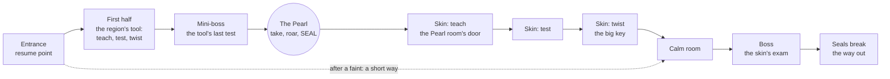

# The Pearl inside the dungeon: the rework plan

*Status: a plan for the owner (2026-10-17). **Built so far** (2026-10-17, build order 2 and the
seal's art from 3): the shared pieces, as proposed: the seal (`object.dungeon-seal`, the record, the
refused travels out, the resume), the Pearl's take with the roar and the 1.5 s glimpse, the boss's
`EnragedLook` and his name red on the boss bar, the far-off roars, `?sealed`, Fatty's full heart in
the Lair's builder, and a sealed example in the dungeon lab: [DUNGEONS.md](../godot/DUNGEONS.md#the-seal).
Not built from them: the music's drums (open point 4) and the journal's slot (no journal has Pearl
slots yet; open point 13). The dungeons' own reworks are their builders' work. It carries the owner's decision of
2026-10-17 ([decisions archive](../story/07-decisions-archive.md#decisions-by-date), "the Pearl
inside the dungeon") through the three built dungeons and the skins. Roadmap
[12.8](../GAME_ROADMAP.md) is the rework, and [7.8](../GAME_ROADMAP.md) the skins. Where a choice was
open it is made here as a **Proposal**. The builders build the proposals, and the owner reviews them
in play; every proposal is listed again in [Open points](#open-points). It reworks the built
dungeons as [DUNGEONS.md](../godot/DUNGEONS.md) describes them, and supersedes parts of their
designs ([Fatty's Lair](2026-10-16-dungeon-fattys-lair.md),
[the Weaver Hollow](2026-10-16-dungeon-weaver-hollow.md),
[the Crystal Mine](2026-10-16-dungeon-crystal-caverns.md)) and of the
[level design guide](2026-10-16-level-design.md)'s dungeon template. Fatty's Lair's way in moves to
`level-1-d5` (the owner, 2026-10-17): that overworld work is another task's; this plan covers the
Lair's inside only.*

*Pictures, drawn with Pillow in the style of the original plans and not in the repo yet:
`fattys-lair-pearl-plan.png`, `weaver-hollow-pearl-plan.png`, `crystal-mine-pearl-plan.png` (each:
the Pearl room, the seal's doors, the two halves shaded apart, the skin's locks in its colour, the
boss) and `pearl-pacing-overview.png` (the three side by side: tension by room, the Pearl's moment,
the boss). Their scripts sit beside the originals': `src/lair_pearl_plan.py`,
`weaver_pearl_plan.py`, `mine_pearl_plan.py`, `pearl_pacing_overview.py`.*

## The decision in one paragraph

Each dungeon's Pearl lies inside it, before its boss, like Zelda's dungeon item: the boss cannot
swallow it whole, so he hides it close by to draw on its power. When the slime takes it, the boss
notices, enraged, though his strength stays the same, and seals the dungeon's exits: the only way
out is to beat him. The second half of the dungeon teaches the Pearl's skin, and the boss fight is
the skin's exam. Fainting or quitting after the Pearl resumes at the entrance, inside, with the doors
to the outside still sealed until the boss falls. The Pearl still goes home to the Wellspring
afterwards.

## The shape every dungeon takes

- **Proposal: the mini-boss guards the Pearl.** Each built dungeon already has a mini-boss whose
  reward room held the big key: the Big Squint and Fatty's hoard, the Brood Warden and the Hoard, the
  Shardback and his Den. The Pearl takes the big chest's place there, as Ocarina of Time's
  mini-bosses guard the dungeon items. The first half then ends on the region's tool's last test, and
  the Pearl is its prize.
- The **big key** stays, for the boss door as built. It moves to the end of the second half, behind
  the skin's twist, except in the Weaver Hollow, where the second half lies behind the Crown Door and
  the big key stays in the Hoard beside the Pearl ([where they stand](#where-the-mini-boss-and-the-big-key-stand)).

## The shared pieces

### The Pearl room

- **The altar.** The Pearl rests on its altar (`decoration-world-solid--pearl-altar`, built) in the
  mini-boss's reward room. Its glow is seen from the room's door through the whole fight (a
  `object.prize-glint` over the altar: sight before reach), and the Pearl itself rises when the
  mini-boss falls: `object.pearl` (`pearl.gd`) with `boss_id` set to the mini-boss's id, so it shows
  once that fight is won. The Warden's room fight already has a `boss_id`; the Larder's and the Den's
  fights get one (`fatty-lair-big-squint`, `crystal-mine-shardback`), which records them in
  `defeated_boss_ids` as the kit does for every boss fight. (`boss_id = ""` shows a Pearl from the
  start; it is not needed here.) The Pearl's `skin_id` grants its skin.
- **The take.** Walked into, as built: the ceremony's card ("Pearl of the Wellspring (n of 8)", the
  skin's name, its gate and its move). The skin is won, and the Pearl makes it the slime's look
  (the skins agent's API). The journal's Pearl slot lights up (**Proposal**: the slot lights on the
  take; its part of the picture completes when the Pearl comes home).
- **The roar.** As the card closes, the boss roars from his room (his own cue: Fatty's bellow, the
  Matron's shriek, the Colossus's grinding roar), the camera shakes hard and dust falls over the
  screen (crystal dust in the Mine, silk dust in the Hollow). One line over the slime names it:
  "Fatty One Eye roars! The way out slams shut."
- **The glimpse** (**Proposal**): the view cuts for 1.5 s to the entrance's camera room, where the
  seal slams up out of the doorway with a boom and glows, then cuts back. It tells the player at once
  that the dungeon has changed. Fallback if it feels heavy: the line alone and the minimap's mark.
- **The skin's first lock** is the Pearl room's own way on: safe, no enemy, no fall, no timer, right
  where the skin is won (the guide's teach step). Lair: a plank barricade; Hollow: a web wall over
  the stair; Mine: a root wall up to the ledge door.

### The seal

- **What seals: every door that leads out of the dungeon, and nothing else.** That is the entrance
  (the doorway the slime came in by) and the way out past the boss (the bolt-hole, the Outer Bough's
  drop, the climb to the Lookout). Every door inside stays as it is, and everything opened for good
  stays open: bolts, winches, drawbridges, key doors, the lift, the cart, the maze's gate, cut web
  walls.
- **How it reads.** A new kit piece, **`object.dungeon-seal`** (`game/dungeon/dungeon_seal.gd`, on
  the kit's `shutter.gd`): the shutter's dressed-stone block, risen in the doorway, bound by a ring
  of light in the boss's colour (Fatty's mud red, the Matron's violet, the Colossus's smoky violet)
  around a dark pearl, pulsing slowly like a heartbeat. It slams up on the take (a boom, a shake) and
  glows; walked into, it hums and refuses: "Sealed. Fatty One Eye's rage holds it shut." Every hit
  and a bomb's blast are refused the same way. It takes no power, so it must never look like any
  lock in the look book: no crack, no web, no roots, no crystal, no keyhole, no eye.
  - Look book row (for the guide): *Seal: no power (the boss's fall breaks it). The kit's shutter
    bound by a glowing ring in the boss's colour round a dark pearl. Must never look like a cracked
    wall, a web wall, roots, a crystal veil, a key door or the boss door.*
  - On the minimap the sealed doorway is marked red while it is shut.
  - Travel doors that leave the dungeon's worlds (`door.gd` to another area, a `climb-wall` with an
    `exit_area_id`) also refuse while sealed, so no other way round a seal exists.
- **The dungeon's state** (`DungeonState`, `game/dungeon/dungeon_state.gd`): `seal()` on the take,
  `is_sealed()`, and `unseal()` when the dungeon's boss is beaten (the `Dungeon` node gets a
  `boss_id`; its defeat is already recorded in the dungeon's beaten bosses and
  `world.defeated_boss_ids`). Saved in the dungeon's record like everything done for good. A seal
  shutter reads `is_sealed()` when its world is built, so after a resume it is shut from the start.
  The seal never engages if the dungeon's boss is already beaten (an old save that beat a boss before
  the rework and takes the Pearl after).
- **Resume at the entrance, inside** (question 109, changed): unchanged in the kit. A faint wakes
  the slime at the entrance marker with full health; a quit writes the autosave at the entrance. The
  entrance's seal is shut behind it, and the way back to the second half and the boss door stays
  open (each dungeon's short way below). Saving stays off inside, and the autosave waits until the
  slime is out, as built.
- **When the boss falls:** "The seals break!" Every seal shutter sinks with a chime and stays down
  for good, the minimap's marks go, and the way out past the boss opens. No glimpse: the slime walks
  out through them.
- **While sealed** (**Proposal**, presentation only): every 45 to 60 s the boss's roar sounds,
  distant, with a light shake and a little dust, and the dungeon's music carries the boss's drums
  under it. Nothing in play changes.
- Dev: `?sealed` (with `map=`) starts a dungeon with its Pearl taken and the seal shut.

### The boss door, the enraged tell, the drop

- **The boss door** keeps its big key (`object.boss-door`, `lock = "big"`), as built. The boss is
  awake when the slime comes in: his room fight or camp starts as built, with his roar.
- **Enraged, same strength.** A presentation component on each boss, **`EnragedLook`**: on from his
  first frame, since the Pearl is always taken first. A slow red pulse over his art, puffs of steam
  or dust, a fiercer idle and a roar on engage; his name on the boss bar in red. No number changes:
  his health, damage, speed and patterns are the built ones.
  - Fatty: flushed red, steam from his top, his eye bloodshot.
  - The Matron: her eyes blaze through the silk, which darkens to violet.
  - The Colossus: his crystal seams glow red-violet. *(His built below-half state is named
    "enraged" in code, `enragedShare`; **Proposal:** call it his second phase in the docs and rename
    the key `phaseTwoShare`, so the two never mix.)*
- **What the boss drops now:** the **full heart** (`object.full-heart`: +20 max HP and +20 max
  energy, questions 17 and 19). **Proposal:** Fatty's built boss heart (`goo_heart.gd`, `hearts` 2)
  becomes the same `object.full-heart`, so all three raise max energy too. The Pearl is already the
  slime's. The Matron still leaves her thread, and the Lair still holds the green key (in R14, on the
  way out). Afterwards the journal points home, and the Pearl's homecoming at the Wellspring plays as
  planned (roadmap 5.17).

### Why the boss keeps his strength, and why he shrinks

The premise says bosses shrink back and calm down when the Pearl leaves them; the decision says the
slime takes the Pearl before the fight and the boss keeps his strength.

- **Proposal:** over the years each boss soaked up the Pearl's power by keeping it close: that is
  what swelled him. Taking the Pearl does not weaken him at once (he is still full of it, and
  furious), so his strength stays the same. Beating him lets the soaked-up power out: it pours from
  him in a stream of light into the Pearl the slime carries, and he shrinks back to his own size and
  calms down.
  - Fatty: the light pours out through his eye (it replaces "the Pearl pops from his eye"), and he
    shrinks into a small, calm one-eyed slime, as built.
  - The Matron: she shrinks into a plain big orb-weaver and scuttles off through her web, as built.
  - The Colossus: his crystal sheds in shards, and he shrinks into a small crystal golem that
    wanders off into the deep workings.
- **The Colossus's lore** ("a golem of crystal grown around Pearl 3", "the Pearl in his chest made
  him part beast"), **Proposal:** he grew from the mine's crystal, fed for years by Pearl 3's glow
  where he keeps it, in the Shardback's Den, a vault of crystal right above his arena. Its power,
  soaked up, made him part beast: he climbs his walls on crystal claws. So the Pearl's power still
  shows in his fight, and the Feral skin it gives lets the slime climb after him.

### Anything the slime must leave for comes before the Pearl

| Dungeon | What lies outside | Where it falls now |
|---|---|---|
| Fatty's Lair | Nothing the main path needs. Burr walks out after he is freed (first half). The Lantern and Goo Bomb side rooms are come-backs for later chapters, after the seal is gone | Fine |
| The Weaver Hollow | The Goo Bomb (Tom) before its gate; nothing inside needs the outside. The forecourt's S1 (Silk) waits for the way out | Fine |
| The Crystal Mine | **The Bow, from Burr in the West village**, for the Chasm's lens | **The Chasm is the first half's last lock, before the Pearl.** The smith sends the slime to Burr at the camp; a slime that reaches the Chasm without the Bow rides the cart to M1, walks out, comes back with it. Question 134 changes from "the Caverns' first half never needs the Bow" to "nothing before the Chasm needs the Bow, and the Chasm comes before the Pearl" |

### Where the mini-boss and the big key stand

| Dungeon | Mini-boss | The Pearl | The big key | The boss door |
|---|---|---|---|---|
| Fatty's Lair | the Big Squint, R12 the Larder (as built) | in the Larder: Fatty's hoard, where the big chest rose | R9 the Watcher Hall, the second half's twist (a plate raises the hidden big chest) | the hub's north ledge (as built) |
| The Weaver Hollow | the Brood Warden, B5 (as built) | in the Hoard, beside the big chest | the Hoard (as built) | the Crown Door on T2's gallery (as built); the second half lies behind it, and C1's new K3 door leads into the Crown |
| The Crystal Mine | the Shardback, M13 the Den (as built) | in the Den, where the big chest rose | M12 the Fort Hall's new balcony, the second half's twist | the shaft floor's east wall (as built) |

### What the dungeon template becomes

For the level design guide, as this plan applies it (the guide is aligned by its own update):

- The dungeon **holds its item: the Pearl**, guarded by the mini-boss halfway.
- **The first half** uses what the slime brings and teaches, tests and twists the region's tool;
  the mini-boss is its last test. **The second half** teaches, tests and twists the Pearl's skin, one
  idea a room; the boss is the skin's exam and uses the tool too.
- **The skin's first lock is the Pearl room's own door** (rule 6 of the rules that matter most
  changes from "each boss's way out uses the skin it gives"). The way out after the boss uses the
  skin once more, as a last flourish.
- **Everything the slime must leave the dungeon for comes before the Pearl.**
- **The seal:** from the take until the boss falls, every door out is shut. By the time of the take,
  a short way from the entrance to the second half and to the boss door exists or is opened in it.
- Size stays 8 to 14 rooms on the main path, 20 to 35 minutes (the Mine runs a little over).

## Fatty's Lair (Chapter 1, the Heavy skin)

*Built 2026-10-17 as below ([DUNGEONS.md](../godot/DUNGEONS.md#fattys-lair-built)), with these
choices made in the build: the Larder's north doorway is at its lx 10..11 with the altar on the
north wall west of it; the Weigh House's first plate opens the inner wall's east door (the slime's
weight) and the statue's plate holds the west door to R10's lane (`shut_on_leave`: only while a
weight stays), so the teach goes stand first, statue second; R10's plate is a `shut_on_leave` one
too, so the statue, not the slime, must hold R9's door; R9's statues stand on the cell lattice and
its big chest in a notch of the south rim; R13's north shutter gave its doorway to the seal; heavy
blocks reset with their room (the Lair's director). The fall's stream of light into the Pearl is a
run of sparkles; Fatty's shrinking into a small slime is not built (his death clip plays).*

Picture: `fattys-lair-pearl-plan.png`. The rooms as built ([DUNGEONS.md](../godot/DUNGEONS.md#fattys-lair-built)):
columns A to E, rows 2 to 6; the Deep is the north-west block, one floor down by the Inner Stair.

### The Pearl room: R12 the Larder

The Big Squint's ambush (shutters, `once`) as built; Fatty's hoard, the army's winter stores, heaped
round the walls, and on the north wall the worms' altar with Pearl 1's glow over it. The Big Squint
falls, the shutters open and Pearl 1 rises where the big chest rose. The take, Fatty's bellow from
his drill hall next door, the glimpse of R1's seal. The Larder's new north doorway is nailed shut
with an `object.plank-barricade`: the Heavy skin's first lock (below).

### The first half: as built, shortened

R1 the Gatehouse (the entrance and the resume point), R2 the Slab Steps, R3 the Pit Hall (the hub),
the west wing (R4 the Squints, R5 the eye latches: K1), the east wing (R6 the Pipe Worms, R7 the bell
and the turning bridge: K2), Burr's cell (two keyholes; his winch opens the Inner Stair), then the
Deep: R8 the Guard Crypt (the Bone Marchers), R11 the Drop-gate Bridge (the Roll's conclusion), R12
the Larder. It tests what the slime brings: the Roll, the Spear, the Gulp's throw.

- **R2 tests the slabs**, since the Roll is now tried outside on the way in (the overworld work's
  slab crossing in `level-1-d5`). Nothing in it changes.
- **Door 3** (R8 to R11, a small-key door) becomes an open doorway, and key 3 goes: R10, where it
  lay, moves to the second half.

### The second half: the Heavy skin, one idea a room

| Step | Room | Its one idea | The locks (objects) |
|---|---|---|---|
| Teach | **R12's north door** | A Roll that hits old planks now smashes them: the Lair's own tool, with a new result. The strong shake and daylight-coloured dust | `object.plank-barricade` (the built one, as the bolt-hole's) |
| Teach | **The Weigh House** (new, C2, an empty screen) | Weight: the slime's sinks a plate; a statue's holds one. The Thorn Guard's old weighing hall, no enemy. A heavy plate before the stone door west (stand: it sinks over 3 s, the slime turns stony; the door opens while it rises); a second plate holds the inner door only while a statue stands on it. **Optional:** an old scale pan with a pouch on the east wall; a Heavy Roll into that wall shakes it down | two `object.heavy-plate`, one `object.heavy-statue`, two stone doors (`object.latch-door`'s gate without a latch, opened by the plates' `gate_id`); `object.loose-prize` (coming) |
| Test | **R10 the Dung Roller Run** (reworked) | A block in a patrolled lane. The Dung Roller (met here first, alone) rolls its ball end to end; a heavy plate lies in the lane before the stone door to R9, and a statue waits in a north niche. Push the statue into the lane and onto the plate while the ball is away: the ball turns back at it, and the plate holds R9's door open | `object.heavy-plate`, `object.heavy-statue`; R9's north stone door (its eye latch goes). The Squint, key 3's chest and R10's bolted door to R8 go |
| Twist | **R9 the Watcher Hall** (reworked) | Cover that moves under the eye. The Watcher Eye (met here first, alone) drifts among its four armour statues; a plate in the open, in its sight, raises the hidden big chest in the south alcove. Push a statue between the eye and the plate and sink it from behind it, or push a statue onto the plate. **The big key** | four `object.heavy-statue` (built), `object.heavy-plate`, the big chest moved from the Larder (`hidden`, risen by the plate); R9's east door becomes an `object.bolted-door`, bolt on R9's side |
| Known | **R3, the counterweight plate** (*changed 2026-10-19, owner: two plates that are not heavy, one held by the freed Burr, the other by the slime, in the first half; see DUNGEONS.md "The main path" step 5*) | The drawbridge's chains run to a heavy plate on the hub's south walk, seen on the very first visit ("It does not budge under you."). Sunk, it lowers the drawbridge for good: the short way to the boss door | `object.heavy-plate` with a new `targets` list (set off through `DungeonState.fire` when it is fully down, as a winch's are), here `object.drawbridge`; R9's plate uses the same list for the big chest. The north ledge's winch goes |
| Calm | the north ledge (as built) | pots with hearts, an energy flower | — |
| Exam | **R13 Fatty's Arena** | [Fatty](#fattys-exam) | — |
| After | R14 and the bolt-hole | the green key; a Heavy Roll through the bolt-hole's barricade into daylight, where Burr waits | the built `object.plank-barricade` |

The second half's path: R12, the barricade, the Weigh House, R10, R9, its bolt into R8, the Inner
Stair up, the hub's plate, the drawbridge, the ledge, the boss door.

- **The way back after a resume:** R1, the bolt to the hub, the drawbridge (once the plate has sunk
  it), the ledge and the boss door: two rooms. Before the drawbridge is down: R1, the hub, the Inner
  Stair, R8, R9 (its bolt opened from inside) or door 3 and R11 to the Larder.
- **R1's Quartermaster's store** (a plank barricade, a Heavy come-back) now opens inside, after the
  Pearl, on the walk back after a faint or at the end: an optional reward for the new skin.
- **The look book's Heavy locks used:** the plank barricade (the Heavy Roll), heavy plates, armour
  statues as heavy blocks (every armour statue in a dungeon is one), and the coming loose prize.
  None stands beside a lock of another power (the hub's plate is far from Burr's cell; R1's store is
  in the corner away from the seal).
- **The Heavy skin's first test moves inside.** The plate's "first use on the walk home with Pearl
  1" becomes its second: the forest path to the Wellspring keeps its Pearl 1 lock as a heavy plate,
  now a short test outside.

### Fatty's exam

His fight as built ([specs/boss.md](../godot/specs/boss.md), `fatty.gd`), with the enraged look and
one change in phase 2. The owner's hints were heavy plates in the arena, or a Heavy Roll that knocks
him off balance. **Proposal:** the Heavy Roll, since the Lair is the Roll's dungeon and the Heavy
Roll is the Roll made heavy.

- **Phase 1** (as built): he chases, hops, leaps behind his shadow, lands in a ring; 700 ms of
  recovery with his eye open: the Spear. It tests the first half (the Squint's lesson).
- **Phase 2** (below half his health): two leaps in a row, the clods falling from the roots, the mud
  ripple a Roll's i-frames pass (as built). His eye stays squinted shut and he braces after his
  landings: every hit clinks. **A Heavy Roll into him while he is on the ground knocks him off
  balance:** he rocks back onto his back, wobbling, eye wide, for 1.6 s (the built
  `phase_two_dizzy_ms`): the Spear. A thrown clod no longer dizzies him ("It splats. Fatty hardly
  notices."); the clods stay as falling hazards.
- **Without the skin** (impossible on the main path now) a Roll bonks off him, as built.
- **His fall:** the power pours out through his eye into Pearl 1, he shrinks into a small calm slime,
  the full heart rises, the seals break, R13's north door (the seal) sinks.
- *Other way (open point):* the drill hall's heavy plates: two plates at the side walls drop the
  hall's old training weights on marked flagstones; the slime holds a plate down while Fatty's leap
  comes down on the mark.

### What moves, what goes, what is new

- **Moves:** Pearl 1 from R14 to the Larder; the big key from the Larder to R9; the green key stays
  in R14 (now the anteroom of the way out).
- **Goes:** door 3's lock and key 3; R10's Squint, its key chest and its bolted door to R8; R9's eye
  latch; the north ledge's winch; R14's altar; the thrown clod's dizzy in phase 2.
- **New:** the Weigh House (C2) and its doorways (from the Larder, to R10); the Larder's north
  doorway with its barricade; R9's bolted door; the plates and statues of C2, R10, R9 and the hub; the
  seal shutters in R1's south doorway and R13's north doorway; Fatty's topple; the full heart in place
  of the goo heart.
- **The builder:** all of it is `godot/tools/build_fattys_lair.gd` edits (the room table, the
  doorways, the objects), then a bake; the art exists (the kit, the fort's masonry, the plates,
  statues and barricades). New art: scale pans and weights to dress the Weigh House (props).

### Size and time

14 rooms on the main path (R1 to R12 minus R9 and R10 in the first half; C2, R10 and R9 in the
second; R13), about **30 minutes** on a first play: the first half 16, the second 9, Fatty and the
way out 5. Build: **M** (a day of agent work with Fatty's change).

## The Weaver Hollow (Chapter 2, the Silk skin)

Picture: `weaver-hollow-pearl-plan.png`. The four floors as built
([DUNGEONS.md](../godot/DUNGEONS.md#the-weaver-hollow-built)).

### The Pearl room: the Hoard

The Brood Warden's den as built (B5, its room fight, its shutter); won, the Hoard's shutter sinks and
the vault opens: the big chest with the big key (as built) and, on the brood's altar beside it,
Pearl 2 (`object.pearl-two` moved out of the Crown's camp, `boss_id` the Warden's fight). Its glow
shows through the Hoard's shutter gap during the fight. The take, the Matron's shriek from the Crown,
the glimpse of T1's seal. The Hoard's stair down to the gallery is choked with old silk: a web wall.

### The first half: as built, a little shorter

The forecourt (the bomb blows the root gate), T1, T2 the hub, T3 (two cracks, the map in T4's
sealed nook), T4 (the cracked floor), the Roots (R1, R2's cast in cover for K1, R3's drop gate and
ladder), T2's east door (K1), B1, B2 (the bomb over the void), B3 (the Mimic: K2), B5 (the Warden),
the Hoard. It is the Goo Bomb's test and twist, and the Warden (a blast plants it) its last test.

- **B4 the Nursery and B6 the Pillar become an optional wing** (the built proposal "if it plays
  long, the Pillar room goes first", taken further): the ambush stays, its chest holds coins and a
  potion instead of K3, and the Pillar keeps its keg chain and its heart. **The Warden's double door
  takes one key** (K2); K3 moves to the second half.

### The second half: the Silk skin, the climb to her

| Step | Room | Its one idea | The locks (objects) |
|---|---|---|---|
| Teach | **The Hoard's stair** | Silk no longer holds you: a web wall over the stair, passed at half speed, or cut for good with the Spear. Its silk spills down the gallery's west end, seen from the hub's floor on the first visit | `object.web-wall` |
| Calm | **T2's gallery** (as built) | the pots, the flower; its winch sinks the stair block: the short way down to T1 | the built winch and shutter |
| Door | **the Crown Door** | the big key (as built) | `object.boss-door` |
| Test | **C1 the Crown Stair** (reworked) | Webs everywhere, and they no longer slow or stick: the stair is painted with floor webs from wall to wall, which the plain slime could only wade, and the Roll now crosses them. A web wall across the stair's straight way: cut it for good, and the retry after a faint is quick. At the top, the K3 door into the Crown and a few pots (the calm spot before her) | painted floor webs (WebLayer), `object.web-wall`, `object.key-door` (one keyhole), `object.dungeon-pot` |
| Twist | **C4 the Spinning Loft** (new, the Crown floor's empty screen east of C1) | Silk under fire. Rows of web walls across the loft; two Slime Spiders (known from Gloop Forest; with the skin their webs no longer stick, question 131) line up and shoot while the slime wades a wall at half speed: wade under fire, or stop and cut a lane. K3 lies in a silk parcel on the far side; the Spear cuts it free (a key wrapped in silk, the lock table's twist) | `object.web-wall`, `object.silk-parcel`, painted floor webs; two Slime Spiders |
| Exam | **C2 the Crown** | [the Matron](#the-matrons-exam) | — |
| After | C3 the Outer Bough | her web wall (pass or cut), the drop to the forecourt by S1 | the built `object.web-wall` |

- **The way back after a resume:** T1, the hub, the stair block (once the gallery's winch is
  turned), the gallery, the Crown Door, C1 (its web wall cut), the K3 door: four rooms. Before the
  winch: T1, the hub, the east door, B1, B2, B5, the Hoard, its stair.
- **Come-backs that open inside now:** S3 (T1's web wall) and S2 (B3's parcels) can be opened on any
  walk after the Pearl; S1 (the forecourt) after the seal lifts, on the way out, as built.
- **The look book's Silk locks used:** web walls, painted floor webs, a silk parcel; the Slime
  Spider's webs. In C1 the web wall stands on the stair's straight way and the K3 door in the north
  doorway, apart; in C4 the walls and the parcel are the same power.
- **The Silk skin's first lock moves** from the Matron's thread to the Hoard's stair. Her thread
  stays in her web after her fall, now a known cut.

### The Matron's exam

Her fight as built ([specs/matron.md](../godot/specs/matron.md) section 8: the cocoon, a blast tears
it, 4 s open, a 1.5 s re-spin, three rounds of 100 of her 300 health), with the enraged look. The
decisions that assumed no Silk skin (her lash traps fully, the shapes cannot cut her webs, the 50%
slowdown) no longer hold: the slime arrives with Silk. **Proposal:** her webs no longer hold the
slime, and the Goo Bomb still tears her cocoon (question 133):

- **Round 1** (low cocoon, the floor clear): as built. Cast, spit, step back; torn, the Spear. Her
  volleys' floor webs no longer slow the slime: it walks them, silky.
- **Round 2** (under 200): **the web-wall cage.** In place of the built ring of floor webs, she spins
  a ring of web walls round her shadow (the same 130 px ring, `object.web-wall` segments spun again
  every `ring_reweb_ms`). A thrown bomb sticks in the cage's silk and blows there, out of reach of her
  shadow. The slime cuts a gap with the Spear, or wades a wall at half speed, and casts inside the
  ring. The Silk skin's cut and pass, under her volleys.
- **Round 3** (under 100): **the webbed floor and her brood.** Her volleys web most of the floor and
  two egg sacs drop by her shadow (as built). The webs no longer stick a Roll: the slime rolls through
  them to dodge the swarm and to set one blast on a sac and her shadow together.
- Her spit no longer roots (`apply_web` does nothing with the skin). If her three-way lash is built
  (roadmap 8.7), it pulls but never traps a silk-skinned slime.
- **Her fall:** the power pours out, she shrinks and scuttles off (as built), the full heart, her
  thread (the Spear cuts its strand: Burr's silk), the seals break: T1's and **C2's east doorway's**.
  *(Fixed while drawing: with the Silk skin in hand during the fight, C2's built east web wall would
  let the slime cut out to C3 and drop into the forecourt before she falls. A seal stands in that
  doorway now.)*

### What moves, what goes, what is new

- **Moves:** Pearl 2 from the Crown's camp to the Hoard; K3 from the Nursery's ambush to C4's
  parcel; the calm room's place in the order (the gallery now follows the Pearl, and C1's top gets
  pots before the boss).
- **Goes off the main path:** B4 and B6 (an optional bomb wing); the double door's second keyhole.
- **New:** C4 the Spinning Loft and its doorway from C1; C1's floor webs, web wall and K3 door; the
  Hoard's stair web wall; the seal shutters in T1's south doorway and C2's east doorway; the Matron's
  cage (round 2) and webbed floor (round 3).
- **The builder:** `godot/tools/weaver_hollow/hollow_floors.gd` (the rooms, doors and objects by
  cell), then `build_weaver_hollow.gd` and a bake; the Matron's rounds in `matron.gd` and
  `game/bosses/matron_cocoon_look.gd` (the cage reuses the web wall's art). New art: the loft's
  dressing (silk rafters), nothing else.

### Size and time

14 rooms on the main path (T1 to T4, R1 to R3, B1, B2, B3, B5 with the Hoard, C1, C4, C2), about
**32 minutes**: the first half 20, the second 7, the Matron 5. Build: **M**.

## The Crystal Mine (Chapter 3, the Feral skin)

*Built 2026-10-17 as below ([DUNGEONS.md](../godot/DUNGEONS.md#the-crystal-mine-built)), with
these changes made in the build: the Den lies one level below the Chasm, reached down a front flight
of stairs from the far rim, so its ledge door is level with M11; its broken south rim is four cells
wide (a two-cell notch left no walkable rim) behind two shutters, and the roots down the shaft's
wall climb one level (the rim at -1 to the floor at -2); M11's rift is a T: its stem runs down
between the two landings from the north wall and its floor along the south, each landing's face two
levels; the veil stands across the mouth of M10's doorway (its brazier on the east landing and one
on M10's side), so the wing is reached only after the rift; M12's balcony is held apart from the
mine's rock top by the hall's north band raised to level 3; the arena has four root walls beside his
three climb spots (they end on the face at his height) and the climb out at x 61, its seal at its
foot; stunned, his open back takes a Spear hit from any side; the boss name in the seal's lines is
"The Crystal Colossus".*

Picture: `crystal-mine-pearl-plan.png`. The rooms as built
([DUNGEONS.md](../godot/DUNGEONS.md#the-crystal-mine-built)): screens by column and row, M1 at
(1, 4).

### The Pearl room: M13 the Shardback's Den

Reached now straight from the Chasm: a new doorway on M9's far side leads down into the Den (and
M9's east doorway to M10 is bricked up). The Shardback fight as built (dark 6: fire light makes his
shell brittle, the Lantern's twist and last test), `once`. Won, Pearl 3 rises where the big chest
rose: this vault of crystal is where the Colossus keeps it (the lore above). The take, the
Colossus's roar (crystal dust, the veins flare violet), the glimpse of M1's seal. The Den's east
doorway (the built Den door, its lock gone) now stands on a ledge one level up: the first climb.

### The first half: as built, ending at the Chasm

The camp (the Lantern; the smith sends the slime to Burr), M1, M2 (dark 1), M5 (dark 2: K1), the hub,
M6 (dark 3; the rotten timbers, a Heavy Roll), M7 (the Pick Mole: K2; the Bone Leaper alone), the
Foreman's Gate, M8 the Dark Maze (dark 4, the set piece), M9 the Chasm (the Bow's lens lowers the
bridge), M13 the Den. The Bow is needed once, at the Chasm, before the Pearl.

- **M10 the Prism Gallery and M11's veil become an optional Lantern wing:** from M11's south part,
  the veil (light its brazier, cross under the bats) leads north to M10 (the Prism Eye, the heavy ore
  crate), whose chest now holds the war journal page that lay on M12's stand.

### The second half: the Feral skin, one idea a room

| Step | Room | Its one idea | The locks (objects) |
|---|---|---|---|
| Teach | **The Den's ledge door** | Hold W at roots and handholds: the slime climbs. One level, no enemy (the Shardback is gone for good), no cost if it lets go | `climb-wall.tscn` (one level) |
| Test | **M11, the rift** (its south part repainted) | Up and down. A rift two levels deep crosses the way from the Den's door to M12's: climb down one face, cross the rift's floor, climb up the other. Dark (the ember's glow shows the handholds) | two `climb-wall`s; the rift painted on the `elevation` layer |
| Twist | **M12 the Fort Hall** (reworked) | A climb under a watcher. A balcony two levels up along the hall's north wall holds the big chest; two root walls climb to it. A climbing slime cannot hide or dodge: the Watcher Eye's beam finds it, and the Bone Marcher's loop passes the walls' feet, so the slime starts a climb when the eye looks away and the Marcher has passed. The Spear, twice as fast now, drops the Marcher quickly. **The big key.** A drop from the balcony's west end lands by the west door | two `climb-wall`s, `object.dungeon-big-chest`; the Watcher Eye and the Bone Marcher as built; the five statues stay as cover, at least three cells from the root walls (a climbable wall never beside a heavy block). The dais's K3 chest and the Den door's lock go |
| Known | **The shaft's north wall** | From the Den's broken south rim, roots and handholds run down the shaft's face to its floor: climb down (or let go: no cost). Seen from the hub's gallery on the very first visit. Two-way: it is also the short way up from the shaft floor to the Den | `climb-wall` (two levels) |
| Calm | M14 the shaft floor (as built) | pots, the refill, the lift's crank (raise it: the short way to the gallery) | — |
| Exam | **M15 the Colossus's Arena** | [the Colossus](#the-colossuss-exam) | — |
| After | the climb out to the Lookout (as built) | the exploration message in daylight (as built) | the built `climb-wall` with its exit |

- **The way back after a resume:** M1, the cart to the Chasm (it runs both ways once found, inside
  the seal), the Den: two rides and a walk. Or M1, M2, the hub, the lift (once raised), the shaft
  floor and the boss door; and from the floor the root wall up to the Den.
- **Come-backs that open inside now:** S5, M1's roots to the shelf (a war journal page), on any walk
  after the Pearl.
- **The look book's Feral locks used:** thick, living roots beside rocky handholds on a cliff face.
  None stands next to the root-rock wall style or a heavy block; the Den's braziers and M11's veil
  are well apart from the climbs.
- **The Feral skin's first lock moves** from the arena's climb-out to the Den's ledge door. The
  climb-out stays as the way out, a last flourish.

### The Colossus's exam

His fight as built (`crystal_colossus.gd`, `colossus_arena.gd`: the four braziers, the weak spot on
a random side, the stomps that put braziers out, the climb and the mites), with the enraged look and
the slime able to climb. The owner's hint: he climbs his walls and throws mites, and the slime climbs
after him. **Proposal:**

- **On the floor** (as built): the Lantern's exam. All four braziers lit bare a weak spot on one
  side; the Spear there; his stomps put the braziers out.
- **On the wall** (new): the Feral skin's exam. After three stomps he leaps onto the north wall at
  the climb spot nearest the slime and clings there, throwing Crystal Mites (as built). Roots and
  handholds run beside each of his climb spots (`climb-wall`s on the arena's north wall). The slime
  climbs after him; a mite's hit knocks it off the wall, at no cost. Level with him, the Spear, twice
  as fast, strikes his gripping claws: **three hits** (`clawHits`) and he loses his grip, crashes down
  with no landing stomp (no brazier goes out) and lies stunned **2.5 s** (`fallStunMs`), his back
  cracked open for the Spear. If the slime does not reach him, he leaps down as built and his landing
  puts a brazier out.
- His numbers stay as built; the two new ones are the claws' hits and the stun.
- **His fall:** the power pours out, he sheds his crystal and shrinks into a small golem, the full
  heart rises, the four braziers burn for good (as built), the seals break: M1's and the crystal over
  the daylight crack at the top of the north wall, the climb to the Lookout.

### What moves, what goes, what is new

- **Moves:** Pearl 3 from where the Colossus falls to the Den (`object.pearl-three`, `boss_id` the
  Den's fight); the big key from the Den to M12's balcony; the war journal page from M12 to M10.
- **Goes:** M9's doorway east to M10; K3 and the Den door's keyhole; the dais chest; the Pearl in his
  arena.
- **New:** M9's far side's doorway south into the Den; the Den's ledge and root wall; M11's rift; M12's
  balcony, root walls and drop; the shaft's north-wall root wall; the arena's root walls at the climb
  spots; the claws and the stun; the seal shutters in M1's south doorway and at the top of the arena's
  climb.
- **The builder:** `godot/tools/build_crystal_mine.gd` (the doorways list, the paint, the rooms'
  objects), then a bake; the Colossus in `crystal_colossus.gd`. Art: the root wall exists
  (`climb-wall.tscn`); the balcony is painted ground; nothing new beyond the seal.

### Size and time

13 rooms on the main path (M1, M2, M5, M4, M6, M7, M8, M9, M13, M11, M12, M14, M15), about **40
minutes** with the camp: the first half 25, the second 7, the Colossus and the climb 8. Over the
guide's 35, as the built mine already was; **Proposal:** keep it, since the maze and the six dark
rooms are the chapter's heart. Build: **L** (the climbs and the Colossus's wall phase need the real
Feral climb).

## The skins, for real (roadmap 7.8)

Each skin is now taught inside its own dungeon, so 7.8 comes first. The owner's rules
([Direction](../story/01-direction.md#the-skins)):

- **Always on once won.** A skin is never put on, taken off or switched; its powers stack, and none
  has a downside (Heavy does not slow the slime). No keys: the controls stay attack, shape, mouth,
  ability, roll and interact; the Feral climb is a held interact.
- **It shows while it works:** stony on a heavy plate or on a grab, silky in a web, claws when
  climbing. The rest of the time the slime looks as itself, or as its everyday look.
- **The everyday look:** in the bag (B, which pauses the game, as for abilities; question 42 is
  about abilities, not skins), a Skins row shows each won skin's card (its gate and its move); the
  player may pick one as the everyday look, cosmetic only, or the plain slime. The Pearl's take makes
  its skin the look.
- **The check** everywhere: `SkinState.is_on(player, SkinState.HEAVY / SILK / FERAL)` (the skins
  agent's API). The Pearl (`pearl.gd`, `pearl.tscn`, `pearl-two`, `pearl-three`) grants by its
  `skin_id`. The run keeps the won skins and the look in the player's record; an old save's
  `skin.*` and `pearl.*` flags become won skins once, when it loads.

| Skin | Its gate | Its change to a move | Its look while it works | Its locks (objects) |
|---|---|---|---|---|
| **Heavy** (Pearl 1) | Sinks heavy plates (feet on the plate, not airborne); grabs and moves heavy blocks with a held interact, one cell a move | **The Heavy Roll:** the Roll's bonk carries the `heavy` tag: it smashes old built or dead things in the way, breaks loose rocks, rubble heaps and rotten trunks, shakes loose what hangs on what it hits, and its screen shake is strong. No enemy push (a later upgrade) | stony: as a plate sinks under it, while it grabs or pushes a block, and on a Heavy Roll's impact | `object.heavy-plate`, `object.heavy-block` / `object.heavy-statue` / `heavy-ore-crate`, `object.plank-barricade`, `rotten-timbers`, `object.rubble-heap`; coming `object.loose-rock`, `object.old-trunk`, `object.old-fence`, `object.loose-prize`. (`object.pressure-plate`, the light plate, needs no skin) |
| **Silk** (Pearl 2) | Floor webs no longer slow it and a Roll no longer sticks in them; web walls are passed at half speed; spit webs no longer root it | **The cut:** a shape's hit (the Spear in Release 1) cuts a web wall open for good and frees what is wrapped in silk | silky: a pale sheen and trailing threads while it is in a web or a web wall | painted floor webs (WebLayer) and `object.floor-web`, `object.web-wall`, `object.silk-parcel`, `object.spider-web`; the Matron's patches, cage and thread |
| **Feral** (Pearl 3) | Climbs walls of thick roots and rocky handholds: a held interact at the foot climbs up or down the face (`skins.feral.climbSpeed`); letting go drops the slime at no cost; at the top it takes the ledge's level. **Proposal:** it can strike while it clings (a thrust along the face, for the Colossus's claws), and a hit knocks it off | **The Spear hits twice as fast.** **Proposal:** the Spear chain's wind-up, active, recovery and rest times are halved; each hit's damage and the charged Lunge stay as they are | claws, while it climbs | `climb-wall.tscn`; a climbable wall never stands beside a heavy block, and a held interact next to both does whichever the slime faces (question 91) |

### What replaces the stand-ins

| Stand-in today | Becomes |
|---|---|
| The story flags `skin.heavy`, `skin.silk`, `skin.feral` (set by `pearl.gd`) | Won skins in `SkinState`, granted by the Pearl's `skin_id`; old flags read once |
| `game/fattys_lair/heavy_check.gd` (`is_heavy`, `is_heavy_roll`: the Stone form or the flag) | `SkinState.is_on(player, SkinState.HEAVY)`; the Roll adds the `heavy` tag (`player_roll.gd` `is_heavy()`), so the barricade, the timbers, the rubble, the Thorn Guard statue and the patterned enemies keep reading the tag |
| `heavy_plate.gd`'s `presses_plates` (the Stone form) and `heavy_grab.gd`'s Stone-form check; the line "Too heavy... I need to be stone." | The Heavy skin; the line becomes "Too heavy to move." / "It does not budge under you." |
| `player.crosses_webs()` reading the Silk form or `skin.silk` | `SkinState.is_on(player, SkinState.SILK)`, the one hook every web reads |
| `climb_wall.gd`'s flag check and scripted three-pull climb | The real held climb, up and down, with the drop and the claws; the walls keep their places and looks |
| The Stone and Silk Gulp forms (`GulpForms.HEAVY`, `STICKY`), the stone and silk essences, Swallow | Removed with roadmap 7.11 once the three skins are in; their art to `asset/to-delete/` |
| The Swim form (`GulpForms.FROG`, `player_swimming.gd`) | **Kept:** its swimming is refactored into the later Swim skin's power behind `SkinState`, not granted in Release 1 (question 75) |
| `dungeon.devPowers` lending the flags for F6 runs | Lends the skins through `SkinState`; a `?skins=heavy,silk,feral` launch option for any world |

## Loose ends settled

The contradictions the decision left open, each settled as a proposal:

1. **The Matron's fight assumed no Silk skin.** It becomes the Silk skin's exam with the Goo Bomb
   still tearing her cocoon: [the Matron's exam](#the-matrons-exam).
2. **The Colossus's lore.** He grew from crystal fed by Pearl 3's glow in the Den, and its soaked-up
   power made him part beast: [lore](#why-the-boss-keeps-his-strength-and-why-he-shrinks). His
   fight is the Feral exam: [the Colossus's exam](#the-colossuss-exam).
3. **Bosses shrinking against "his strength stays the same".** He soaked the Pearl's power up over
   the years; taking the Pearl does not drain him; beating him lets it out, and he shrinks back.
4. **Sealing against things opened for good.** Only the doors out seal, with one kit piece; all else
   opened stays open, and the seals break when he falls:

   | Dungeon | What seals (from the take to his fall) | What stays open | After the boss |
   |---|---|---|---|
   | Fatty's Lair | R1's south doorway (the way in; its outer gate stays up, held by the inner winch, but the seal stands inside it); R13's north doorway (the way to the bolt-hole) | the bolt to the hub, the other bolts, Burr's door, door 3, the drawbridge once down | both seals sink; the outer gate is still up for good; the bolt-hole's barricade waits for a Heavy Roll |
   | The Weaver Hollow | T1's south doorway (the blown root gate outside stays blown); C2's east doorway (the way to C3's drop) | the hatch, the drawbridges, the key doors, the stair block once sunk, cut web walls | both sink; C3's web wall and drop as built |
   | The Crystal Mine | M1's south doorway (the camp's lantern gate outside stays open); the top of the arena's climb (the tunnel to the Lookout) | the cart (Chasm and M1 are both inside), the lift, M1's iron shutter, the Foreman's Gate, the maze's gate, the Chasm's bridge | both break; the climb-out to the Lookout as built |
5. **Where the mini-boss and the big key stand:** [the table](#where-the-mini-boss-and-the-big-key-stand).
6. **The Bow and the Chasm:** the Chasm comes before Pearl 3, as the first half's last lock; nothing
   before it needs the Bow; question 134 reads "nothing before the Chasm needs the Bow".
7. **The Heavy skin's first test** moves into the Lair (the barricade, the Weigh House, R10, R9, the
   hub's plate); the Wellspring path's heavy plate becomes a test outside.
8. **What in questions 137 to 139 is now moot, and what replaces it:**

   | Built proposal | Now |
   |---|---|
   | 137: the way out is a plank barricade a Heavy Roll breaks; the plate's first use is on the walk home | The barricade is the Larder's north door, the skin's first lock right at the Pearl; the bolt-hole's barricade stays as the last flourish; the plate's first use is the Weigh House |
   | 137: the outer gate stays up once the inner winch turns | Still, and the seal stands inside R1's doorway from the take until Fatty falls |
   | 137: Fatty's second phase throws clods and sends a ripple a Roll passes | The ripple and the clods stay; a Heavy Roll topples him, and a thrown clod no longer dizzies him |
   | 138: the way out drops into the forecourt | Still, behind C2's east seal until she falls |
   | 138: the cocoon opens about 4 s, re-spins in 1.5 s, three rounds | The timings stay; rounds 2 and 3 become the cage and the webbed floor |
   | 138: if it plays long, the Pillar room goes first | Done: B4 and B6 are an optional wing |
   | 139: the exploration message on stepping into daylight at the Lookout | Still, after the climb out |
   | 139: the mine is costed for 100 energy | Still: the climbs are free, the second half asks for no energy, the arena's 40 plus relights stand |
   | 139: a slime at the Chasm without the Bow is sent to Burr | Still, and it now comes before the Pearl |

## Checklist run

The guide's checklists, run on this plan (what failed while drawing it was changed):

**Readability**
- [x] Each half reads as one line: the first to the mini-boss's door, the second from the Pearl
      room's door to the boss door; the Pearl's glow is the landmark of the room before it.
- [x] Each second half's first lock is seen from the Pearl: the Larder's barricade, the Hoard's
      stair, the Den's ledge door.

**The clarity rule**
- [x] Every lock is in the look book with its one power; the seal is a new row with no power and a
      look of its own.
- [x] *Fixed:* M12's root walls and its armour statues (heavy blocks) stand at least three cells
      apart (a climbable wall never beside a heavy block).
- [x] No two powers' locks side by side: the Den's braziers and its root wall, M11's veil and its
      rift, C1's web wall and its K3 door, the hub's plate and Burr's cell all stand apart.
- [x] Every wrong tool is refused with a line: the seal's, the plates' and blocks' new lines, the
      cage's ("A thrown bomb sticks in the silk.").

**Every lock taught**
- [x] Each skin's first lock is safe and at the Pearl room's door; each second-half room asks one
      new thing about it; the boss uses it.
- [x] The main path needs no combo and no later power; the Bow (Chapter 3's second power) comes
      before Pearl 3.

**No softlock, the slime never trapped**
- [x] Nothing needed lies outside after the take ([the check](#anything-the-slime-must-leave-for-comes-before-the-pearl)).
- [x] After a resume the way back to the boss door is open in each dungeon; the seal never shuts an
      inner door.
- [x] *Fixed:* the ways out past each boss (the Lair's arena north door, the Crown's east door, the
      arena's climb-out) are sealed too, so no skin lets the slime slip out before the boss falls.
- [x] *Fixed:* the big key cannot be had without the Pearl: the Lair's R9 opens only through C2 and
      R10 (R9's door to R8 is bolted on R9's side); the Mine's M9 door to M10 is bricked, so M11 and
      M12 are reached only through the Den; the Hollow's Hoard stair needs the Silk skin.
- [x] Keys equal keyholes: the Lair K1 + K2 (Burr); the Hollow K1, K2, K3 for three single doors; the
      Mine K1 + K2 (the Foreman's Gate).
- [x] Heavy blocks reset with their room; plates are not saved; the drawbridge, the big chests and
      the bolts are.
- [x] Energy: the skins are free; no puzzle passes 100.

**Pacing**
- [x] The Pearl is each dungeon's turning point, right after its first-half peak (the mini-boss):
      the roar and the seal raise the tension, the teach room releases it, and the second half climbs
      again to the boss (`pearl-pacing-overview.png`).
- [x] A calm room before every boss door (the Lair's ledge, C1's top, the shaft floor).
- [x] Room counts: 14, 14 and 13 on the main path; the Mine at about 40 minutes stays over the
      guide's 35 (an open point).

## Open points

Each with its proposal; the builders build the proposals.

1. **The mini-boss guards the Pearl** in all three, the Pearl in the big chest's place. *Proposal:*
   yes. The other way: the Pearl in a quiet room of its own after a puzzle.
2. **The big key** stays for the boss door: the Lair's in R9, the Hollow's in the Hoard beside the
   Pearl, the Mine's on M12's balcony. *Proposal:* as written. The other way: no big key, and the
   roar unbars the boss door.
3. **The seal's look and the glimpse.** *Proposal:* one kit piece, the shutter bound by a glowing ring
   in the boss's colour round a dark pearl, and a 1.5 s camera glimpse of the entrance on the take.
   The other way: no glimpse, a line and the minimap's red mark.
4. **The second half's distant roars and the music's drums** while sealed. *Proposal:* yes,
   presentation only, every 45 to 60 s.
5. **Fatty's exam.** *Proposal:* phase 2's answer is a Heavy Roll that topples him (a thrown clod no
   longer dizzies him). The other way: the drill hall's plates drop its old weights on him.
6. **The Matron's exam.** *Proposal:* round 2 is a cage of web walls a thrown bomb cannot pass (cut
   in or wade, then cast inside), round 3 a webbed floor the Roll crosses; her spit no longer roots.
7. **The Colossus's exam.** *Proposal:* the slime climbs beside him on the north wall and three
   Spear hits on his claws bring him down, stunned 2.5 s with his back open; this needs a strike while
   climbing.
8. **The lore of the shrinking bosses and of the Colossus.** *Proposal:* the soaked-up power,
   released when he is beaten; the Colossus grew from crystal fed by the Pearl in the Den.
9. **The Lair's changes:** door 3 opens without a key and key 3 goes; the drawbridge comes down from
   the hub's counterweight plate instead of the ledge's winch; the Weigh House is a new room in C2.
   *Proposal:* as written.
10. **The Hollow's changes:** B4 and B6 become an optional wing and the Warden's door takes one key;
    K3 lies in a silk parcel in the new C4; the calm room before the boss is C1's top. *Proposal:* as
    written.
11. **The Mine's changes:** M9's door to M10 is bricked and a new door leads down into the Den; M10
    and M11's veil become an optional Lantern wing; K3 goes; the big key moves to M12's balcony.
    *Proposal:* as written.
12. **Fatty's heart.** *Proposal:* his goo heart becomes the full heart (`object.full-heart`), so
    each boss raises max energy too (question 19).
13. **The journal's Pearl slot.** *Proposal:* it lights up on the take; its piece of the picture
    completes when the Pearl comes home.
14. **The Feral skin's details.** *Proposal:* it climbs up and down a face (not along it), strikes
    while it clings, and a hit knocks it off; the Spear's chain runs at half its times, its damage and
    the Lunge unchanged.
15. **The Mine's length,** about 40 minutes. *Proposal:* keep it; if the first play runs long, the
    maze's long way loses a corridor.
16. **The Colossus's built "enraged" phase.** *Proposal:* call it his second phase and rename the key
    `phaseTwoShare`, so it never mixes with the Pearl's rage.

## The build order

Skins first, then the dungeons. **Sizes:** S about half a day of agent work, M about a day, L one to
two days.

| # | Work | Size | Needs | Runs in parallel with |
|---|---|---|---|---|
| 1 | **The skins' core** (7.8): `SkinState` (grant, `is_on`, the look, the save and the old flags), the Pearl's `skin_id`, the bag's Skins row and the everyday look, the dev option | S | — | 2, 3 |
| 2 | **The kit's seal and the Pearl inside:** `DungeonState` seal, `object.dungeon-seal`, the Pearl's take setting it off (the roar, the line, the glimpse), travel and climb exits refusing while sealed, the boss's fall breaking it, `EnragedLook`, the distant roars, `?sealed`; tried in the dungeon lab | M | `pearl.gd` as built | 1, 3, 4 to 6 |
| 3 | **Art:** the seal shutter (one picture, three tints), the skins' looks (stony, silky, claws: shader settings and a claw overlay), the Weigh House's props, C4's dressing | S | — | 1, 2, 4 to 6 |
| 4 | **The Heavy skin:** plates, blocks, the Heavy Roll's tag and shake, its look and lines; tried in the playground's Heavy corner | M | 1 | 5, 6 |
| 5 | **The Silk skin:** `crosses_webs()` on `SkinState`, the cut on web walls and parcels, its look | S | 1 | 4, 6 |
| 6 | **The Feral skin:** the held climb up and down, the drop, the strike while clinging, the Spear at twice the speed, its look; the built climb walls switched over | L | 1 | 4, 5 |
| 7 | **Fatty's Lair rework:** the builder's rooms and doors, the Weigh House, R10, R9, the hub's plate, Fatty's topple and full heart | M | 2, 4 | 8, 9 |
| 8 | **The Weaver Hollow rework:** Pearl 2 in the Hoard, the stair's web wall, C1, the new C4, the one-key door, the Matron's cage and webbed floor | M | 2, 5 | 7, 9 |
| 9 | **The Crystal Mine rework:** the doorways, the Den's Pearl and ledge, M11's rift, M12's balcony, the shaft's wall, the Colossus's wall phase | L | 2, 6 | 7, 8 |
| 10 | **The old forms go** (7.11): the Stone and Silk forms, the essences, Swallow; the Swim form's swimming kept for later | S | 4, 5, 6 | 7 to 9 |
| 11 | **Docs:** DUNGEONS.md's three "(built)" sections, the three designs' status, the bosses' specs, the guide's template and look book (the seal row) | S | 7 to 9 | — |
| 12 | **The owner plays each dungeon through;** the tests run when he asks | — | 7 to 11 | — |

With three agents: 1, 2 and 3 at once; then 4, 5 and 6 at once (6 the longest); then each dungeon as
soon as its skin is in (the Lair can start while Feral is still being built). About four to five
working days in all, two to three with the parallel tracks.
