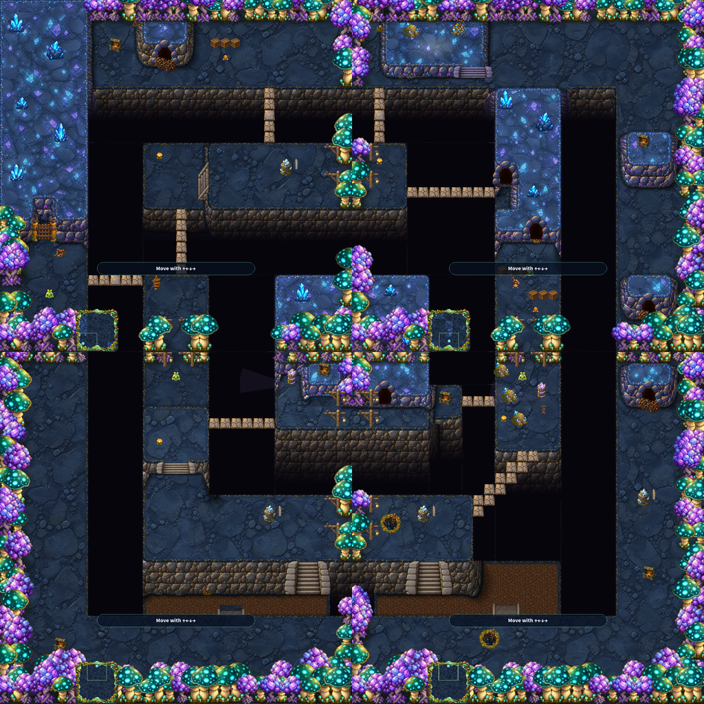
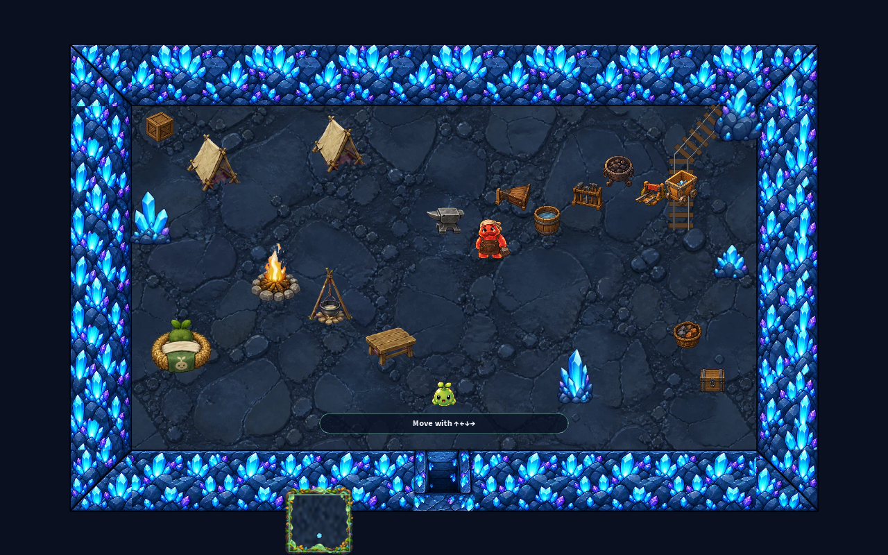

# The Crystal Caverns' falling-slab maze: the Spiral

Roadmap 12.9 (and 12.3, the smith); Chapter 3 beats 3 and 4. Designed and built 2026-11-20/21.
**Built, not playtested.**

## How it was chosen

On 2026-11-20 three sketches of the maze were drawn on the Caverns' real 4-chunk grid (G4 H4 / G5
H5, 32 x 32 cells a chunk), each with the main path numbered:

| Sketch | The idea |
|---|---|
| A, the Climb (`caverns-spiral/sketch-a-the-climb.png`) | one mountain rising a terrace a chunk, the cart rolling back downhill |
| B, the Islands (`caverns-spiral/sketch-b-the-islands.png`) | crystal islands in one great void, the smith's island below the gate |
| **C, the Spiral** (`caverns-spiral/sketch-c-the-spiral.png`) | rings round a central peak, the smith inside it |

The owner, the same day: "i like the idea of circular maze for this chapter. don't drop the others
since i like the island approach for our sky charter where the player can plane with the sky skin."
So **C is the Caverns' maze**, and **B is kept for the sky chapter**: the Northern ruins, where the
Cloud skin (Gale's Pearl, a later release) floats across gaps from a ledge. A is kept too.

The detailed plan of the Spiral (`caverns-spiral/spiral-plan-map.png`,
`caverns-spiral/spiral-plan-caves.png`) then drew three answers from the owner:

- **The void is most of the damage area** ("make void holes the greatest part of the damage area
  so it hurt and set back on them, spikes are less common"): every run of slabs, long or short,
  crosses the void; a fall costs `dungeon.void.damage` (10 of 100) and puts the slime back on the
  last safe ground, the run's start. Spikes only in one canyon, which no run crosses.
- **The Corner Cave stays** on the main road ("Keep the cave").
- **The slabs keep today's cracked flagstones** ("Flagstones").

## The shape



Rings round a central peak, by distance from the region's edge (cells, the whole region 64 x 64):

| Ring | Width | What | Level |
|---|---|---|---|
| the rim | 2 | crystal trees (the forest layer's crystal tree), the gate mountain in G4's north-west | the ground's |
| outer ring | 6 | side ways: the first yard, the north shelf, the Lookout's foot, the east shelf, the south-east bay, the south strip | 0 or 1 (the Lookout plateau 2) |
| outer canyon | 5 | the void; its stretch along the main ring's south side is the spike canyon | hole −2 (spikes −1) |
| **main ring** | 6 | **the main road**, climbing as it goes round: 0 on G4's west side, 1 along the north, 2 down the east and along the south, 3 on G5's west side | 0 → 3 |
| the void | 6 | a hole with the `void` hazard | −2 |
| inner ledge | 3 | only south and west of the peak | 3 |
| the peak | 14 x 11 | crystal rock, level 4, the smith's cave in its south face, a level-5 shoulder (G5) | 4 |

The peak is the region's landmark, seen from every chunk.

## The main path

1. In from Gloop Forest's web lane at G4's west edge, rows 26-27, into the **first yard** (level 0).
2. The **mine's gate**, shut, in the gate mountain's face, its brazier cold; the smith's cart's end
   of line beside it, empty.
3. **Short 1** (two slabs, a landing, two slabs) over the outer canyon: quick Rolls.
4. The sign ("No landing out there ... the Charged Roll"), then **Run 1**, LONG 6 north over a gap.
5. Stairs up to level 1; along the north side, a Crystal Crawler alone at its pillar; crossing X1.
6. **Run 2**, LONG 8 east (an energy flower before it).
7. **The Corner Cave** (lit): Glint Bats; in at the crag's west mouth (level 1), out at its south
   mouth onto the east side (level 2).
8. South down the east side: Pick Moles behind crates, X2, a Prism Eye alone on open ground with
   rocks to hide behind.
9. **Run 3**, a LONG run cut diagonally across the ring's south-east corner (slab pairs), Glint Bats.
10. West along the south side (Crawlers), X3.
11. A front flight up to level 3.
12. **Run 4**, LONG 6 over the void to the inner ledge, a second Prism Eye watching.
13. X5, the **smith's cave** in the peak's face.
14. The smith: the **Lantern** and the **Smith's Crystal** in one visit; his lamp, given a flame,
    takes the brake off his cart.
15. The cart rides once, one way, down to the first yard. One flame on the brazier opens the gate.
16. Out to Pip in Slimeshire for the Bow (through the web lane, no maze on the way), and back.
17. Into the mine.

Loop back before the smith: a ledge drop at G5's west side (level 3 to a low strip, level 0) and
crossing X4 back to the ring's start, then Short 1 to the yard.

| Run | Slabs | Held | Energy | Role |
|---|---|---|---|---|
| Short 1 | 2 + landing + 2 | a tap | 0 | quick Rolls |
| Run 1 | 6 | ~0.7 s | ~8 | teach the Charged Roll |
| Run 2 | 8 | ~1.1 s | ~13 | test |
| Run 3 | 5 diagonal steps | ~0.9 s | ~11 | twist: the diagonal, bats |
| Run 4 | 6 | ~0.7 s | ~8 | the end: a Prism Eye to time |
| side LONG 3 | 3 | ~0.1 s | ~2 | a chest on the void islet |
| Short 2, Short 3 | 2 + landing + 2 | taps | 0 | to the north shelf; to the Lookout's foot |

(Estimates: the Charged Roll launches at 460 units/s easing to 340, drains 12 energy a second while
held past its first 450 ms; about 40 energy of 100 for the four main runs. Energy comes back 1 a
second in the story mode, so energy flowers stand before Runs 2, 3 and 4.) No run crosses a chunk
line or bends: the Roll does not steer, so Run 3's diagonal is a staircase of slab pairs.

## Crossings (rule 11)

| Line | Crossing | Where | Level |
|---|---|---|---|
| G4 \| H4 | X1 | rows 15-16 | 1 |
| H4 \| H5 | X2 | H4/H5 cols 15-16 | 2 |
| G5 \| H5 | X3 | G5/H5 rows 15-16 | 2 |
| G5 \| H5 | X5 | G5/H5 rows 5-6 (the inner ledge) | 3 |
| G4 \| G5 | X4 | cols 15-16 (the loop back) | 0 |

Each between lantern posts on its own side of the line. Everywhere else on a line stands a band of
crystal trees, or the void (which closes a line by itself, owner 2026-11-20).
`tools/check_chunk_lines.gd -- --world=crystal-caverns` passes 8 lines and flags G4|H4 and G5|H5 for
their void stretches (the checker walks a hole as open ground), accepted as Burr's yard ditch is.

## The caves (room worlds, crystal-cave walls)



| Cave | World | Ways |
|---|---|---|
| The Smith's Cave (main) | `crystal-caverns-smith-cave` | south doorway to H5's peak face (`smith-cave-door`) |
| The Corner Cave (main, lit) | `crystal-caverns-corner-cave` | two south doorways: H4's crag west mouth (`corner-cave-west`) and south mouth (`corner-cave-south`) |
| The Bay Cave (side, lit) | `crystal-caverns-bay-cave` | two cave ladders up to holes with a ladder: the ring's south side (`bay-cave-down`) and the bay (`bay-cave-up`), both in H5 |
| The Dark Nook (the Lantern) | `crystal-caverns-dark-nook` | south doorway to the north shelf's rock (G4, `dark-nook-mouth`, deadthorn) |
| The Under-line Tunnel (the Lantern) | `crystal-caverns-under-line-tunnel` | two south doorways: the east shelf (H4, `tunnel-north`) and the bay (H5, `tunnel-south`), deadthorn at both |

Their doors target the chunk worlds directly, as the mine's do. The dark rooms are `DarkRoom`s lit
for good by their two braziers.

## Side ways and secrets

- The north shelf (Short 2): a Pick Mole, a chest, the Dark Nook.
- The Lookout's foot (Short 3) and the east shelf: the **heart quarter** in a chest on a pinnacle,
  climbed with Feral vines (after Pearl 3); the Under-line Tunnel.
- The void islet (side LONG 3): a chest.
- The south-east bay (the Bay Cave, or the spike canyon's stairs): a Crawler, a chest.
- The south strip (G5, only through the spike canyon: its stairs out lead up to the strip too): a
  chest. A slime crossing the canyon with Rolls takes less spike damage (the Roll's i-frames).
- The peak's shoulder (Feral vines from the inner ledge): a chest.

## Changes from the plan of 2026-11-20

- **The South-west Passage is gone**: the yard had no room for its mouth beside the gate and the
  cart. The south strip is reached through the spike canyon instead (stairs up from the pit on its
  south side too), and the bay the same way.
- **The Bay Cave is reached by ladders** (holes with a ladder), not mouths: the ring's south side has
  no face to cut a mouth into.
- **Run 2 runs on row 17** and lands on a two-row strip under the corner crag, whose face covers the
  strip's first rows (a raised wall covers the rows below its south edge).
- **The cave mouths stand in small crystal rocks** where the ring has no face of its own (the Dark
  Nook, the Under-line Tunnel's two mouths).
- **The Corner Cave is flat inside**: the level change is outside (in at level 1, out at level 2).

## The smith and his cart

- `game/crystal_mine/mine_camp.gd` (the cave's `Objects/MineCamp`): the first talk gives the
  Lantern, then the Smith's Crystal (once; not with the Bow learned already), then his lamp's lesson;
  while the lamp is cold, the lesson again; lit, "ride it down"; until the Bow, the crystal's errand;
  then tips; after the Colossus, his pride in Pip. He reads flags only: his lamp's
  (`candle-lit.smith-cave-lamp`) and the gate's brazier's in G4 (`candle-lit.mine-gate-brazier`).
- `game/crystal_mine/smith_cart.gd` (the cave's `Objects/smith-cart`): refuses while the lamp is
  cold; lit, rides once to G4's `yard-cart` (a door's travel, a fade) and sets `smith-cart.ridden`.
- The yard's station (`Spiral/yard-cart-station`, a MineCartStation with `cart_flag`) shows the cart
  once ridden and never sends it back.
- `game/crystal_mine/charged_roll_hint.gd`: the sign before Run 1 says what is missing without the
  Charged Roll, or how to cross with it.

## Tools

```bash
"<Godot 4.7.2 console exe>" --headless --path godot -s res://tools/build_caverns_spiral.gd -- --chunk=g4 [--dry]
"<Godot 4.7.2 console exe>" --headless --path godot -s res://tools/build_caverns_rooms.gd -- --room=smith-cave [--dry]
"<Godot 4.7.2 console exe>" --headless --path godot -s res://tools/bake_elevation.gd -- --world=crystal-caverns-g4,crystal-caverns-h4,crystal-caverns-g5,crystal-caverns-h5
```

One chunk or one room a run. They laid the first version; the scenes are now the ones to edit by
hand, and running a tool again lays its chunk or room afresh (hand edits there are lost).
`tools/build_mine_outside.gd` (the old camp) is deleted: run again it would have wiped G4 and H4.

## Not done

- Not playtested: the runs' energy, the crawlers' and eyes' places, the falls and set-backs, the
  rooms' doors, the cart ride and the smith's talks are all unplayed. `tests/test_mine_camp.gd` was
  rewritten for the cave and the yard but not run.
- The Corner Cave has no stair art inside; the rooms have no floor trim.
- The world map's "Mine camp" marker is now "The smith's cave"; the in-game map's room links are not
  checked.
