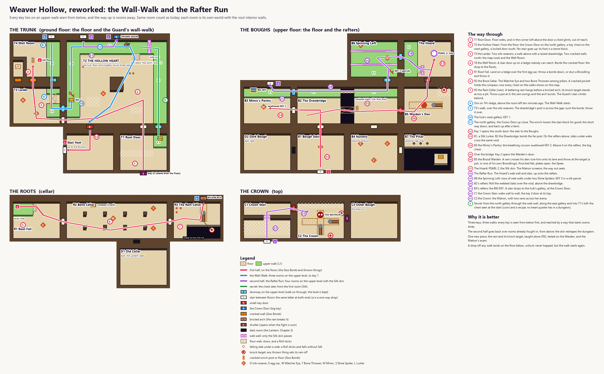
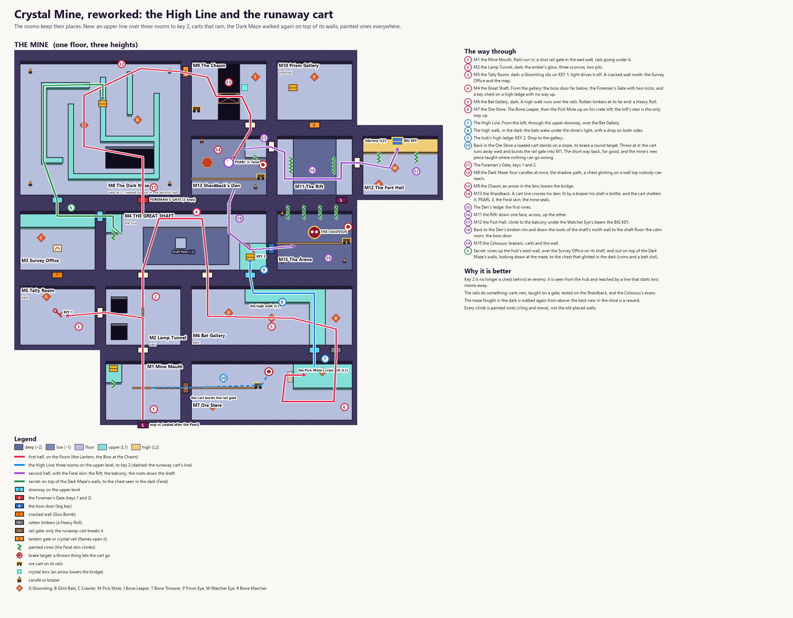
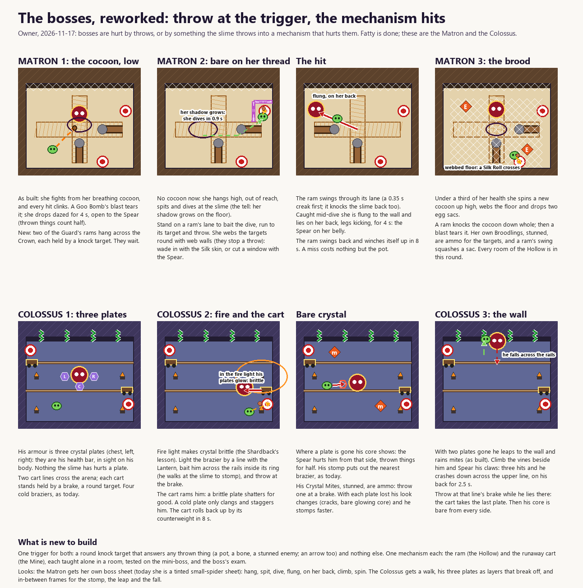
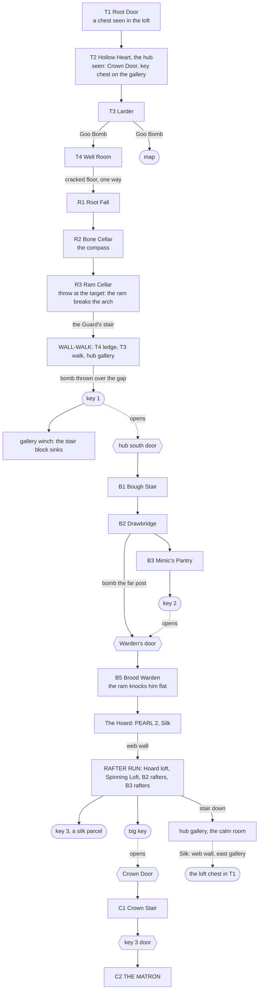

# Dungeons 2 and 3, reworked: the Weaver Hollow and the Crystal Mine

*Status: **step 1 approved by the owner on 2026-11-23** (the mechanisms in a lab world: "yes we can start step
1"; built, two fix rounds reviewed on 2026-11-24:
[DUNGEONS.md](../godot/DUNGEONS.md#mechanisms-the-knock-target-the-ram-the-runaway-cart)), with one change: no heart quarter inside a dungeon ([call 4](#the-owners-calls)). **On 2026-11-24 he said "Yes, start step 2"
with the other five calls as proposed:** step 2 (the bosses) is built in two boss labs, filmed and reviewed in
code on 2026-11-24, with the changes he asked for while it was built (noted under each boss below); not yet
played with a keyboard. Steps 3 and 4 (the Hollow and the Mine rebuilt one world per room, and the
game switched over to them) were built and reviewed on 2026-11-25, and step 5 ("step 5 this is the
way to go so get rid of the old") retired the old worlds the same day
([the archive](../archive/2026-11-25-old-hollow-and-mine.md)). His request: check dungeon 2,
then 3; the maps must make sense, be hard to solve without being boring, and keep the player
exploring; rooms with several levels where the level is there for a reason (a key or a secret on a
room's second level, reached only by crossing several rooms up there); the bosses' looks and
mechanics, with something thrown at a trigger so that a mechanism hurts the boss. This doc is the
audit, the new maps, the two boss fights and the build plan. It builds on the first designs
([the Hollow](2026-10-16-dungeon-weaver-hollow.md), [the Mine](2026-10-16-dungeon-crystal-caverns.md)),
the Pearl inside each dungeon ([2026-10-17](2026-10-17-pearl-mid-dungeon.md)) and the
[level design guide](2026-10-16-level-design.md); where it changes a decided thing it says so under
[The owner's calls](#the-owners-calls).*

Pictures (drawn by `output/dungeon-rework/*.py`):

- 
- 
- 
- As built today, for comparison: [the Hollow's Boughs](dungeons-rework/asbuilt-hollow-boughs.jpg),
  [the Mine](dungeons-rework/asbuilt-mine.jpg).

## The audit: what is wrong today

Both dungeons work as lessons and fail as places. Found by reading the designs, the as-built notes
([DUNGEONS.md](../godot/DUNGEONS.md)) and rendering every floor on 2026-11-23:

| | The Weaver Hollow | The Crystal Mine |
|---|---|---|
| **The way through** | One corridor of 14 rooms, each "one idea", in a fixed order. Nothing to plan, no room seen twice with new eyes | Better (two wings, two keys, the cart), but each key is a chest behind an enemy |
| **Height** | Four floors that never see each other. The hub's gallery and R1's ledge are the only levels, and neither is a route | The Great Shaft has three heights but they are scenery; the second half's climbs are three short faces |
| **The rooms** | Bare 16 x 14 boxes: one floor colour, a patch of grass, one gimmick, nothing else (see the render) | The same, and seven rooms are black boxes with a few props |
| **The walls** | The cliff look with `doorway_art.gd` frames, which the owner rejected on 2026-10-17 ([DUNGEON_ROOMS.md](../godot/DUNGEON_ROOMS.md#interior-walls)); the rooms are not worlds, so they are not edited as the Lair's are | The same; and the game plays one 80 x 70 scene, the 14 room files are dead copies |
| **Throwing** | Built before throw combat became the game (2026-11-01): only bombs are thrown. No pot at a target, no enemy as ammo | The same; the rails are a drawing and the cart a fade |
| **The second half** | Two rooms of web walls | Three climbs on placed climb walls, not the painted vines (cling and move) of 2026-11-12 |
| **The boss** | An empty brown room. She is a small spider's sheet tinted and scaled 2.6, four still poses, a cocoon that does not move, borrowed sounds; a thrown thing does nothing | A black room. Nine still poses, no walk (a bob of one pose), leaps are one pose slid along; a thrown thing does nothing |

The owner's rule of 2026-11-17 ("bosses are hurt by throws, or by something the slime throws into a
mechanism that hurts them") is built for Fatty only; question 166 lists the Matron and the Colossus
as left.

## What changes, in one page

1. **Every key lies on an upper walk.** It is seen from the floor first (the compass then marks
   it), and the way up starts rooms away. A walk crosses three or four rooms through doorways on
   the upper level; a drop off it lands unhurt on the floor below, so nobody is trapped, but the
   walk starts again.
2. **The second half goes back over the first, from above.** The Pearl's skin opens the upper
   level of rooms already fought in: the rafters over the Boughs (Silk), the tops of the Dark
   Maze's walls (Feral).
3. **One mechanism a dungeon, set off by a throw:** the Guard's **ram** in the Hollow, the
   **runaway cart** in the Mine. Each is taught alone in a quiet room, tested on the mini-boss, and
   is the boss's exam. Their trigger is one new piece, the **knock target**.
4. **Each room is its own world** with the bevelled interior walls (root rock in the Hollow, the
   crystal cave in the Mine, fort stone in the Fort Hall), a room door on each edge and a layout for
   the map, exactly as Fatty's Lair: hand-edited scenes, nothing regenerated after the first build.
5. **Rooms are dressed.** Each room gets its theme's furniture and a floor that is not one flat
   colour (the build's checklist, below).

## The Weaver Hollow

The Thorn Guard's watch fort inside the Watch Oak, as today. 21 rooms (22 today), 13 on the main
path, about 35 minutes.

**The key graph**

**The rooms and what their level is for**

| Room | Floor | Upper level (L1) | Why the level is there |
|---|---|---|---|
| T1 Root Door | floor webs; the way in | a corner loft with a chest | The chest is seen in the first minute and reached in the last, from the hub's east gallery: 100 coins and the Silkspun Stew recipe (a tonic until recipes are items) |
| T2 the Hollow Heart (2 x 2) | the hub; its south door wants key 1 | a gallery round three sides: west (key 1's chest), north (the Crown Door, the winch), east (behind a web wall) | Both prizes are in sight from the floor and the stair's foot is a stone block: the question "how do I get up there" runs the first half |
| T3 the Larder | two orb-weavers; two cracked walls | a walk over the room with a raised drawbridge | The bomb thrown over the gap (today's B2 lesson), now with enemies below who cannot reach |
| T4 the Well Room | the cracked floor, the drop | a ledge with a stair door | The way back from the Roots comes out above the room the slime left |
| R1 Root Fall | the first egg sac | the landing ledge | Kept: throw down at the sac, or stun a Broodling and throw it |
| R2 the Bone Cellar | Watcher Eye, two Bone Throwers, pillars | — | Kept; its cracked pocket now holds the **compass** (key 1 moved to the gallery) |
| R3 the Ram Cellar (new, replaces the Drop Gate) | a ram hung before a bricked arch, its target across a pit | — | The mechanism, taught where nothing can go wrong |
| B1 Bough Stair | a Silk Lurker | — | Kept |
| B2 the Drawbridge (2 x 1) | the void, the drawbridge (bomb) | rafters along the north wall, cut by the same void: four slabs under webs | Silk's twist: a Roll sticks on a webbed slab and falls with it; with the skin it rolls across |
| B3 the Mimic's Pantry | the Cocoon Mimic (key 2) | rafters with the big chest | The big key hangs over the Mimic through the whole first half |
| B5 the Warden's Den | the Brood Warden; a ram across the den | — | The ram's test: on its lane when it swings, he is knocked flat, plates open |
| The Hoard | Pearl 2 on its altar | a loft behind a web wall and a stair | The skin's first lock, safe, at the Pearl |
| B6 the Spinning Loft | — | the whole room | Key 3 in a silk parcel past two rows of web walls and two Slime Spiders (today's C4) |
| B4 the Nursery, B7 the Pillar | the optional bomb wing, as today | — | The Pillar's prize becomes coins and a potion: its heart quarter goes (no quarter inside a dungeon) |
| C1, C2, C3 | the Crown Stair, the Crown, the Outer Bough | — | C2 is rebuilt as her arena (below) |
| D1, D2 | the two dark rooms for the Lantern | — | Kept |

**Rules it keeps:** no web wall stands on the way to Pearl 2 (owner, 2026-11-21: only floor webs
there); three keys for three doors, none spendable wrong; the map in the first third behind a
crack; every lock one power and one look (the ram's bricked arch carries no crack: a crack is the
bomb's); a calm room before the boss door (the gallery); a faint resumes at T1, and with the winch
turned the Crown Door is three rooms away.

## The Crystal Mine

The rooms keep their places on the 5 x 5 grid and their lessons of light; 14 rooms, about 40
minutes.

| Change | Today | Reworked |
|---|---|---|
| **Key 2** | a chest behind the Pick Mole | on a high ledge of the Great Shaft, seen from the gallery. The **High Line**: the Mole's crate loft (its stair is the only way up), through an upper doorway, the high walk over the Bat Gallery in the dark, to the ledge |
| **M7's shortcut** | a crank lifts M1's shutter | a loaded cart on a slope, its brake a knock target: thrown at, the cart runs west and bursts the rail gate into M1. The mechanism's teach, and the rails finally do something |
| **The Shardback** | braziers make his shell brittle, then the Spear | a cart line crosses the Den: brittle in the fire light, the cart shatters his shell in one blow (the Spear still works) |
| **The climbs** | 19 placed climb walls | painted on a `vines` layer (cling and move), balconies where a climb needs a rest |
| **The Dark Maze** | walked once, in the dark | its inner walls are level 1 already: after Pearl 3 the slime climbs the hub's west wall, crosses the Survey Office on a shelf and walks the maze **on top of its walls** to the chest that glinted in the dark (S1: 50 coins and the belt slot, as today) |
| **The arena** | four braziers and a wall | two cart lines across it, braziers beside them (below) |
| **Rooms** | one 80 x 70 scene | a world a room; the cart and the lift travel between worlds as a door does |

The second half's main way (the Den's ledge, the Rift, the Fort Hall's balcony and the big key,
the roots down the shaft) stays as built.

## The bosses

One trigger, the **knock target**: a round wooden target on a rope latch. Any thrown thing sets it
off (a pot, a bone, a stunned enemy, an arrow); the Spear and the slime's body clink on it. It is
never a lock that stays open: it lets its mechanism go, and the mechanism winds back by itself.
Look book: never beside a bell (a bell opens for good) or a lens (the Bow's).

### The Orb-Weaver Matron

300 health in three rounds; the arena is the Crown rebuilt 20 x 16 with two rams crossing it.

| Round | She | The answer | Taught in |
|---|---|---|---|
| 1 | fights from her breathing cocoon, hung low | a blast tears it (as built); 4 s dazed, the Spear | B3, the Mimic |
| 2 (under 200) | no cocoon: hangs high out of reach, spits, and **dives** at the slime (her shadow grows for 0.9 s). She rings the targets with web walls, which stop a throw | bait the dive onto a ram's lane, wade into the ring (Silk) or cut a window (Spear), throw at the target: the ram catches her mid-dive and flings her to the wall, on her back 4 s | R3, B5; the web walls in B6 |
| 3 (under 100) | a new cocoon, high; the floor webbed; two egg sacs | a ram knocks the cocoon down whole, then a blast tears it; her Broodlings, stunned, are ammo; a Silk Roll crosses the webs | everything |

Thrown things hurt her for half a Spear hit while she is down, as Fatty. The rams hit the slime too
(a knock, light damage), with a 0.35 s creak first.

**Her look:** a boss sheet of her own (384 px cells; today a small spider's sheet, tinted): hanging
idle (4 frames), spit (3), dive (3), caught by the ram (2), on her back kicking (4), climbing (4),
spinning a cocoon (4), the cocoon breathing (4) and swinging when struck (3), her fall. Her own
hiss, shriek and impact sounds.

**As built (2026-11-24, `world.matron-lab`), with the owner's changes** (the fight in full:
[matron spec §9](../godot/specs/matron.md#9-the-ram-fight-the-rework-built-2026-11-24-in-a-lab-the-hollows-since-2026-11-25)):
five rams along the north wall, not two, their targets roped across the room so that which target
lets which ram go takes finding; the rams are both sides' tools (a ram that catches her dive also
hurts her 20, and she spits a glob of web at a target to let a ram go at the slime); every cocoon
hangs over one ram's lane picked at random, so round 1's can be knocked down too; her spit and webs
are bigger. Step 3 builds the Crown to this, not to the two rams above.

### The Crystal Colossus

240 health as three plates and a core.

1. **Three plates** (chest, left, right) drawn on his body: his health bar in sight. Nothing hurts
   a plate; in a lit brazier's ring they glow orange, brittle.
2. **Fire and the cart:** light the brazier by a line (the Lantern), bait him across the rails
   inside its ring, throw at the brake. A brittle plate shatters for good; a cold one clangs and
   staggers him. His stomp puts out the nearest brazier, as today.
3. **Bare crystal:** where a plate is gone the Spear hurts from that side, thrown things for half.
   His mites, stunned, are ammo.
4. **The wall** (two plates gone): he leaps up and rains mites, as built; three Spear hits on his
   claws from the vines and he crashes down across the upper line, 4 s on his back (the owner,
   2026-11-24: "Keep 4 seconds"; first planned at 2.5 s, too short once the cart comes from the far
   wall's tunnel): that line's cart takes the last plate. Then the core, from every side.

**His look:** a walk in three directions (4 steps each), in-between frames for the raise, the
stomp, the leap, the cling and the fall; the three plates as layers over his body that crack, glow
and burst into shards; his own stomp, roar and shatter sounds.

**As built (2026-11-24, `world.colossus-lab`), with the owner's changes** (the fight in full:
[DUNGEONS.md, "The plate fight"](../godot/DUNGEONS.md#the-plate-fight-step-2-of-the-rework)): a
bigger room (24 x 20 cells) with a void strip down each side (a fall costs 10 and puts the slime
back); the carts come out of tunnels in the walls, roll the whole room and leave by the far
tunnel when they miss him; a cart that strikes him he kicks back into its tunnel. The owner's
second round (the same day): the upper line under the wall is gone, two lines run down the room
from tunnels in the north wall right under his two climb spots instead (he crashes onto one); he
leaps at a slime that keeps away from him; his stomps put braziers out only once all four burn
and he is hurt, or 45 s after a brazier was last lit or put out; every 22 s he warns (2.5 s,
the floor cracking) and quakes the floor for 5 s, hurting a slime on it over time: only climbing the
roots up his wall escapes it; and his blows shake rocks loose from the roof (never by the rails):
they hurt a slime they land on and lie as things to throw, so the fight never runs out of ammo. Step
4 builds his room in the Mine to this.

## What the engine has, and what must be built

Checked in the code on 2026-11-23:

- **There already:** room worlds, room doors and the layout map with floors (the Lair); interior
  walls in root rock and crystal cave; raised floors in such a room with a flight of stairs
  (the playground's cliff cave); a room-door scroll keeps the slime's level, so an upper doorway
  needs only its rim painted at that level; walking under a bridge (R7); a blast reaches its
  targets across levels; the bell answers thrown hits (the knock target's model); stunned enemies
  as ammo; falling slabs, floor webs, web walls, drawbridges, winches, shutters, seals.
- **Limits the design respects:** a thrown thing hits only on the thrower's level (every target
  stands on the level it is thrown from); enemies never change level; a room's face is one level
  high (every walk is one level over its floor; pits are painted holes); no ladder inside a world
  (stairs and stair doors only); a door cannot stand in a face (no floor door under a walk).
- **To build:**
  1. the knock target, the ram (with the bricked arch it breaks) and the runaway cart (with its
     rail gate), each with its full set of frames and sounds, in a lab world, filmed;
  2. hooks on a boss and a mini-boss for "struck by a mechanism";
  3. a slab under a web (the two pieces exist; their meeting is untested);
  4. a drawbridge at an upper level over a floor (the deck over lower ground, as R7's slabs);
  5. the crystal cave's door leaves (its frame has openings only), and both dungeons' layouts;
  6. the cart and the lift between worlds;
  7. the Matron's and the Colossus's fights and art;
  8. a film tool for each boss (frame by frame, as `film_worm_bulwark.gd`).

## The build, by agents

One piece at a time, each ending in pictures or a film for the owner, each reviewed in code before
the next. Tests run only when he asks.

| Step | What | Shown to the owner |
|---|---|---|
| 1 | The mechanisms in a lab world: target, ram, cart | a film of each: thrown at, swinging, hitting, winding back |
| 2 | The two bosses in a boss lab, art first (a sheet for his yes), then the fight | the sheets; a film of each round |
| 3 | The Hollow, a floor at a time: the Trunk and the Roots, then the Boughs, then the Crown | each room rendered; the walks filmed |
| 4 | The Mine, a wing at a time | the same |
| 5 | Docs, tests updated, the old shells and builders retired (done 2026-11-25: the Hollow's four floors and the one-scene Mine, their room copies, builders and dead tools deleted; the tests rewritten for the rooms, not run yet) | — |

**Every room's checklist** (so none is a bare box again): its interior walls and a floor trim; two
floor textures at least; five to twelve props of its theme (silk drapes, the Guard's racks and
bunks, casks, roots; or timbers, ore heaps, tools, crystal clusters); one thing that moves (a
drape, a lamp, dust); what is seen from the door on entering (the prize, the lock, or the way on);
pots where a throw is asked for.

## The owner's calls

Each changes something he settled before. *2026-11-24: calls 1, 2, 3, 5 and 6 accepted as proposed
("Yes, start step 2"); call 4 he changed on 2026-11-23, below.*

1. **Both dungeons rebuilt as room worlds** with the interior walls (his direction of 2026-10-18,
   done only for the Lair). The few hand edits in today's rooms (the chests' contents) carry over.
2. **The Hollow's big key** moves from the Hoard (question 116, as built) to B3's rafters, at the
   Rafter Run's end.
3. **R3's drop gate** goes; the Ram Cellar takes its place. **Key 1** moves from R2's pocket to the
   hub's gallery; R2 gets the compass.
4. ~~The Hollow's heart quarter moves from the Pillar to T1's loft.~~ *2026-11-23 (owner): "remove the heart
   quarter entirely, not quarter inside the dungeons they are outside world secrets." No dungeon holds a heart
   quarter: the Pillar's goes, T1's loft chest holds coins and a recipe, and the Mine's wall-top chest keeps S1's
   coins and belt slot. The rule is in the [level design guide](2026-10-16-level-design.md) and
   [DUNGEONS.md](../godot/DUNGEONS.md#chests).*
5. **The Mine's key 2** moves to the hub's high ledge; **M7's crank** becomes the runaway cart.
6. **The Matron's exam** gains the ram beside the bomb and the Silk skin; **the Colossus's** gains
   the cart beside the Lantern and the Feral skin (guide rule 6 holds: the skin is still needed).
