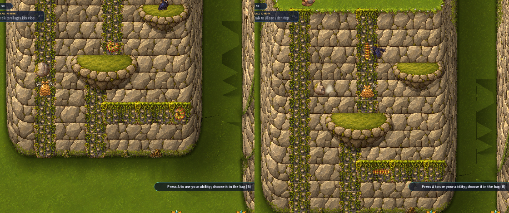

# Bestiary: the enemies as built

The design is the accepted [bestiary](../design/2026-10-16-bestiary.md) (29 enemies, question 107;
roadmap 12.7). This page says how the built ones work in Godot, where they are, what their numbers
are and which hooks the coming powers use. The base enemy (chase AI, attacks, hits, death) is
[specs/enemy.md](specs/enemy.md); the reactions to the body-shapes hits are
[BODY_SHAPES.md](BODY_SHAPES.md#the-reaction). What each enemy's hits cost the slime follows its tier (where it is first
met) since 2026-11-24: [health and damage](../design/2026-11-24-health-and-damage.md).

Built: rows 1 to 3 and 15 to 17 (before 2026-10-16), and rows 4 to 10 (the first batch,
2026-10-16): the prologue worm, the Popworm, the Spitcap, the Hopper, the Bramble Boar, the Thorn
Guard Statue and the Rook Thief. Rows 11 to 14 (Fatty's Lair, 2026-10-16): the Squint, the Pipe
Worm, the Dung Roller and the Big Squint. Rows 18 to 22 (Gloop Forest and the Weaver Hollow,
2026-10-16): the Silk Lurker, the Thornball, the Broodling (and its egg sac), the Cocoon Mimic and
the Brood Warden. Rows 30 to 32 (every dungeon's skeletons, 2026-10-16): the Bone Leaper, the Bone
Thrower and the Bone Marcher, with their bone pile. Rows 23 to 29 (the Crystal Caverns and the
mine, 2026-10-16): the Gloomling, the Glint Bat, the Crystal Crawler, the Prism Eye, the Pick Mole,
the Shardback and the Crystal Mite; and row 33, every dungeon's Watcher Eye, on the Prism Eye's
beam. Rows 1 to 5, Gorge's worm soldiers, were
repainted on 2026-10-16 (the [Art](#art) section). Rows 34 to 36, the climb monsters for the tall
walls (2026-11-14): the Rock Chucker, the Spiny Caterpillar and the Ledge Raven
([The climb monsters](#the-climb-monsters-rows-34-to-36)). Row 37, the Worm Bulwark (2026-11-21,
the owner's new enemy): a shield worm who charges ([37. Worm Bulwark](#37-worm-bulwark-charger)).
Row 38, the Carnivore Plant (2026-11-21, the owner's next): a man-eating plant in a pot who eats
whatever comes near, enemies too ([38. Carnivore Plant](#38-carnivore-plant-ambusher)).

## The Bestiary corner

The owner sees every enemy in the playground before it goes into its chapter.

- **Where:** east of the playground's old east edge. The world grew east from 52 to 104 columns
  (x 3328 to 6656, grass on every row; the rows are unchanged: the playground grows sideways, never
  up or down). The corner is x 3392 to 6592, y 384 to 4736. Walk east from the spawn along y 1100 to
  1600 (north of the Lantern corner), or start there: `?map=playground&spawn=3420,800` (desktop
  `-- --map=playground --spawn=3420,800`), just west of pen 1.
- **The pens:** 33, one per bestiary row, in its order (the seventh row, 30 to 33, is every
  dungeon's skeletons and the Watcher Eye), five to a row: pen *n* is 512 x 448 px with
  its top-left at x 3456 + 640 x ((*n* - 1) mod 5), y 576 + 608 x floor((*n* - 1) / 5). A sign over
  each gives the row's number, name, kind and right tool; the pens of enemies not built yet are
  grey and say "coming next". Rows 1 to 10 (Chapter 1) are the top two rows. **Pen 34** (2026-11-13,
  beside pen 33) is no bestiary row: three Gloomlings in a dark pen round a brazier that burns, to
  try their hunt in full darkness ("23. Gloomling"). **Pen 37** (2026-11-21) holds the Worm Bulwark:
  under pen 34, top-left x 5376, y 4832 (on the open grass south of the last row; the last row's
  fifth slot is the Sky corner's sign and sky). **Pen 38** (2026-11-21, under pen 33, top-left
  x 4736, y 4832) holds the Carnivore Plant and a prologue worm to feed her, three clay pots, and
  the Lantern on the Ability Box (`box_ability = &"lantern"`). **Pen 39** (2026-11-22, under pen
  32, top-left x 4096, y 4832) holds the Jelly Bouncer and a Worm Brawler to lure into his zap, two
  clay pots, a lump of coal and a lantern (stone and metal, light and sturdy: they lie whole after
  a bounce), and the Bow on the Ability Box (`box_ability = &"bow"`).
- **The fence:** posts and a rope, and a body on the `stairs` physics layer (19), the layer every
  walking body but the slime collides with ([ELEVATION.md](ELEVATION.md#stairs-walk)): the enemies
  stay in, the slime walks in and out, and the Bramble Boar crashes into it.
- **The fight:** the pen is each of its enemies' arena (`configure_arena`): an enemy fights only
  while the slime's centre is inside its pen and leaves it alone outside (the base chase AI walks
  back to the pen's middle; the patterned enemies go home or go quiet). Enemies take their
  `enemy-types.json` `maxHp` when it is higher than their scene's (none is since 2026-11-24, when the worm swordsman's scene went from 8 to 40), as in the
  shapes testbed's pen.
- **Respawn:** a pen's enemy comes back 3 s after it dies (`respawn_ms`). **F4** brings every pen
  back at once; it is the shapes testbed's pen key and still respawns that pen too (the corner reads
  it in `_input` without handling it). **F5** fills the slime's energy (the testbed).
- **Supplies:** what a right tool needs lies in its pen and comes back 2.5 s after it is taken:
  three clay pots in pens 4 and 10 (the Heavy skin of pens 5, 9 and 26 comes from the Skins
  corner's pedestal or `?skins=heavy`: [SKINS.md](SKINS.md)). Pen 12's supplies are scenery its enemy needs: a short fieldstone
  wall (five `object.wall-stone-solid` pieces, never taken) with the Pipe Worm's pipe in its middle.
  Pen 21's is a real silk cocoon (`object.cocoon-prize`, never taken) beside the Cocoon Mimic.
  Pen 30's are two armour statues (`object.decoration-world-solid.armor-statue`, never taken) in
  front of the Bone Leaper, to hide behind (they block its sight); pen 32's a clay pot inside the
  Bone Marcher's square.
  The Caverns' pens: a crystal key (`object.collectible-crystal-key`) under the Gloomling (pen 23;
  a pickup gets a new instance id each time it is put back, so the run's record of the last one
  does not free it); a crystal pillar (`object.crystal-pillar`) inside the Crystal Crawler's loop
  (25); a heavy block (`object.heavy-block`) on the Prism Eye's column and a stone essence to push
  it (26); three wooden crates (`object.interior-storage-crate`) in front of the Pick Mole (27);
  two braziers (`object.brazier`) in the Shardback's pen (28); two armour statues and a stone
  pedestal round the Watcher Eye (33). None of them is ever taken but the key.
- **The dark pens** (23 Gloomling, 24 Glint Bat, 28 Shardback): each holds a `DarkRoom`
  (`game/world/darkness/dark_room.gd`, a child of the pen, its size) with no candles, so it stays
  dark; the slime glows in it (its ember, 160 px) and lights what it comes near. Their
  `box_ability` is `&"lantern"` (F puffs a flame, 10 energy). **Pen 34** is dark too, but lends the
  Goo Bomb (`box_ability = &"goo-bombs"`), so the slime has no ember there: the only light is its
  brazier (`pen-34-brazier`, the corner's child: `object.brazier`, `lit_at_start`, `burn_ms` -1,
  120 px) and a bomb's own glow.
- **The Goo Bomb pens** (19 to 21, `box_ability = &"goo-bombs"`): walking into the pen puts the Goo
  Bomb on the Ability Box (F; S in keys-only), named over the slime ("F: Goo Bomb"). It stays chosen
  after the slime walks out, so a bomb can be cast at the fence and spat (or thrown) in; the bag (B)
  changes it back. A bomb costs 20 energy, and the energy refills only 1 a second: F5.
- **Rework mode only:** like the other corners, it takes itself out in the classic game (the test
  runner's playground).
- **Files:** `godot/game/dev/corners/bestiary_corner.tscn` (instanced into
  `game/scenes/worlds/playground.tscn` at the origin; the pens are its children, placed by their
  `position`), `bestiary_corner.gd` (the mode check, F4), `bestiary_pen.gd` (`@tool`: one pen: its
  sign, fence, enemies (`enemy_types`, `posts`, `enemy_properties`), respawn, supplies and
  `box_ability`; the editor draws the fence and the sign). To fill a "coming next" pen: give it `enemy_types` (and
  `posts`) in the Inspector.

## What the patterned enemies share

The Popworm, the Spitcap, the Hopper, the Boar, the Statue and the Rook (and Fatty's Lair's
Squint, Pipe Worm and Dung Roller, and Chapter 2's Silk Lurker, Thornball, egg sac, Broodling, Cocoon
Mimic and Brood Warden, and the skeletons through `game/enemy/skeleton_enemy.gd`, the bone pile,
and the Caverns' seven and the Watcher Eye, on the Prism Eye's `game/scripts/prism_eye.gd`)
extend `game/enemy/patterned_enemy.gd` (`PatternedEnemyScript`, which extends the base enemy). It replaces
the base chase step with a phase machine of each enemy's own; hits, reactions, death, rewards and the
energy shard stay the base enemy's.

- **Step:** the defeated path as the base enemy; a reaction stun slides the body (or holds it, for
  the rooted ones) and pauses the pattern (`_on_stunned` cancels a tell where a stun should: the
  Spitcap's charge, the Hopper's crouch, the Boar's scrape); else `_step_pattern(now, delta, target,
  engaged)`. `engaged`: the slime is a live target inside the enemy's arena (its pen), or, without
  an arena, within `targeting_radius`.
- **Phases:** `get_phase()` names the phase, which the reaction profile's `states` are keyed by.
- **Shielded phases** (`_shields`): in the air, asleep, hidden, charging. Every hit there, old-style
  or rework, is refused with "immune" (a clink), except the enemy's **kill hit** (`_kill_hit`: the
  seed thrown back, a Heavy Roll), which takes all its health. The kill hit gets through in every
  phase, past the reaction profile's `states` immunities too (since 2026-10-16: before, a profile
  state with `"immune": ["*"]` clinked it in the rework mode, so a hidden Spitcap and a sleeping
  Statue could not be killed that way, as this page said they could).
- **No hurtbox / not solid** (`set_hurtbox`, `set_solid`): underground or high up nothing finds
  it, and the slime passes over a mound or under a flyer; the body keeps its mask, so it still keeps
  to walls and the pen's fence. A leap is the exception: `set_airborne` drops the mask until landing
  (`air_blocked` checks the walls and water by hand), so liftables and bodies never stop a jump.
- **Numbers:** each type's `pattern` block in `game/data/enemy-types.json` (`pattern(key)`); the
  base stats (health, speeds, contact damage in `attributes`, rewards) are the scene's exports, as
  for every enemy. `corpseMs` / `corpseFadeMs`: how long the defeated pose stays and fades.
- **The look:** a sheet of key poses on `Pose/Visual` (`game/runtime/sheet_sprite.gd`), facing
  right and mirrored by `face_x`; the patterns lift, bob, squash and lean the `Pose` node in code
  (`set_look`), so the reactions' hit motion keeps the Visual's own transform. Flyers and jumpers get
  a code ellipse on the ground (`game/enemy/ground_shadow.gd`).
- **Walk cycles** (2026-10-19, the owner: the swayed standing pose looked poor): a scene whose sheet
  has them sets `walk_frame` (the first: four steps facing right, mirrored for left, then four
  walking toward the viewer, then four walking away) and `walk_step_px` (the ground covered per
  frame, so the feet keep pace); `show_walk(delta, stand)` picks the facing from the body's velocity
  and shows `stand` while it stands still. A sheet without them (`walk_frame` -1) keeps the sway.
  Every enemy that walks on legs has them: the Squint, the Big Squint, the Bramble Boar, the
  Thornball, the Brood Warden, the Shardback, the Bone Marcher, the Bone Thrower (two sets: holding
  its bone, and empty-handed from frame 16), the Broodling, the Cocoon Mimic (open-mouthed, while it
  is out of its cocoon), the Crystal Mite, the Thorn Guard Statue and the Bone Leaper (a knuckle
  crawl); the Clod Stomper's and the prologue worm's `walk-*` clips play theirs (the Stomper's
  frames 5 to 16, the worm's wriggle 4 to 15). Not given walks, as they do not walk: the Hopper
  (it jumps), the Rook Thief and the Glint Bat (they fly), the Popworm (a mound underground), the
  Silk Lurker (it hangs), the Crystal Crawler (seen from above round its pillar), the Gloomling (a
  smoke blob that drifts), the Pick Mole (ducked behind its crates), the Dung Roller (its two push
  strides) and the turrets and eyes.
- **Sounds:** existing global cues for now (`Jump`, `Land`, `DropPop`, `GroundCreak`, `RollBonk`,
  ...) and the scenes' hurt and death sounds from the library; nothing new is baked. The Pipe Worm,
  the Spitcap, the Cocoon Mimic and the Rook Thief borrowed the Gulp's cues; since Sound Picker round
  7 (2026-10-16) they have their own (`PipeWormCharge` / `PipeWormSpit`, `SpitcapCharge` /
  `SpitcapSpit`, `MimicWrap` / `MimicGrab` / `MimicSpit`, `RookSteal`), playing the Gulp's round-5
  takes ([audio spec §12](specs/audio.md#12-round-7-the-gulps-suck-catch-and-throw)). The Pipe Worm
  has one sound since Sound Picker round 8 (2026-10-19): its spit (`PipeWormSpit`,
  `enemy/pipe-worm-spit.wav`, the owner's pick); its charge is silent.
- **A hit from a point** (`_route_hit_from(origin, target, damage, knockback, knock?)`, added for
  the Caverns' rows): `_route_immediate_attack`'s request from another point than the enemy's centre
  (a beam's start, a pickaxe's landing spot), knocked away from it or along `knock`.
- **Thrown in an arc** (`game/enemy/lobbed_shot.gd`, the Pick Mole's pickaxe): a node under the
  world's entities that flies from a ground point to another in `flight_ms` of gameplay time,
  `arc_px` high, spinning, its landing spot darkening on the ground, and calls `on_land(to)`.
- **Light** (the Caverns' rows; `game/enemy/light_sense.gd`): `light_at(tree, point, pad,
  fire_only)` reads the Lantern's light sources (group `light_sources`, `light_circle()`,
  [DARKNESS.md](DARKNESS.md)) that reach a point, `brightest_from` where the strongest is,
  `flame_at` whether a Lantern flame lights it; `fire_only` leaves the slime's ember out. It only
  reads them. `game/enemy/dark_eyes.gd`: two dots drawn over a dark room's darkness (absolute z 46),
  shown only inside a room that is still dark, so a thing out of the light shows only its eyes.
- **The ground ellipse's colour** (`GroundShadowLook.tint`, COLOR by default): the Shardback's slam
  zone is a dark red.

### Hooks for the powers

- **Heavy:** the Roll (`game/player/roll/player_roll.gd`) is a Heavy Roll while the Heavy skin is on
  (SkinState, [SKINS.md](SKINS.md#heavy)): its bonk's hit carries the
  tags `roll` + `heavy` (`PatternedEnemyScript.is_heavy_roll`), and the ground shakes
  (`game/enemy/ground_shake.gd`: every node in `ground_shake_listeners` gets `on_ground_shake(at,
  radius, heavy)`): each bonk shakes `rollBonkShakeRadiusPx` (150) round its impact, and a Heavy ball
  rumbles `rollHeavyRumbleRadiusPx` (64) round its feet every step it rolls
  (`character.player.movement`). The coming Heavy skin's moves (and the Squash Slam) can call
  `GroundShake.shake` the same way.
- **Catchable projectiles:** an enemy projectile that joins the mouth's `suckable` group with
  `origin`, `can_take`, `suck_info` and `take` (`game/scripts/spore_seed.gd`) is sucked in with Q
  like a pot; its `suck_info` brings its own picture (`texture`, `art_px`, held_look.gd) and
  `material` (how it breaks); thrown back, its hit carries its kind as a tag. The Pipe Worm's mud
  glob (`game/scripts/mud_glob.gd`) extends the seed with its own kind and picture. The Bone
  Thrower's boomerang bone (`game/scripts/bone.gd`) follows the same contract on both its legs, and
  so does a thing that is no projectile: the skull on a skeleton's bone pile
  (`game/enemy/bone_skull.gd`, a sprite under the pile's body, in the group only while it lies
  there). Both break as material `bone` (`thrown_object.gd`: dust, `BreakWood`).
- **Spear-only openings:** the Spear's hits carry the tag `spear` (its shape's tags; the old spear
  weapons too). The Squints' `_shields` let only those through, and thrown things (tag `thrown`,
  owner 2026-10-22), and only while the visor is open.
- **The Bow:** the Rook Thief is in the group `bow_targets` with `on_arrow_hit(hit) -> bool` (it is
  knocked down from any height); the Bow (12.6) calls it. The Silk Lurker is in it too (an arrow
  cuts its thread at any height). So are the Glint Bat (brought down from any height), the Crystal
  Crawler (killed by an arrow across its way, `hit.direction` or `hit.knock`, or in a turn), the
  Watcher Eye (an arrow into the eye, against its gaze; the Prism Eye only shuts its petals since it
  became invulnerable, 2026-11-21) and the Pick Mole (while
  it is up). So is every bell (`game/scripts/lash_bell.gd`: an arrow rings it, as a thrown thing
  does; the Spear and the Lash never do; owner, 2026-10-16).
- **The Lantern's flame:** its hit carries the tags `fire` + `lantern` (`lantern_flame.gd`,
  unchanged) and it is a light source while it flies: it is the Glint Bat's kill hit, it makes the
  Shardback's shell brittle, and its light makes the Gloomling bolt. The ember's glow (in a dark
  room) drives the Gloomling, and with no light on the slime in a dark room the Gloomling hunts it
  (`light_sense.gd` `dark_at`: a dark room that is still dark); the Glint Bat is awake while its
  room is dark and sleeps once every candle burns.
- **The Goo Bomb's blast:** its hit carries the tag `blast` (`goo_blast.gd`, unchanged): the
  Thornball's spikes let it through and it flips it (`commit_damage`), and it is the egg sac's and
  the Cocoon Mimic's kill hit. The Thornball also reads the `goo_bombs` group: a bomb resting near it
  (`can_take`, `ground_point`) makes it cower. It is the Pick Mole's kill hit too, even ducked.
- **A hold on the slime** (the Cocoon Mimic): the slime's `sticky` status (rooted, as in a web),
  refreshed while held, `spend_energy` for the drain, `get_move_intent` for the shakes,
  `set_effect_alpha` to hide it inside and `recoil` to break it out; nothing in the player changed.

## The enemies

Three flags in a type's `reactions` (enemy-types.json) say how the ground treats it when a blow
moves it (2026-11-16: [THROW_COMBAT.md](THROW_COMBAT.md#knocked-enemies-and-the-ground-2026-11-16)):
`flies` (the Rook Thief, the Glint Bat, the Ledge Raven: holes and water do nothing to it),
`aquatic` (deep water does not drown it; none yet) and `hazardProof` (a list of "fall", "void",
"water", "spikes", "lava"; none yet). A new water or lava creature needs its flag.

| # | Enemy | Scene (`character.<id>`), script | Weight, material |
|---|---|---|---|
| 4 | Prologue worm | `prologue-worm.tscn`, the base `enemy.gd` | light, worm |
| 5 | Popworm | `popworm.tscn`, `game/scripts/popworm.gd` | light, worm |
| 6 | Spitcap | `spitcap.tscn`, `spitcap.gd`; its seed `projectile.spore-seed` (`spore_seed.gd`) | light, wood |
| 7 | Hopper | `hopper.tscn`, `hopper.gd` | light, chitin |
| 8 | Bramble Boar | `bramble-boar.tscn`, `bramble_boar.gd` | medium, straw |
| 9 | Thorn Guard Statue | `thorn-guard.tscn`, `thorn_guard.gd` | heavy (poise 4), stone |
| 10 | Rook Thief | `rook-thief.tscn`, `rook_thief.gd` | light, silk |
| 11 | Squint | `squint.tscn`, `squint.gd` | medium, stone |
| 12 | Pipe Worm | `pipe-worm.tscn`, `pipe_worm.gd`; its glob `projectile.mud-glob` (`mud_glob.gd`) | light, worm |
| 13 | Dung Roller | `dung-roller.tscn`, `dung_roller.gd`; its ball for the Gulp `game/enemy/dung_ball.gd` | medium, chitin |
| 14 | Big Squint | `big-squint.tscn`, the Squint's `squint.gd` with its own numbers | heavy, stone |
| 18 | Silk Lurker | `silk-lurker.tscn`, `silk_lurker.gd` | light, chitin |
| 19 | Thornball | `thornball.tscn`, `thornball.gd` | light, straw |
| 20 | Broodling | `broodling.tscn`, `broodling.gd`; its nest `egg-sac.tscn` (`egg_sac.gd`), the pen's enemy | tiny, goo; the sac heavy, silk |
| 21 | Cocoon Mimic | `cocoon-mimic.tscn`, `cocoon_mimic.gd`; the real cocoon `object.cocoon-prize` (`objects/cocoon-prize.tscn`, a picture) | medium, silk |
| 22 | Brood Warden | `brood-warden.tscn`, `brood_warden.gd` | heavy, chitin |
| 23 | Gloomling | `gloomling.tscn`, `gloomling.gd` (pens 23 and 34) | light, silk (nothing reaches it) |
| 24 | Glint Bat | `glint-bat.tscn`, `glint_bat.gd` | light, silk |
| 25 | Crystal Crawler | `crystal-crawler.tscn`, `crystal_crawler.gd`; its pillar `object.crystal-pillar` | light, chitin |
| 26 | Prism Eye | `prism-eye.tscn`, `prism_eye.gd` (with `game/enemy/prism_look.gd`) | medium, stone |
| 27 | Pick Mole | `pick-mole.tscn`, `pick_mole.gd`; its pickaxe `game/enemy/lobbed_shot.gd` | light, mud |
| 28 | Shardback | `shardback.tscn`, `shardback.gd`; the braziers `object.brazier` | heavy (poise 4), stone |
| 29 | Crystal Mite | `crystal-mite.tscn`, `crystal_mite.gd` | tiny, stone |
| 30 | Bone Leaper | `bone-leaper.tscn`, `bone_leaper.gd` (on `game/enemy/skeleton_enemy.gd`) | light, stone |
| 31 | Bone Thrower | `bone-thrower.tscn`, `bone_thrower.gd`; its bone `projectile.bone` (`bone.gd`) | light, stone |
| 32 | Bone Marcher | `bone-marcher.tscn`, `bone_marcher.gd` | medium, stone |
| 33 | Watcher Eye | `watcher-eye.tscn`, `watcher_eye.gd` (on `prism_eye.gd`) | medium, stone |
| 34 | Rock Chucker | `rock-chucker.tscn`, `rock_chucker.gd`; its boulder `game/enemy/wall_rock.gd` | medium, worm |
| 35 | Spiny Caterpillar | `spiny-caterpillar.tscn`, `spiny_caterpillar.gd` | light, chitin |
| 36 | Ledge Raven | `ledge-raven.tscn`, `ledge_raven.gd` | light, silk |
| 37 | Worm Bulwark | `worm-bulwark.tscn`, `worm_bulwark.gd` | heavy (poise 4), worm |
| 38 | Carnivore Plant | `carnivore-plant.tscn`, `carnivore_plant.gd` | heavy (rooted), wood |
| 39 | Jelly Bouncer | `jelly-bouncer.tscn`, `jelly_bouncer.gd`; his ring and bolts `game/enemy/zap_look.gd`, the shock `game/feel/shock_look.gd`, a bounce `game/throw/bounced_throw.gd` | medium, goo |

Scenes in `godot/game/scenes/characters/` (the seed, the glob and the bone in `projectiles/`), all
in `scene_index.json`.

### 2, 15, 16. Worm Archer, Slime Spider, Orb-weaver (four-way shooters)

The base enemy (`enemy.gd`) with the line-up AI (`game/enemy/line_up_ai.gd`, owner 2026-10-16; the
rules and numbers: [specs/enemy.md](specs/enemy.md) section 20): their shots fly only straight up,
down, left or right. Once one sees the slime it runs fast (`alignSpeed`: the archer 130, the spider
140, the weaver 120) to the nearer of the slime's row or column, at bow range; lined up (within
`alignTolerancePx` 8) it stops, winds up (the tell) and shoots down the line; a slime that steps
off the line in the wind-up is missed. Too close, it backs off along the line (`backOffSpeed`). The
spiders scuttle sideways, looking at the slime. Pens 2, 15 and 16; the signs of pens 2 and 15 call
them liner-ups.

Webs and the Roll (owner, 2026-10-16, question 131): a spit web that hits roots the slime
(`stickMs`); a Roll sticks in a floor web (the Matron's volley patches; the Orb-weaver's laid webs
and Tom's maze webs are not built) as a walk is caught by one, so a Roll never crosses a web
(`game/enemy/spider_web_port.gd`). Pen 15's sign gives the Slime Spider's right tool as "the Silk
skin: then its webs no longer stick; stay off its lines": with the Silk skin (`player.gd`
`crosses_webs`, [SKINS.md](SKINS.md#silk)) webs no longer catch or root the slime.

### 4. Prologue worm (chaser)

The worm swordsman's chase and swing (the base enemy) with **1 hit point**: anything kills it, a
thrown pot (20 damage) included. A small, scrawny, mean grunt of Gorge's army (a scarf scrap and a
twig club; smaller on screen than the swordsman), slower (55 px/s) and weaker
(5 damage against its 10) than the swordsman, with a longer wind-up (550 ms: it leans back, then swings the twig).
Its clips are keyed on its poses (idle, walk, swing, knocked over; since 2026-10-19 its `walk-*`
clips play its wriggle cycles, frames 4 to 15) with a code bob in the scene's AnimationPlayer; side
clips are mirrored for left.

### 5. Popworm (burrower)

- **Burrowed:** a dirt mound slides toward the slime (`burrowSpeed` 90; home at `homeSpeed` 60
  while the slime is out of the pen), leaving dust. No hurtbox, not solid.
- **Tell** (`tellMs` 550): within `surfaceRangePx` 44 of the slime (at most every `resurfaceMs`
  1300) it stops and its leafy tail flicks up out of the mound.
- **Up** (`upMs` 950): it pops out and bites `biteAtMs` 120 later (`biteDamage` 10, `biteKnockback`
  220, the slime within `biteRangePx` 64). Open the whole time: the Spear's moment (40 health: a
  jab and a second jab, or a chain).
- **Sink** (`sinkMs` 260), then underground again.
- **Right tool:** a heavy shake within the shake's radius + `shakeReachPx` 24 of the mound (a Heavy
  Roll rumbling past, or its bonk nearby) throws it out of the ground **dazed** (`dazedMs` 2200),
  limp on the soil and open.

### 6. Spitcap (turret)

- Rooted (knockbacks never move it). **Hidden** under its cap, a clinking shell, while the slime is
  within `hideRangePx` 88 or out of the pen; up again `unhideMs` 600 after the slime steps out of
  that range (`riseMs` 180 to pop up).
- **Up:** it turns to the slime's nearer axis and spits on a steady beat, every `spitIntervalMs`
  1800 (the first `firstSpitMs` 500 after it rises), but four-way (owner, 2026-10-16): only when the
  slime is lined up, its hurtbox middle within `alignTolerancePx` 16 of the Spitcap's row or column
  (`game/enemy/four_way_aim.gd`). A slime at a diagonal is never spat at.
- **Charge** (the tell, `spitWindupMs` 520): it swells and shakes, the aim locked along that line;
  then it spits one spore seed straight down it (`projectile.spore-seed`: 170 px/s, 5 damage,
  2.6 s; a slime that stepped off the line is missed) and shows its spitting pose (`spitPoseMs`
  260). The slime stepping close cancels the charge (it hides).
- **Right tool:** the seed is suckable (Q catches it in flight, within the suck's 160 px cone);
  thrown back (Q), its hit carries the tag `spore-seed`, which kills a Spitcap at once, hidden or
  not. The Spear reaches it from just outside its hiding range (the jab's line is 110 px; a chain
  from 96 px kills it).

### 7. Hopper (jumper)

- **Rest** (`landMs` 500): landed and open.
- **Crouch** (the tell, `crouchMs` 320): it folds its legs and a shadow darkens on the ground where it
  will land: toward the slime, `hopPx` 120 at most (toward home while the slime is out of the pen).
- **Air** (`airMs` 600, `hopHeightPx` 48): every hit clinks and the slime passes under it; a wall
  ends the hop early.
- **Landing:** the slime within `landHitRadiusPx` 34 takes 10 (`contactDamage`) with 240 knockback.
- **Right tool:** a Spear thrust timed to its landing (40 health).

### 8. Bramble Boar (charger)

- **Idle:** it faces the slime (walks home at `homeSpeed` 50 while the slime is out of the pen).
- **Scrape** (the tell, `scrapeMs` 900): once it has a clear line to the slime (and
  `scrapeCooldownMs` 900 after its last charge) it lowers its head and scrapes, kicking dust back.
- **Charge:** the line to the slime's centre is locked at the scrape's end; it runs it at
  `chargeSpeed` 300 (dust trail; its bramble front clinks every hit) until something stops it:
  - the slime (within `chargeHitPx` 44): 10 damage (`chargeDamage`) with 340 knockback, and it skids
    to a stop (`skidMs` 350);
  - anything else (a wall, the pen's fence, a rock, another enemy): it crashes onto its back,
    **stunned** for `stunMs` 2200, belly up, every hit doubled (`stunnedDamageTaken` 2; the
    reaction profile's `states.stunned`);
  - `chargeMaxMs` 2500 without a hit: it skids to a stop.
- **Right tool:** Roll aside and let it hit the fence, then the Spear on its belly (60 health:
  two jabs there, doubled to 28 and 32, finish it).

### 9. Thorn Guard Statue (patroller)

- **Asleep:** a statue, every hit clinks. Statues with the same `guard_group` are a set (pen 9:
  two, `bestiary-pen-9`): when the slime's centre passes between two of them (within
  `wakeCorridorPx` 40 of the line between them) the whole set wakes.
- **Wake** (the tell, `wakeMs` 700): glowing eyes, it shakes the moss off (still a clink).
- **March:** straight lines at 70 px/s, first along the axis the slime is furthest along; when
  something stops it (a wall, the fence, another statue: statues collide with enemies) it turns: a
  quarter turn toward the slime's side, else the other way, else back. Touching the slime: 10
  damage, 260 knockback (`contactReachPx` 40, `contactCooldownMs` 700). Heavy: Spear hits are armor
  (damage, no stun); 90 health is about six jabs.
- **Right tool:** a Heavy Roll (the bonk with `roll` + `heavy`) knocks it back to rubble at once,
  awake or asleep; the bonk's 34 px reaches a statue standing beside it too.
- **Back to sleep:** the slime out of its pen for `sleepAfterMs` 1500, it marches home and sleeps
  there again, whole (`returnMaxMs` 6000 at most).

### 10. Rook Thief (thief)

- A flyer: its body is neither solid nor stopped (layer and mask 0); its root is the ground point
  under it (its shadow), its art and hurtbox ride its height.
- **Loop:** an ellipse round its home (`loopRadiusX` 170 x `loopRadiusY` 120, `loopSpeed` 150 px/s)
  `flyHeightPx` 90 up, out of reach.
- **Tell** (`tellMs` 650): `swoopEveryMs` 2600 after its last swoop, with the slime in reach of the
  loop (`swoopReachPx` 160 beyond it), it caws, folds its wings and its shadow darkens.
- **Swoop** (`swoopMs` 900): a straight dive from the loop through where the slime stood at the
  tell's end, `swoopOvershootPx` 140 on, down to `swoopLowPx` 12 at its middle; under
  `lowHeightPx` 34 it can be hit. Touching the slime there (ground points within `stealRadiusPx`
  28) it steals `stealCoins` 5 (what the slime has; "-5c" in red) and flies off with the pouch,
  higher (`carryHeightPx` 130) and faster, for `carryMs` 3200, then comes back around. It keeps
  what it took.
- **Rise** (`riseMs` 700) back onto its loop.
- **Right tool:** a thrown thing that hits it (the tag `thrown`: a pot thrown as it swoops low)
  knocks it down: it falls (`fallMs` 250), lies open on the ground for `downMs` 2200 and drops every
  coin it took ("+Nc"; they go back to the slime). A Spear jab as it swoops past also hurts it (30
  health). Defeated, it drops them too. The Bow's hook: `on_arrow_hit`.

### 11. Squint (armoured)

A squat burrow beast of Fatty's Lair in slate-blue clay armour, its one crimson eye behind a visor of
two plates. Nothing else in the game is plated like it.
- **Walk:** visor shut, it creeps at the slime (`walkSpeed` 45; home while the slime is out of the
  pen), stepping through its walk cycles (side, down, up). Its armour clinks every hit.
- **Rear** (the tell, `rearMs` 650): within `leapRangePx` 120 (and `cooldownMs` 900 after its last
  opening) it rears up rattling, and a ring (`ringRadiusPx` 52 x `ringRadiusYPx` 30, the boss
  telegraph) lights on the ground under the slime's feet (`leapPx` 130 at most away).
- **Air** (`airMs` 380, `hopHeightPx` 34): it leaps there, a shadow under it; a wall or the water
  ends the leap early. In the air it has no body mask (`set_airborne`): the slime and the liftable
  things (the Gulp's suckables, lying in the world) pass under it, and only the landing slam hurts.
  It never lands on a wall, water or liftable: `landing_point` shortens the leap to the furthest
  free spot before the planned one, and the telegraph shows that spot.
- **Slam:** the slime in the ring takes `slamDamage` 5 with 220 knockback; the screen shakes. The
  Roll's i-frames or a step out of the ring dodge it.
- **Open** (`openMs` 900): it lies flat, dazed, the visor open. Only a hit tagged `spear` or
  `thrown` gets through (`_shields`; the Axe, the Hammer and the Roll still clink; thrown things
  since 2026-10-22). 32 health: two jabs and
  the finisher (about 42 together) kill it inside one opening. A reaction stun pauses the pattern, so
  a chain that has started keeps the eye open until it ends.
- **Right tool:** the Spear, or something thrown, in the eye after its slam.

### 12. Pipe Worm (turret)

One of Gorge's worm soldiers (the red war scarf and the badge), in an old clay pipe set in a wall.
Its scene is the pipe and the worm (`aim_direction`, the way the pipe faces; its feet at the wall's
foot); the wall is the world's. A placed worm faces the way its placed node is turned (rotate it in
the editor: down unturned, snapped to the four ways; the editor draws the half it sees, enemy spec
§3.3), so a worm in a side wall or a block's top face is turned to face the open floor (R6's six and
R11's, 2026-10-19). In pen 12 it is a short fieldstone wall (the pen's supplies), which
blocks the slime.
- **Its view: the half in front of its wall** (owner, 2026-10-19; it was a circle that saw through
  the wall): it sees the slime only past its wall's foot along its pipe's line (`aim_direction`
  snapped to up, down, left or right), within the pen (or `targeting_radius`). Behind the wall or
  level with it the slime is not seen, however near.
- **Hidden:** down in the pipe, two eyes glinting in the dark (`game/enemy/eye_glint.gd`): blows
  never reach it (every hit clinks). It hides while the slime is out of view or within
  `hideRangePx` 72, and looks out `unhideMs` 500 after the slime is back in view.
- **Up** (`riseMs` 200): it spits on a beat, every `spitIntervalMs` 1700 (`firstSpitMs` 400 after it
  comes up), at the slime wherever it stands in view (the four-way rule of 2026-10-16 is gone): the
  aim is the slime's hurtbox middle when the charge starts, kept within `aimConeDeg` 160 of the
  pipe's line.
- **Charge** (the tell, `spitWindupMs` 550): it swells and shakes in its pipe; then a mud glob along
  the aim (`projectile.mud-glob`: 150 px/s, 5 damage; a slime that moved is missed) and its spitting
  pose (`spitPoseMs` 300). Blows still clink. The worm never comes out of its wall (owner,
  2026-10-19, after trying it): the glob is born off the wall instead, 38 px out along the pipe's
  line from its middle and past a deep wall's foot, so it never hits the wall it leaves.
- **Right tool:** the glob is suckable (Q catches it in flight); thrown back (Q) into the pipe, its
  hit carries the tag `mud-glob`: one hit, it dies, hidden or not. Anything else thrown (a pot, a
  rock: tag `thrown`) hits it too, hidden or not, for its own damage (owner, 2026-10-19): its
  shield lets the tag through (`_shields`) and, in the rework, its phases' immunity is every class
  but the throws' (`"immune": ["*", "!thrown", "!thrown-medium", "!thrown-heavy", "!thrown-freeze",
  "!thrown-sleep"]`: a crate, a keg, an ice block or a puffball hits it as a pot does; owner,
  2026-11-21, after only `thrown`, the light throws' class, got through). A throw strikes only what it has a clear line to
  (owner, 2026-11-01: "nothing should cross walls"), and the worm's hurtbox sits inside its wall, so
  the line is measured to its `reach_point`, just out of its wall's face along its pipe's line
  (AbilityWorld `reach_point`; 2026-11-21: measured to the hurtbox's middle, the wall cut every
  line and five of R6's six worms could not be hit).
- **Spear + Roll:** a Roll's bonk within `bonkReachPx` 60 of its feet (rolling into the wall under
  its pipe; any bonk, heavy or not, through GroundShake) jolts it out: it lies on the floor in front
  of the pipe, dazed for `dazedMs` 2600 and open to every hit (30 health: two jabs), then wriggles
  back in.
- **Beaten, its pipe stays** (owner, 2026-10-19): the corpse fades in front of its empty pipe, which
  stays in the wall (`_leave_empty_pipe`: a plain picture of the empty pipe on the world's entity
  layer, group `pipe_worm_empty_pipe`) until the world is built again and the worm is back. A worm
  that comes back on the spot sooner (the playground's pen) takes the pipe's place.
- **A pipe up in a deep wall** (2026-10-19; a dungeon room's walls are two cells deep and collide
  over their whole cells, so in Fatty's Lair's R6 the globs were born inside the wall and stopped at
  once: the worms never hit): `_wall_depth` finds, once, where the line out of the worm's centre
  leaves the world's collision (its wall's face); the glob is born 10 units past that face (at least
  its 38 px mouth), so a mouth just outside a face, closer than the glob's size, moves out too (R6's
  side walls, whose globs died at once). Its view starts there, and the bonk's reach and the
  shaken-out worm (pose and hurtbox) move out by as much. A pipe whose mouth is clear of its wall
  (pen 12) has no depth and plays as before.

### 13. Dung Roller (patroller)

A dung beetle pushing a big mud ball back and forth along a fixed track. Its body is the ball (the
root stands where the ball meets the ground); the beetle (`beetle`, with its own body shape and
hurtbox shape that follow it) walks behind the ball, moved round it by the script.
- **Track:** a straight line through where it was placed. On the placed enemy, the Inspector's
  **Patrol Axis** picks Horizontal or Vertical and **Patrol Length** how far it rolls to each side
  (owner, 2026-11-21: "modify in what direction they wander, horizontal or vertical, since they
  always go straight"); the editor draws the line. With the axis on "Its own track" it keeps its
  `track` (a `PackedVector2Array` of points from where it was placed, old centres; pen 13 sets
  `(-150, 0), (150, 0)` through `enemy_properties`, Fatty's Lair's R10 a long one through
  `overrides`). The ball rolls from point to point at `rollSpeed` 120 and back. Anything but the
  slime that stops it (a wall, the fence, a rock) turns it back early.
- **The ball:** rolling, it hits the slime within `ballHitPx` 40 for `ballDamage` 10 with 300
  knockback (every `contactCooldownMs` 600 at most). A hit from the ball's side clinks.
- **Turn** (the tell, `turnMs` 900 for a half turn): at each end the ball stops and the beetle walks
  round it (the front side), braces (`braceMs` 350) and pushes off the other way. That is the gap:
  the ball lies still and harmless and the beetle shows its back.
- **Soft from behind:** a hit whose attacker stands more than `rearDot` 0.3 behind the beetle (away
  from the ball) lands, times `rearDamageTaken` 2; any other clinks. A hit's stun holds it on its
  track. 30 health: two Spear jabs from behind.
- **Right tool:** Roll through the gap (into the lane behind it as it passes, or past the resting
  ball) and hit the beetle from behind. Or steal its ball.

**The stolen ball** (owner, 2026-11-21: "you can suck the dung and they get furious and charge at
you. The dung is a throwable: you can throw it at him or at other monsters. If you throw it at
nothing, the ball stays and the beetle forgets about you and goes for it"; `game/enemy/dung_ball.gd`):
- **The Gulp takes the ball** off the beetle (the ball is a suckable while the beetle has it, as the
  skull on a bone pile is; a light thing, so Gulp level 1 lifts it). From then on the body is the
  beetle alone and nothing shields it: every hit lands, as it is (no rear bonus).
- **Furious:** it stamps for `furyMs` 650 (red, steaming, "!!"), then charges the slime in straight
  dashes: `chargeSpeed` 300 for `chargePx` 240 or until something stops it, a breather of
  `chargeRestMs` 750 between dashes, the last `chargeTellMs` 320 of it leaning back (the tell). A
  dash that reaches the slime (`chargeHitPx` 34) deals `chargeDamage` 5 with 280 knockback. It
  rages while the slime has the ball, or has broken it, and stands inside its reach (its pen, else
  its `targeting_radius` 320).
- **The ball thrown** is a light soft throwable ([THROW_COMBAT.md](THROW_COMBAT.md)): a blow that
  hurts an enemy breaks it (a mud splat, `BreakSoft`); thrown back at a beetle that has lost its
  ball it is the kill hit, whatever its health.
- **A miss leaves it whole** where it came down (the ground, a wall, a clink), and so does a hit on
  the slime: the mouth drops the ball whole behind it instead of bursting it. The beetle then
  forgets the slime at once, walks to its ball (`fetchSpeed` 110, round what stands in the way),
  takes it and rolls it back to the nearest point of its track. The Gulp can steal it again, lying
  or pushed.
- **A new ball:** once the slime is out of its reach it walks home (`homeSpeed` 70). There, when its
  ball is no more (broken, or gone with the slime through a door: it counts as gone `ballOutMs`
  1200 after the mouth last held it with no ball lying anywhere), it kneads a new one (`kneadMs`
  1500) and patrols again; while the slime still carries the ball somewhere, it waits at home.
- **Beaten with its ball**, the ball stays on the ground as a throwable of nobody.

Filmed, not played with a keyboard: `bash scripts/godot/film-enemy-ways.sh <name> --film=<axis |
steal | throw-miss | throw-back | throw-other | leave | pen>` stages each case on the playground's
grass (`pen`: in the Bestiary corner's pen 13 as it stands) and writes a frame strip to
`output/enemy-ways/<name>/` (`godot/tools/film_enemy_ways.gd`). Filmed on 2026-11-21: all seven
behave as described.

**Up and down** (owner, 2026-11-21: "dung-roller only have horizontal tiles, we need vertical tiles
also"): its sheet has eight frames (`256x256-tile_8x1-dung-roller.webp`): the side pushes, on its
back, the ball, then pushing away from the viewer seen from behind (frames 4 and 5) and toward it
seen from the front (6 and 7). The beetle looks the way it pushes, walks, dashes or turns
(`_look_toward`: the side view, mirrored for left, when the way is more across than up or down,
else the back or the front view; `_pose_frame` picks the stride). Its orbit round the ball is
flattened less (`ORBIT_Y` 0.8, it was 0.55), so pushing up or down it stands clear enough of the
ball to read: in front of it rolling up, behind it rolling down. Filmed (`--film=axis`), not played.

**Its sounds** (owner, 2026-11-21: "we need to work on the sound effects of the beetle i dont like
it"): it borrowed the slime's (the `SlamWindup` bubble for its brace, the Roll's whoosh and bonk, a
synth pop) and a generic hit and splat. It has its own cues now, chosen in [Sound Picker round 13](specs/audio.md#15-round-13-the-beetle-and-the-bubble):
`DungBrace` (the brace, and the lean-back before a dash), `DungPush` (pushing off), `DungBump` (the
ball or a dash meeting a wall), `DungFury` (the stamp), `DungCharge` (each dash), `DungBall` (its
ball back, or a new one kneaded), `DungHurt` and `DungDeath` (played by its script on `damaged` and
`_defeat`: its scene has no hurt or death player now). His picks (2026-11-22): a gritty feet scrape
for the brace, a mud shove, a wet splat-thud, an angry chitter, a wing-case whirr for the dash, a mud
squish for the ball, a knock and squeak, a squeal and topple.

### 14. Big Squint (mini-boss)

Fatty's Lair's mini-boss: the Squint's script with its own numbers (`big-squint` in
`enemy-types.json`) and a bulkier, horned, mossy sheet at 1.5 times the size.
- The same walk, rear, leap and slam, with a bigger ring (84 x 46), `leapPx` 170, `slamDamage` 10
  (280 knockback) and a heavier shake.
- **Two stomps** (`stomps` 2): after the first it settles `betweenMs` 260, visor shut, and rears
  again (`nextRearMs` 420) with a new ring under the slime's feet.
- **Open** (`openMs` 1100) after the second: the Spear only, as the Squint's (taps hold it, the
  finisher knocks it back). 96 health: two openings of a Spear chain.
- **Right tool:** the Spear, or something thrown, in the eye after its second stomp.

### 18. Silk Lurker (ambusher)

A fat furry spider with a pale skull on its back, hanging on a silk thread. Like the Rook, its root
is the ground point under it (its shadow) and its art, hurtbox and thread (a code `Line2D`, fading
upward into the "canopy") ride its height; its body is never solid and never slides.
- **Lurk:** `lurkHeightPx` 150 up, out of reach (no hurtbox), legs folded. The tell of where it
  waits is its dark shadow on the ground and the thread.
- **Tell** (`tellMs` 450): the slime's feet within `dropRangePx` 50 of its shadow (at most every
  `redropMs` 1400): it shivers, the thread creaks (`GroundCreak`) and the shadow grows dark.
- **Drop** (`dropMs` 200): down to `hangHeightPx` 8, legs flung open; the slime's feet still within
  `biteRangePx` 52 take `dropDamage` 20 (220 knockback). Step out of the shadow in the tell.
- **Hang** (`hangMs` 2600): it dangles low, swinging toward the slime, open; touching it hurts
  `swayDamage` 10. A hit sets it **spinning** like a pinata (`spinMs` 1400, each hit starts it again):
  dizzy, harmless, open. Then it climbs back up (`climbMs` 800).
- **Cut down:** the Bow's arrow (`on_arrow_hit`, group `bow_targets`, any height) or a thrown thing
  that hits it low cuts its thread: it falls (`fallMs` 260) and lies on its back for `downMs` 2400
  (every hit 1.5 times: `downDamageTaken`, `states.down`), then climbs a new thread.
- **Right tool:** hit it while it hangs (30 health: three jabs, or a chain).

### 19. Thornball (charger)

A grumpy hedgehog that curls into a spiked ball.
- **Idle:** it faces the slime (home at `homeSpeed` 45 while the slime is out of the pen).
- **Curl** (the tell, `curlMs` 700): with a clear line to the slime (`rollCooldownMs` 900 after its
  last roll) it curls up, quills out, shivering.
- **Roll:** a straight line at the slime's centre at `rollSpeed` 320, spinning about its middle. Its
  spikes clink every hit but a Goo Bomb's blast. It bounces off whatever stops it (walls, the pen's
  fence, the slime, which takes `rollDamage` 20 with 300 knockback within `rollHitPx` 40), as a
  ball off a cushion; at the third bounce (`bounces` 3) it slows over `slowMs` 500 and flops on its
  back (`rollMaxMs` 6000 at most).
- **Dizzy** (`dizzyMs` 2400): belly up, every hit doubled (`dizzyDamageTaken` 2, `states.dizzy`).
- **Cower:** a Goo Bomb resting within `bombFearPx` 120 of it while it stands or curls: it curls
  into a tight ball and holds still (hits clink) until the bomb is gone.
- **Right tool:** a Goo Bomb's blast (tag `blast`) flips it at once, rolling or cowering, dizzy for
  `blastDizzyMs` 3000: the blast's 40, then one jab (50 health). Cast the bomb at the fence (or while
  it is dizzy) and spit or throw it near it. Without a bomb: Roll aside, let it bounce itself out,
  and two jabs on its belly (28 and 32).

### 20. Broodling (swarm)

Tiny cream spiderlings with orange spots and huge black eyes (never the Slime Spider's lime and
purple), poured out of an egg sac. The pen's enemy is the egg sac (`character.egg-sac`); the
Broodlings are its spawn, with its arena.
- **The egg sac:** three silk pods glued to the ground, rooted (heavy: the Spear's hits are armor).
  While the slime is in its arena: `firstHatchMs` 400, then every `hatchEveryMs` 1400, it **swells**
  (the tell, `swellMs` 500: a pod splits, legs poke out) and **hatches** `hatchCount` 2 Broodlings
  toward the slime, while fewer than `maxBrood` 6 of its arena are alive (group `broodlings`).
- **A Broodling** (8 health, tiny: every hit pops it, with the pop streak): it hops out
  (`hatchMs` 280), zigzags at the slime (`scuttleSpeed` 115, `zigzagRad` 0.5 every `zigzagMs` 160,
  keeping `spreadPx` 20 from the others), crouches (the tell, `crouchMs` 220) within `leapRangePx` 70
  and leaps `leapPx` 80 (`leapMs` 240): `biteDamage` 5 within `biteRangePx` 24. Then it recovers
  (`recoverMs` 420, `leapCooldownMs` 700). Away from the slime it goes back to the sac.
- **Right tool:** a Goo Bomb on the egg sac (the blast is its kill hit): the swarm stops, and the
  Broodlings by it pop too. Pen 20's sac stands by the east fence, so the bomb can be cast outside
  and spat over it. Without a bomb: pop them as they come and tear the sac with the Spear (45 health:
  a chain and a jab).

### 21. Cocoon Mimic (mimic)

A monster that looks just like a silk-wrapped prize (a cocoon with a gold coin in it), beside a real
one in its pen (the same picture: `brood-props` frame 3 at the mimic's size). Real cocoons never
breathe.
- **Disguised:** it swells and sinks slowly (`breathMs` 2600, `breathSwell` 0.12): the tell.
- **Burst** (`burstMs` 380): the slime's centre within `wakeRangePx` 60 (or any hit) wakes it: a
  toothy mouth, silk tatters flying. **Lunge** (`lungeMs` 220): up to `lungePx` 90 at where the slime
  stood; reaching its feet (`grabRangePx` 48, the slime not rolling: the Roll dodges it) it grabs.
- **Hold:** it clamps shut over the slime, which is rooted and hidden inside, and drinks
  `drainPerSecond` 20 energy (empty: `chewDamage` 5 every `chewMs` 1000). Each new press of a move
  key (or a turn to another one) shakes it ("Shake it off! (move keys)" the first time):
  `shakeOffPresses` 6 throw it off, **dazed** for `dazedMs` 2200 (every hit doubled:
  `dazedDamageTaken`, `states.dazed`). After `holdMaxMs` 5000 it spits the slime out
  (`spitDamage` 10). Hits clink while it holds, but the blast.
- **Open** (`openMs` 5000): awake, it creeps at the slime (`creepSpeed` 40) and lunges again within
  `lungeRangePx` 90 (`lungeCooldownMs` 1200 apart); then, or when the slime leaves, it walks home
  and wraps itself up again (`wrapMs` 600).
- **Right tool:** a Goo Bomb next to it (the blast is its kill hit): cast about 110 px from it (out
  of its waking range), spit the bomb toward it and step back. Without a bomb: let it grab, shake it
  off, and two jabs while it is dazed (60 health).
- **A swallowed drop** (2026-10-17, for the Weaver Hollow's B3: it swallowed small key 2): set on a
  placed enemy's `overrides`, e.g. `{"swallowed_flag": "weaver-hollow.b3-mimic-key",
  "swallowed_scene_id": "<a pickup scene id>", "swallowed_settings": {...}}`. Beaten (by any hit),
  it spits the scene out once: it hops from its middle to 40 below its feet (`MimicSpit`), the flag
  is set and the spot kept in the map's object state (`swallowed:<flag>`). A world built again puts
  the drop back there while the flag is set (a pickup already taken frees itself by its own record:
  a CollectibleScript in it gets the world's map id and the flag as its record unless the settings
  say otherwise), and a Mimic built with the flag set has nothing more to give. Or
  `swallowed_item_id` / `swallowed_count`: an items.json item falls as loot (EnemyLoot, kept by
  the map until picked up). Until the dungeon kit's key pickup exists, a test drops
  `object.collectible-green-key` (`test_weaver_bombs.gd`).

### 22. Brood Warden (mini-boss)

The Weaver Hollow's mini-boss: a hulking guard spider in rust-red armour plates with two scythe-blade
forelegs, drawn about twice the slime's size.
- **Guard:** it stalks the slime (`walkSpeed` 45) until it is within `sweepRangePx` 84.
- **Wind-up** (the tell, `windupMs` 650; the second `windup2Ms` 450): blades pulled back to one side;
  the sweep's half-ring (`sweepArcDeg` 170, `sweepRadiusPx` 104 round its centre, aimed at the slime)
  glows on the ground (`AttackTelegraph`).
- **Sweep** (`sweepMs` 180): the slime in the half-ring takes `sweepDamage` 20 with 300 knockback.
  After `betweenMs` 250 the second sweep comes from the other side, aimed again.
- **Planted** (`plantedMs` 1200): after the two sweeps its legs stay dug in and its back plates open
  on glowing joints: the only time it can be hurt (heavy: the hits land as armor, no stagger, so the
  window never stretches). Every other hit clinks. Then it rises (`recoverMs` 500) and guards again
  (`nextSweepMs` 600).
- **Right tool:** hit it while it is planted (120 health: a Spear chain per window, three windows).
  Back out of the half-ring in the wind-up (or Roll), step in when it plants.

### 23. Gloomling (shadow)

A blob of living shadow with two pale lilac eyes that sits on something the slime wants (pen 23: a
crystal key). The one enemy nothing hurts: no hurtbox, no solid body, so jabs, throws, bombs and
flames pass through it. Pen 23 is dark: only its eyes show (`dark_eyes.gd`). It runs from every
light, and in full darkness it comes for the slime and hurts it on contact (owner, 2026-11-13: "they
run away when there is light but if there is all dark they attack the slime").
- **Sit:** on its post. **Flinch** (the tell, `flinchMs` 260): light reaches it (any light source
  within its `bodyRadiusPx` 18, `light_sense.gd`: the slime's 160 px ember, a candle, a flame, a
  bomb): it squeezes tall, eyes wide.
- **Flee:** straight away from the brightest light at `fleeSpeed` 150 (slower than the slime's
  200), shrinking as its dread grows: light on it fills the dread in `dreadMs` 2400 all told, out
  of the light it drains in `recoverMs` 3000; it is drawn from 1 down to `minScale` 0.4.
- **Creep:** `calmMs` 600 out of the light, it creeps back to its post at `creepSpeed` 40.
- **Full darkness** is what it hunts in: no light source reaches it, none reaches the slime's centre
  (its ember, a candle or brazier it stands by, a bomb), both are in a dark room that is still dark
  (`light_sense.gd` `dark_at`), and the slime is in its arena (its pen, its camera room). The ember
  shows only while the Lantern is the Ability Box's choice
  ([DARKNESS.md](DARKNESS.md#dark-rooms-gameworlddarknessdark_roomgd)), so a slime with another
  ability chosen (or without the Lantern) is in full darkness. Outside a dark room, or in one lit by
  its candles, it never hunts.
- **Rise** (the tell, `huntTellMs` 450): it swells (x 1.15) and its eyes turn from lilac to red,
  larger and narrowed, with the GroundCreak cue (a stand-in).
- **Hunt:** straight at the slime at `huntSpeed` 110 (the slime's 200 outruns it); touching it
  (centres within `contactReachPx` 26, at most every `contactCooldownMs` 900) it bites for
  `contactDamage` 20 with `contactKnockback` 180 (the HitDull cue, a stand-in), then holds still for
  `biteRestMs` 500. Light on it: it flinches and flees as ever (a light between it and the slime
  stops it each time it tries to cross). Light on the slime, or the slime out of the dark or out of
  its arena: the hunt is off and it creeps home, its eyes lilac again; back in the dark, it rises
  again.
- **Chased off:** full dread, it breaks into wisps and is gone (it counts as beaten; the pen brings
  it back).
- **Right tool:** the Lantern: walk in glowing and it runs off its key; corner it in your light and
  it is chased off. A puff whose light touches it adds `flameDread` 0.4 at once and makes it bolt
  (`boltSpeed` 240 for `boltMs` 600). Without a light there is no fighting it: keep away from it,
  or stand in a light (pen 34: the brazier's glow, or a Goo Bomb's while its fuse burns).
- **Smothers a candle** (2026-10-17, the Crystal Mine's Dark Maze): it is in the group
  `candle_smotherers`; while its body is within `SMOTHER_RADIUS_PX` 40 of a candle's foot, that
  candle refuses a flame ("The shadow smothers the wick.";
  [DARKNESS.md](DARKNESS.md#candles-gameworldfirecandlegd)). A Gloomling that leaves its candle to
  hunt frees the wick until it is back.
- Filmed in the running game by `tools/render_gloomling.gd` (`--scene=flee` in pen 23, `attack` in
  pen 34; [TOOLING.md](../TOOLING.md)).

### 24. Glint Bat (flyer)

A plum-grey cave bat with gold eyes. Two in pen 24, which is dark. It flies as the Rook does (body
neither solid nor stopped; the art and hurtbox ride its height).
- **Asleep:** hanging `roostHeightPx` 100 up, out of reach; in the dark only its eyes glint, as
  slits, brighter now and then.
- **Wake** (the tell, `wakeMs` 650; owner, 2026-10-23: "awake while the room is not 100% lit,
  asleep once it is; that gives the Lantern more use"): while its dark room is still dark and the
  slime is in its pen (or its targeting radius), at least `restMs` 1200 after its last swoop: eyes
  wide, a squeak, its shadow darkens. Light every candle of the room (the Lantern) and it flies home
  and sleeps for good. Bats belong only in rooms with a `DarkRoom` (the Lair's two lit-room bats were
  taken out).
- **Swoop** (`swoopMs` 1300): a dive through where the slime stood, `swoopOvershootPx` 120 on (kept
  `arenaInsetPx` 32 inside its pen), weaving `waveAmpPx` 36 side to side (`waveCount` 1.5), down to
  `swoopLowPx` 12. Under `lowHeightPx` 36 it can be hit; touching the slime there (within
  `biteRadiusPx` 26) it bites for `biteDamage` 20 (160 knockback), once a swoop.
- **Return** (`returnMs` 1400) to its roost, then asleep again.
- **Right tool:** a Lantern puff as it dives (a hit tagged `fire` is its kill hit). The Spear as it
  swoops low (20 health: two jabs). A stun holds it in the air and holds the swoop's clock. Beaten,
  it drops to the ground (`fallMs` 280).

### 25. Crystal Crawler (wall crawler)

A slate centipede with icy crystal spikes on its back, crawling round a crystal pillar
(`object.crystal-pillar`, `game/scenes/objects/crystal-pillar.tscn`, a 62 x 34 footprint).
- **The loop:** the rectangle `loop_size` (116 x 88, the scene's export) whose top edge's middle is
  its post, corner to corner at `crawlSpeed` 60, clockwise (`clockwise`). Its body is neither solid
  nor stopped; the art (a view from above, centred in its cell) turns with its way, and on the top
  edge it passes behind the pillar.
- **Crawl:** every hit on its spiked back clinks.
- **Turn** (the tell, `turnMs` 700, at every corner): it twists round on its side, its pale belly
  up: open. A stun holds the turn's clock.
- **Spikes:** touching it hurts (20, 220 knockback, within `contactReachPx` 26, every 700 ms).
- **Right tool:** the Spear on its belly as it turns (24 health: two jabs; wait at a corner beside
  its loop). The Bow from the side (hook). The Feral skin will meet it on the wall later.

### 26. Prism Eye (sentinel, the tower)

A crystal orb on a banded rock pillar, rooted and solid (Zelda's Beamos). Its pupil is drawn on the
blank orb and follows its gaze; a faint wedge on the ground shows where it looks
(`game/enemy/prism_look.gd` draws the wedge, the pupil, the aim line and the beam).
- **Watch:** its gaze turns smoothly (`turnDegPerS` 45). It sees the slime within `gazeHalfDeg` 14
  of it, within `sightPx` 300, with nothing solid between them: a ray between their old centres
  (the bodies' middle height) on the `world` layer: walls, rocks, statues, the heavy block.
- **Charge** (the tell, `chargeMs` 200: owner, 2026-10-16, "towers and eyes shoot faster, 200 ms
  after they see you"): the orb flashes white and blazes, a cue sounds, an aim line flickers on. The
  aim locks on the slime and follows it at `trackDegPerS` 60.
- **Fire** (`beamMs` 300): a beam from the orb along the aim to the first solid thing (`beamPx` 360
  at most, cut at its pen's edge); the slime's centre within `beamHalfWidthPx` 12 + `slimeRadiusPx`
  12 of it takes `beamDamage` 10 (260 knockback along the beam), once.
- **Cool** (`coolMs` 1400): crystal petals shut over the orb, then it watches again.
- **Invulnerable** (owner, 2026-11-21: "make prism eye invulnerable, you have to go around him";
  `invulnerable` 1 in its `pattern`): every hit clinks, from any side and in every phase, and an
  arrow into its eye only makes it shut its petals. Only a sleep throw lands (as on every
  invulnerable enemy on the ground: [THROW_COMBAT.md](THROW_COMBAT.md)), so a puffball lets the
  slime slip past it. It is an obstacle to get round, not an enemy to beat.
- **Right tool:** do not be seen: hide behind the heavy block on its column (pen 26; the Heavy skin
  pushes the block, `heavy_block.gd`, to other cover) and go round while it looks away, or put it to
  sleep. Before 2026-11-21 its back was open (a hit from an attacker it looked away from, `backDot`
  0.2, landed and alarmed it for `alertMs` 1400, turning it at `alertTurnDegPerS` 150; 28 health: two
  Spear hits) and an arrow into its eye shattered it: the Watcher Eye keeps those rules, and so does
  a Prism Eye whose `invulnerable` is 0. `godot/tools/check_prism_eye_invulnerable.gd` checks both
  eyes headless.
- **Aim switch** (`aimDirections`, 0 here): 4 or 8 makes it a line shooter: the gaze holds one of the
  4 (or 8) lines for `holdMs` 1300, turns to the next over `stepMs` 320, sees the slime only on the
  line it holds (`lineTolerancePx` 16, drawn as a band) and beams straight down it (no tracking). The
  owner chose the smooth gaze (2026-10-16); the switch stays for a line-shooting eye.

### 27. Pick Mole (lobber)

A miner mole in a dented helmet, behind three crates (`object.interior-storage-crate`). It lobs
pickaxes **eight ways** (owner, 2026-10-16: along the slime's row, column or a diagonal;
`aimDirections` 8, `game/enemy/four_way_aim.gd` with `eight = true`).
- **Ducked** (`duckMs` 1500): only its helmet shows over the crates; every hit clinks but a blast.
- **Line up** (`shuffleMaxMs` 1200 at most): still ducked, it sidesteps along its crates (its lane,
  `laneHalfPx` 64 either side of its post, `shuffleSpeed` 80) to the nearest spot where the slime
  lies on one of its lines (`lineTolerancePx` 14): straight under it, or on a diagonal through it.
- **Pop** (the tell, `popMs` 450): up, a pickaxe raised; its line locks (the line it shares with
  the slime, else the nearest of the eight).
- **Throw:** `throws` 3, every `throwEveryMs` 520: each pickaxe spins along the line in an arc
  (`flightMs` 700, `arcPx` 80, `game/enemy/lobbed_shot.gd`) to where the slime's row or column
  crosses it (`minThrowPx` 40 to `maxThrowPx` 320), its landing spot darkening on the ground; landing
  within `landRadiusPx` 24 of the slime's feet it hits for `pickDamage` 20 (200 knockback). A slime
  that steps off the line is missed.
- **Reload** (`reloadMs` 800): arms down, open; then it ducks.
- **Right tool:** a Goo Bomb over the crates (F casts one, Q sucks it in, Q throws it at the crates:
  the blast, tag `blast`, is its kill hit even ducked). The Spear from beside the crates while it is
  up (24 health: two jabs; a stun ends the volley). The Bow's hook while it is up.
- `aimDirections` 4 lines up only on its column; 0 throws at the slime wherever it stands.

### 28. Shardback (armoured mini-boss)

An old tortoise under a shell of icy crystal, in the dark pen 28 with two braziers
(`object.brazier`: `game/world/fire/candle.gd` on `brazier-unlit.tscn` / `brazier-lit.tscn`, a light
of 120 px, out after 20 s).
- **Walk:** it plods at the slime (`walkSpeed` 38; home at 50 when the slime is out).
- **Rear** (the tell, `rearMs` 800): within `slamRangePx` 76 (every `slamCooldownMs` 1200 at most) it
  rears up, crystals glowing, and a dark red ellipse (`slamRx` 92 x `slamRy` 62) darkens round its
  feet.
- **Slam** (`slamPoseMs` 450): the slime's feet in the ellipse take `slamDamage` 40 (320 knockback);
  shards and dust, a small shake. **Recover** (`recoverMs` 900). The slam also puts out every lit
  brazier with `stomp_puts_out` in its ellipse grown by `slamPutsOutScale` (1.8; `CandleScript.put_out_near`,
  2026-10-17): the Crystal Mine's Den, the rehearsal for the Colossus's stomps.
- **The shell:** unlit, hits are armor (heavy, poise 4: every fourth jab staggers it, which cancels
  a slam) and only `shellDamageTaken` 0.3 of them hurt, with a clink: about 33 jabs, the patient way.
  **Brittle** in fire light (`light_sense.gd` with `fire_only`: a lit brazier, a flame, a bomb, never
  the slime's own ember) and for `brittleLingerMs` 1200 after, or `brittleMs` 4000 after a Lantern
  flame hits it: its shell glows hot orange and hits take `brittleDamageTaken` 1.6, cracking it
  (crystal shards, `BreakGlass`).
- **Right tool:** light a brazier with the Lantern and lead it into the light, or puff it straight
  on; then the Spear (140 health: about two chains while brittle).

### 29. Crystal Mite (swarm)

Tiny rose-quartz golems with amber eyes (pink, apart from the Caverns' blue crystal and the violet
Gloomling). The Crystal Colossus throws them down from his wall (built 2026-10-17,
[DUNGEONS.md](DUNGEONS.md#the-crystal-colossus-roadmap-124)); in pen 29 four drop in on a beat by themselves (the
pen's four slots cap them; each comes back `respawn_ms` 1500 after it dies).
- **Wait:** out of sight until the slime is in the pen, then for its beat: the mites share one beat
  (`beatMs` 900; the first `dropDelayMs` 400 after the slime came in).
- **Drop** (the tell, `dropTellMs` 750): a shadow darkens on the ground within `scatterPx` 70 of the
  slime's feet; in the last `fallMs` 280 the mite falls in from `dropHeightPx` 240, curled up. On
  the slime (within `landHitPx` 26) it hits for `landDamage` 10. A slime climbing a wall (the
  Feral skin, the Colossus's arena; 2026-10-17) gets one dropped straight down the face onto it: its
  spot is the wall's foot right under the slime, and it hits the climber above (within
  `climberHitPx` 30 across), which knocks it off the wall.
- **Land** (`landedMs` 450), then **run** at the slime at `runSpeed` 115, bumping it for 10 (160
  knockback, every 700 ms).
- **Right tool:** any hit (1 health, weight tiny: every hit launches it, the kill pops). Killed, it
  can drop an energy shard (the reactions' `combat.energyShard` roll).

### The skeletons: the bone pile (rows 30 to 32)

The great war's fallen ([premise](../story/02-premise.md)), found only in the dungeons; none of them
chases the slime. They are the fallen Thorn Guard, whose bones Gorge's vassals raised to guard the
dungeons, the old forts (owner, 2026-10-16, question 125). Each reads apart at a glance: the Leaper crouches low in a red scarf, the Thrower
stands tall in a mossy hood with a big bone in its hand, the Marcher wears an old iron helmet and a
shield. Their base, `game/enemy/skeleton_enemy.gd` (`SkeletonEnemyScript`, on the patterned
enemy), adds the bone pile:

- **Collapse:** beaten, a skeleton does not die. It falls into a pile of bones with its skull on top
  (`pile`; the pose hides, `128x128-bone-pile.webp` and the skull show under the body, on the
  ground). A pile is not a live enemy: it never moves or attacks and is not solid. No rewards yet.
- **Stands up:** `reassembleMs` 3000 after the collapse it stands up whole (full health) where it
  lies; for the last `reassembleTellMs` 700 the bones rattle and the skull hops (`reassemble`, the
  tell). `reassembleMs` 0 turns the trait off: beaten, it dies at once like any enemy.
- **Scattered:** any hit with damage on the pile scatters it for good (it bursts into bones, the
  heap left spreads flat and fades, `corpseMs` 900 / `corpseFadeMs` 400): the final death, with the
  rewards and the energy shard. The hit shows its own damage (the pile keeps its full health) and
  counts as a kill.
- **The skull** (`game/enemy/bone_skull.gd`): while it lies on the pile it is in the mouth's
  `suckable` group, so the Gulp (Q) takes it like a pot (its own picture, `64x64-skull.webp`, the
  Marcher's `64x64-helmet-skull.webp`; the scene's `skull_texture`). Thrown, it hits as a pot (20,
  tags `thrown` and `skull`). Without its skull the pile never stands up: it crumbles
  `headlessMs` 1200 later (the final death, with the rewards).
- **The look's exports** (every skeleton scene): `pile_texture`, `pile_offset`, `pile_scale`,
  `skull_texture`, `skull_offset`, `skull_scale`.

### 30. Bone Leaper (pouncer)

- **Watch:** it crouches still. It sees the slime only engaged (in its pen), within `sightPx` 220
  and in a clear line (the world's line of sight: walls, statues, rocks block it; the pen's fence
  does not). With the slime away it creeps back to where it was placed (`homeSpeed` 40).
- **Cast** (the tell, `castMs` 500): it rattles, its eye sockets glow brighter and brighter
  (`game/enemy/socket_glow.gd`), and a ringed shadow darkens on the ground where it will land
  (`game/enemy/landing_mark.gd`): where the slime stood when the cast began, `leapMaxPx` 240 at
  most. A stun in the cast cancels it.
- **Air** (`airMs` 620, `leapHeightPx` 70): one big leap there, any angle (a pounce, not a shot).
  Every hit clinks and the slime passes under it; a wall or the water ends the leap early.
- **Landing:** the slime within `landHitRadiusPx` 38 takes `landDamage` 10 with 280 knockback, and
  the ground shakes a little.
- **Stuck** (`stuckMs` 1300): its feet sink in; it is open and takes `stuckDamageTaken` 2 times the
  damage (`states.stuck` for rework hits). Then it pulls free (`recoverMs` 320) and watches again,
  `castCooldownMs` 800 before its next cast.
- **Right tool:** Roll out of the shadow, then the Spear while it is stuck (40 health: two jabs
  there). Pen 30's two statues show its sight: behind one, in range, it never casts.

### 31. Bone Thrower (thrower)

- **Eight ways:** the skeletons are the eight-way kind of shooter (owner, 2026-10-16: the archers
  shoot four ways, the skeletons eight; `game/enemy/four_way_aim.gd` with `eight`): it throws only
  along the slime's row, column or one of its diagonals.
- **Its post:** it keeps to where it was placed and turns to the slime. To throw it sidesteps onto
  one of those lines, `lineUpLeashPx` 72 at most from its post, at `stepSpeed` 60 (the reachable
  line nearest to it; with none in reach it waits at the leash's edge and does not throw). When the
  slime comes within `backOffRangePx` 96 it also steps back along the line (`backOffPx` 44, inside
  the leash); with the slime away it walks back to its post.
- **Armed:** it bats every blow away with the bone in its hand (a clink; `states.armed`), but a
  thrown thing still hits it. Lined up (within `lineTolerancePx` 10), in a clear line and within
  `throwRangePx` 220, it throws every `throwEveryMs` 1500 (the first `firstThrowMs` 700 after the
  slime comes).
- **Wind-up** (the tell, `windupMs` 550): it leans back with the bone behind its head and rattles,
  the aim locked along the line at the start: a slime that steps off the line is missed. Still
  guarded.
- **Out:** the bone (`projectile.bone`, `game/scripts/bone.gd`, a 64 px picture spinning in flight)
  flies `boneRangePx` 220 along the line at `boneSpeed` 230, slowing to `boneTurnShare` 0.3 of it,
  then comes back along the same line to its hand, speeding up again; it hurts the slime on each leg
  (10, 200 knockback; one hit a leg) and flies on after a hit. A wall stops it on either leg: it
  breaks and the Thrower is unarmed. The Thrower stands still where it threw, its hand empty: it is
  **open**.
- **Catch** (`catchPoseMs` 220): the bone is back (within `boneCatchPx` 16 of its hand); armed again.
- **Unarmed:** the Gulp stole its bone (Q, in flight, either leg: `stolenRegrowMs` 10000, owner
  2026-10-16, question 124) or a wall broke it (`regrowMs` 3500): it only rattles its jaw and shakes
  its fists (open), until a new bone grows in its hand (a sparkle).
- **Right tool:** close in while its bone is out and hit it (30 health: a jab and a second jab), or
  catch the bone and throw it back at it (20, the tags `thrown` and `bone`).

### 32. Bone Marcher (patroller)

- **March:** it walks its `route` at a steady `movement_speed` 70, round and round (`route_loop`
  true) or back and forth, starting at the route point nearest to it. The route is points from where
  it was placed (old centres), set in the Inspector (the marcher scene's EnemyScript, a
  PlacedEnemy's `overrides`, a pen's `enemy_properties`) and drawn in the editor by
  `game/enemy/route_preview.gd` (`@tool`: the line, the loop's closing line, an arrow per leg and
  each point's number): the scene's `RoutePreview` reads its EnemyScript; pen 32's `route-preview`
  reads the pen's `enemy_properties`.
- **It never stops:** its body does not collide with the slime's (mask 1025: world and water), so it
  walks on through the slime, and nothing the slime does changes its route. Blocked by something
  solid for `blockedMs` 600 (a pushed block), it turns back along its route.
- **Touching it hurts:** the slime within `contactReachPx` 34 takes `contactDamage` 5 with 260
  knockback, at most every `contactCooldownMs` 700.
- **Any hit drops it:** every hit with damage is its kill hit: it falls into the bone pile at once
  (20 health), which stands up and marches on unless it is finished.
- **The look:** its walk cycles (side, mirrored for left; down; up; four steps each, a frame every
  10.5 px), a stomp bob and a step sound every `stepMs` 300.
- **Right tool:** time the gap to pass; any hit drops it (pen 32: a square loop of 256 px round a
  clay pot; time the gap in, take the pot, throw it), then hit the pile or take its skull.

### 33. Watcher Eye (sentinel, every dungeon)

A floating eye of carved grey stone with a band of amber runes (the owner, 2026-10-16: an eye
that levitates and wanders its area, besides the static tower). It is the Prism Eye's script with
its own scene and numbers: the sight, the 200 ms charge, the beam, the open back and the alarm are
the same; its own are below. Pen 33 has two armour statues and a stone pedestal to hide behind.
- **Hover and wander:** it floats `floatHeightPx` 40 up (bob `bobPx` 4, a shadow under it) and
  drifts to a spot within `wanderRadiusPx` 120 of its post (`arenaInsetPx` 48 inside its pen) at
  `wanderSpeed` 32, rests there `wanderPauseMs` 1000 (`wanderMaxMs` 5000 at most to get there),
  then picks another. It never chases. Its body is not solid (the slime passes under it), but
  statues and walls stop it (mask `world`).
- **Gaze:** turns smoothly (`turnDegPerS` 40) as it drifts; a dim gaze line on the ground; its iris
  is drawn on the blank eyeball; looking up the screen it shows its carved back.
- **Charge** (`chargeMs` 200): its eye and runes glow; the aim stays where the slime stood
  (`trackDegPerS` 0), so a slime that steps aside is missed. **Fire** (`beamMs` 450): a long beam
  (`beamPx` 560), `beamDamage` 10 (280 knockback), stopped by the first solid thing. **Cool**
  (`coolMs` 900).
- **Right tool:** stay behind a statue as it drifts; when it looks away, the Spear from behind (its
  front clinks; 28 health: two jabs, or two Lunges, never one; owner, 2026-11-01: two Spear
  hits). The Bow's hook: an arrow into its eye.
- `aimDirections` (0) and the line numbers as the Prism Eye's.

### The climb monsters (rows 34 to 36)

The tall walls' enemies (the owner, 2026-11-13: three monsters "for the climb dynamic"; he approved
how they work from a sketch, and on 2026-11-14 drew the raven's flight as two loops). Each hits
the slime it touches, and a hit knocks a climbing slime off the wall (feral_climb.gd `drop`: it
falls to the balcony or the foot under it, the fall itself costs nothing). Their movements are
fixed, so a climber learns them and slips by. They stand in the climb lab (`?map=climb-lab`): the
Chucker on the sheer wall's rim over its left column, a caterpillar up and down the column over
the first balcony, one along a band of vines across the wall, the raven on the high balcony. Place
them from the Scenery dock's Enemies category like any placed enemy.

### 34. Rock Chucker (thrower, on a rim)

A burly worm of Gorge's army in a dented iron helmet, a sack of boulders on its back. Place it on
the high ground at the rim of a front wall: it never leaves its post (a hit does not move it).
- **The face** under it is read from the elevation once: straight down from its feet, the first
  point on no level is the rim, the first on a lower level again is the foot (`get_face`). Placed
  over no wall it never throws.
- **Throw:** while the slime is below its rim, within `reachXPx` 240 across and `reachYPx` 1200
  down, every `throwEveryMs` 2200 (`firstThrowMs` 700) it lifts a boulder over its head
  (`windupMs` 600, the tell) and throws it (`throwPoseMs` 300).
- **The boulder** (game/enemy/wall_rock.gd, `rockScale` 0.8) bounces down the face from side to
  side (the owner: "from one side to the other"): from its hands (`handLiftPx` 56 over its feet)
  to bounces `hopDownPx` 96 apart, each on the other side of a lane `laneHalfPx` 80 each side of
  the Chucker, the first toward the slime's side; each hop takes `hopMs` 380, bulges `hopArcPx` 34
  up and swells as it comes off the wall, and every bounce puffs dust and thuds. At the foot it
  shatters. The slime within `rockHitPx` 28 of it takes `rockDamage` 20 (`rockKnockback` 220) and
  the boulder shatters there. A boulder whose thrower is beaten shatters harmless.
- **Right tool:** get up over the rim beside it and beat it (30 health, anything hurts it).

### 35. Spiny Caterpillar (wall crawler, on vines)

A fat mustard-and-moss caterpillar with red spikes, seen from above as it crawls on the vines.
- **Its track** is the run of painted vines it is placed on (VineLayer `run_rect`): their column
  when it starts up or down, their row when it starts left or right. The way it starts is
  `aim_direction`, set by turning its placed enemy (placed_enemy.gd "Facing": unturned it starts
  down; turned a quarter it crawls sideways). It crawls end to end at `crawlSpeed` 55, its body
  (`bodyHalfPx` 30) kept on the vines, curls round at each end (`turnMs` 500) and crawls back.
  Off the vines (a climbable wall, bare rock) it crawls `trackPx` 192 along its way and back.
- **Spikes:** the slime's centre within `contactReachPx` 30 of the line along its body takes
  `contactDamage` 20 (200 knockback), at most every `contactCooldownMs` 700.
- **Right tool:** the Spear's strike along the face while clinging (player.gd `_climb_strike`;
  20 health: two jabs). Its body is neither solid nor stopped; a hit does not move it.

### 36. Ledge Raven (flyer, on a balcony)

A big scruffy raven with amber eyes, perched on a balcony's floor (place it there).
- **Tell** (`tellMs` 450): the slime's centre within `wakeRangePx` 220 of its perch, `restMs` 1400
  after it last landed (`firstRestMs` 600 at first), it caws and ruffles.
- **Flight** (the owner's drawing, 2026-11-14: "2 circular loops, then back to its place"): it
  sweeps out of its perch onto a circle of `loopRadiusPx` 150 round a point `loopRisePx` 40 over
  it, flies round it `loops` 2 times (`clockwise`, the scene's export; first straight up) at
  `loopSpeed` 340 and glides back in to land (`flight_point`), about 5.5 s in all. The path is the
  same every time. Touching the slime on the way (`contactReachPx` 30) is `contactDamage` 20 with
  200 knockback, at most every `contactCooldownMs` 700.
- **Right tool:** hit it on its perch (30 health); in flight every hit clinks. It flies on the
  wall's face as seen from the front: no height, no shadow; neither solid nor stopped.

### 37. Worm Bulwark (charger)

The owner, 2026-11-21: "a heavy-armour worm with a big shield. The Spear does not hurt him. They
charge at you when they see you, with a wind-up first. They are not easy to stop, so you can dodge
them while they pass; they can't stop running easily either. 3 light hits to die, 2 medium, 1
heavy." The rest are the defaults he accepted the same day. A hulking dark-olive worm of Gorge's
army in a dented iron helmet and iron plates, behind an iron tower shield with Gorge's horned
mark. `worm-bulwark.tscn`, `game/scripts/worm_bulwark.gd` (on the patterned enemy, the Bramble
Boar's charge as its model); pen 37; placeable from the Scenery dock's Enemies category.

- **Plod:** he faces the slime behind his shield and plods toward it at `walkSpeed` 50 (stopping
  `holdPx` 70 from it), inching along on his walk cycles; out of the pen he walks home at
  `homeSpeed` 50.
- **Wind-up** (the tell, `windupMs` 800): once the slime is within `sightPx` 260 with a clear line
  (and `chargeCooldownMs` 600 after his last run) he crouches behind the shield, stamps, kicks dust
  and glares red.
- **Charge:** the line from his feet to the slime's is locked at the wind-up's end; he runs it dead
  straight at `chargeSpeed` 280 (the slime walks at 180: step aside, do not outrun him) for up to
  `chargeMaxMs` 1600, about 450 px. The slime in his way (`chargeHitPx` 40) is **bowled aside**:
  `chargeDamage` 10 with `chargeKnockback` 340, knocked mostly sideways (`bowlSideShare` 0.8) at
  most every `contactCooldownMs` 600, and he runs on (while he runs and skids the slime's body
  does not stop his). Anything else that stops him (a wall, the
  pen's fence, a rock, another enemy) and his shield slams into it: **dazed** for `dazedMs` 1500,
  his back to the slime (a shake and sparks).
- **Skid** (`skidMs` 600): at the run's end he skids on along his line, from `skidSpeedShare` 0.8
  of his charge speed to a stop (about 70 px); early in it he still bowls the slime over.
- **Turn** (`turnMs` 900): after a skid or a daze he turns round slowly to the slime, then plods.
  His back is open the whole skid, daze and turn.
- **The shield** blocks every hit from his front with the clink (a hit within `shieldDot` 0.35 of
  the way he faces, about 70° either side): a thrown thing by the way it flies, any other hit by
  where the slime stands. Hits into his sides and back land.
- **Hits, not damage** (the type's `hits` block): a light hit takes a third of his health, a medium
  half, a heavy all of it (`light` 3, `medium` 2, `heavy` 1; 120 health: 40, 60, 120), whatever the
  thing is made of (a hot throw, a metal kettle, a snowball are one hit of their weight). A thrown
  thing's weight is its hit (the hit carries it: `thrown_object.gd` `rework_hit`, the `weight`
  field), a thrown enemy is a medium hit; the shape powers and the Goo Bomb by their tags
  (`byTag`: the Axe's `cut` light, the Hammer's `crush` and the bomb's `blast` medium). The bomb's
  blast goes round the shield (`roundShield`). The Spear, arrows, the Lantern's flame and the Roll
  (`clinkTags`: `spear`, `arrow`, `fire`, `roll`) clink from every side. The blows a knock brings
  (a wall splat, a bowled enemy, a fall, a danger zone) do not hurt him (`take_reaction_damage`):
  only counted hits wear him down, so a pot that knocks him into the wall he faces is still one
  light hit. A hole or deep water still takes him.
- **Hard to stop:** his run and skid are armoured (`states.charge`, `states.skid`: armor 4,
  `noSleep`): a hit in the back hurts but does not stop him, and a sleep throw clinks. A hit that
  lands in the wind-up cancels it. Heavy (`knockbackScale` 0.2): throws barely push him, and only a
  Gulp 3 can pick him up while he is dazed (enemies as ammo).
- **Right tool:** step aside from his charge and throw at his back while he skids, lies dazed
  against a wall or turns. Pen 37 has three clay pots, a crate and a keg (the crate needs Gulp 2,
  the keg Gulp 3: the dev powers board, F10).
- **Sounds:** borrowed cues for now (`BoarScrape` on the wind-up, `RollLaunch` on the run,
  `RollBonk` and `HitBlocked` on a wall, `Land` getting up; the worm soldiers' hurt and death
  sounds); his own wait for a Sound Picker round.
- **Filmed** (2026-11-21, `scripts/godot/film-enemy-ways.sh <name> --tool=film_worm_bulwark
  --film=<dodge|bowl|wall|front|pen|walk>`, `godot/tools/film_worm_bulwark.gd`, in the corridor between
  the pen rows and in pen 37): `output/enemy-ways/bulwark-*/strip.png`; all as intended (a pot in
  his back 120 to 80, three pots 80, 40, down, two crates 60, down, a keg down, a pot at the shield
  clinks, the bowled slime takes 27 and he runs on, the pen's fence dazes him).

### 38. Carnivore Plant (ambusher)

The owner, 2026-11-21: "she stays in her pot waiting for a victim; she eats everything that comes
near, even enemies; if she gets an enemy she goes to sleep to digest until the scene gets
reloaded; if she gets you she damages you and spits you back; if you hit her with a liftable she
goes to sleep for 10 seconds; only fire kills them; if you get too close you get eaten, so the
best way is to sleep her or give her something to eat." A greedy flytrap-headed plant with mean
yellow eyes in a big cracked clay pot. `carnivore-plant.tscn`, `game/scripts/carnivore_plant.gd`
(on the patterned enemy; her hold on the slime is the Cocoon Mimic's); pen 38; placeable from the
Scenery dock's Enemies category. She never moves (rooted: `knockbackScale` 0, every hit class
`armor`, so nothing stuns or pushes her).

- **Her reach** (owner, 2026-11-22: "make the reach distance editable in the editor"): set per
  plant, her placed enemy's **Reach** in the Inspector (or `reach_px` in a pen's
  `enemy_properties`), in world units from her pot; 0 keeps her type's `biteRangePx` 72. The editor
  draws it round her: the bite reach in red, where she starts to open in orange. The numbers below
  are the type's; a plant's own reach scales her tell (`tellRangePx` / `biteRangePx` of it) and her
  feed reach (as much more as `feedReachPx` is beyond `biteRangePx`) with it. She has no wander
  settings (she never moves), and a placed plant goes for the slime wherever it is: her reach alone
  decides (in her pen, while it is in the pen). Filmed at 140: `output/carnivore-plant/reach-sheet.png`.
- **Wait:** she watches from her pot with a slow sway. Anything within `tellRangePx` 60 of her pot
  (the slime's feet, an enemy's feet), `recoverMs` 900 after her last bite, sets her off.
- **Open** (the tell, `tellMs` 350): she rears up, jaws wide, toward it: to either side, down toward
  the viewer or up away from it (whichever way it is more: her side, down and up poses, owner
  2026-11-21). Step back now.
- **Snap** (`snapMs` 200): her head lunges that way at the nearest thing within `biteRangePx` 72
  (the slime only while it is not rolling: a Roll slips past), and the jaws close on it where her
  head reaches in the snap pose (`_jaw`, measured on the sheet).
  - **An enemy** (any on the ground: not a boss, a flyer, a carried one or another plant) dies
    where it stood, quietly (no death puff; its rewards fall there, rooms and quests hear its
    death), and its body slides up into her jaws as they close and is gone (the base enemy's
    `FATE_EATEN`, over the snap). Then she **eats** it (owner, 2026-11-21: "she gets him and
    swallows it, all part of the eat animation"): she hauls it back over her pot (`haulMs` 160),
    munches it twice (`munches` 2 x `munchMs` 260, her head bulging), **swallows** (`swallowMs`
    520: her head tipped back, a bulge down her stem) and **burps** ("Burp!", `burpMs` 520), then
    **digests**, asleep for good, until the world is built again (the chunk built anew, the room
    entered again). Asleep she bites nothing.
  - **The slime** is dragged into her jaws (its own recoil, `pullMs` 160), hidden and rooted there
    (`sticky`) while she chews (`holdMs` 1200; `chewDamage` 20 every `chewMs` 550, none in the last
    `chewMs`), then she **spits** it far back out the way she struck (owner: "far away, not that
    close"): `spitDamage` 20, then the slime's own recoil `spitPx` 220 in `spitFlyMs` 380. A bite
    costs the slime 40, the chew 20 and the spit 20 (the owner, 2026-11-24: "put plants back to 40
    damage at least", "Make it 20 + 20"; [health and damage](../design/2026-11-24-health-and-damage.md)); 48 before the
    rebalance, after his "the chew alone makes 30 damage" of 2026-11-21.
  - Nothing in reach: she misses and rests `missRecoverMs` 500.
- **A thrown thing** (any liftable, light to heavy, a puffball too) hurts her not at all but puts
  her to sleep (**doze**) for `dozeMs` 5000 (the owner, 2026-11-22: 5 s, down from the first 10);
  another throw starts the count again. A "z" floats up every `snoreEveryMs` 900 while she dozes
  or digests.
- **Feed her:** a thrown enemy (enemies as ammo, [THROW_COMBAT.md](THROW_COMBAT.md#stunned-enemies-as-ammo-prototype))
  is food, but she never catches it in the air (owner, 2026-11-21: "it has to bounce and then she
  picks him up from the floor"). Landing within `feedReachPx` 90 of her pot while she is awake, it
  bounces off her (a hop, `feedBouncePx` 24 in `feedBounceMs` 260, never out of her reach) and lies
  dazed (`feedDazeMs` 2500) with no landing hit (`catch_thrown`, which
  `game/throw/gulpable_enemy.gd` asks of every node in the group `enemy_eaters` as the enemy
  lands); `feedPickMs` 450 later she opens, snaps it up off the floor and eats it.
- **Only fire kills her:** a hit tagged `fire` (the Lantern's flame) burns her in any phase, asleep
  too (`_kill_hit`; charred, smoking). Every other blow (the Spear, the Axe, the Hammer, the Roll,
  arrows, the Goo Bomb) clinks.
- **Right tool:** the Lantern's flame; else put her to sleep with a throw and walk past, or lure an
  enemy into her reach (or throw one at her) and she sleeps for good.
- **Sounds:** her own, the owner's picks of Sound Picker round 14
  ([audio spec §16](specs/audio.md#16-round-14-the-carnivore-plant)): `PlantOpen` on the tell,
  `PlantSnap`, `PlantMunch` on each chew, `PlantSwallow`, `PlantBurp`, `PlantSpit`, `PlantDoze`,
  `PlantBurn`.
- **Filmed** (`scripts/godot/film-enemy-ways.sh <name> --tool=film_carnivore_plant
  --film=<bite|eat|doze|fire|feed> [--approach=left|below|above]`, `godot/tools/film_carnivore_plant.gd`,
  in pen 38): `output/enemy-ways/plant-*/strip.png`.

### 39. Jelly Bouncer (shocker)

The owner, 2026-11-22: "a jelly form monster that does not attack you, he just wanders around
slowly; eventually he emits lightning and if you are close enough you get electrocuted (an
electrocution animation that shows your bones). Thrown objects bounce off him back to the thrower,
so it is better to avoid them. If hit by the Spear, the Axe or the Hammer you get electrocuted; the
only way to kill him is range attacks." His answers the same day: the zap only in his random zap,
never at a touch; a thing that bounces back can be caught by the mouth (the rebound's catch); 2
arrows or 1 bomb kill him; the Lantern's flame does not hurt him (he is jelly); his zap shocks other
enemies too and reaches further in shallow water; the owner places him in the worlds himself. The
rest are the defaults he accepted. A plump dome of glossy electric-cyan jelly with a glowing yellow
spark core and small mean yellow eyes. `jelly-bouncer.tscn`, `game/scripts/jelly_bouncer.gd` (on the
patterned enemy); pen 39; placeable from the Scenery dock's Enemies category (a placed one wanders in
its wander area).

- **Wander:** a soft hop of `hopPx` 24 over `hopMs` 420 (lifted `hopLiftPx` 12, stretched up, a
  squash as he lands) every `hopEveryMs` 650 or so, toward a spot of his pen, his placed enemy's
  wander area, or `wanderRadiusPx` 110 round where he started; a new spot once there or when a hop
  would meet a wall. About 20 px a second: slow. Resting, he wobbles.
- **Charge** (the tell, `chargeMs` 800), every `zapEveryMinMs` 4000 to `zapEveryMaxMs` 6000 at
  random: he stops, swells and blazes (his charge pose, a quiver), and the ring of his reach flickers
  on the ground, brighter as the zap nears (`zap_look.gd`, drawn behind him). Step out of it.
- **Zap** (`zapMs` 320): everything within `zapRadiusPx` 96 of his feet (x `waterReachScale` 1.6
  while he stands in shallow water), on his level and with no wall between, is **shocked**; jagged
  bolts reach each of them and the ring's edge, and his art flashes white. Then he rests (`afterMs`
  500) and wanders on. Touching him does nothing at any time.
  - **The slime:** `zapDamage` 20, no knock; it is **frozen** for `shockMs`
    800 (`suppress_movement`: no walking, no action) while its look flickers, then kicked
    `shockKnockPx` 60 away from him (its own recoil, `shockKnockMs` 220). A Roll that dodges the hit
    (its invulnerability) dodges the shock.
  - **Other enemies** (on the ground; not another jelly, not a flyer): `zapEnemyDamage` 20 and dazed
    `zapEnemyDazeMs` 1600 (`EnemyReactions.put_down`), their bones flickering too. Lure an enemy that
    chases the slime past him as he charges.
- **The electrocution look** (`game/feel/shock_look.gd`, on any body, the slime's and the
  enemies'): every 70 ms the body flips between an **X-ray** (its art darkened to a deep blue
  silhouette through `self_modulate` with the cartoon skeleton glowing in it: one picture for every
  shape and skin, sized to the body's hurtbox) and its own look lit pale yellow; little sparks
  crackle round it; at the end a grey puff of smoke and (the slime) the kick away. A slime has no
  bones: the gag says it does.
- **The shapes** (the Spear, the Axe, the Hammer: a hit tagged `weapon`) do him no harm, with no
  clink (the hit is refused as `conducts`), and the slime that struck is shocked as by the zap, at
  most every `weaponShockCooldownMs` 600. The Roll, the Lash, the Slam and every other blow clink.
- **A thrown thing bounces off him** (thrown_object.gd: it touches him and does not strike or break;
  [THROW_COMBAT.md](THROW_COMBAT.md#off-a-jelly-2026-11-22)): he wobbles and boings, and the thing
  flies back whole from where it touched him toward where the slime stood (not homing) at
  `bounceSpeed` 380 for up to `bounceRangePx` 360, rising `bounceArcPx` 22. It hits the slime it
  meets for `bounceDamageLight` 10, `-Medium` 20 or `-Heavy` 20 by the throw's weight
  (`bounceKnockback` 180 along its flight) and breaks there; a wall or the end of its flight breaks
  it as a missed throw (a sturdy stone, metal or bone thing lies there whole instead). **The catch:**
  Q with an empty mouth while it is within the rebound's `catchRangePx` of the slime takes it out of
  the air ("Catch!", and its next throw is hot), as a sturdy thing's rebound. A piercing thing stops
  at him too; a Goo Bomb does not bounce (it drops at him and blows).
- **A thrown enemy** (enemies as ammo) is shocked where it lands by him (`catch_thrown`, the
  eaters' contract of game/throw/gulpable_enemy.gd, within `thrownEnemyReachPx` 60): it takes the
  zap's damage and daze with no landing hit and bounces off him `thrownEnemyBouncePx` 26.
- **What kills him:** arrows, `arrowHits` 2 of them whatever an arrow's damage (each takes half his
  40 health), and the Goo Bomb's blast, at once (his `_kill_hit`). The Lantern's flame clinks. He
  melts into a puddle with a fizz of sparks (`BubblePop`).
- **Right tool:** the Bow from outside his ring, or a Goo Bomb thrown or set by him; keep out of his
  ring when he charges; do not throw at him (or catch what comes back).
- **Sounds:** borrowed cues for now (`PrismCharge` on the charge, `SlamImpact` on the zap,
  `StatusBurn` on a shock, `StatusBouncy` on a bounce, `BubblePop` melting); his own wait for a
  Sound Picker round.
- **Filmed** (2026-11-22, `scripts/godot/film-enemy-ways.sh <name> --tool=film_jelly_bouncer
  --film=<zap|throw|catch|spear|arrows>`, `godot/tools/film_jelly_bouncer.gd`, in pen 39):
  `output/enemy-ways/jelly-*/strip.png`.

## Art

One Magnific GPT 2.5 sheet per enemy (four key poses in a 2 x 2 grid, Lili's sheet as the style
reference; 700 credits for the seven), sources and prompts in
`asset/Originals/enemies/bestiary/README.md`, packed by `python scripts/characters/pack-bestiary-enemies.py`
into `godot/asset/MAPS/enemies/256x256-tile_4x1-<enemy>.webp` (the Spitcap's three poses
`256x256-tile_3x1-spitcap.webp`, its seed `64x64-spore-seed.webp`). The scenes draw them at 0.235
to 0.33 (the Boar and the Rook biggest, the prologue worm smallest). The climb monsters (rows 34
to 36, 160 credits, first takes) are four more sheets there: the Rock Chucker's, the Spiny
Caterpillar's (centred, head up: its scene turns it), the Ledge Raven's (its flaps face right) and
`climb-props` (the boulder's two faces `64x64-tile_2x1-climb-rock.webp`, its shards
`128x128-climb-rock-shards.webp`, a pebble).

Fatty's Lair's four (600 credits: five sheets and the Pipe Worm's second take, regenerated for the
army's mark): `256x256-tile_16x1-squint.webp`, `-tile_16x1-big-squint`, `256x256-tile_4x1-pipe-worm.webp`
and `-dung-roller`, and the
glob `64x64-mud-glob.webp` (a single picture: `SINGLES` in the packer). The Pipe Worm's first three
poses include its pipe and hang from the pipe's top (`HUNG`), so the pipe stays put as the worm comes
out; its fourth (fallen out) stands on the bottom, and the scene draws the empty pipe (`Hole`, frame
0) behind it then. The Dung Roller's fourth frame is its ball, which the scene draws as a sprite of
its own (`BallLook/Spin/BallVisual`, spun as it rolls). Drawn at 0.25 (the Squint), 0.36 (the Big
Squint), 0.215 (the Pipe Worm) and 0.19 / 0.215 (the beetle / its ball).

Chapter 2's five (600 credits: six sheets, each the first take): `256x256-tile_4x1-silk-lurker.webp`,
`-thornball`, `-broodling`, `-cocoon-mimic`, `-brood-warden`, and `-brood-props` (the egg sac's
three states and the real cocoon, generated with the mimic's and the Broodling's sheets as
references, so the cocoon is the mimic's disguise and the pods hold Broodlings; its faint background
haze is cleared by the packer, `HAZY`). Drawn at 0.36 (the Lurker), 0.24 (the Thornball), 0.13 (the
Broodling), 0.30 (the egg sac, the mimic), 0.31 (the real cocoon, so it stands as tall as the
mimic's disguise) and 0.50 (the Warden). The Lurker's thread and every telegraph are code.

The skeletons (rows 30 to 32; 400 credits: four generations, each the first take): one sheet each,
`256x256-tile_4x1-bone-leaper.webp` (watching, casting with glowing sockets, in the air, landed
stuck), `-bone-thrower` (armed, wind-up, thrown with the hand empty, unarmed with fists) and
`-bone-marcher` (marching down left foot and right foot, marching up from behind, both feet), and a
props sheet (`skeleton-props-sheet.png`, made with the Thrower's and the Marcher's sheets as
references so the remains match) cut into `64x64-bone.webp` (the thrown bone), `64x64-skull.webp`,
`64x64-helmet-skull.webp` and `128x128-bone-pile.webp` (the pile without its skull; the skull lies
on it as a sprite of its own). The four sheets came with a faint background haze, which the packer
clears (`HAZY`). Drawn at 0.32 (the Leaper), 0.30 (the Thrower, the Marcher), 0.40 (the bone), 0.38
(the skull) and 0.44 (the pile). The Leaper's socket glow and landing ring, and every rattle, are
code.

The Caverns' seven and the Watcher Eye (900 credits: nine generations, each the first take):
`256x256-tile_4x1-gloomling.webp` (resting, flinching, scuttling, dissolving), `-glint-bat` (asleep
hanging, woken hanging, swooping, fallen), `-crystal-crawler` (two crawling steps seen from above, the
turn with its belly up, flipped; its poses are centred in their cells, `CENTRED`, as it turns round
its middle), `-prism-eye` (watching with a blank orb, blazing, petals shut, shattered),
`-pick-mole` (ducked, pickaxe raised, throwing, knocked out), `-shardback` (walking, rearing,
slamming, shell broken), `-crystal-mite` (ready, running, falling curled, shattered) and
`-watcher-eye` (front with a blank eyeball, glowing, its back, broken). A props sheet
(`caverns-props-sheet.png`, `PROP_SHEETS` in the packer) gives `godot/asset/MAPS/props/caverns/256x256-crystal-pillar.webp`,
`256x256-tile_2x1-brazier.webp` (unlit, lit) and the pickaxe `godot/asset/MAPS/enemies/64x64-pickaxe.webp`.
The crates (the storage crate), the statues and the pedestal are the game's own props. Drawn at
0.27 (the Gloomling), 0.26 (the bat), 0.28 (the crawler), 0.42 (the Prism Eye, the Shardback), 0.30
(the mole), 0.16 (the mite), 0.25 (the Watcher Eye), 0.42 (the pillar) and 0.35 (the braziers).
In code: the pupil and the iris on the two eyes (they follow the gaze), the gaze wedge and line,
the aim line and the beams (`prism_look.gd`), the eyes in the dark (`dark_eyes.gd`), the
Gloomling's shrink and the Shardback's brittle glow (a tint), the mites' and the slam's ground
marks. Clarity: the Gloomling is inky violet smoke with lilac eyes, the bat plum-grey with gold
eyes, the mites rose-pink quartz; the Caverns' crystal props are blue.

Rows 1 to 3 repainted, rows 4 and 5 too (2026-10-16, 1,100 credits): the old 64 px worm sheets did
not fit the game art, and every worm is now one of Gorge's soldiers, mean, in war gear by rank, with
one army mark (the red war scarf and the dark iron badge with Gorge's horned slime-head, as on the
Pipe Worm). The swordsman (`256x256-tile_8x1-worm-swordsman.webp`) and the brawler (`-tile_8x1-worm-brawler`)
have eight poses from two sheets each: idle, walk, wind-up, strike, hurt, defeated, and a back view
walking and striking up (the side poses serve down too, mirrored for left). The archer
(`-tile_12x1-worm-archer`) has twelve from three, as it shoots along four lines only: idle, walk,
draw and loose to the side, hurt, defeated, the back view, drawing up, drawing and loosing down
(facing the viewer), loosing up, and a fast run. Its scene's clips: the base enemy's `idle-`, `walk-`,
`attack-`, `knockback-` and `die-<facing>` (the attack draws along its line, then looses at the
wind-up's end), plus `draw_side` / `draw_down` / `draw_up` (the drawn bow, held), `shoot_side` /
`shoot_down` / `shoot_up` (the release) and `run_side` / `run_down` / `run_up`. The arrow
(`64x64-worm-arrow.webp`, pointing right, turned to its flight) and the brawler's punch hit
(`64x64-tile_3x1-worm-brawler-hit.webp`) come from one props sheet. The prologue worm's and the
Popworm's sheets were replaced in place (same names and poses). Drawn at 0.29 (the swordsman), 0.26
(the archer, the Popworm), 0.265 (the brawler) and 0.2 (the prologue worm), so the soldiers cover
about what the old 64 px art did and the grunt is clearly smaller; hurtboxes, reach and collision
are unchanged, and the clips keep their names and the attack timing (`attackWindupMs`: the strike
pose shows at the impact). The old sheets wait in `asset/to-delete/MAPS/enemies/`.

Rows 15 and 16 repainted (2026-10-16, 800 credits: three sheets each, the webs' sheet and one
retake of the Orb-weaver's third, which came with a glow round its poses): the old 64 px Slime Spider and Orb-weaver sheets
looked like 3D renders, and the Orb-weaver looked cute. Both are now the Orb-Weaver Matron's goo
brood, mean: the Slime Spider a wobbling chartreuse goo dome with olive spots, crimson eyes and long
violet legs; the Orb-weaver a fat leaf-green goo spider with a pale orb-web on its back, a leaf
sprout, moss, amber eyes and thick clawed legs. Each has thirteen poses from three sheets
(`256x256-tile_13x1-slime-spider.webp`, `-tile_13x1-orb-weaver`): from the front idle, scuttle,
rearing (the tell) and spitting down; the same four facing right (mirrored for left); from behind
idle and spitting up; hurt; defeated (on its back in a goo puddle); and the front scuttle mirrored,
the other stride. They spit along four lines only, so `attack-down` rears and spits down, `attack-up`
spits up from behind and `attack-side` to the side, the spit at the wind-up's end (600 ms, the
weaver's 650); the clips keep the base enemy's names and stay shorter than wind-up plus recovery,
so the shot's timing is unchanged. The packer places their poses by the body (`BODY_ANCHORED`: the
body stays put as legs rear or a spray shoots out on any side) and lifts a pose that hangs lower
than the idle one (`BODY_FLOOR_PX`), as the ground ghosts a body's pixels more than 12 px below its
feet. Their web (`64x64-tile_3x1-spider-web.webp`: the glob, bursting, the open net; the Matron's
volley too) and the web wrapped over a caught slime (`128x128-spider-web-cover.webp`, grown in by
its clips' scale) come from one props sheet. Drawn at 0.33 (the spider) and 0.46 (the weaver), so
they cover about what the old art did; hurtboxes, collision and reach are unchanged. The old spider
sheet and web wait in `asset/to-delete/MAPS/enemies/`; the old orb-weaver sheet and web cover stay,
as the Orb-Weaver Matron and its web patch (`effect.matron-web-patch`) still use them.

**The walk cycles** (2026-10-19, 5,500 credits: 55 generations, the Squint's three included; the Thornball's side walk taken
four times, fog behind the first and its head turning to the camera every other step in the second,
and the Crystal Mite's and the Thorn Guard's side walks twice each, as their first takes faced the
camera): three more sheets per enemy after its first
(`<enemy>-sheet-2.png` to `-4.png`, the Bone Thrower's empty-handed walk `-5` to `-7`), four steps
each in a 2 x 2 grid: facing right, walking toward the viewer, walking away. Generated with the
enemy's first sheet and Lili as references. The packer adds them after the four poses (`WALK`),
each sheet resized so its poses' mean area matches the first pose's (`WALK_MATCHED`), so the sheets
became `-tile_16x1-` (the Squint, the Big Squint, the Bramble Boar, the Thornball, the Brood
Warden, the Shardback, the Bone Marcher, the prologue worm, the Thorn Guard, the Broodling, the
Cocoon Mimic, the Crystal Mite, the Bone Leaper) and `-tile_28x1-bone-thrower`. Where the walk's
bigger poses shrank the whole sheet, the scene's Visual was scaled back up to keep the old size: the
Boar 0.329, the Thornball 0.244, the Warden 0.514, the Marcher 0.305, the Thrower 0.341, the
prologue worm 0.269, the Crystal Mite 0.165. The Clod
Stomper's walk is in its own sheet (`256x256-tile_17x1-clod-stomper.webp`,
`asset/Originals/enemies/clod-stomper/README.md`).

The Worm Bulwark (row 37, 2026-11-21, 160 credits: two takes of each of his two sheets, the first
with Lili and the Worm Brawler's sheet as references, the second with his first): `worm-bulwark-sheet.png`
(take A: standing guard, the wind-up, the charge, defeated; facing right; take B kept beside it as
`worm-bulwark-sheet-take-b.png`) and `worm-bulwark-sheet-2.png` (take B: charging toward the viewer
behind the shield, charging away seen from behind, the skid, dazed); then his walk cycles (the
owner's go-ahead the same day, 240 credits: two takes of each, take A kept), an inching crawl with
no legs, the shield held level: `-sheet-3.png` facing right, `-4` toward the viewer behind the
shield, `-5` away seen from behind. Packed into `256x256-tile_20x1-worm-bulwark.webp`
(`MASS_CENTRED`, the later sheets `WALK_MATCHED`; `walk_frame` 8, `walk_step_px` 10), drawn at
0.46: about 60 px tall, bigger than the Brawler. The charge shows its front or back frame while he
runs up or down the screen; standing, the wind-up and the turn facing up or down use the first
step of the walk toward or away from the viewer (no front or back stand of their own).

The Carnivore Plant (row 38, 2026-11-21, 320 credits: two takes of each of her four sheets; the
first sheet's take B beside it as `carnivore-plant-sheet-take-b.png`): `carnivore-plant-sheet.png`
(waiting, about to strike with the jaws open, the snap with her stem stretched far to the right,
chewing), `-sheet-2.png` (dozing, digesting fat and asleep, spitting, burnt), `-sheet-3.png`
(striking toward the viewer and away: open and snap each) and `-sheet-4.png` (spitting toward the
viewer and away, the swallow with a bulge down her stem, the burp), packed into
`384x384-tile_16x1-carnivore-plant.webp`: bigger cells than the others (`CELLS`), as her snap
reaches far out of the pot, and every pose placed by its pot (`POT_ANCHORED`: the pose's biggest
terracotta blob, its middle at the cell's middle and its bottom on `POT_FLOORS` 300, which leaves
room below for the down strike; two poses whose pot hides behind the stem or the goo by hand,
`POT_ANCHORS`; each later sheet sized by its usual pot), so the pot never moves. Drawn at 0.5
(about 60 px tall waiting, her side snap reaching about 60 px from her pot); her side poses face
right, mirrored for left.

The Jelly Bouncer (row 39, 2026-11-22, 160 credits: two takes each of his sheet and of the
skeleton, take A of both kept, take B beside them): `jelly-bouncer-sheet.png` (resting, charging up
with sparks over his skin, zapping with bolts bursting out, melted into a puddle), packed into
`256x256-tile_4x1-jelly-bouncer.webp` (`FAINT_HAZE`: his sparks are kept), drawn at 0.3 (about 59 x
37 px resting); and `shock-skeleton.png`, the cartoon skeleton every shocked body shows, packed as a
single picture `128x128-shock-skeleton.webp` (`SINGLES`). His hop, wobble and swell, the ring, the
bolts, the sparks round a shocked body and the X-ray tint are code.

The scenes load their sheets through `game/runtime/sheet_sprite.gd` (`sheet_path`): the imported
texture when there is one, else the file itself, so a sheet packed while an editor holds the
project shows before the editor imports it; it loads as soon as `sheet_path` is set, so a scene
instanced outside the tree (the placed enemies' editor picture) has it too. Commit the `.import`
files the editor makes for them.

## Not done yet

- The Jelly Bouncer (row 39, 2026-11-22) is a first take: filmed in pen 39, not played with a
  keyboard; his numbers are first guesses; borrowed sounds; in no region's world yet (the owner
  places him); no test covers him. The electrocution look's skeleton is one front view for every
  body, whichever way it faces.

- The Carnivore Plant (row 38, 2026-11-21) is a first take: filmed in pen 38, not played with a
  keyboard; her numbers are first guesses; she strikes four ways (a diagonal victim takes the
  nearer way); her chew, swallow and burp poses face the viewer whichever way she struck; in no region's world yet; no test covers her.

- The Worm Bulwark (row 37, 2026-11-21) is a first take: filmed in the playground, not played with
  a keyboard; his numbers are the defaults the owner accepted, untuned; his front and back stands
  and wind-ups borrow the walk's first steps; borrowed sounds; in no region's world yet; no test
  covers him. The shapes' and the Goo Bomb's hits on him (by tag) and the Roll's clink were not
  filmed.

- The climb monsters (rows 34 to 36, 2026-11-14) are first takes: none is in a region's world yet
  (only the climb lab), their numbers are untuned, their sounds are stand-in global cues (the
  boulder's thud is the heavy block's bump), and no test covers them.

- None of them is placed in its region yet (with each chapter's work, 12.7).
- No tests cover them yet (`pnpm test:godot`, 12.7's "done when").
- Sounds are stand-in global cues; no new sound is baked.
- The Statue's turn and the Rook's loop are the first take, not tuned with the owner.
- Fatty's Lair's four are first takes too (the Squints' rings and leaps, the Dung Roller's speed and
  turn, the Pipe Worm's beat); the lair's own walls are not built, so pen 12 borrows the fieldstone
  wall.
- Chapter 2's five are first takes too (the Thornball's speed, the swarm's size, the mimic's breath
  and shake count, the Warden's half-ring). The Silk Lurker has no canopy to hide in yet (in the pen
  it hangs in the open); the Silk skin and the Axe (cutting its thread, the egg sacs and cocoons in
  the old dungeon plan) are not built.
- The skeletons are first takes too (the Leaper's sight and leap, the Thrower's leash and bone
  range, the Marcher's pace, the pile's 3 s); the owner kept the bone pile as built (2026-10-16, question 123). No
  dungeon is built yet, so they stand only in their pens. They have no sound of their own (wood
  clacks and the global cues).
- The Gloomling's hunt (2026-11-13) is a first take: its speed, bite and tell are untuned, its
  sounds are stand-ins (the owner picks them in the Sound Picker), it has no art of its own (the
  scuttle frame, red eyes), it walks straight at the slime (a light in its way stops it, it does not
  go round), and no test covers it. In the Crystal Mine it changes M5 and M8: with the Goo Bomb
  chosen (M5's cracked wall) the slime has no ember, so M5's Gloomling comes for it.
- The Caverns' seven and the Watcher Eye are first takes too (the Gloomling's dread, the bats' wake
  reach and wave, the crawler's speed and turn, the eyes' turn rate and 200 ms charge, the mole's
  lane and arcs, the Shardback's shell shares, the mites' beat). No Caverns world exists yet, so the
  dark pens borrow the playground's grass; the Bow (the hooks above), the Feral skin (the crawler on
  the wall) and the Colossus (who throws the mites) are not built. The Gloomling's key is a real
  crystal key: the first one taken shows the key ceremony once.
