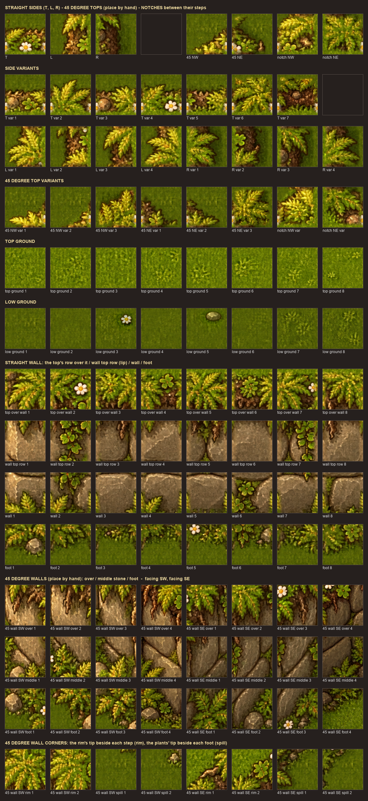

# Cliffs painted by hand

> **Handoff (2026-10-09):** what was tried, what worked, what failed and where the owner stands:
> [CLIFFS-HANDOFF.md](CLIFFS-HANDOFF.md). The chosen approach is the cliff builder below.
>
> **Latest (2026-10-10, awaiting the owner's verdict):** [painted elevation](#painted-elevation-2026-10-10):
> the elevation system's cliffs (any shape painted on an `elevation` layer) drawn with art cut from
> the approved H painting. It replaced the right-angle shape painter in the cliff shapes lab.


> **Status:** first version, 2026-10-09, in the **cliff lab** only (`world.cliff-lab`). It is the
> hand-painted alternative to the automatic [elevation](ELEVATION.md), which stays in the code.

## Owner decisions (2026-10-09)

- Cliffs are painted by hand with Godot's terrain tools, not built by a script from painted
  levels: the owner wants control over every wall and edge.
- Gameplay is the simple Zelda kind: walls and the borders of a raised top are solid; nothing
  knows heights (no walking behind, no ledge drops, no stairs yet).
- Walls and edges must not look flat, the borders above all. Irregularities never reach more than
  one tile outside the cliff, and never run more than two tiles in a row along a side.
- The sheet is laid out like a classic tile sheet (a 3 x 3 with a one-wide column, a one-tall row
  and a single cell; a wall block below): every tile is exactly one cell, so any tile can be
  picked by hand and read at a glance. Tiles stay at 128 px of art per 64-unit cell.
- The ground is part of the sheet: the tops are filled with it, with several plain and decorated
  ground tiles so it does not repeat.
- Low ground is drawn darker than the raised tops, so the eye tells high from low.
- One shared cliff tile set for every world; art is added per region when a region needs it.
- A border is drawn to the very edge of its cell, so it does not look short beside the wall.
- Octagons need 45 degree pieces: chamfers for the tops and 45 degree walls.

## The sheet



`godot/asset/MAPS/cliffs/meadow-rock-highland.png`, 8 columns of 128 px cells:

| Rows | Block | What |
|---|---|---|
| 0-3, cols 0-3 | **Top** | the 3 x 3 (corners, sides, centre), the one-wide column (top, middle, bottom), the one-tall row (left, middle, right), the single cell |
| 0-1, cols 5-6 | **Inner corners** | the notch when only a diagonal neighbour is not top, placed as they meet round it |
| 2-4 | **Border variants** | top, bottom, left and right sides from a second island, and bitten ones |
| 5-6 | **Ground** | seven plain and eight decorated ground tiles: every one joins every other and every border tile |
| 7-10 | **Wall** | cap (with the hanging lip), middle, bottom (plants at its foot), one-level wall; each as left end, middle, right end, one wide, and three decorated middles (roots, vines, boulders, a fern crack, moss) |
| 11 | **Foot** | the ground band and rubble under a wall: ends, middle, single, three with rubble |
| 12-13 | **45 degree pieces** | top chamfers (NW, NE, SW, SE), a top over a 45 degree wall (SE, SW: ground on one side, the wall's top row with its lip hanging straight down on the other), the 45 degree wall's last row (SE, SW: stone, rubble standing along the line). The SE face is drawn darker, the SW face lighter (light from the upper left) |

The ragged border stays inside its cell, its rim line 10 px from the cell's side (tufts past the
side are cut there), so each tile is what it shows and a border reaches the cell's edge.

## Painting

The lab (`game/scenes/worlds/cliff-lab.tscn`, F6, or `?map=cliff-lab`) shows every case: plateaus
with walls one to four levels high, a pit with its far wall, an L shape and a stepped outline.

A world gets one TileMapLayer `cliffs` after its `ground`, with
`res://game/world/cliffs/cliff_tileset.tres`, **scale 0.5** and **z_index -1**. Its terrain set
"Cliffs" (Match Corners and Sides) has four terrains, painted in the TileMap panel's **Terrains**
tab **in this order**:

| Order | Terrain | Paint |
|---|---|---|
| 1 | Highland top | the raised top's cells: its border follows the painted outline, its ground fills it |
| 2 | Rock wall top | the wall's top row, under the top's south edge (the row with the lip); a one-level wall is only this row |
| 3 | Rock wall | the rows below it, one per extra level (a pit's wall is its north side) |
| 4 | Wall foot | the row under the wall's lowest row |

The order matters: Godot gives a side shared by two terrains to one of them depending on which
was painted last, and the tiles are made for this order (each also carries alternatives for the
other answer, but a top painted after its wall keeps a border at its foot). To fix a cliff,
re-stroke its rows in the order above. Godot picks each tile from its neighbours and a random
variant (ground and decorations, border variants, decorated stone); any cell can be replaced by
hand from the **Tiles** tab. Keep a free row between a wall's foot and another top.

**Octagons:** paint the shape with the terrains (a 45 degree side is a staircase of single-cell
steps), then place the 45 degree pieces by hand from the Tiles tab on the step cells: a chamfer
on each step of a top's north sides; on a south side, "45 top over wall" on the top's step cell,
plain "wall middle" stone under it for each extra level, and "45 wall foot" on the wall's last
row (no foot tile under it). A chamfer and a square corner have the same neighbours, so terrain
painting never picks these pieces itself (weight 0); the lab's octagon shows the placement.

**Collision:** wall cells are solid (physics layer 1, `world`), and so is a 12-unit strip inside
every side of a top that faces nothing (and its inner corners): a top is neither climbed nor left.
The 45 degree pieces are solid along their diagonal: a chamfer's cut-off corner, the stone half of
a 45 degree wall cell.
Ways up and down (ledges, stairs) are not built yet.

## Light

`game/world/ground_shade.gd` (mounted by `WorldService.register_world` and, in the editor, by the
ground's `world_ground.gd`) multiplies the ground, the water and the terrain edges by a warm shade
(`low_tint` 0.80, 0.77, 0.72) wherever the cliff layer has no top, turning to full light inside a
top's border cells. The cliff art, props and bodies draw above it and keep their light. A world
without painted tops gets no shade.

## Cliff builder (prototype, 2026-10-09)

A second way to make cliffs, tried after the tile sheet proved hard to paint with: a **cliff
builder** node draws a whole cliff of any size from one approved painting (plateau B, dip A in
`asset/Originals/elevation/cliff-concepts/`). The lab is `game/scenes/worlds/cliff-kit-lab.tscn`
(`world.cliff-kit-lab`, dev only; rebuilt by `godot/tools/build_cliff_kit_lab.gd`).

- **Use:** add a Node2D with `res://game/world/cliffs/cliff_builder.gd` (or duplicate one in the
  lab), put it on the grid, and set **kit** (plateau or dip), **width_cells**, **height_cells** and
  **variation** in the Inspector; it redraws at once. Paint the ground under it as usual.
- **How:** `python scripts/art/build-cliff-kit.py` scales each painting to 128 px per cell (18 x 18
  cells), cuts the outside ground away and writes its straight middle columns and rows
  (`godot/asset/MAPS/cliffs/kit-<name>.png`, `.json`). The builder keeps the painting's corners and
  fills the extra length with runs of the middle in a random order; `cliff_builder.gdshader`
  crossfades where two runs meet.
- **Limits:** the smallest size is the corners alone (plateau 12 x 14, dip 12 x 12 cells); smaller
  cliffs need a smaller painting. One wall height (two levels). No collision yet.

## Painted elevation (2026-10-10)

The cliff shape node (below) put pieces of the paintings next to each other cell by cell and showed
seams where a wall ends and along the side borders: an AI painting is never on the grid (painting
A's left border drifts 80 px from row to row), so two cells copied from different spots do not
meet. The playground's cliffs never misalign because [the elevation](ELEVATION.md) copies no
cells: it lays continuous strips along the painted outline (a wall texture that repeats sideways
and down, corner stones where a wall ends, a lip, rim and foot whose art runs on around every
corner). So the cliffs are now the elevation's, with its art cut from the approved H painting:

- **Art** (no new generation): `python scripts/art/build-elevation-art-from-painting.py [--preview
  DIR]` cuts the wall style `storybook-rock` (wall, end stones, the stairs' coping) and the fringe
  `storybook-grass` (lip and foot; the rims reuse the lip) out of the aligned paintings
  `kit-h3.png` and `kit-h2.png` into `godot/asset/MAPS/elevation/`
  ([ELEVATION.md](ELEVATION.md#making-the-art)).
- **A world uses it** through its `ground` layer's metadata (Inspector > Metadata > Add Metadata,
  type Dictionary): `cliff_wall_styles` = `{"highland": "storybook-rock"}` and `cliff_fringe` =
  `{"highland": "storybook-grass"}`. Other worlds keep their walls.
- **Paint** on the world's `elevation` layer (levels −3 … 3, one stone course per level; single-cell
  steps make 45° edges; stairs tiles too); hide the layer (eye icon) to see the result. Everything
  the elevation has comes with it: walls, collision, walking behind hills, stairs, ledge drops.
- **Lab:** `game/scenes/worlds/cliff-shapes-lab.tscn` (`world.cliff-shapes-lab`, dev only): L, T,
  plus, U from the north and from the south, joined rectangles, a 1-2-3 terrace, an octagon, a
  hole, walls of 1-3 courses and a terrace with a flush front. Its builder
  `godot/tools/build_cliff_shapes_lab.gd` does not overwrite the lab unless given `-- --force`, so
  you can paint in it.
- **Limits:** the lip and foot ferns are at 0.75 of the painting's scale (to fit the elevation's
  strip); the wall repeats every two stones (536 px); `storybook-rock` has no tile on the `cliffs`
  paint layer yet; the low ground is not darker than the tops (`ground_shade.gd` only reads the cliff
  tile set); the treads of stairs stay sandstone.

The cliff shape node (`cliff_shape.gd`, `.gdshader`, `cliff_paint_tileset.tres`; right angles,
levels 1-8 as stone courses, tight spots as configuration warnings) is no longer used by any scene;
it stays until the owner agrees to remove it.

## Cliff builder: the chosen approach (2026-10-09)

After the tile sheet and the paint-the-shape builder showed seams wherever pieces of different AI
paintings met, the owner chose the first cliff builder: **one approved painting stretched to any
size**. The tile and shape tools above stay as experiments.

- **Add one:** in a world scene, Add Node and search **CliffBuilder** (or duplicate one from the lab),
  and put it on the 64-unit grid (its origin is the cliff's top-left corner).
- **Inspector:** `kind` (octagon, rectangle 1 / 2 / 3 levels, octagon dip), `width_cells`,
  `height_cells` (the smallest size is the painting's corners alone; asking for less clamps to
  it), `variation` (another arrangement of the stretched middle), `behind_depth`.
- **How:** each painting (aligned by `scripts/art/build-cliff-kit.py`: one stone course per cell) is
  split into a head, a straight middle and a tail across and down (`columns`, `rows`, `tails` in
  the tool). The cliff keeps head and tail and fills the extra length with runs of the middle in a
  random order, crossfaded where two runs meet (`cliff_builder.gdshader`). A rectangle is an H
  painting stretched: its left leg, the leg's middle, its right leg.
- **In the game:** solid where the painting has wall and along a 12-unit strip inside its top's
  open sides (`CliffPiece.rects_for`); on the north side the strip sits `behind_depth` in and an
  overlay above the bodies redraws that band, so bodies go behind the cliff. The dip has no
  collision yet.
- **Levels:** stack builders: a smaller cliff placed on a bigger one's top, later in the scene tree,
  draws over it and has its own collision.
- **Lab:** `game/scenes/worlds/cliff-pieces-lab.tscn` (`world.cliff-pieces-lab`, dev only; rebuilt by
  `godot/tools/build_cliff_pieces_lab.gd`, so make your own cliffs in another scene).
- **Whole pieces:** `cliff_piece.gd` places a painting unstretched (the same collision).
- **New kinds:** generate a painting with the approved ones as references, approve it, add it to
  `KITS` in the tool (alignment, outline, slices) and to `KINDS` in `cliff_builder.gd`.

## Making the art

The tiles come from generated art (Magnific GPT 2.5, [guide](../assets/magnific-mcp-guide.md)) in
`asset/Originals/elevation/cliff-tiles/`, cut by `python scripts/art/build-cliff-tiles.py
[--preview DIR]` into the sheet, its tile list and the guide picture; then
`godot/tools/build_cliff_lab.gd` writes the TileSet and rebuilds the lab (import the sheet in the
editor first):

```bash
"<Godot 4.7.2 console exe>" --headless --path godot -s res://tools/build_cliff_lab.gd
```

| Source | Prompt idea | Becomes |
|---|---|---|
| `top-island-c.png`, `-d.png` | a grass patch whose border is a thick, chunky, very irregular band of tufts, ferns, clods, roots and stones, no straight side | the 3 x 3 and its runs (c), side variants (d) |
| `top-hole-d.png` | the same border round a hole (no fog inside) | inner corners |
| `lip-a.png`, `lip-b.png` | a cliff top's front edge with a ragged hanging curtain | the lip in a wall's cap |
| `foot-b.png` | plants and rubble against a wall's base | the plants in a wall's bottom, the foot row |
| `wall-features-a.png` | 8 decorations for the wall face, 4 x 2 grid | decorated wall tiles |
| `foot-rubble-a.png` | 8 rubble clusters, 4 x 2 grid | rubble in the foot row |
| `ground-decor-a.png` | 12 small, subtle ground decorations, 4 x 3 grid | decorated ground tiles |

The ground is the 128 px grass sheet ([TERRAIN_LAB.md](TERRAIN_LAB.md#ground-at-128-px)); the
stone courses and wall ends are the elevation's (`godot/asset/MAPS/elevation/meadow-rock-*`).
How the tool keeps the art irregular yet seamless:

- One ground cell is made to wrap both ways; every other ground tile, and the ground inside every
  border tile, has its four sides blended to that one, so all of them join.
- The island is laid on a 3 x 3 canvas with its rim line 10 px inside the outer cells; the
  sides are made to wrap along their length and the corners blended to the sides they meet; the
  one-wide and one-tall runs and the single cell are halves of corners and sides. Only a 48 px
  band of border art is kept in its own colours, over the ground.
- Side variants (the second island, and bitten ones that ease to nothing at the joins) are blended
  to the same joins. Inner corners are an arc of the hole's border at the island's scale, its
  circle crossing the cell's sides where the sides' rim lines do, blended to the sides next to them.
- 45 degree pieces are made from the same art without new generation: a chamfer lays the T (or B)
  side along the diagonal; a 45 degree wall masks the stone courses with the diagonal, hangs the
  lip straight down from it and stands rubble clusters upright along it.
- Wall strips are made to wrap and every variant shares the same side columns; wall ends fade the
  lip, plants and foot out along a ragged line.

The first set (meadow rock, highland grass) took 19 GPT 2.5 images and a 2x upscale of the grass
sheet (about 2,100 credits).

## Next steps

- More grounds and rocks (each needs its island, hole, lip and foot; walls may reuse stone).
- Ledges (one-way drops) and stairs, as painted tiles.
- Outcrop patterns (1-2 tile boulders and spurs) stamped from the Patterns tab.
- The wall's top row does not hide the player behind it yet (draw the lip above bodies).
- A 45 degree wall starts at an octagon's corner with a straight cut, not rounded end stones.
- At the ends of a foot row, terrain painting sometimes picks middle pieces (swap them by hand).

## Files

| Path | What |
|---|---|
| `scripts/art/build-elevation-art-from-painting.py` | Cuts the elevation art `storybook-rock` and `storybook-grass` from the H paintings |
| `godot/tools/build_cliff_shapes_lab.gd` | Builds the cliff shapes lab (elevation layer, the lab's metadata) |
| `scripts/art/build-cliff-tiles.py` | Cuts the generated art into the sheet, its tile list and the guide |
| `asset/Originals/elevation/cliff-tiles/` | Generated sources |
| `godot/asset/MAPS/cliffs/` | `meadow-rock-highland.png` (the sheet) and `.json` (the tile list) |
| `docs/godot/cliffs-sheet-guide.png` | The sheet with every tile labelled |
| `godot/tools/build_cliff_lab.gd` | Writes the TileSet (terrains, neighbours, collision) and the lab |
| `godot/game/world/cliffs/cliff_tileset.tres` | The cliff tile set (tool output) |
| `godot/game/world/ground_shade.gd`, `.gdshader` | The light by height |
| `godot/game/scenes/worlds/cliff-lab.tscn` | The lab (tool output; `world.cliff-lab`, dev only) |
