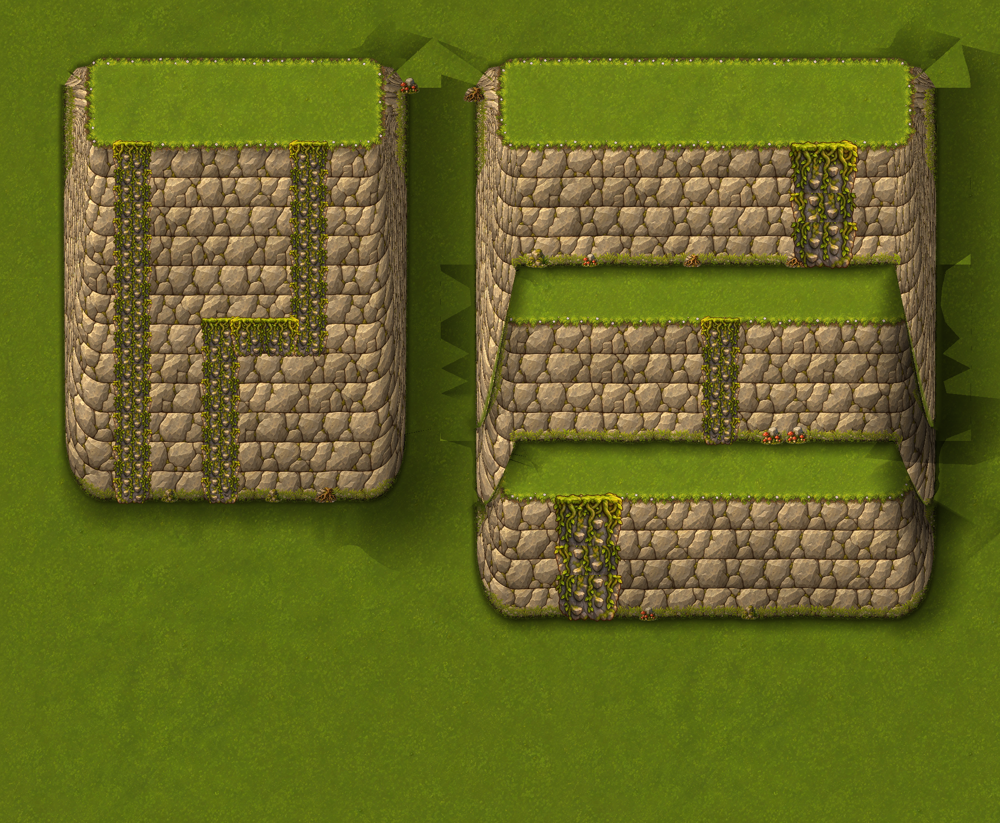
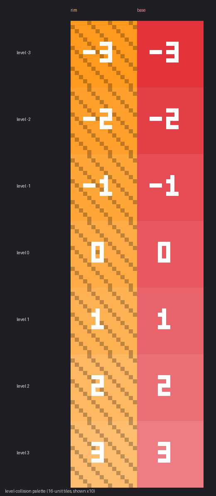
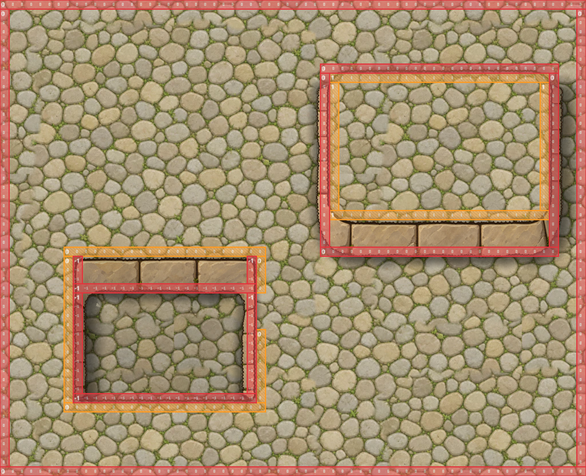
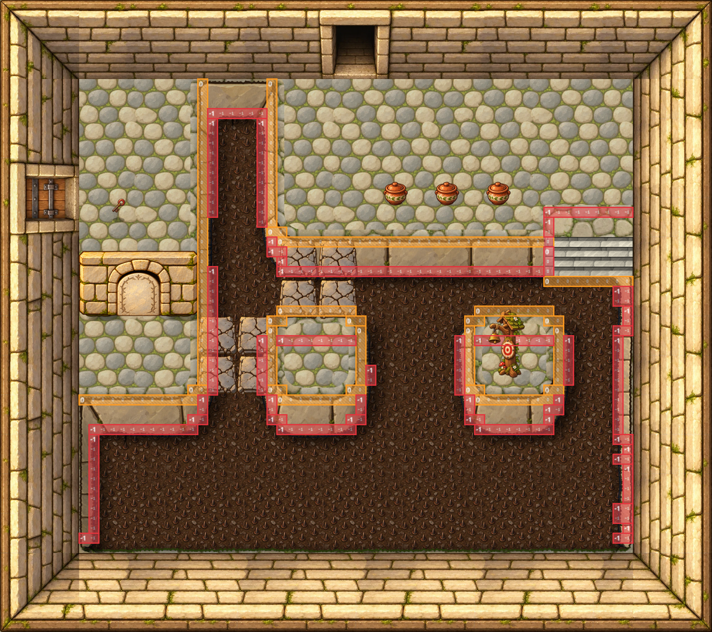

# Elevation: hills, holes and ground levels

> **One cliff look: side walls (owner, 2026-10-14: "I think it is the way to go").** Every world
> draws its cliffs with [Side walls](#side-walls): there is no setting to choose a look, and a world
> made later draws them by itself. The front-only look (walls under south faces only, with fern lips
> and feet, corner stones at wall ends, the model's square cast shadows, the rims' light and water
> lapping at walls' feet) was deprecated on 2026-10-14 and **removed on 2026-10-17** (the owner's
> approval of 2026-10-17): the 49 worlds that still drew it (of the 52 that paint elevation) were
> converted, their caches rebaked, its code and shaders deleted (git history up to `7973880e` has
> them), its 40 art files moved to `asset/to-delete/MAPS/elevation/`, and the ground layer
> metadata `cliff_look` and `cliff_fringe` went with it.

> **The cliff system (2026-10-12).** The hand-painted cliff experiments of 2026-10-09/10 (a tile
> sheet painted with Godot terrains, the cliff builder, the shape painter, the rectangle prototype)
> were removed: this system won, drawn with art cut from the approved painting
> ([Storybook art](#storybook-art)). Their code is in git history (commits `ded3c904`, `14aa891a`).
> The manual fixed-cell prototype stays ([CLIFF-MANUAL-PROTOTYPE.md](CLIFF-MANUAL-PROTOTYPE.md)).

> **Status:** first version, 2026-10-05, in the playground only (the **Elevation Park**, rows
> 28-121 south of the old playground). Since 2026-10-09 level-1 paints it too (its village plateaus,
> two flights of stairs, and from 2026-10-10 a wall along its north edge painted above the map). The
> owner asked to retake elevation after the Phaser-era attempt (branch `feat/elevation-levels`, never merged and
> deleted on 2026-10-14; its design is archived in [ELEVATION_LEVELS.md](../archive/phaser/ELEVATION_LEVELS.md)) failed on
> art that did not join at the top and foot of 2- and 3-level walls.

## Owner decisions (2026-10-05)

(The decisions as they were taken. The front faces only, the per-ground lips and feet and the
corner stones at wall ends below were replaced by the [side walls](#side-walls) of 2026-10-13/14.)

- Three pieces of art make a cliff: the **top edge** and the **bottom edge**, per terrain (the
  terrain is the master), and a **wall** that repeats seamlessly sideways and downwards.
- Hills and holes are **cubes, diamonds and octagons**, showing **only their front faces**: a
  square shows its south face, a diamond its south-west and south-east faces, an octagon all three.
  North, east and west sides are rims without a wall.
- Holes are hills upside down: the wall shows on their far (north) side.
- Later the same day: wall ends need an edge of their own (they looked cut out), every ground
  needs its own cliff foot, and water at a wall's foot laps back and forth against it.
- 2026-10-06: walls are taller than the slime, so it must be able to go **behind** them and be
  hidden, for any hill size, and a taller hill must hide more than a lower one. Corners and the
  top shadows looked fake. Focus on the art, the physics and the collisions.
- Later on 2026-10-06: going 64 units per level behind a hill looked wrong, so the walk-behind
  depth is **capped**. Hidden bodies show as a **mix of silhouette and see-through**, the player
  and the enemies alike. Rims **hold the slime like in Zelda** until it insists; then a short fall
  plays and it lands **where the picture says it falls** (in front of a wall, behind a hill, beside
  it). Jumping on and off hills broke the collisions, the camera snapped at landing and the shadow
  stayed behind; the jump also reached level-1 tops. The owner is unsure the jump fits the game: it
  stays as a low hop that never climbs (below), easy to drop later.
- 2026-10-08: the jump is removed from the game. Its code stays (no key runs it and nothing
  teaches it), so stairs and ledge drops are the only ways between levels in play. Ledge drops
  still fly with the jump's flight (`jump_sequence.gd`).
- 2026-10-11, from an *A Link to the Past* screenshot: "cliffs can connect to the ground with no
  stairs, giving the illusion of different levels; it works on 45 degree angles that converge the
  upper level and the lower level". Built as [ramps](#ramps), prototyped in the cliff shapes lab
  ([Storybook art](#storybook-art)).
- Later on 2026-10-11, after painting a U with two 45° arms and ramps along their feet: "the green
  arrows are only used in open cliffs, not in closed figure cliffs, since the corners join the wall
  with the ground. So if they are used the cliff is open and the shadow and other rules may not
  apply". A ramp marks where a cliff **opens**: the wall comes down to meet the ground and the top
  joins it, instead of turning a corner and closing the shape ([open ends](#open-ends)).

## What you see

A raised area is drawn where it is painted, as a block seen from all four sides
([Side walls](#side-walls) has the details). Below its south-facing edges hangs a rock wall, **one
stone course (one cell, 64 units) per level of drop**, so a 3-level wall shows three courses with
their joints lined up across every face; its east and west sides show a narrow strip of the same
wall, its back (north) edge none. Its corners are round and its edges wobble a little. The wall is
of one of twenty-four **wall styles** (meadow rock, snow rock, sandstone, cave rock, crystal rock, mossy
rock, masonry, root rock, red rock): the one painted over its top, else its ground's
([Wall styles](#wall-styles)). The top's edge is drawn from its own ground (darkening towards the
edge and hanging over the wall in round clumps with a dark outline), the foot from the lower
ground's (a dark line, a few clumps and a soft shadow); a wall standing in **water** has the water
lapping up its base to a wobbling waterline, with patches of foam, as a deep-water bank's foot. A **one-row open cliff** (below) has no back rim. Raised ground **casts a
shadow** to the lower right from its walls' feet (the light comes from the upper left), longer for
a taller wall. Faces are shaded by the way they look (west lit, south mid, east dark). The ground of
a hole and the lower courses of its walls darken with every level of depth; since 2026-11-06 a
raised top, the upper courses of its walls, its edges, ramps and stairs get lighter with every level
of height the same way (the owner: "light the upper levels ... so the optical effect is better"), 8%
a level, at most 24%, a colour near white lifted less so snow keeps its detail.

**Stairs** (reworked 2026-10-11 after the stairs of *A Link to the Past*, at the owner's request:
"they do not pass the bottom and on the top only the top edge of the cliff"; painted and set into
the walls on 2026-11-06, the owner: they looked "painted on top of the wall instead of coming from
inside the wall", their "perfect lines" did not match the map, and steps built from textures were
"the same square painted stairs just a different art": "paint the whole stair at once") are flights
of worn stone steps cut from the cliff's own rock, each **painted whole** where there is a piece for
its size (the concepts the owner picked, **Front A** for front flights and **West C** for side
flights; pieces and concepts in `asset/Originals/elevation/stairs-painted/`), in one of six **art
sets**, each painted for a family of grounds (the owner, 2026-11-06: "at least 3 or 4 different art
stairs to match our other grounds"; he picked them from two concepts each): **desert** (worn
sandstone between round boulders: sandstone, the desert and earth walls, red rock), **meadow** (grey
fieldstone with grass and moss: meadow rock, storybook rock), **snow** (blue-grey stone, snow on the
treads, icicles: snow rock, ice dirt), **forest** (log steps in dark earth between root-wrapped
rocks: root rock, mossy rock, forest faces), **town** (cut stone blocks and slabs: masonry, castle
and town faces) and **cave** (the town's blocks, another painting: cave and crystal rock, dungeon
and volcanic faces). A flight takes the set of the wall style it is cut into (`ElevationStairs.art_set`;
painting a hill's `cliffs` layer changes it), drawn as painted on its set's own style and coloured
after the wall on the others (red in red rock, pale in castle faces); a flight leaving a top with no
wall style takes the desert set in its ground's colour. No joint lines are drawn over them. They
leave a rim in any of 8 directions:
- **front flights** (south, south-west, south-east) are set into the cliff's face, from its top edge
  down to its foot and no further: no landing on the top, nothing run out over the lower ground.
  Each is one painted piece (one for a one-level flight, one for two or more levels): its steps sit
  in a notch, framed either side by big rounded boulders that overlap the steps' ends and the wall
  beside them (their posts are not drawn, they still block), so the steps come out of the rock as
  in Front A. A 45° flight (south-west, south-east) has pieces of its own, painted on the slanted
  face (the steps run with it, round boulders either side); a south-east flight draws the
  south-west piece mirrored and in shade (that face turns from the light). The top's edge breaks
  only over the steps;
- **side flights** (east, west) run out a cell per level beside the hill (seen from the side), each
  one painted piece (West C's painting for two levels one cell wide, new paintings in the game's own
  camera for one level, one or two cells wide; an eastward flight draws the westward piece
  mirrored; a size with no piece yet is built from the kit, below). A side flight comes out of the
  hill's side wall: where the hill runs on past its near side, the side wall's rock covers the part
  of the flight behind the wall's surface (the owner's green line: from the rim on the flight's near
  side down to the wall's foot), so the steps come out of the rock;
- **back flights** are foreshortened (north 1.5 cells per level, 45° ones a diagonal cell), as no
  face of the hill shows there: steps from the rim (no landing) down onto the lower ground, between
  two low side walls, built from the painted kit (treads seen from above, side walls of big rounded
  blocks with slabs on top); what of a back flight lies behind the hill's top is hidden by it.

A flight is one or two cells wide. The flights of 2026-10-06 (a landing on the top, railings with
newel posts in the cliff's rock, front flights running a cell per level past the wall) are in git
history and `asset/Originals/elevation/stairs-mockups/`; those of 2026-10-11 to 2026-11-06 (blocks
in a ruler grid outlined in dark lines, posts beside a front flight, in one pale stone coloured by
the ground) are in git history.

**Ramps** join the levels with no steps, as in *A Link to the Past*: ground that slopes from the
lower level up to the top beside or behind it, drawn as flat ground, so the two levels seem to
meet. Beside a ramp the cliff shows only the height left between the top and the slope: the wall
**tapers** from its full height to nothing where the slope reaches the top, on a straight south face
or a 45° one, its stone courses where they always are, the top's edge running on along it to the
end and the foot line following the slope up. Where the slope reaches the top at the end of the face
and the top ends there too (an arm's or a ridge's tip, a face's end) the cliff is **open**: no wall
turns around the end and no shadow falls on the slope there; at a closed plateau's corner the rim
stays closed ([Open ends](#open-ends)). A **one-row open cliff** (owner,
2026-10-11) is a top one row thick (or, since 2026-10-14, one column thick: an arm running north)
that ramps join to the ground below, as the owner's U in the cliff shapes lab: it has no back rim
(on so narrow a top it made a second top border), no wall on its inner sides, and its ramps take no
shadow. Nor has it a hidden strip behind it (`ElevationGrid.no_strip`):
its back reads as flat ground, so nothing walks under it from behind. Around it **only walls
collide** (owner, 2026-10-12; `Elevation._find_open_zone`): in its cells, the lower cells touching
it and the cells its ramps stand on, a collision line with ground of the cliff's level on one side
and ground of its ramps' bottom level on the other (its back edge, an arm's side, a ramp's sides
and ends, the cliff's tip) is cut out (`_cut_open_seams`), no ledge drops over it, and a body
crossing it takes the level of where its feet are (`_level_across_open`). So the cliff, its ramps
and the ground around them are one walk, as they look: a body coming onto the top from anywhere
stands at its level by the time it reaches the front rim, the rim holds it there and a drop off it
lands at the right level, whatever level the ground behind is painted. The faces and the wall a
ramp tapers still collide, and their rims are jump borders: here a body drops over the tapered wall
too. Every other cliff, ramps or not, keeps its back rim, strip and collision.

**Behind the hills.** A hill hides the ground right behind it: from the north, a body can walk
`behindDepth` (32 units on screen) into a hill's top, and the hill covers what of it is behind; a
body in a hole walks as far under its near rim. The depth is the same for every height (in 3D it
would be 64 units per level, which buries the slime behind a tall hill); what shows of the body
still follows the height. The hidden part of a body shows as a **ghost**: its own colours tinted
blue and see-through (the player at 0.6, enemies and NPCs fainter at 0.35). East and west sides
hide nothing (the camera looks north).

**Moving between levels.**

- **Stairs** join two levels and are a passage, not ground (owner, 2026-10-14, the
  [stairs walk](#stairs-walk)): the player stepping onto a flight along it is carried to the other
  end a step at a time, slower than walking and with a stair-step sound, and takes the level of that
  end as it steps off; it cannot stop on the way. Enemies and NPCs never set foot on stairs (they
  stay on their levels; ramps are ground to them). The posts or side walls hold a body on the steps;
  a body put on a flight takes the level of the height it stands at (the upper half of a level's
  stretch the level above).
- **Ramps** too: a body takes the level of the height it stands at (the upper half of a level's
  stretch the level above), and steps between the slope and the top beside it where the face left
  between them is low, at the top end. Their long sides are open ground: a body walks on and off
  them anywhere their side meets ground below the slope's highest part (taking that ground's level
  when it steps off). A free top end is the top's rim carried on: the top level is held there and drops
  over it, lower levels meet it as a wall. The tapered wall beside a ramp is solid and no ledge
  drops over it (except around a one-row open cliff, below); on the slope no ledge drops over a
  wall that rises above it either.
- **Open cliffs**: around a one-row open cliff a body walks on and off the top and its ramps
  anywhere no wall stands, taking the level of where its feet are ([What you see](#what-you-see)
  has the rule); its front rim holds and drops like any other.
- **Changing area**: the player is spawned in the new world and takes the level
  of the ground where it appears (`track` with no level); crossing a chunk line (a scroll) it keeps
  its level where that level can stand there ([Across chunk lines](#across-chunk-lines)). So does a slime put somewhere inside
  the same world: waking from a faint at the spawn, the entrance or a bed, arriving by a stair hatch
  or at a room's entry (`player.gd` `arrive_at`), whatever level it left (2026-10-19: one that
  fainted in R7's spike pit woke under the north floor).
- **Ledge drops.** A rim holds the slime, as in Zelda. Pushing against it for `dropPushMs`
  (280 ms) drops it over: a small hop off the edge, then a fall. Shape does not matter (a straight
  rim, a 45° one, a tip, a wall's top): the side of the body facing the push is probed a few units
  further (`Elevation.ledge_below`), and it is at a ledge when what is past it is lower ground (a
  lower top, or a wall whose top is at or below its level). The landing follows height alone: it
  is where a fall straight down looks like it lands from the camera, `dropOutward` (22 units) past
  where it stood and one cell lower on screen per level dropped. Over a south face (straight or
  45°) that is the wall's foot; over a back rim, the strip behind the hill (hidden); over a side rim
  or a tip, beside the hill. Where that spot has no room (a wall, deep water) the landing takes the
  nearest spot that has, up towards the rim or further out, so a side drop past a wall lands beside
  it, not hidden behind the hill; with no room at all the rim keeps holding. Nothing drops up a
  wall, from the strip behind a hill into the hill, or off stairs (their posts and side walls are
  solid).
- **The jump** (hidden since 2026-10-08: no key runs it; tests still do) is a low hop
  (`hopArcHeight` 36 units, below one level) that **never climbs**: it stops before higher ground,
  walls, trees, props, closed doors, fences and stairs going up (the whole foot line off their
  steps). Its landing is worked
  out on the ground plane, as the camera sees the world (`Elevation.hop_target`; owner,
  2026-10-27: a jump off a level lands lower than it started, by the height it fell): the body's
  ground point moves the hop's distance along its way while it falls, so a landing on a lower level
  is 64 units lower on screen per level dropped (a jump east or west off a level-0 rim onto level −1
  ends 64 units further down the screen). Over a rim (`ledge_below`) or out over a flight of stairs
  going down from its level it is in the air: steps are no ground in the air, so it flies over them.
  It lands at the end of the hop on the highest lower level where the body has room (`_lands`: in a
  world with [painted collision](#painting-collision) off that level's rims and bases, so past the
  wall foot painted for it; never on the steps of a flight; never inside a wall, a tree, a prop or a
  closed door, and never with one of them between take-off and landing: `body_fits` and
  `_path_clear` ask the physics of the world layer, 2026-10-30, the owner: "nothing should cross
  walls"), else further out (up to two cells),
  else back towards where it left its level; when none of those has room (the floor the full height
  lower is behind a wall, as beside r4's east ledge, whose rim is 40 units above the room's south
  wall), it and a ledge drop land as low as there is room, never higher than where they started
  (`_landing_raised`; owner, 2026-10-30: a painted rim is there to drop over). With painted collision the hop on its own level follows
  what collides as the walk does (`body_fits` `by_paint`: the painted rims and bases, the stairs, and
  the world layer's walls), not the `elevation` paint's level of the cells: where the painted
  rims and bases sit past the cells' level change, a body that walked there still jumps (owner,
  2026-10-28, r4). `body_fits` tests its points `FIT_INSET` (1 unit) inside the body's rect, so a body
  the collision stopped against a painted base (its feet a hair past the line) still fits and jumps
  along the wall. Without elevation it is Phaser's jump.
- **The flight** (`jump_sequence.gd`, for both) is worked out in 3D: the point on the ground moves
  evenly from take-off to landing and the height falls under gravity. The body travels on screen
  with it, so the camera and the hurtbox follow smoothly; the art rides above the body, rising first
  and falling faster at the end. The shadow lies on the ground under the slime (on the top while it
  is over it, then on the lower ground, hidden behind a hill), smaller and fainter the higher the
  slime. The body's depth blends from take-off to landing, so it stays in front of the wall it falls
  down and slips behind the hill it drops behind. Pressure plates ignore a slime in the air.

The values live in `game-constants.json` `elevation`: `behindDepth` (rounded to half a cell),
`dropPushMs`, `dropOutward`,
`dropBaseMs` (260) and `dropMsPerLevel` (90) for a drop's time, `hopArcHeight`.

**The park** (`game/dev/playground.tscn` or the world `game/scenes/worlds/playground.tscn`, F6;
walk south from the spawn, or launch with
`?map=playground&spawn=1280,1950`): square hills at levels 1, 2 and 3, diamond hills, octagon hills,
a square hole (-1), a diamond hole (-2) and an octagon hole (-3), terraces (levels 1-3 nested), a
sand plateau and a snow plateau, a ridge of levels 1, 2 and 3 on one south edge, a flooded diamond
hole, a two-level cliff standing in a lake (with an island and a deep pool), and a row of plateaus on
forest soil, moss, fallen leaves, cavern, crystal and cobble. Every square and octagon hill, the
terraces, the plateaus, the ridge, the lake cliff and two holes have stairs. At the bottom, the
stairs showcase: a level-2 octagon with a flight on each of its 8 sides, and a level-1 octagon with
flights two cells wide. The plateaus' flights show the stairs' colours. Every wall style shows: the
plateaus take their ground's,
and the `cliffs` layer paints the diamonds (sandstone, mossy rock, crystal rock), the octagons
(masonry, red rock, cave rock), the octagon hole's far wall (root rock), the ridge (cave rock,
masonry and sandstone meeting on one edge), the lake cliff's east half (mossy rock) and the
showcase (red rock, masonry). The square hills, the terraces and the other holes keep meadow rock.

## Authoring

1. Give the world an `elevation` TileMapLayer beside its ground layer (same grid), with the tile
   set `game/world/elevation/elevation_tileset.tres` and the script
   `game/world/elevation/elevation_layer.gd`.
2. Paint the **top you walk on** with a level tile (−3 … 16; unpainted cells are level 0; the
   levels over 3: [High levels](#high-levels)). The wall
   appears by itself below the area's south edges and covers the cells there: leave as many free
   rows below a south edge as the levels it drops. A hole is painted the same way with a negative
   level; its far wall covers its first rows. A wall along the map's north edge with its top off
   the map: paint the top on the rows **above the map** (row −1 and up, at most `MAX_ROWS_ABOVE` =
   19, the tallest wall's courses): the elevation starts its grid that many rows higher (`cell_offset`; its node moves up as far),
   so only the wall and its top edge hang into the map. Its top takes the ground of the map's first
   row.
3. Shapes come from the steps of the paint: **single-cell steps make a straight 45° edge**, steps
   of two cells or more keep a square corner. A staircase of single steps is a diamond's side; a
   rectangle with its corners cut by single steps is an octagon; a diagonal line of single cells
   (each touching the next only at a corner) is a staircase on both sides, a **45° ridge** about
   45 units wide (two blocks touching only at a corner stay apart there).
4. Paint **stairs** with the arrow tiles (row 2 of the palette; row 3, once an open landing, paints
   the same flights; the arrow points down the stairs) on the **first cell past the rim**, on the
   lower side, in the flight's direction: below a south edge the wall's first row, beside a side the
   cell next to it, north of a back rim the cell above it, at a 45° rim the lower cell whose corner
   the chamfer fills. Two such cells side by side along the rim make one flight two cells wide. The
   flight joins the higher ground behind the cell to the level of the cell (the ground it leads
   down to). A front flight stays in its wall; the others need room on that ground: a cell per
   level beside the hill (sides), 1.5 cells per level to the north (a diagonal cell per level at a
   45° back rim), keep other hills out of it. **A side flight's look follows the hill around it**
   (2026-11-21, west-village B5's hill): beside a straight side it stands out on its own stone box,
   a long slanted block in front of the side; with the hill on the cell just north of its top cell
   (the flight tucked into a corner of the hill) it is drawn cut into the rock, the steps set into
   the side. For the cut-in look, paint that one hill cell north of the flight. The old `S` tile is a front flight. The flight's
   colour comes from a road at its foot or its top end (cobble, sand or forest soil), else the
   ground of the top it leaves: paint the road up to the stairs to give them the road's colour.
   Any number of flights may leave one straight rim: each opens its own way through the rim's
   collision (until 2026-11-02 only the first flight along a long straight side opened, so a
   second side flight further along it could be climbed but not walked down from the top).
5. Paint **ramps** with the green wedge tiles (row 4 of the palette; the arrow points down the
   slope) on **every cell of lower ground the ramp runs over**: along the foot of a wall (the cells
   right below a south face's wall, or the diagonal of cells in front of a 45° face), or out from a
   rim like stairs (below a south face's wall, beside a side, north of a back rim). Its length is
   the cells painted along the arrow: along a 45° face one diagonal cell per level is enough (a
   diagonal cell is 1.4 cells long), along a straight face or out from a rim two per level (2-3
   read gentler); its width is the cells side by side. Ramps are for **open cliffs**: paint them
   where the cliff should come down to the ground, at an arm's or a ridge's tip or a face's end
   ([Ramps](#ramps) has an example); at a closed plateau's corner the wall still tapers, but the
   rim stays closed around it ([Open ends](#open-ends)).
6. The ground on top and below is the ground layer's: paint sand on a plateau and its top edge is
   drawn in sand.
7. The **wall style** follows the ground on top; to choose another, paint it on a `cliffs` layer
   ([Wall styles](#wall-styles)).

In the editor the cliffs follow the paint at once (the layer's script mounts the drawing under the
ground layer, never saved with the scene); hide the `elevation` layer (eye icon) to see the result
without its numbered squares. The game hides the layer.

`scripts/maps/build-elevation-park.py` builds the park and is the worked example; it rewrites the
playground's park rows, so hand edits to the park are lost when it runs again.

**Fences** with their own collision are painted on the `fences` layer and documented in
[FENCES.md](FENCES.md) (`game/world/fences/`). They do not create elevation rims or cliff art; of
the elevation they read only a cell's level and draw into its depth map.

**Sky floors** (islands over the clouds) paint the sky as holes (level -2 or lower) and draw it with
a `SkyFloor` node over an area: [SKY_FLOOR.md](SKY_FLOOR.md). It draws this drawing's own holes mesh
again with the sky (in the Shade, under the walls) and its wall meshes again with the cloud bank up
their feet; a drop into the sky is the dungeon kit's void fall, pinned to the sky cells (`SkyFall`).

### High levels

Levels go up to **16** since 2026-11-12 (3 before; the owner: "more than 10 levels for my new ideas
of climbable chunks"), so one wall can be nineteen courses tall (−3 to 16).

- **Painting.** The tile set's last two rows hold the levels 4 … 16 (red through purple to pale
  blue, their number on them). A wall still takes a row a level: leave as many free rows below a
  south edge as the levels it drops (twelve rows under a level-12 top that comes down to level 0),
  and paint a ledge on the way down as its own level from under the higher top's edge (its first
  rows lie under that wall).
- **16 is the most.** Each level's collision is on a physics layer of its own and there are 32:
  levels −3 … 3 on layers 12 … 18, 4 … 16 on 20 … 32 (`ElevationGrid.physics_bit`; 19 is the
  stairs').
- **Levels in colours.** The shaders get a level in a vertex colour or a depth-map texel, 8 bits
  each: (level + 4) / 32, and a depth below a wall's top edge as (dy + 128) / 1536
  (`level_code.gd` writes them, `elevation_code.gdshaderinc` reads them; / 8 and / 512 before, which
  ended at level 4 and six courses). A depth texel's step is 6 units now (2 before); the hiding of
  bodies behind higher ground allows 12.
- **Light.** The tops get lighter up to level 3 and no further (`BRIGHTEST`), so a mountain's high
  ledges share one light.
- **Chunks** read 19 rows of their north and south neighbours' paint instead of 6
  (`MAX_ROWS_ABOVE`), as far as the tallest wall hangs.
- **Caches.** `CACHE_VERSION` is 4: every world's cache was baked again.
- **The climb lab** (`world.climb-lab`, `?map=climb-lab`; `game/scenes/worlds/dev/climb-lab.tscn`,
  first painted by `tools/build_climb_lab.gd`, then the owner's to repaint): a sheer wall twelve
  courses tall with two balconies ([Balconies](SKINS.md#balconies)) and terraces at 12, 8 and 4,
  with vines to climb them ([Painting vines](SKINS.md#painting-vines)); it lends the Feral skin.
  Since 2026-11-14 it also holds the climb monsters ([BESTIARY.md](BESTIARY.md#the-climb-monsters-rows-34-to-36):
  a Rock Chucker on the sheer wall's rim, two Spiny Caterpillars, one on a band of vines added
  across row 14, and a Ledge Raven on the high balcony), placed by hand under its `Enemies` node.

Not looked at yet on tall walls: the drop off a high rim (`dropBaseMs` + `dropMsPerLevel` a level:
1.3 s from level 12), stairs and ramps over many levels (a ramp's height in the depth map ends at
8 levels, `RAMP_LEVELS`), and a wall taller than the screen under the camera.

- **Tall walls' sides** (2026-11-13). A side wall is no wider than a three-level one (52 units,
  `SIDE_FULL_DROP`; grown on with the height, a twelve-level side was 140 wide and buried the ledges
  beside it), and a wall over three levels turns its corner as a three-level one does under a
  straight stretch (`reach`, `TALL_TURN`): its side stays a strip all the way down and rounds off
  over its last courses only. No outdoor wall was over three levels before, so the worlds painted
  until then draw as they did.

## Wall styles

Inside a dungeon room with interior walls, a hole's walls take the cliff style of the room's walls
before the ground's choice (INTERIOR_WALLS.md "Pits and holes"); the `cliffs` layer still overrides.

A wall is of one wall style (2026-10-08; before, every cliff was meadow rock; flights of stairs
take their colour from their ground instead, [Stairs](#how-it-works)). The style of a wall is, in
order:

1. the one painted on the world's **`cliffs` layer** over the top it hangs from: a TileMapLayer
   named `cliffs` beside the `ground` and `elevation` layers (same grid), with the tile set
   `game/world/elevation/cliffs/cliff_tileset.tres` and the script
   `game/world/elevation/cliffs/cliff_layer.gd`. Paint the cells of a hill's top (all of them, or
   only those along the walls you want to change). A hole's far wall hangs from the ground around
   the hole: paint those cells. Like the other layers it follows in the editor at once and hides
   itself in the game;
2. else the style of the **ground on top**: the world's own choice for that ground, if its ground
   layer has the metadata `cliff_wall_styles` (a Dictionary, ground → style, e.g.
   `{"highland": "storybook-rock"}`), else the **ground's default wall**: the table
   `game/world/elevation/cliffs/ground_wall_styles.tres` (below);
3. else meadow rock (`DEFAULT_WALL_STYLE`); a style without wall art also falls back to it.

What stands in a wall follows its style too (2026-11-14): a balcony painted on it and a cave mouth
or wall hole placed in it show the picture made for that style (SKINS.md "Balconies", DUNGEONS.md
"Holes and hatches"). They ask `Elevation.wall_style_at(point)`, the style a face is drawn in at a
point ("" off any wall), and look again whenever the elevation is built (the `wall_pictures` group).

**Each ground's default wall** (2026-11-06, the owner: "i want to use those dirt walls, and being
able to change the default wall for a ground"): open `ground_wall_styles.tres` in the Inspector, one
drop-down per ground (`Grass (highland)`, `Sand (sanddessert)`, ...) offering every style the
`cliffs` layer paints (the tile set's `wall_style` data); the revert arrow puts back the default as
shipped (`GroundWallStyles.DEFAULTS` in `ground_wall_styles.gd`, the table in "Ground on top"
below). An open world's walls and stairs follow at once; every world's walls of that ground change,
and the table is part of every world's cache key (`Elevation.ground_wall_styles()`, `_cache_key`), so
bake the caches after a change (a game run from the project rebuilds an outdated world as it loads
it; an exported game only reads the caches). Sand takes `desert-dirt` since 2026-11-06 (the
owner's pick there); `mountain-dirt`, `ice-dirt` and the faces are in no ground's default yet: pick them there, or paint them on a
hill's `cliffs` layer. A preview of the earth walls as defaults (grass on mountain dirt, sand on
desert dirt, snow on ice dirt): `asset/Originals/elevation/wall-variation/dirt-walls-preview.png`.

**A world's own wall for a ground, in the Inspector** (2026-11-06, the owner: "trying different wall
on a ground right there in the inspector"): select the world's `elevation` layer; its **Wall
Styles** section has one drop-down per ground the world paints (`Sand (sanddessert)`, ...), first
`default: <style>` (the ground's default above), then every style. A pick writes the ground layer's
`cliff_wall_styles` metadata (`elevation_layer.gd`; back to `default` removes it), the walls and
stairs follow at once, the revert arrow returns to the default, and a hill painted on the `cliffs`
layer keeps its paint. Bake that world's cache after (its key holds the metadata). In a chunk world
the pick is the chunk's own (see the limits under "Across chunk lines").

The metadata is per world, so a world can try a style without changing the others (the cliff
labs do, [Storybook art](#storybook-art)). The fieldstone walls' `walls` layer (WALLS.md) has a
`wall_style` data layer too; it paints no cliff (only a layer with `cliff_tileset.tres` does,
`Elevation.find_cliff_layer`).

| Style | Tile | Look | Ground on top (as shipped) |
|---|---|---|---|
| `meadow-rock` | M | warm grey-brown boulders with tufts of moss | grass (`highland`), and any ground not listed |
| `snow-rock` | S | cold blue-grey granite with ice crystals in the cracks | snow (`frozen`) |
| `sandstone` | D | ochre and peach wind-smoothed blocks with layered strata | sand (`sanddessert`) |
| `cave-rock` | C | dark slate-blue slabs, pale cave mushrooms, specks of glowing moss | `cavern-floor` |
| `crystal-rock` | K | indigo slabs with violet and cyan crystal clusters | `crystal-floor` |
| `mossy-rock` | G | grey-green stones under cushions of moss, ferns | `forest-moss` |
| `masonry` | B | cut limestone blocks in a running bond, quoins at the ends | `town-cobble` |
| `root-rock` | R | dark umber stones in forest soil, threaded with roots | `forest-floor` |
| `red-rock` | A | terracotta and rust-red stones with fallen autumn leaves | `amberleaf` |
| `mountain-dirt` | EM | an earth face (no courses): dark loam with half-buried grey stones and pale roots | none yet; paint it |
| `desert-dirt` | ED | an earth face: wind-carved badland clay in wavy rust, ochre and cream bands, pebbles | sand since 2026-11-06 (the owner's pick in `ground_wall_styles.tres`; `sandstone` as shipped) |
| `ice-dirt` | EI | an earth face: frozen brown soil with veins of blue ice, hoarfrost and small icicles | none yet; paint it |
| `autumn-face` | FA | a face (no courses): an orange basalt-column face with autumn tufts | none yet; paint it |
| `castle-face` | FC | a face (no courses): pale cut limestone bricks, two rows a level | none yet; paint it |
| `cave-face` | FV | a face (no courses): blue-grey rock columns | none yet; paint it |
| `crystal-face` | FK | a face (no courses): indigo rock columns with violet and cyan crystals | none yet; paint it |
| `desert-face` | FD | a face (no courses): stacked sandstone blocks and ledges | none yet; paint it |
| `dungeon-face` | FU | a face (no courses): dark slate bricks, two rows a level | none yet; paint it |
| `forest-face` | FF | a face (no courses): mossy rock columns with roots and ferns | none yet; paint it |
| `meadow-face` | FM | a face (no courses): golden rock columns | none yet; paint it |
| `snow-face` | FS | a face (no courses): ice columns capped with snow, icicles | none yet; paint it |
| `town-face` | FT | a face (no courses): mossy fieldstone masonry, two rows a level | none yet; paint it |
| `volcanic-face` | FO | a face (no courses): dark basalt columns with glowing seams | none yet; paint it |
| `desert-strata` | DS | a face (no courses): layered desert strata in wide bands | none yet; paint it |
| `storybook-rock` | – | rounded grey-brown stones of the approved H plateau painting, cut from it | none; a world picks it by metadata |

Exactly where: a style is read at the middle of each boundary edge of a top, a little into the top
(half a cell in when the cell there is a corner triangle a chamfer raised, so it belongs to the
painted cell across the corner). A top's border is drawn as one chain of walls
([Side walls](#side-walls)): the chain takes the commonest style its grounds give it
(`Elevation._ground_style_at`), and each stretch of it painted on the `cliffs` layer the painted
style (`_painted_style_at`; its stretch goes into a mesh of its own), so two styles meet on a line
across the wall where the paint changes along it, and a path of another ground reaching the edge
does not change the wall. The model's walls keep a style each too (`Elevation.band_styles`, per
`grid.bands`, the paint else the ground under each half-column).

## How it works

`WorldService.register_world` calls `Elevation.mount(ground, true)` after the water and the terrain
edges: `game/world/elevation/elevation.gd` adds the node `Elevation` under the ground layer, builds
the model and draws it.

**The model** (`elevation_grid.gd`, pure data). The map is authored as the camera sees it. Every
cell is split into 8 triangles ("tris"): its 4 corner triangles and the 4 quarters of its centre
diamond, which meet on the 45° lines. A **chamfer** gives a corner triangle the level across the
corner where a convex corner and a concave one form one step of a staircase (they pair along the
45° line), so single steps become straight diagonal edges and lone corners stay square. Where two
raised cells touch only at a corner (a saddle) and the two lower cells there each pair with a
convex corner beside them along the 45° line (the raised cells are part of a diagonal line of
single cells), the corner joins them into one 45° ridge (`_saddle_flips`; a lowered diagonal line
makes a trench the same way); two blocks touching at a corner pair with neither and stay apart.
**Walls** are swept per half-cell column, top to bottom: below an edge where the north tri is
higher (level a) than the south one (level b), the wall covers the next 4·(a − b) tris, one cell of
depth per level, unless a tri in front of the wall plane hides it first (a tri of level l at depth d
cells hides it when d ≥ a − l: the near rim of a hole, a lower platform standing in front). A wall
that reaches its depth has a foot. A covered tri is wall, walkable at no level. Stairs are not in the
model: a stairs cell counts as the ground it leads down to, and the flight stands on it.

**The ground in 3D** (`elevation_grid.gd`). One level up is 64 units up and drawn a cell higher,
so the ground of level L seen at screen point p lies at ground position p + L cells (south): that
is the depth of a body, feet y + 64 · level. A level walks on its own visible tops (not walls), on
stairs that reach it, and on the strip behind higher ground: below every **back rim** (an edge
where ground it walks on, north, meets a higher top, south: a hill's north and diagonal back rims,
a hole's near rim) it may go `behind` cells further (`behindDepth` / 64, rounded to half a
cell), into whatever higher ground is there: the top, and at a hill's tip (a diamond's or an
octagon's side corner) the top corner of its wall. So the strip's edge runs straight on to the tip
and turns down the wall's end to its foot (with side walls, the side wall starting at a tip's round
holds a body pressing straight down there; walking along the face slides past the tip). The strip
never reaches the hill's real footprint (a cell per level
below its back rims). `is_walkable_point` answers for a point: higher ground is walkable when the
point `behind` north of it is. The rest of a wall stays solid, east and west sides stay plain rims
in the model (their drawn side walls collide too: [Side walls](#side-walls)), a diagonal back rim
gets a slanted strip.

**Hiding** (`elevation_occlusion.gd`, `elevation_occlusion.gdshaderinc`). Depth is the ground
position of what a pixel shows (a wall shows its plane, the depth of its top edge). Every tri of
the elevated part of the world, plus a thin core past each rim, is drawn once into a SubViewport
(`Occlusion/DepthMap`, 2 world units per texel; coarser if a side would pass 4096 texels): level,
how far below a wall's top edge; then the stairs' faces at their height: a side or back flight
marked as a structure (the shadows on a ramp read its height, level − dy / 64), a front flight as
the wall it is set into, and ramps' slopes as ground of their bottom
level, marked as ramps (they hide nothing, and cast no shadow except that of the wall they cover,
over which they keep their height). The thin core past each rim (`ElevationRims.add_cores`) hides a
body behind the top's edge too. The body shaders (`hit_flash.gdshader`
on enemies and NPCs, `form_skin.gdshader` on the player) read it: a pixel whose terrain is nearer
than the body's feet (feet y + 64 · level) by more than 12 units is drawn as the ghost: its colour
mixed 45 % with the blue tint, at `elevation_silhouette` opacity. Every physics step `Elevation` sets
each tracked body's depth and ghost opacity on its sprites' materials (sprites without one get the
neutral hit-flash material); a body in the air (`set_flight`) gets the depth its flight gives it.

**Shadows.** The walls cast their shadows from their feet ([Side walls](#side-walls)). A ramp's
slope, drawn over the ground, takes the shadows of what stands higher at its own height
(`elevation_cast_shadow.gdshaderinc`): each pixel looks back towards the light along three rays
through the depth map for ground high enough to shade it (`SHADOW_UNITS` = 20 units of shadow per
level), so the shadow beside a slope is as long as the face is high there. (The square cast
shadows the model once drew over all the lower ground went with the front-only look.)

**The drawing** (children of `Elevation`, bottom to top; all world-space, so nothing has seams):

| Node | What | Art |
|---|---|---|
| `Patches` | chamfered corner triangles that take the ground across the corner; the top's ground over the water surface's soft edge along a rim over water | the ground's sheet (`elevation_ground.gdshader`) |
| `Shade` | the ground of holes, darker per level of depth (`DEPTH_DARKEN`, 20% a level since 2026-10-31, the owner: lower levels "a little darker" for the depth; 13% before; at most half, `DARKEST`); the ground of raised tops ("tops", 2026-11-06), lighter per level of height (`RAISE_LIGHTEN` 8% a level, at most `BRIGHTEST` 1.24; `level_lit` lifts a colour less the nearer it is to white, `LIFT_SOFT`), as the walls, their edges and feet, ramps and stairs light themselves (`elevation_light.gdshaderinc`) | multiply (`elevation_shade.gdshader`); the tops read the ground drawn under them back from the screen (`elevation_top_light.gdshader`, a multiply blend cannot lift above 1) |
| `RoomShade` | in a room, the lower floor a wall more than one level high covers in the model but its face (one cell) leaves in view ([Faces in rooms](#faces-in-rooms)); built with the faces, not cached | as `Shade` |
| `Sides` | every top's walls, top edge and foot ([Side walls](#side-walls)), grouped by level, wall style and the top/lower ground pair at each edge (`<level> <style> <top ground> <lower ground>`) | `art/<style>-wall.png` (its `-wall-variants.png`: [Wall variation](#wall-variation)), `-side.png`, `-corners.png` and the grounds' sheets (`sides/elevation_sides.gdshader`, `_sides_material`) |
| `Ramps` | every ramp's slope and skirt as its lower ground, with the shadows at its height; an open end's cap over the top edge's ends (lower ground, and the top's ground on the top); a rimmed ramp's landing as its top's ground over its edge ([Ramps](#ramps)); where a flight of stairs leaves a top, that top's ground over its edge (`add_approach`) | the ground's sheet (`elevation_ramp.gdshader`) |
| `RampFeet` | the foot line along a slope's edge where it runs at a face (`_add_ramp_foot`) | as a wall's foot (`elevation_sides.gdshader`) |
| `Stairs` | every flight, back to front: a front flight's painted piece over its face, a side flight's piece over its box (the kit's treads, side walls and their tops for a size without one, and for back flights), without what lies behind the hill (`occlude`) or its side wall (`cut_into`); flights in a row of one colour share a mesh (`<wall style or ground>-<n>`) | the painted pieces of the flight's art set (`stairs-front-1.png`, `-2.png`, `stairs-diag-1.png`, `-2.png`, `stairs-side-<levels>-<cells>.png` for the desert set, `stairs-<set>-…` for the others) and the kit `stairs-tread.png`, `stairs-blocks.png`, recoloured to the stone of the wall the flight is cut into (`elevation_stairs.gdshader`, `ElevationStairs.make_material`) |

**Rims** (`elevation_rims.gd`): a top's boundary edges (where it meets lower ground, or a wall at
or below its level), each with the top on its left: LIP where it hangs over the wall right below it
(a south face), RIM elsewhere. The walls (`sides/elevation_sides.gd`) are drawn and traced along
them. Fences ([FENCES.md](FENCES.md)) are painted as ordinary cells on their own layer and do not
read these edges. `add_cores` puts a thin core of the top's depth past each rim into the depth map.
Depth darkening is shared by every shader
(`elevation_light.gdshaderinc`).

**Collision and levels.** Each level has a static body (`Collision/Level<n>`) on its own physics
layer (`ElevationGrid.physics_bit`: levels −3 … 3 on layers 12 … 18, 4 … 16 on 20 … 32, `level <n>`
in project.godot) whose segments surround exactly
the ground that level can walk on (the 3D ground above). Nothing is placed by hand: the painted
tiles give the model and `collision_segments` traces the outline from it on a finer grid, every
cell quadrant cut by its two diagonals (16 parts per cell). Each tri is two of those parts and a
shift of half a cell maps the grid onto itself, so a part is walkable when its tri is, or when its
tri is a higher top and the part `behind` north of it is walkable. The outline is the border
between walkable and blocked parts, so it closes at every corner by construction (where a hole's
far-wall foot meets its lowered near rim it takes a small step). About 9 ms per level for the
park, once at load. Every player, enemy and NPC body in the world is
tracked (`Elevation.track`) and collides only with its own level's layer: walls block the lower
ground, rims keep a body on its hill or out of a hole, and the strip behind a hill is open to the
level below. A body's level changes only on stairs (one standing on a flight takes the level of the
height it stands at, the upper half of a one-level flight the top level; the player's stairs walk
sets the level of the end it steps off at), when a jump or drop lands (`track(body, level)` sets
the new layer) and when the player is put somewhere without walking (a respawn, `arrive_at`: the
level of the ground there). While a flight (a jump's, a drop's or the stairs walk) runs it owns the body and
places it every step, so nothing collides on the way. `WorldService.elevation` answers `level_at`,
`is_walkable`, `level_of(body)`, `track`, `body_fits`, `drop_target` (the ledge push in
`player.gd`) and `hop_target` (the jump in `player_abilities.gd`).

**Passages opened at run time** (2026-10-14, the Goo Bomb's cracked walls,
[BODY_SHAPES.md](BODY_SHAPES.md#the-goo-bomb-2026-10-14)): `open_passage(world_rect, level)` makes the
tris whose middle lies in the rect walkable for that level whatever covers them (`ElevationGrid.open_rect`,
`open_tris`; `is_walkable` and `collision_segments` honour them), and rebuilds only that level's
collision body (deferred, tens of ms). Through a cliff face it opens the drawn wall as well
(2026-10-17; before, the side walls' collision still shut the hole): the levels of the tops whose
wall or ground the rect covers are noted (`_passage_tops`), and in the rect, reaching
`PASSAGE_FOOT_SLACK` (20 units) below it for the drawn foot's dip, the drawn walls of those tops
neither block that level (`_in_passage`, `_sides_walkable`) nor stop its traced collision (the rect's
outline is cut into it, `_with_sides`). A passage over a hole (a slab, a drawbridge) opens no such top:
the hole's walls hang from its rim, the passage's own level. The drawing does not change: the cracked
wall's hole art covers the face, and a body in the opening shows as the ghost behind the wall.
Passages stay through later rebuilds; the cracked wall opens its own again at every load from its
story flag.

**Stairs** (`elevation_stairs.gd`). A flight is built in 3D in its own frame (s along its
direction from the rim, t across, h up); a point at ground (x, y) and height H is drawn at
(x, y − H) and its depth is its ground y. A front flight (`in_face`) has no run: it is a vertical
surface in the plane of the face (as the wall is), from the rim (h = top) to the foot (h = 0), so a
body on it stands at the height it is drawn at, at the face's depth. The others run out
(`end` = a cell per level, a north one 1.5) with 4 steps per level and no landing. `Elevation`
finds the flights in the painted stairs cells (`painted_stairs`; a run of cells side by side along
the rim with one kind is one flight; its rim is where the higher ground behind the cells begins),
picks each one's colour (`stone`: the wall style of the top it leaves, `_wall_style_at` as for a
wall, whose mean colour `ElevationStairs.STONE_COLOURS` holds, made a worn slab's,
`STONE_SATURATION`, `STONE_VALUE`; without one, the ground's: `_stairs_ground`, the grounds a
quarter cell past its two ends, a road first, `STAIRS_ROAD_GROUNDS`; `_stairs_colour`, that ground's
average colour, MapTerrain's, made a paler stone, `STAIRS_SATURATION`, `STAIRS_VALUE`), tells a side
flight the wall it comes out of (`cut_into`, below) and asks each for:
- `walk`, the walkable surface on screen (the face between the posts; the steps' nosing line
  between the side walls): walkable by every level the flight joins; a body there takes the level
  of the height it stands at (`height_at`, `level_at`) and its depth (`depth_at`, the true ground
  position under it, so a near side wall hides its feet);
- the way just past its ends (`overhang`: `REACH` 32 units into the top, `BEYOND` 48 past a side or
  back flight's bottom end): walkable by every level it joins where the ground of that end is
  (`_stairs_rule`), without changing a body's level. A body's level follows its feet, but its body
  reaches further: over a 45° rim its upper corner meets the top before its feet are halfway up a
  level, and the end of a back flight is only 32 units (a third of its run) from its rim on screen;
- its blockers per level (`blockers`): a front flight's posts for every level it joins; else what
  of the structure stands at that level's height, drawn at that height (the side walls' and steps'
  bases for the bottom one), and the side walls along the nosing line for every level it joins (a
  body on the steps stands at their height). Collision comes from these footprints, never from what
  is drawn: what of a flight stands higher, over ground behind it, only hides a body there (the
  depth map);
- its silhouette, the whole structure as drawn, and `approach`, the top's ground just behind its
  rim (`occupies`; `add_approach` draws that ground over the top's edge). Fence openings beside
  stairs are left by the painted fence cells;
- its faces, back to front for the camera (a front flight: its steps; else the far side wall's
  inner face, the steps from the far end, then each side wall), written to the depth map and,
  where the flight has no painted piece, drawn in one mesh per colour. A front flight draws its
  piece instead (`_piece_quads`: `FRONT_PIECES`, a 45° one `DIAG_PIECES` (mirrored for south-east,
  `PIECE_AWAY_LIGHT` as light), the piece in three slices in the face's plane, the
  two frames at the piece's own proportions, 52 units of the art each, the steps stretched across
  the flight's walkable width, from the top edge to `PIECE_SINK` below the foot), a side flight of
  a size in `SIDE_PIECES` its piece over its box (`_side_piece`: from the end of its run to the rim,
  from the top of its far side wall to its near side's foot; transparent above the far side wall's
  top; mirrored for an eastward flight). The pieces are its art set's
  (`elevation_stairs_sets.gd`, generated by the art script: per set each piece's texture and mean
  colour, where its front pieces' steps begin, the style it is painted for); every set's pieces have
  the same proportions, so only the textures change. A material per wall style binds its set's
  pieces (`make_material`: drawn as painted, `as_painted`, on the set's own style).
  Godot's 2D drawing has no depth test, so what of a flight lies below its top level where the
  hill's top is drawn (`occlude`: a back flight's foot and first steps behind the rim) is cut out of
  its faces, its depth and its silhouette;
- and what of a side flight lies behind the hill's side wall (`cut_into`, 2026-11-06): the side wall
  is a slanted face from the rim at the top level to its foot `ElevationSides.reach` out along the
  flight (39 units for two levels), the hill's rock behind it. Seen through the triangle that face
  cuts out of the plane of the flight's near side (rim at the top, the wall's foot, the rim at the
  bottom), every part of the flight lies behind that rock (the camera looks down at 45° from the
  south: a ray from it rises through the rock), so that triangle is cut out of its faces and depth
  (`rock_cuts`) and the side wall drawn under the flight shows there. Only as far down the screen
  as the hill's straight side runs on past the flight's near side (probed every `ROCK_STEP`, less
  `ROCK_ROUND` where the wall turns round the top's corner, nothing under `ROCK_MIN`): the side wall
  is drawn only along it (an octagon's short side, a hole's side ending at its back edge: no cut).

Each level's collision then traces the stairs too (`_with_stairs`): near a flight, the terrain's
outline, the flight's outlines and those of flights it touches are cut where they cross, a piece
is kept where it parts walkable from blocked ground, pieces on one line merge and ends a hair apart
are welded into one point (a body sliding along an edge would catch on the next one's end). About 27 ms for
the park's 39 flights and 165 ms for all levels' collision, once at load (2026-10-11).

### Stairs walk

Stairs are a passage, not ground (owner, 2026-10-14: they "should feel like a transition, similar to
Zelda ... it take longer to cross them than normal terrain", and the player should not be able to
stay in the middle of them). Built on 2026-10-14; awaiting the owner's verdict.

- **Stepping on.** After each step of movement `player.gd` `_enter_stairs` asks for the flight
  whose steps hold the slime's feet (`Elevation.flight_at`: stairs, never a ramp). A move at least
  `stairsAlong` (0.35) along the flight's ground direction (`dir`: on a front flight the up or down
  key, on a side flight left or right, on a 45° flight either of its two keys) starts the walk down
  or up it (`PlayerAbilities.begin_stairs`). Partway up a flight (more than a step from either end:
  knocked there, or come on from the side) any move starts it towards the nearer end. A click
  order's route walks onto the stairs the same way. Only a walk steps on: the steps are floor to the
  player's collision, so a move that is not a walk would carry the slime up or down a flight past
  the walk (owner, 2026-10-27: a Spear strike, a Roll and a knockback did). Every other move of the
  player's body (a shape strike's step or charge such as the Spear's jabs and Lunge dart, a
  knockback, the grab; `player.gd` `_off_stairs_velocity`, before `ArcadeMover.move`) loses the part
  of its move that would put a point of the slime's foot line (its middle or a side) on a flight's
  steps it is not on yet (`Elevation.steps_entered`), so it stops at the stairs, also when a side of
  the slime already stands over the first step (a walk along a flight's foot leaves it so); a Roll
  that would ends there, without a bonk (`_keep_roll_off_stairs`). The Feral climb is left alone.
- **The walk** (`stairs_sequence.gd`, an ability sequence like the jump's) locks actions and
  movement, faces the way it goes, plays the walk clip, keeps the line across the flight it came in
  on (its t, at least 14 units off the side walls) and climbs or descends in footsteps of
  `stairsFootstepMs` (400 ms), each covering `stairsPerFootstep` (2) stairs (4 stairs a level): a
  footstep eases in (smoothstep) under a hop of `stairsStepBob` (3 units) and lands with the
  `StairsStep` cue; then it walks `stairsExit` (22 units) off the end over `stairsExitMs` (160 ms).
  A two-level front flight takes about 1.8 s with 4 footsteps (walking the same 150 units takes about
  0.75 s). The owner tried two paces on 2026-10-14 (climbing should sound slower than walking,
  whose steps are 540 ms apart) and kept this one, footsteps with one hop and one sound each, over
  a hop on every stair with the sound on a pace of its own; the values are the owner's. The body's depth follows the steps (`set_flight`,
  in the flight's frame); its level stays the one it came from until it steps off, then it is
  tracked at the level of that end. The camera follows as usual; the footsteps stay quiet (the walk
  has its own sound).
- **On the way** the slime cannot stop, turn back, attack or use an ability; a hit still hurts but
  does not knock it off (`apply_knockback`). A travel or a death that tears the walk down puts it at
  the far end (`cancel`). A click order waits and plans again from where it stepped off
  (`ClickOrders.resume`).
- **Enemies and NPCs** (owner, 2026-10-14: they "don't walk stairs, they stay in their levels; they
  do walk ramps since it is normal ground"): the collision has a `Stairs` body (under `Collision`)
  on physics layer 19, `stairs` (`STAIRS_LAYER`), holding every flight's `walk` (ramps left out);
  `track` puts that layer in the mask of every tracked body but the player (`PLAYER_LAYER`), so they
  stop at a flight's foot or top and walk ramps as ground.
- **Tuning**: the `elevation` block of `game-constants.json` (`stairsFootstepMs`,
  `stairsPerFootstep`, `stairsStepBob`, `stairsExit`, `stairsExitMs`, `stairsAlong`). The sound (`footstep.stairs`, the `StairsStep`
  player in `game/scenes/audio/global.tscn`) is a stone tap, the owner's pick of six in Sound
  Picker round 6 ([audio spec §10.2](specs/audio.md#102-global-cues-added-effectscue-in-globaltscn)).
- **Probe**: `tools/render_stairs_walk.gd` records the walk in the running game
  ([TOOLING.md](../TOOLING.md)).

### Ramps

**How to paint one** (the owner's U in the cliff shapes lab, 2026-10-11): a level-2 U of single
cells, (42,84), (43,85), (44..53,86), (54,85), (55,84), is a main wall with two 45° arms rising to
tips at (42,84) and (55,84) (a diagonal line of cells is a 45° ridge, Authoring step 3), the west
arm's wall facing south-west, the east arm's south-east. Each arm opens into the ground at its tip:
the ramp tiles go on the lower ground along the **foot of the arm's wall**, the arrow pointing down
along the face towards the main wall: `ramp-se` at (42,87) and (43,88) under the west arm,
`ramp-sw` at (55,87) and (54,88) under the east arm. Two diagonal cells for two levels: the slope
runs from the tip (the top end, at the arm's height) down to where the arm meets the main wall (the
bottom end, on the ground), and the arm's wall tapers from nothing at the tip to its full two
courses there.

A ramp (`elevation_ramp.gd`, 2026-10-11) is a flight of stairs without its stone: the same frame
(s down its direction from its top end, t across, h up), a smooth surface whose height falls
evenly from the top level at s = 0 to the bottom level at its length, no steps, posts or side
walls. `Elevation._build_ramps` makes one ramp of each block of painted cells
(`painted_ramps`: kind `ramp-<direction>`, 8 directions; a cell counts as the ground past its
bottom end, like a stairs cell) and finds what it joins (`_make_ramp`):

- **a rim right behind its top cells** (searched back along the arrow past one wall course per
  level, as stairs find theirs): its top end lies on that rim (front ramps leave a south face like
  stairs and cover the wall there, side ramps leave a side, back ramps a back rim);
- else **the face of a top beside its cells**, searched across the arrow (along the other diagonal
  for a 45° arrow, through the wall) from the cells' middle and a quarter step either way along
  them: its near side is put on that wall's foot (the cells only say roughly where), its top end
  where the face begins when that is within a cell (a 45° tip, a plateau's corner), its bottom end
  where the face turns into another face of the top when that is within a cell (where a 45° arm
  meets the main wall), and the top's level is its top. This is the *Link to the Past* ramp: the
  wall above the slope tapers to nothing at the top end.

Its length runs from there to the far end of the painted cells (or that corner); a ramp that finds
neither is left out with a warning ("leads to no higher ground"). The ramp is part of
`Elevation.stairs` (it extends `ElevationStairs`), so everything that knows flights knows it:

- **Walking.** Its slope is walkable by every level it joins (`walks_level`), except its high end
  (`high_end`: its first `END_BAND`, 32 units of s, more on a back ramp, foreshortened), which
  only the top level walks; the high end stops `HIGH_END_MARGIN` (8 units) before a climbing body's
  front gets there while the body is still of the level below (its reach up the slope from where it
  takes the top level), but never shorter than `HIGH_END_MIN` (8 units), so a steep ramp, one
  diagonal cell per level, climbs without a catch (the U's ramps: 29.9 units). A body there takes
  the level of its height (`level_at`) and its true depth (`depth_at`); a body of a level that may
  not stand where its feet touch the slope (the high end: the feet of a level-0 body walking past a
  tip touch its top corner, beside the wall it meets there) keeps its level (`_physics_process`).
  Along the face beside it, where the wall left between the slope and the top is lower than
  `JOIN_HEIGHT` (20 units), and at least `JOIN_MIN` (44 units) along the slope (a body crossing a
  45° top edge needs about 36), the walk reaches over it to the top's edge: there the ramp and the
  top are one level, and a body climbing the slope walks on onto the top. The rest of the tapered
  face is wall (solid; `ledge_below` finds no ledge where the probe straight ahead of the body meets
  it, so a rim drops normally once the body is past the face's end). A body on the slope below its
  high end stands lower than its level's ground: a wall beside it whose top is higher than the
  slope there (the wall a front ramp cuts through) goes up for `ledge_below`, whatever its level,
  so pushing into it never drops the body.
- **Top end.** A ramp against a rim stands against its top. A free top end (a ramp along a face)
  is that top's rim carried on: the top level is held there and drops over it (`drop_target`),
  lower levels meet it, and the high end, as a wall, so nothing climbs onto a ramp's highest part
  from beside or behind it. A rimmed ramp's top corners reach `EAR` (16 units) over the rim beside
  them, so a body overhanging the slope's side slides onto it there; where a straight front ramp
  cuts through the wall it leaves, the corner of that wall's foot and the slope's side is cut at
  45° (`FOOT_EAR`, 18 units), so a body walking up with its side over the ground beside the slope
  slides onto it instead of stopping at the wall's foot.
- **Open sides.** A ramp has no side wall and no face of its own: what of its long sides faces the
  camera (`skirt`, from the slope's edge down to the ground) is drawn as ground and walked as ground
  of its bottom level; from the high end down (`soft_skirt`) a body on the slope steps onto it, and
  above that the levels over the bottom meet it as a rim. A long side facing no camera (a front or
  back ramp's) has a strip `SOFT_MARGIN` (32 units) wide past its edge, its start cut at 45° from
  the slope's top corner, where a body on the slope may step onto ground of any level from the
  bottom up to its own (`sides`, `lets_off`, `_stairs_rule`). Off the slope a body takes the level
  of the ground there (`_level_off_ramp`, every physics step). So a body walks on and off a ramp
  along its open sides, as the picture says, and the top's own rims stay rims.
- **Enemies a blow moves** (owner, 2026-11-16). An enemy never walks off a rim, but one knocked or
  thrown against an unfenced rim the slime could drop from (`drop_target`: a rim that drops, no
  fence, no wall, room below) goes over: it falls in the drop's arc and time, lands knocked down
  with fall damage per level, and lives on that level from then on
  ([THROW_COMBAT.md](THROW_COMBAT.md#knocked-enemies-and-the-ground-2026-11-16)).
- **Drops.** A drop lands on a slope only right where it falls, only below where it started, and
  never on a slope that leads back up to the level it falls from (off the tip of a 45° arm the body
  would land on its own ramp and climb straight back): at the slope's level there; never on the
  slope it starts from, and the search for room passes over slopes (`_landing_level`).
- **Collision.** `_with_stairs` traces it like a flight, with the borders of its slope, its open
  sides' strips, its skirt and the line where its high end begins, and the terrain outlines of the
  other levels it joins (`_ramp_borders`), since it makes their ground walkable; terrain edges as
  far as those outlines reach are traced with it, and a terrain edge that runs on from one ramp to
  another flight is cut by both (`_flights_further`). Every outline stays closed.
- **Drawing.** `Ramps` draws the slope and its skirt with the lower ground's own sheet in world space
  (`elevation_ramp.gdshader`, the 128 px sheet like the ground), after the walls: it covers the wall
  below the slope, the top edge's hanging part and the wall's old foot, so of the wall only the part
  above the slope shows, with its own stone courses. Along the face the slope's edge lies
  `EDGE_INSET` (10 units) in from the face (`edge_t`), so the wall's stones stay whole up to it. A
  rimmed ramp's landing (`add_landing`) covers its top's edge where it leaves the rim with that
  top's ground, fading out at its sides: the edge breaks there, so the way down reads (the front
  ramp's cut through the wall, the back ramp's gap in the rim). The slope takes the shadows at its
  own height (`elevation_cast_shadow.gdshaderinc`), so the shadows of the face and the top beside it
  grow with the face's height. `RampFeet` lays the foot line along the slope's edge where it runs at
  the face (only where a wall really stands beside the slope, `_ramp_wall_span`: a repainted top may
  end the wall before the face found for the ramp does): see [Side walls](#side-walls), "Open
  cliffs". A straight front ramp cuts through the wall it leaves; the wall beside it ends there
  with no stones of its own.
- **Depth.** The slope and skirt go into the depth map as ground of the bottom level, marked as a
  ramp (`ElevationOcclusion.encode_ramp`, b = 0.875): they hide nothing (the slope reads as flat
  ground). For the shadows on a slope they are that ground too, except over the wall they cover,
  where they keep their height (g, `add_ramp_depth`): the shadow beside the slope is as long as the
  slope is high there, and the slope's free edges (drawn as ground) cast none.

#### Open ends

A ramp running along a face whose top end lies where that face begins (`at_face_end`: a 45° arm's
tip, the end of a straight face, a plateau's corner) and where the top ends too (`top_ends`,
`Elevation._top_ends_at`: within `RAMP_TOP_REACH`, a cell, of that corner no top lies more than
`RAMP_TOP_BEYOND`, 0.45 cells, beyond the top end; a 45° ridge's square tip reaches 0.35) marks
where the cliff **opens** (`ElevationRamp.opens`, the owner's rule of 2026-10-11): the wall comes
down to meet the ground and the top joins it, instead of turning a corner and closing the shape.
At a plateau's corner the top's side runs on past the top end: the shape stays closed there, and
its rim and shadow stay (the lab's three 45° plateau cases).

- **The wall** tapers to nothing at the end.
- **The rim** does not turn around the end: the top's boundary edges beyond the top end (s ≤ 0 at
  the top's height, not along it) whose middle lies within `OPEN_REACH` (40 units) of the end's
  corner are left out (`ElevationRamp.closes`, `Elevation._closes_open_end`, the `left_out` filter
  in `_build_drawing`: no wall, edge or depth core there). The wall and its edge run on to the end
  and stop; on a 45° arm the back edge runs on to the end too. The **cap** covers the top edge's
  ends with ground and fades out (`_cap_triangles`, a grid of 12-unit squares): opaque out to
  `CAP_RADIUS` (56 units) from the corner and from `CAP_BEYOND` (8) beyond the top end, clear
  `CAP_FADE` (16) further out and `CAP_INTO` (16) along the slope. Where edges were left out
  (`cuts_rim`, a ridge's or an arm's tip) the edges end right at the top end: the cap is opaque up to
  `CAP_SOLID` (4) along the slope, just past their ends, and clear at `CAP_INTO_CUT` (40), so they
  fade in from nothing instead of ending on a line. It is drawn with the lower ground, and with the
  top's own ground where it covers the top (`add_cap_top`).
- **No shadow** falls on the slope and the cap near the end (`shadow_take`): none within
  `OPEN_NEAR` (64 units) of the corner, all of it again `OPEN_FADE` (48) down the slope and
  `OPEN_FAR` (160) from the corner, carried in their vertex colour r (`elevation_ramp.gdshader`).
  Beside the slope the shadows of the face and the top fade with the face's height by themselves.
- **Walking**: a body climbing the slope walks on onto the top over the low face at the end (the
  join above); the tapered face stays solid. From the top near the end a body steps back onto the
  slope towards it (down-left on a south-west arm) and walks down it along the face.

Front and back ramps (against a rim) are not open ends: the wall beside a front ramp keeps its full
height and ends at the cut.

Paint the tiles on the lower ground, along the wall's foot or out from a rim (Authoring, step 5).
The cliff shapes lab's last rows show each kind, and the owner's U beside them
([Storybook art](#storybook-art)).

Teleport and the Stretch Lash treat ground off the slime's level like a solid tile
(`ability_terrain.gd`). Terrain edges skip corners whose cells have different levels (the cliff
draws its own rims there). Visual only otherwise: the ground cells stay the gameplay truth for
footsteps and water.

## Making the art

All art is generated with Magnific (`gpt-2-mini`, `transparentBackground: true`,
[Magnific guide](../assets/magnific-mcp-guide.md)), saved in `asset/Originals/elevation/generated/`
and turned into runtime textures by `python scripts/art/build-elevation-art.py [name ...] [--preview
DIR]` (numpy, Pillow) into `godot/asset/MAPS/elevation/`.

- **Wall** (1:1): "a seamless tileable texture of a natural stone cliff wall seen straight from the
  front … exactly four horizontal courses … separated by thin dark straight crevices", references:
  the rock props sheet (`asset/MAPS/rocks/96x96-tile_8x3.webp`) and the style sheet. The tool finds
  the crevices, resamples two complete courses to 128 px each and makes them periodic (`WALLS`: the
  source, its courses, whether to even out its light). The other wall styles (2026-10-08) were made
  the same way with meadow rock's source (`wall-rock-a.png`) as the only reference: the style block,
  then "a seamless tileable texture of a <snowy mountain rock / desert sandstone / …> cliff wall seen
  straight from the front, like the reference wall … exactly four horizontal courses of equal
  height, separated by three thin dark straight horizontal crevices … at one quarter, one half and
  three quarters of the height; these crevices are the darkest lines in the image and nothing
  crosses them. <the rock> … Same painting, size of stones, camera and light as the reference",
  two candidates each (`<style>-wall-a.png`, `-b.png`). Masonry needed a second try without the
  reference (it copied the boulders) asking for "a single row of chunky rectangular cut stone
  blocks … laid in a running bond" (`masonry-wall-c.png`, `-d.png`); it came out with about 4.4
  courses, so its entry gives that count. The generator paints the light falling off from the upper
  left across the frame, which would repeat as a bright patch every period: the tool evens it out
  (divides out the brightness averaged over 4 × 4 blocks) for every style but meadow rock.
- **Lips, feet and wall ends** (2026-10-05/08) were the front-only look's art: each ground's lip and
  foot fringe and each style's corner-stone ends. They went with it on 2026-10-17 (the wall ends'
  runtime art is in `asset/to-delete/MAPS/elevation/`; the Magnific sources and their prompts stay in
  `asset/Originals/elevation/generated/` and git history). The side walls draw their edges and feet
  from the grounds' sheets; since 2026-11-05 the lips and feet are back as **ledge strips**
  (`godot/asset/MAPS/elevation/fringe/`, [Side walls](#side-walls) "Ledge variety").
- **Stairs** (2026-10-06 … 11-06): the first stairs were drawn from rows of cut sandstone (treads,
  risers and a railing coping per wall style, built by `build-elevation-art.py`); the painted stairs
  below replaced them, and their art, sources and code went on 2026-11-07 (git history keeps them).
- **The painted stairs** (2026-11-06, the owner's picks of the concepts Front A and West C, made with
  Magnific GPT 2.5 from renders of the desert test; everything in
  `asset/Originals/elevation/stairs-painted/`): `python scripts/art/build-stairs-kit.py [--preview DIR]`
  builds them into `godot/asset/MAPS/elevation/`:
  - **front pieces** (`stairs-front-1.png`, `-2.png`): cut-out sheets of a whole front flight, its
    steps in a notch between rock frames (`piece-2x1-b.png`, `piece-2x2-b.png`), cut in three where
    the steps begin and end (`PIECES`), the frames scaled to 52 world units across and the steps to
    a two-cell flight's 128 (the sheets' steps are narrower), 3 px per world unit; it prints the row
    where the steps begin (`FRONT_PIECES` "top"): the piece is drawn whole from the top edge and the
    top's own ground runs down the face to its top step (`add_approach`), so the wall's ledge is not
    painted over the stairs (owner, 2026-11-06; lifting the piece instead cut its boulders' tops);
  - **side pieces** (`stairs-side-<levels>-<cells>.png`): a westward side flight painted in the
    game's own camera over a render of it (`concept-west-c.png` for two levels one cell, the
    `concept-side-1-*` sheets for one level), cut out along the flight's box (`SIDE_PIECES`: the box
    in the sheet) and made transparent above the far side wall's top. A new size: render a flight
    of it, have it repainted from that render with West C as the style reference, add its box;
  - **45° front pieces** (`stairs-diag-1.png`, `-2.png`): a south-west flight rendered and repainted
    in the game's own camera (`concept-diag-1-b.png`, `concept-diag-2-a.png`), its slanted face
    unskewed into a flat piece (`DIAG_PIECES`: the rim's top in the concept and its px per world
    unit; across, the flight's t from one frame's outer edge to the other's, 52 screen units each;
    down, the height from the top edge to 6 below the foot), the frames' outer 10 units faded out
    and the concept's grass keyed out (green above red, `DIAG_KEY`);
  - **the art sets** (`SETS` in the script: per set, the wall styles that take it, the one it is
    painted for, and how each piece is made): the desert set as above; the others from the concept
    the owner picked of the two-level front flight (`sets/front2-<set>-<a|b>.png`, the desert piece
    repainted in each family's wall material with its wall art as reference) and, for the other six
    pieces, the desert pieces (or renders of the flights) repainted in that concept's style: the
    one-level front as a cut-out, the 45° ones from the desert piece as it shows on screen (its
    slanted face, unskewed again, `build_diag_screen`), the side ones fitted to the flight's outline
    (`build_side_piece`). Sheets in `asset/Originals/elevation/stairs-painted/sets/`, outputs
    `stairs-<set>-<piece>.png`, and the script writes
    `godot/game/world/elevation/elevation_stairs_sets.gd`. A new set: a concept of the two-level
    front, then its six pieces repainted from the desert ones, an entry in `SETS`;
  - **the kit** for back flights and sizes without a piece: one row of treads (`tread-a.png`, two
    rows joined along a seam and made periodic, `stairs-tread.png`) and the rounded blocks
    (`blocks-a.png`, periodic both ways, 132 units a side, `stairs-blocks.png`).

  It prints each texture's mean colour (`ElevationStairs.KIT_MEANS`: the shader recolours each texel
  as the tint times the texel over that mean, `keep_colour` of its own hue shifts kept) and every
  wall style's mean colour (`STONE_COLOURS`). The concepts the owner picked (`concept-front-a.png`,
  `concept-west-c.png`) stay there; the tries he turned down (risers, boulder pillars, the pieces and
  concepts not picked, the sets' B concepts but the cave's) were deleted on 2026-11-07.
- **Cut from a painting** (2026-10-10): `storybook-rock` (its wall) is not generated:
  `python scripts/art/build-elevation-art-from-painting.py [--preview DIR]` cuts it from the approved
  H plateau painting as aligned by `build-cliff-kit.py` (`asset/Originals/elevation/cliff-kit/kit-h3.png`):
  the wall from the clean middle course of the three-course painting (two spans, one joint each,
  joined and made periodic through stone faces; the second row mirrored and shifted)
  ([Storybook art](#storybook-art)); its side strip and corner stones come from
  `build-side-wall-art.py` ([Side walls](#side-walls)).
- **Earth walls** (2026-11-05, the owner: dirt walls for mountain, desert and ice; "we don't have to
  stick to the blocks styles", "we dont need to make the between lines so evident ... since level
  will be controlled by code and not by the look"): `mountain-dirt`, `desert-dirt` and `ice-dirt` are
  **seamless** styles (0 courses in `WALLS`): one continuous face of earth with no courses or
  crevices, its levels told apart by the walls' height, top edge and foot. Prompt: the style block,
  then "a seamless tileable texture of a natural earth cliff face seen straight from the front ... one
  continuous wall of earth with no rows, no blocks, no bricks and no straight lines across it, and it
  tiles seamlessly on all four sides", and the earth of each (dark loam with half-buried stones and
  dangling roots; wind-carved badland clay in wavy sediment bands; frozen soil with ice veins,
  hoarfrost and short icicles), the only reference a crop of the approved H plateau painting
  (`asset/Originals/concepts/zelda-tile-grid/painted/grid/style-h-plateau-crop.png`) "for the painting
  style only". Two candidates each (`<style>-wall-a.png`, `-b.png`, 40 credits a picture). The tool
  scales a source by `SEAMLESS_SCALE` (as a four-course source is), cuts one course from its middle
  and makes it periodic both ways; the texture holds it twice, so stacked levels run on without a
  line. A first try in rows of bulging soil lumps after the owner's dirt concept (he asked for
  something less blocky) was deleted on 2026-11-07.
- **Faces** (2026-11-05, the owner liked them: "i think that art is cool"): the eleven
  `asset/Originals/elevation/faces/<name>-a.png` and `faces-v2/desert-a.png`, art of the Phaser-era
  elevation experiment (2026-10-04, unused until then), are seamless styles too: `<name>-face` and
  `desert-strata` (sources given as `../faces/...` in `WALLS`, no second candidate). The brick ones
  (`castle-face`, `dungeon-face`, `town-face`: `SEAMLESS_ROWS`) are scaled so that two rows of bricks
  fill a level exactly (their row period measured, `row_period`) and cut from a mortar line, so the
  rows run on across levels; their wall art is a little wider (553-573 px), `desert-strata`'s 672.
- The editor's paint tiles (levels, stairs, ramps in row 4, 2026-10-11):
  `python scripts/art/build-elevation-paint-tiles.py`, and for the
  `cliffs` layer `python scripts/art/build-cliff-paint-tiles.py` (a swatch of each wall).

Then let the editor import them. The 2026-10-05 sets (one wall, its two ends, stairs, nine grounds'
lips and feet, with spare candidates) used about 4,300 credits; the eight wall styles of 2026-10-08
(a wall and two ends each, two candidates of everything) 5,000. A new wall style: generate its wall
as above, add it to `WALLS`, run the tool with its name, add it to `build-cliff-paint-tiles.py`
`TILES` and a tile in `cliff_tileset.tres` (the same order; the drop-downs of
`ground_wall_styles.tres` list it then), and pick it there for a ground that should take it; for side and corner stones of its own, `build-side-wall-art.py`.

`res://tools/render_elevation_park.gd` (windowed: `--path godot -s
res://tools/render_elevation_park.gd -- --out=<dir>`) renders the park's rows and a few close-ups
with the game's own drawing, for checking new art in place.

### Storybook art

The approved H plateau paintings (`asset/Originals/elevation/cliff-concepts/h-plateau-a.png` and
`h-plateau-level3.png`, Magnific GPT 2.5) are aligned by `python scripts/art/build-cliff-kit.py`
(one stone course to a 128 px cell, the outside ground cut away, the colours matched) into
`asset/Originals/elevation/cliff-kit/kit-h2.png` and `kit-h3.png` (art-tool inputs, outside the
Godot project since 2026-10-17 so they no longer ship in the web build: 24 MB);
`build-elevation-art-from-painting.py` cuts `storybook-rock` from them (above). A world uses it
through its `ground` layer's metadata (Inspector > Metadata > Add Metadata, type Dictionary):
`cliff_wall_styles` = `{"highland": "storybook-rock"}` ([Wall styles](#wall-styles)). Limits: the
wall art repeats every two stones (536 px; the [wall variation](#wall-variation) rearranges its
blocks), and `storybook-rock` has no tile on the `cliffs` paint layer
yet.

The **cliff shapes lab** (`godot/game/scenes/worlds/dev/cliff-shapes-lab.tscn`,
`world.cliff-shapes-lab`, dev only) shows it: L, T, plus, U from the north and from the south,
joined rectangles, a 1-2-3 terrace, an octagon, a hole, walls of 1-3 courses, a terrace with a flush
front, and in its last rows (69-89) every kind of [ramp](#ramps); beside them (columns 42-55, rows
84-88) the owner's level-2 U, whose two 45° arms open into the ground through ramps. Its builder
`godot/tools/build_cliff_shapes_lab.gd` does not overwrite the lab unless given `-- --force`, which
drops the owner's U and anything else painted there.

### Wall variation

> **On in every world since 2026-11-05** (the owner: "Yes, all styles", after the prototype). It
> came from comparing our cliffs with a proposal of procedural walls (Polygon2D, edge extrusion,
> procedural texturing): our walls already are generated geometry, but their art repeated. Before
> and after: `asset/Originals/elevation/wall-variation/meadow-rock-compare.png`; every style's
> variants: `<style>-variants-preview.png` there (today's art above, the variants below).

A wall's art (`<style>-wall.png`) is periodic: every period (416 px, 3.25 cells, for the generated
styles; 536 for `storybook-rock`) the same stones come back, and a course is the same as the course
two levels below. With wall variation a wall shows a style's **variants** instead:
`python scripts/art/build-wall-variants.py [style ...] [--preview DIR]` quilts six courses
(`<style>-wall-variants.png`, a period wide, stacked) from the style's stone courses: its wall art's
two and the two complete courses of its other Magnific candidate (`EXTRA`, colour matched), laid in
patches along seams of least difference that keep to the dark gaps between stones (image quilting).
Every variant keeps the same few columns at its two ends (the wall art's first course, its wrap
moved to a gap between stones), so any variant follows any other without a seam. In
`elevation_sides.gdshader` (`wall_rock`) each course of a wall (crevice to crevice) is shifted by its
own amount and picks a variant per period, so neither the periods along a wall nor the courses down
it repeat; each chain's art starts a whole number of periods in, picked by where it lies
(`ElevationSides.START_PERIODS`), so two hills run different sequences. Off, a wall looks as before
(a whole number of periods changes nothing).

Every style has its variants: the generated ones from their wall art and their other
candidate, `storybook-rock` (cut from a painting, no other candidate) from its own two courses in
wider patches (`SIZES`: a block or more each, so the seams find the joints between its blocks).
The seamless earth walls have no crevices to hide a course's joins: their variants are quilted from
their two sources' other rows (not the rows their wall art was cut from, or every variant came out
the wall art again) and also keep the wall art's top and bottom rows (`BAND`, with seams inside
them), so any variant sits on any other without a line; the shader does not shift their courses
(`course_shift` 0, `Elevation.SEAMLESS_WALL_STYLES`), and their kept columns sit in the plainest
stretch of the course, since they show one above the other. A face has one source only: its
variants come from that source's rows beside the wall art's (a brick face's from mortar line to
mortar line, a row period apart), and `desert-strata`'s short source, with none left beside, from
all of its rows, the patches that would copy the base where they go held back (`COPY_MIN`). A world
turns it off with its `ground` layer's metadata `cliff_wall_variation` = `false` (Inspector >
Metadata > Add Metadata, type bool); without it `Elevation.WALL_VARIATION_DEFAULT` (true) holds. A
style without a variants sheet keeps its wall art. `res://tools/render_cliff_sides_lab.gd`
`--wall-variation=on|off` sets it in memory for a render, to compare. After changing a style's wall
art, run `build-wall-variants.py` for it again (its variants are cut from that art). Limits: side
strips and corner stones are unchanged; `storybook-rock` has only four blocks to rearrange, and a
seam may join two of them into one long stone; a baked cache made before 2026-11-05 starts every
chain at the same period (all were rebaked that day).

## Side walls

> **The cliff look (built 2026-10-13, approved 2026-10-14, every world since 2026-10-17).** The
> owner, from a reference screenshot:
> "the cliff in our game does not have side view, only front view ... the game gains a lot when the
> player can identify a cliff right away". The goal: tops that read as raised blocks from all four
> sides, with round corners and walls that are not ruler-straight, in our current art, open cliffs
> included. Target concept (Magnific GPT 2.5, from the H painting and the owner's reference):
> `asset/Originals/elevation/side-walls/concept-d.png` (a-c are the other candidates).
> The owner's first review (same day): "I like how it looks", but the edges were too crowded with
> plants (they want the reference's simple borders: seamless and easy), the inner corners needed
> work, and a back corner whose rim curved into the side wall looked like you could not walk behind
> the hill ("the edge [should] clearly go behind the wall"). Second review: no black wall hint along
> the back edge ("the black border on the top makes no sense"), keep its shadow on the ground, a
> bigger contrast between the ground and the edge, and art for the inner corners. Third review: the
> corner stones and plant tufts tried in the inner corners "suck" ("not a straight wall covered with
> a plant to hide the bad look"): an inner corner is "a continuous seamless curve"; the straight
> band along the top edge was worse than the jagged grass edge; the side strips and corners should
> look like the concept. Fourth review: "I like this version better"; the top's corners a little more
> rounded, and new art for the side strip and corners. Fifth: does it work on other grounds (the
> lab's grounds row), and fix the square corners and stepped shadows seen on a grass plateau on
> sand. Sixth: the side wall should start higher, where the top's round begins, its collision with
> it; collision must follow the drawn walls ("edges that block movement when it shouldn't"); the
> open cliff's fern foot along a ramp no longer fits; level-1 keeps its own stones. All of it is
> what follows. On 2026-10-14: "I think it is the way to go". On 2026-10-17 the front-only look was
> removed and every world converted.

Every world draws its cliffs this way (no setting chooses it). The cliffs keep the model, collision,
stairs, ramps, open cliffs and depth of this system; their walls, edges, feet, shadows and water
feet are **Sides** (`game/world/elevation/sides/elevation_sides.gd`, `elevation_sides.gdshader`; no
fringe art, the edges are drawn from the grounds' own sheets), which follow round borders instead
of the model's square cells:

- **Every side has a wall.** Besides the front (south) wall, one stone course per level as before,
  the east and west sides show a narrow strip of the same wall seen from the side (`SIDE`, 24 units
  for one level, growing as the drop to the power `THIN_GROWTH` (0.7), so a tall side stays a strip:
  39 units for two levels, 52 for three, and no wider for more, `SIDE_FULL_DROP`:
  [High levels](#high-levels)). A back (north) edge shows no wall at all: the side's reach
  fades out as the normal turns north (`BACK_FADE`); its edge keeps its grass clumps, outlined in a
  dark green (`back_outline_colour`) instead of the walls' brown, and a shadow on the ground behind
  (`backness`). The west strip is lit, the east one in shade (`shade`). A side strip shows a single
  column of short rounded stones, as in the concept, whatever its height: one course across its
  width and the stones `SIDE_U_RATE` (2.6) times shorter along it (`side_of`), in the style's own
  side art (`<style>-side.png`, below) where it has one. Round a front corner the courses keep
  wrapping as the front's and merge into that column over `SIDE_RAMP` (56) units along the side
  (`_side_ramps`; the side art blends in by the same measure, vertex colour r). Over every front
  corner each course turns on a big rounded stone of its own (`_add_corner_stones`, the style's
  `<style>-corners.png`, one of `CORNER_STONES` (4) picked by place), `CORNER_LENGTH` (72) units long
  along that course's middle line and centred on the corner, so it has the same proportions at
  every height. Holes get the same: their inner side walls show, the far one as a
  front wall.
- **Round, wobbling edges.** A top's border (ElevationRims.boundary_edges, the top on the left) is
  chained per level, its corners rounded (`RADIUS_OUTER` 40, `RADIUS_INNER` 20 units, smaller where
  the runs are short) and resampled every `STEP` (6) units; corners are sampled finely so the walls
  turn smoothly. The top edge wobbles by up to `TOP_WOBBLE` (3.5) units and the foot by
  `FOOT_WOBBLE` (4), from a noise fixed in world space (repainting elsewhere changes nothing).
- **Back corners.** A front corner's wall turns smoothly onto the side. At an outer corner of a back
  edge and a side (`_is_back_corner`) the top's corner rounds with `RADIUS_BACK` (34) and the side
  wall starts where that round begins (the back edge's end), from nothing, widening `CAP_SLOPE` (0.65) per
  unit along the side to its full width (`_caps`): a slanted end, past which the back edge visibly
  runs on behind the wall, so the ground behind the hill reads as walkable (it is: the strip behind
  a hill). Only a wall's sideways reach is cut so. Where a back face meets a 45° front face at one
  corner (an octagon's east and west points, 2026-11-03: the owner saw the wall there "curve"), the
  front wall hangs its full height from the corner: the half of the corner's arc that faces the front
  hangs that wall as it is (its fibre and light), and the wall ends there on a straight edge, its
  stones running on to it (round a back corner the art's u runs across the fibres, not down them);
  the foot along that edge has no clumps (`_add_foot`: where the foot runs down the wall's own
  fibres it is the wall's end, not its base). Until then that front wall's fibres were cut like a
  side's, so its foot slanted up into the corner over some 60 units and then jumped to full height,
  with a light seam in the wall where it did.
- **Inner corners fold.** At an inner corner of a true side (east or west, its normal's |x| over 0.9)
  and a front or back wall, a 45° one too (`_is_side_inner_corner`; the top turns with `RADIUS_FOLD`,
  14) the two walls are one wall folding
  round, as in the owner's reference: over the stretch of border round the corner (the other wall's
  reach plus `FOLD_RUN` (56) units each way, less where the runs are short) every fibre runs to the
  point as far along the foot's path (`FOLD_RUN` along one wall's foot, round a corner of
  `FOLD_FOOT_RADIUS` (28) where it meets the other's, on along that), so the fibres turn from
  straight down to straight out without crossing and every stone course runs on round the corner
  (`_fold_corners`); the light turns with them, and the feet there keep to the path (no wobble).
- **Corners that cannot fold** (2026-11-03, the owner's octagon hole in the park: 3 levels deep, its
  west and east walls four cells long, too short to fold under a wall that tall; until then their
  strips sat on the 45° faces like slabs, with a flat top, a shadow over the face and dark wedges at
  their feet). Seen from the camera a side strip is nearer than the wall beside it, so the two meet
  along the corner's edge (`_open_corners`): beside a front wall the strip starts from nothing at the
  top's corner and widens down that edge to its full width where the two feet meet, with no foot
  along the edge and the front wall's foot starting there too; the half of the corner's arc on the
  front wall's side hangs that wall on to the corner (the strip, drawn after it, covers its end), so
  no sliver of the top shows between the two (it did until 2026-11-03). The two walls' shadows are
  one from where their feet meet (Shadows, below). Beside a back edge (no wall) the strip runs on past
  the corner out to its own foot line until the back edge's top hides it, with a side's foot there.
- **Every other inner corner** of two walls (two fronts at a 45° turn, say): each wall keeps its own
  courses, and their feet end where the two walls' foot lines meet instead of crossing there
  (`_meet_feet`), so no loop of wall draws a dark spike under the corner; their shadows join as one
  (Shadows, below). Until 2026-11-06 a 45° face (|x| 0.707) passed the fold's side test at 0.7, so a
  straight front meeting one at an inner corner folded: the owner saw tall single-course slabs over
  some three cells there ("it was good at some point"), and at a front over a lower shelf the fold
  hung the 45° face's height over the shelf.
- **How a wall hangs.** From each point of the border a "fibre" runs to the foot along the point's
  outward normal, as far as the shape K reaches that way (`reach`: `FRONT` 64 per level down, the
  side and back reaches out and up, a superellipse of exponent `SHAPE` 2.5 between them). The wall
  art runs along the border (u, measured `U_DEPTH` (0.6) down the fibres so the stones keep their
  width where the fibres fan out at a corner; a loop is stretched to close on whole periods of the
  art) and down the fibres (v, a course per level). Where the fibres fan out (a corner) the wall
  between two of them is cut down its length so the art bends smoothly; both walls beside a fibre
  cut it at the same points (until 2026-11-03 one was cut where the other was not, and the ground
  showed through in hairlines). A wall something stands in front of (a cut band) ends where it does.
- **The style's side art.** `python scripts/art/build-side-wall-art.py [--style S] [--source PNG]`
  builds `<style>-side.png` (four rounded stones side by side on a joint's dark, a course tall,
  periodic) and `<style>-corners.png` (the same stones on transparency) in
  `godot/asset/MAPS/elevation/` from a Magnific sheet of four rounded stones
  (`asset/Originals/elevation/side-walls/corner-stones-a.png`, GPT 2.5 with the style's wall and
  concept-d as references), colour-matched to the style's wall art. Only `storybook-rock` has them;
  a style without them draws its sides and corners with its wall art (`Elevation._sides_material`).
- **Corner fills.** Between a corner's arc and the model's square corner the ground is the model's:
  past an outer corner the top's square cell would poke out past the round edge, inside an inner
  one the lower ground would show. `_add_corner_fills` draws the lower ground there (outer) or the
  top's (inner), first in the level's mesh. The top edge wobbles outward only, for the same reason.
- **Shadows.** The foot's shadow is the cliff's cast shadow (the model's own, which stepped along
  its square cells, went with the front-only look): `FOOT_OUT` (20) units past the foot plus `SHADOW_PER_LEVEL` (22) per level
  of the wall there, as the foot faces east (`SHADOW_EAST` 1) or south (`SHADOW_SOUTH` 0.3), so a
  hill throws a round shadow to the lower right, longer for a taller one, and none past a back
  corner's slanted end. A back edge keeps a short shadow on the ground behind. The shadow is
  translucent, so it must cover the ground once, and two shadows that meet must be as dark on both
  sides of the line between them. It is one ring per run of drawn foot (`_shadow_runs`; runs whose
  ends lie within `SHADOW_JOIN` (16) units of each other are one), its length and strength averaged
  along the foot over `SHADOW_SMOOTH` (24) units either way (`_smooth_shadow`), and all the rings are
  laid together once every chain's feet are known (`_lay_shadows`, 2026-11-11):
  - A shadow runs out from its foot along the foot line's normal (a "fibre"), from the feet without
    their wobble (by the wobbled line every dent of it would notch the shadow). Each fibre ends where
    another foot on the same floor is as near as its own: another stretch of its own chain's foot
    (round an inner corner, where the foot turns in tighter than the shadow is long) or another
    chain's (two hills across a narrow way, a terrace's side beside the wall it stands against). So
    every spot is drawn by the fibre of its nearest foot, with no overlap and no gap. A fibre shorter
    than the way to that line runs on to it where the other foot's shadow still reaches there.
  - Along a fibre the shadow is its own foot's up to where another wall's would be darker
    (`_darkest`: of every other foot whose shadow reaches there, by the distance from it), and that
    wall's from there to the fibre's end. So every spot shows the darkest of all the shadows that
    reach it, whichever fibre draws it: a tall wall's long shadow runs on under a low wall's short
    one. A fibre cut short keeps its fade's rate. The fibres' ways are the foot line's own normals
    over a short span (`SHADOW_SPAN`, 3): over the foot strip's wider span they turned over several
    feet at a sharp turn of the foot and left a pocket of bare ground there.
  - A fibre that would meet another foot from behind (that foot's wall stands between: a wall that
    ends against this one) fades out over what is left of it, so it lies soft over that wall's end.
  - Feet bunched within `SHADOW_BUNCH` (1.5) units of each other (a corner's finely cut arc, folded
    onto one spot of the foot) cast one fibre.
  - Each piece of shadow is drawn over the foot's strip, its neighbours' strips too (`SHADOW_LEAD`,
    8, later in the painter's order): a strip leans with its foot line, and where the next stretch's
    strip leaned over this one's shadow it was drawn after it, a light sliver across the shadowed
    strip at every point (streaks where a fold starts and wherever the foot wobbles, until
    2026-11-11). Stretches of foot a hair long (a corner's finely cut arc) are joined into one, in
    the strip and in the shadow: left out one by one they added up to a gap, a light wedge at a
    fold's corner.

  Until 2026-11-03 each wall cast its own strip of shadow, cut where neighbours crossed, so at inner
  corners two shadows overlapped (darker) or left gaps, on hard lines (the octagon hole's corners).
  From then until 2026-11-11 each chain shaped its own ring, turning crossing fibres towards each
  other in up to 400 passes: round a deep corner that left fans of overlapping slivers (black
  hairlines in desert-b7), and two chains' shadows still lay over each other. A fold's stretch is
  measured from the corner's vertex along the two runs' straight lines, as its foot path is; measured
  along the border's rounded arc it ended a few units past the next plain point's foot, so the foot
  line stepped back there and the shadow was drawn three times over (a dark hairline).
- **Water.** A rim over water covers the water surface's soft edge with the top's ground, 30 units
  inward onto the top (`_add_water_covers`). Where the ground at a wall's foot is water
  (`_ground_below`, checked per edge; `KIND_FOOT_WATER`) the foot draws the water itself, with the
  water surface's own maths and parameters (`water_surface.gdshaderinc`, which
  `WaterSurface.share_water` hands the sides' material, `has_water`): open water against the wall,
  back to the water around by the foot's far end (`foot_rows`, FOOT_OUT), so it joins it without a
  seam. The water laps up the wall's base to a waterline `water_line_rise` (2.8) units up, wobbling
  `water_line_sway` (2.4) either way as a bank's does; the rock just above it is wet (darker), the
  wall's shadow falls on the water from the waterline out, and foam laps at the waterline in patches
  (`water_line_foam`, shared with the deep-water bank: [specs/water.md §11](specs/water.md#11-banks-godot-only)).
  Owner, 2026-11-01: the old straight band of foam made the joint hard; it is now as soft as a
  shore's. Without a water surface (no parameters) the foot keeps the band of foam (`foam_colour`).
  This follows the painted ground, not its
  solidity: shallow water is walkable but still gets the water's foot. An outer corner beside water stays nearly
  square (`RADIUS_WATER`, 3): a round one would need the moving water surface between it and the
  model's square corner.
- **Simple edges, drawn.** Along the top edge (a piece from `EDGE_IN` (12) units over the top to
  `EDGE_OUT` (24; 9 before the ledge variety) past the edge; the top's ground covers only
  `grass_reach_in` (12) of the `EDGE_IN` (36) over the top, the rest is for a lip strip's art) the top's own ground (its sheet in world
  space, as the ground draws it: no seam) darkens over its last `band_width` (12) units (`band_shade`
  0.22) and hangs a little over the wall in round clumps of two sizes (`overhang_front` 2.5 units plus
  up to `clump_height` 4.5; less on sides), shaded towards their tips, with a dark warm outline
  (`outline_width` 3) along them. Along the foot (`FOOT_UP` (30; 7 before) up
  the wall, `FOOT_OUT` (20) over the ground; a dry foot's art is a piece of its own reaching
  `FOOT_DOWN` (16) over the ground too, `KIND_FOOT_ART`, and its shadow ring another, `KIND_FOOT_SHADOW`) a few clumps of the lower ground grow up the wall's base
  under a dark line (`foot_outline`), and the ground takes a soft shadow, stronger facing the lower
  right (the clumps darken with it), fading out before a ramp's slope (`under_ramp`: the slope is
  drawn over it and would cut it on a line). These are uniforms of `elevation_sides.gdshader`; on a
  ground darker than `DARK_GROUND` (0.32, its average colour's value) the top edge's outline is a
  light rim of the ground's hue instead (`_sides_material`), the foot's line stays dark
  (`foot_line_colour`). The strip
  up the wall takes its way from neighbours `FOOT_SPAN` (8) units apart and shrinks where its offsets
  would cross, so it never folds over itself; it is left out where the foot runs down the wall's own
  fibres (a wall's end). The shadow is drawn as a ring of its own (Shadows, above). At an outer
  corner tighter than the band over the top, the band's inner side meets in a mitre (`_mitre`), which
  pulls in only the two runs that meet there: past them, round a narrow U (desert-b8's pocket,
  2026-11-07, the owner: "wrong painting"), the walk went on and fanned a far edge's whole band
  across the U as streaks of stretched lip art; it showed once the band grew to 36 units with the
  ledge variety.
- **Fixed ledges** (2026-11-06, the owner: "instead of random ledges let's try a fixed ledge with
  some variation like the walls but occupying all the edge, not random spots, in the top and
  bottom; in the bottoms ... blend with the shadow and the ground ... painting the shadow over the
  ledger with opacity"; `elevation_sides.gdshader`): every top
  edge shows the top ground's **lip strip** and every foot the lower ground's **foot strip** (the
  ledge strips below) along its whole length. The lip goes all round a top (the owner: "why the top
  lid stops at the sides and back?"): past a side edge it hangs `lip_side_out` (0.45) of its reach
  over the narrow side wall, past a back edge (no wall) only `lip_back_out` (0.15), so its soil never
  lies on the ground as a dark slab. Grounds without a strip keep the plain clumps. They vary as the walls do: every `ledge_period` (150) units the strip
  is read from a place of its own (`ledge_period_of`, hashed per period from the anchored u, so two
  chunks agree across a line), the change ragged plant by plant over `lip_blend` of a period. Over a
  foot strip the foot's shadow is laid at `foot_shadow_over` (0.75) of its strength, as strong as over
  the ground at the foot line and fading out `foot_shadow_up` (26) units up the wall, so the strip
  sinks into the shadowed ground. They replaced the ledge variety's kinds (below), removed on
  2026-11-07.
- **Terraces against a higher wall** (2026-11-06, the owner: "the low level should reach the top wall
  and blend nicely with it"): where a lower top stands in front of part of a higher top's wall (the
  Sunscar shelf under the Great Mesa) the wall's foot steps between its two drops beside the
  terrace's ends. No foot and no shadow is drawn along that step (`_add_foot`: two neighbouring
  points whose depths differ by half a level or more); its shadow fell on the terrace as a dark
  wedge. And the terrace's side edge runs on up to the higher wall (`ElevationRims._boundary_mode`: a
  vertical edge beside a wall whose top is higher and whose foot is lower than the terrace is a rim),
  drawn without a foot (`_edge_drop`: the wall stands behind it); before, it stopped a row short,
  where the wall reached the ground beside it. Its side strip runs on up to that wall in front of the
  wall's lower courses (the owner: "the lateral wall and lower level need to keep going to meet the
  side wall with a join ... like an interior joint only seen on holes"): those pieces (`Border.over`,
  `_over_level`) go in a mesh of the higher wall's level drawn after that level's walls (key marked
  `ElevationSides.OVER_KEY`, `_draw_rank`).
  **The joint folds** (2026-11-11, the owner on desert-b7's plateau under the frame: "this borders
  don't look too good", "the joint can be painted in a better way ... to pass seamless"; until then
  the strip started from nothing at the wall and widened to its full width, a straight-edged wedge
  with its own stones laid over the wall's). Below the terrace's level that corner is a hole's inner
  corner, and it is drawn as one (`_with_terrace_joints`): for a stretch along the wall past the
  terrace (half of what the wall runs on straight, `JOINT_CELLS` (2) cells at most), the wall's
  courses below the terrace's level hang from the terrace's own chain, from a line across the wall's
  face at the terrace's level, so the terrace's side and they fold round the corner as one wall
  (`_fold_corners`), with one foot and one shadow round it. That stretch takes the wall's style, its
  u (`_join_u`) and its courses, so where it ends (on fibres hanging straight, `JOINT_STRAIGHT`) the
  wall's own lower courses run on from it without a seam; the wall's own courses end `JOINT_TUCK`
  (0.15) of a level below the terrace's level along it. The joint's corner is square
  (`RADIUS_JOINT`), with no lip round it and none along the line. The walls collide as before
  (`_add_chain_shape`: the wall counts down to its own foot, the terrace's side straight up to it).
  Where the wall runs on less than `JOINT_MIN` (2) cells past the terrace (a slot a cell wide), or
  the terrace's edge or the wall is a 45° one, the old join stays: the strip starts from nothing at
  the wall and widens to its full width where its own foot begins (`_taper_against_walls`), its top
  edge draws no band past the edge along that stretch, and its foot's shadow fades out over the last
  `WALL_SHADOW_FADE` (72) units before the wall (`_fade_shadow_near_walls`).
  The same holds the other way round (`_with_front_joints`, 2026-11-11/12, the owner on a ledge
  between two taller walls in desert-b7: "you can see the 2 walls clashing"): where a ledge's south
  wall ends against a taller wall's straight side that runs on down to the same floor. That side's
  strip down to the ledge's level stays the wall's own and runs on unbroken past the ledge's edge;
  the rest of its width (the part that stands on the lower floor) hangs from the ledge's chain for
  a stretch below the corner, along the strip's own foot line (`inset`, `narrow`), and folds into
  the ledge's wall as one wall with one foot and one shadow. The stretch takes the wall's style, u
  and stones (`art_from`), so the strip runs on from it without a seam. Where the side is too short
  to share but the wall turns 45° outward right after it, its whole run hangs from the ledge's
  chain and the wall's own corner laps over its end. A ledge with such a joint at both ends cannot
  run on from both walls' art: its u changes in a crease down the second joint's corner
  (`_join_u`).
  `tools/check_cliff_joints.gd` lists the joints that keep the plain join (45° edges against another
  level's wall, slots too short to fold), by world and cell, for repainting:
  `"<Godot console exe>" --headless --path godot -s res://tools/check_cliff_joints.gd [-- --world=<text>] [--all]`.
  Where a straight wall's height steps (beside a terrace's end), the piece across the step hangs as
  deep as its first point at both ends and the art's u is measured across the fibres there: hung
  between the two depths it was a sheared sliver, and by the distance between the two measuring
  points the art jumped sideways (a seam down the wall, until 2026-11-11).
- **Ledge variety** (2026-11-05, the owner after the terraced meadow concept,
  `asset/Originals/elevation/concepts/terraced-meadow-concept.png`: "not all ledges have to be painted
  the same"; then, seeing the first try barely change anything, "check the art cause we have a bunch
  of ledges not being used"). It first changed the lip's kind about every 150 units along an edge
  (plain clumps, a shaggy overhang of tufts, rim stones of the wall's rock, bare soil, the lip
  strip) and the foot's (plain, tall grass, fallen stones, the foot strip); the fixed ledges above
  replaced that ("instead of random ledges"), and those kinds were removed on 2026-11-07. What
  stays of it: the **ledge strips**, and the plain clumps where a ground has none.
  The **ledge strips** are the front-only look's lips and feet (2026-10-05/10), back from
  `asset/to-delete/` in `godot/asset/MAPS/elevation/fringe/<name>-lip.png` / `-foot.png`, periodic
  along the edge at 2 px a unit, their edge line on row 96 (lip) / 80 (foot). `Elevation.FRINGE_GROUNDS`
  gives each ground its strips (grass and the gravel path: `highland`, a thin band of grass with a
  few flowers; snow, sand, forest floor, moss, fallen leaves, cavern, crystal and cobble their own).
  Grass took `storybook-grass` (the approved H painting's big ferns and flowers) until 2026-11-06,
  when the owner found it "too crowded i can't even see the wall, we need something more subtle"
  (the options: `asset/Originals/elevation/wall-variation/grass-ledge-options.png`, the fern strip,
  the thin grass strip picked, and no strip); its strips were deleted on 2026-11-07. The
  plant strips were painted on a solid background, keyed out by the shader (`Elevation.FRINGE_KEYS`,
  the commonest colour of each strip's opaque pixels; `key_near` 0.05 … `key_far` 0.12): a foot's
  everywhere, so the wall and the real ground show between its ferns, a lip's over the top only (its
  soil and roots still hang over the wall); its part over the top melts into the top's ground over
  `strip_top_fade` (20). Strips of snow, sand, stones and cobbles are their own material, not keyed.
  Each chain's top edge and foot measure along from their own start (`ElevationSides._edge_seed`,
  `EDGE_SEEDS` steps of `EDGE_SEED_STEP` units by where the chain lies), so every hill runs its own
  sequence. All are uniforms of `elevation_sides.gdshader` (`lip_of`, `foot_of`, `strip_art`). Before and after: `asset/Originals/elevation/wall-variation/ledge-strips.png`; the
  unused art found: `unused-ledge-art.png` there.
- **Ledge dressing** (2026-11-06, the owner: "Yes, decor and ivy"). Pieces drawn at the foot of the
  walls as `ElevationSides` builds them (`sides/ledge_dressing.gd`, `ledge_dressing.gdshader`), just
  past the foot line. The border is cut into `SLOT` (56) unit slots whose luck comes from where they
  lie on the overworld (`origin`: two chunks agree along their line), with `FOOT_CHANCE` 0.36 (a side
  wall's foot `FOOT_SIDE_SHARE` 0.2 of it: the owner, 2026-11-06, "a lot fewer in the laterals");
  sizes `FOOT_SCALE` of the atlas piece. Nothing goes within `CORNER_CLEAR` (36) units of a corner's
  arc or an open chain's end, on a back edge, over water, under a ramp's slope, within
  `Elevation.DRESSING_STAIRS_CLEAR` (24) of a flight's box, or at a foot that hangs into a sky floor
  (its lower ground is `Elevation.SKY_GROUND`, which also draws no foot there:
  [SKY_FLOOR.md](SKY_FLOOR.md#how-it-works)). What grows where follows the lower ground
  (`FOOT_SETS`), not the wall style: grass and forest mossy rocks, roots and mushrooms; fallen leaves
  autumn rocks; sand dead bushes and skulls; snow snowy rocks, firs and ice; cavern basalt; crystal
  ground crystals; ash lava rock; cobble ruins. The first dressing also hung ivy (icicles on snow)
  down front faces and stood pieces on the rim; the owner turned them down (2026-11-06: pieces "only
  in the bottom", the golden boulders and sandstone blocks "don't fit well"; then, of the icicles,
  "random object on the top ledger like those ices, remove them all"), and they, their art and their
  code were removed on 2026-11-07 (before and after:
  `asset/Originals/elevation/dressing/no-hanging-pieces.png`). The pieces are drawn, not bodies (no
  collision, under every body), one mesh per level (`"<level>|dressing"`, ElevationSides.build) after
  that level's walls, so higher walls, ramps and stairs cover them; holes darken them like their
  ground. The atlas: `python scripts/art/build-cliff-dressing.py [--preview DIR]` cuts the pieces it
  keeps from the cliff decor sheet (`asset/Originals/elevation/props/cliff-decor-a.png`, 16 pieces on
  white, Phaser era) into `godot/asset/MAPS/elevation/dressing/cliff-dressing.png` and `.json` (each
  piece's rect and anchor); rebake the caches after rebuilding it (the cache key does not see it).
  The first kit: `asset/Originals/elevation/dressing/dressing-kit.png`, `ledge-dressing.png`.
  Proposed next: a `ledges` paint layer choosing a stretch's dressing by hand, and a density per
  world.
- **Painter's order.** Pieces use the top and lower ground of their own edge, so a single cliff
  perimeter can change ground treatment tile by tile; wall style still follows the chain's
  commonest style, with the `cliffs` layer overriding each painted stretch: [Wall styles](#wall-styles).
  Meshes are grouped by level, wall style and ground pair, lowest level first; pieces inside each are
  drawn by the screen y of the border point they hang from, so where faces overlap (an inner corner)
  the nearer face covers the farther one. A top edge is drawn `EDGE_LEAD` (8) and a foot `FOOT_LEAD`
  (24) units of depth later than its wall, so they stay over the walls they belong to.
- **Collision follows the drawing.** The model's cells are square and its walls hang only below
  front edges, so each level walks by the drawn shapes (`ElevationSides.shapes`: per chain its wall
  polygons, from the smooth border to the foot, over the points whose fibre reaches out more than
  `WALL_MIN` (0.75 units: a back edge, whose foot lies out only by the top edge's wobble, has none,
  so the strip behind a hill stays open; until 2026-10-17 a sliver along it closed that strip), and
  the zones between each round outer corner and the model's square corner). `_terrain_walkable` (used by `is_walkable` and the
  collision tracing) asks the model, then `_sides_walkable`: a top's own level stops at its round
  corners (the zone past one is not walkable); a level below it cannot enter a drawn wall (a side
  strip stands on ground the model calls walkable), and where the model blocks it for that top (the
  zone past a round corner, the model's wall below the drawn foot) it is the ground below the wall
  (`_below_at`). Stairs and ramps decide first (`_stairs_rule`). Where a drawn wall's uneven foot
  reaches past the bottom step of a front flight (up to `STAIRS_FOOT_SLACK`, 20 units down the
  flight, `dir`: a 45° face pushes the foot out further), that strip is the ground the flight starts
  from (`_at_stairs_foot`; as wall it closed the foot of most of the lab's flights to their lower
  level until 2026-10-14). `_with_sides` then traces each
  level as `_with_stairs` traces flights: near the tops, the model's outline, the borders, the
  walls' outlines and the steps' outlines moved down by that slack (since 2026-10-17: before, a wall
  foot running under a flight's bottom step was kept whole and blocked part of the step) are cut
  where they cross (`_split_all`, `SPLIT_BUCKET` buckets) and each piece is kept where it parts
  walkable from blocked ground, so the collision runs along the drawn feet, side strips and round
  corners; the strip behind a hill stays open. A ledge push off a round corner
  finds the ground below there (`_lower_level_at`). Each border is simplified once
  (`SHAPE_TOLERANCE`, 0.5 units, keeping corner ends and where walls start or end, `_kept`) and its
  walls, zones and edges all take its points, so every test agrees with the line its pieces are cut
  along; the walls' feet are simplified the same. Shapes are looked up by place (`_side_cells`,
  `SHAPE_CELL`). Pieces of different outlines may end a few units apart; no gap in a level's
  collision is as wide as a body (`test_elevation` checks the park). Load (2026-10-14, desktop):
  level-1 0.74 s in all (0.5 s with front walls only; the sides' collision about 0.15 s), the lab
  1.7 s (its collision 0.38 s, its side drawing about 0.4 s over the front look's); from the baked
  cache much less ([Baked cache](#baked-cache)).
- **Open cliffs** keep their rules: the edges left out at an open end or along a one-row open
  cliff's back (`left_out`) get no wall either, so no side wall stands where the cliff opens into the
  ground. Its inner sides neither (owner, 2026-10-14: "when the structure is an open cliff ... do
  not paint the inner wall"): the lower ground right behind the cliff's cells, and what joins it
  inside the cliff's bounding box, is the ground it encloses (`_find_open_inner`, `_open_inner`; an
  L of single cells encloses the ground behind its row), and a side of the cliff facing it is left
  out like its back (`_is_inner_side`); its outer sides keep their walls. A ramp's slope covers the
  wall below it, its edge along the face hard (`ElevationRamp.edge_t`, `EDGE_INSET` in from the
  face), so the tapered wall's stones stay whole up to it, and the foot line along the slope lies on
  that edge, where the stones end (fading in over `RAMP_FOOT_FADE_IN`, 6 units of face, at the top
  end). Along the slope's edge at the face the foot is the same dark line and clumps as every wall's,
  with a short shadow on the slope (`RampFeet`: `_add_ramp_foot`, `RAMP_FOOT_OUT`,
  `RAMP_FOOT_SHADOW`), fading in from nothing where the face does.

**The cliff sides lab** (`godot/game/scenes/worlds/dev/cliff-sides-lab.tscn`, `world.cliff-sides-lab`,
dev only; F6, or `?map=cliff-sides-lab`) shows the owner's reference shape (a notch and a step),
blocks of 1, 2 and 3 levels (one with a front flight), an L, U shapes from the north and the south,
an octagon, a 1-2-3 terrace, a hole, the owner's open U with ramps, ramps along a south face and a
diamond; below them (rows 52-80) the grounds row: a level-2 plateau with a step on snow, sand,
forest floor, forest moss, fallen leaves, cavern, crystal and cobble (each top takes its ground's
wall style, `ground_wall_styles.tres`), then grass on sand, sand on grass, snow on grass and grass in
water. `godot/tools/build_cliff_sides_lab.gd` builds it (it does not overwrite the lab unless
given `-- --force`). `res://tools/render_cliff_sides_lab.gd` (windowed: `--path godot -s
res://tools/render_cliff_sides_lab.gd -- --out=<dir> [--only=<name prefix>] [--collision]
[--scene=res://... [--rect=x,y,w,h] [--wall-style=<style>]]`) renders it (or another world, whole
and a close-up in cells) with the game's drawing, whole and in close-ups at the art's resolution,
with each level's collision outline on request.

**The conversion (2026-10-17).** Since side walls are the only look, a world needs no setting or
conversion step: it draws them when it loads, and `tools/bake_elevation.gd` bakes its cache. Of the
60 world scenes with an `elevation` layer, 52 paint elevation; 49 of those still drew front-only
walls and now draw side walls (the playground's park, the fence park, the cliff shapes lab, and 46
region chunks: desert, frostpeak, north and south wilds, northern ruins, sticky swamp, volcano
ridge, west village); level-1's c4 and d4 and the cliff sides lab already did. Gloop Forest's and
Crystal Caverns' chunks paint no elevation. The before and after of a handful were compared by eye;
the placeholder regions' small plateaus only gained their side strips and round corners. With the
look removed, the ground layer metadata `cliff_look` and `cliff_fringe` mean nothing (the dungeon
builders' tools still set `cliff_look`; harmless).

Limits (2026-10-13): round a front corner the wall's own courses still fan under the corner stones
and merge into the side's column past them (a 3-level corner shows thin wrapped courses for a
moment); only `storybook-rock` has side and corner art; the lab's walls are `storybook-rock` only;
styles other than `storybook-rock` draw their sides and corners with their wall art; a shadow strip
cast over a lower top does not climb the walls standing on it; a chain's edges use one top and one lower ground (a
plateau standing on two grounds draws its foot's clumps in the commoner); edges over ground in a cast
shadow are not shaded by it (the foot's clumps are darkened to match instead); inside a concave round corner the drawn
top bulges a little past the model's top, which the top's level cannot walk; about
300,000 vertices for the lab, not yet measured on the web. Since 2026-10-17 (every world): a body
pressing straight down behind a 45° back face is held at the tip by the side wall starting there
(along the face it slides past); a straight front ramp's cut through a wall has no corner stones
(the wall stops at the slope's side); the stairs' side walls stand on the ground with no foot
line; a wall stretch painted another style on the `cliffs` layer is drawn in a mesh of its own
after its chain's, so where it overlaps another face (an inner corner) it may cover it; a few of
the cliff shapes lab's ramp examples (45° faces meeting a plateau's corner) show small stray wall
pieces at the face's end. Fence links follow their painted cell centers, so corners may need an
extra direction tile to follow an irregular shape.

## Faces in rooms

In a world whose rooms are drawn by an `interior-walls` layer (a dungeon room world) the level
changes are drawn as the room's own wall faces, not as cliffs (owner, 2026-10-19, after Zelda
ALttP; `game/world/elevation/room_faces.gd`, Elevation `_build_room_faces`, at every rebuild, live
in the editor): the Sides and corner Patches go, and in their place, over the pits' shade and the
hazards' look and under the stairs:

- **front**: a lower cell with a higher one north of it gets the room style's north-wall run
  squashed to one cell (one cell however many levels it drops), its cap on the upper floor's edge,
  darker at its foot;
- **sides**: a higher cell west or east gives the west/east-wall run squashed to the side wall's
  strip (24 units), mitred into a front in the same cell, and carried down beside a front that turns
  round a convex corner;
- **back**: a higher cell south leaves only the south run's cap along the edge. With **four visible
  walls** (2026-10-19, the owner's choice: tick `room_back_faces` on the room's `elevation` layer;
  on in every room of Fatty's Lair with levels: R2, the hub, R11, the Old Armoury, the Glow-Moss
  Burrow, and R7, whose painted collision the owner redoes; the cap-only look stays an option until
  the Lair is tested) the raised floor's north side is a face too, foreshortened like the sides: the
  south-wall run squashed to the sides' 24 units along the south end of the lower cell north of it,
  its foot (darker) on the lower floor, its cap on the upper floor's edge, mitred at 45° into the side
  faces at the floor's corners (an outer corner in a 24-unit square of the diagonal cell, an inner
  corner in the face's own cell). The rest of that cell stays lower floor. A one-cell gap between two raised floors keeps
  the cap (the front fills it).

The floor trim (INTERIOR_WALLS.md "Floor trim") follows these faces' feet: `RoomFaces.feet` gives, from
the same neighbour rules (`_ups`), which cells a face covers whole and how far each face reaches into
the lower cells it stands on.

**A wall more than one level high** (2026-10-31, the owner: a raised floor two levels above a pit, R4's
block, showed a bright row under its face and drew bodies standing there as ghosts "like they were
behind it"): the model stands a wall as tall as its drop, two rows for two levels (`tri_band`), where
a room draws its face one cell high, the second row floor. Two corrections, built with the faces at
every rebuild (so no cache needs a rebake): `RoomShade` shades the room's lower floor the model's
walls cover (the Shade leaves every covered tri out), and `_room_depth` draws over the depth map
(`add_occluder`) the face's cell as a one-level wall over the floor in front of it, as every face of
a one-level drop already reads, and the rows past it as that floor, then the flights' depth again
over it so stairs keep theirs. A body below the face is in front of it.

**A room collides by its faces' footprint** (2026-10-30, the owner: the level collision should be
his to paint, not the outdoor cliffs' guess): the faces' cells as level-collision tiles
(`room_collision`, `RoomFaces.build`'s `cells`: a base of the lower level at each face's foot, a rim
of the higher level on the upper floor's edge, an edge on a north border with no face), square as the
faces are drawn, so a slime on a raised floor reaches the drawn corner and one below never slides
into a face (the 2026-10-19 review's H1: the outdoor outline, rounded at every corner and wobbling
±4 units, no longer collides in rooms). It collides as a painted layer does
([Painting collision](#painting-collision), the stairs traced in), and a `level-collision` layer in
Override mode is put over it tile by tile; one in Replace mode collides alone (R4, R7 and the
Glow-Moss Burrow). Everything else is the outdoor code: the ledge drops (the hop, landing one cell a
level lower on screen, in front of the face), the decks' passages and the slabs. Level changes
outside every room's style get no collision (they get no faces either). Two marks in the model make it fit the faces
(`_mark_room_levels`, 2026-10-19): inside a room **no hidden strip lies behind a raised floor**
(`ElevationGrid.no_strip`, as behind the one-row open cliffs: outdoors a hill's top hides a body
walking in behind it, a room's cap hides nothing), so a body below stops at the floor's north edge;
and a **back face is a wall for the levels below it** (`ElevationGrid.back_face`): they stop at its
foot, and a drop off the floor's north edge lands past it. The model's finest step is half a cell,
so it blocks the south 32 units of the cell (a corner's quarter) against the 24 drawn: a body below
stops 8 units short of the drawn foot, as at the side faces; "Fill" puts the base in the 16-unit
row the foot lies in. The room's walls and the
`room_back_faces` tick are part of the baked cache's key. Not drawn yet: faces
taller than one level (a void's walls show one cell), doors and chests set into a face.

**Raised floors and stairs in rooms** (2026-11-13, the playground's cliff cave: a room on levels 0
and 1, INTERIOR_WALLS.md "Pits and holes"): a flight whose top is a room's floor draws no approach
(`_leaves_room_floor`; outdoors the top's ground sheet is drawn over its edge there so the rim breaks
for the way down, but a room's faces leave the flight's cells open and the sheet would cover the
room's floor), and the room's floor is drawn on raised cells and under the flights that need it
(`InteriorWallLayer._draw_floor`). The approach is part of the baked cache: the two rooms with
stairs (the cliff cave, R7) were baked again.

**Decks hide what is under them** (2026-10-19, everywhere): a slab, a landing, a lowered drawbridge
or a shadow path puts its rectangles in the terrain's depth map as ground of its level while it holds
(`hazard_deck.gd` `_sync_depth`, `ElevationOcclusion.add_occluder` as the fences do), so a body of a
lower level walking under it shows as its ghost behind it, as behind a cliff; a fallen slab or a
raised drawbridge hides nothing.

**A deck's passage is open only while it holds** (2026-10-19, everywhere; the owner: a missing slab
made the slime "fall differently"): `hazard_watch.gd` `_sync_passages` opens the cells of the decks
that hold (`Elevation.open_passage`, merged per level) and closes those of a slab that fell or a
plank that sank (`Elevation.close_passage`, `ElevationGrid.reopen`) until it is back. So the floor's
rim beside the gap holds the slime and a push drops it with the ledge drop, landing in front of the
face, as at any rim, automatic or painted. A deck closes only once the slime's body on its level is
clear of it and of a quarter cell round it (the rim coming back never shuts the slime inside it); a
slime standing on a slab as it falls is the hazard's, as before. A level's collision is rebuilt only
when a passage changes what that level walks on (planks over flat water change nothing), once a frame.
Where no floor of the pit lies under the gap (with four visible walls, a bridge between two raised
floors' faces: R7's north bridge spans the north floor's face and the landing's back face), a slime
that falls with the slab is put back on the rim it fell from, as from the void (`hazard_watch.gd`
`_land`), and a push at the rim above it finds no room to land: no drop there. Likewise beside a back
face's outer corner, whose mark covers half a cell (32 units) where the drawn mitre is 24: R7's north
floor at about x 576..620 holds the slime but has no drop (2026-10-19, for the owner to decide).

Fixes found on the way that hold everywhere (2026-10-19): a deck's passage beside a top's round
corner or side opens that edge too (`_cut_passage_seams`, `_in_level_passage`: a Roll from a landing
onto a slab beside it was bonked); a landing or a pit fall needs the whole body on the terrain's
ground of the level it lands on (`body_fits` with painted collision too: never on a wall face); a
hazard catches only strictly inside its rectangle and its painted floor (a rim's edge is the rim's).
`tests/test_fattys_lair.gd` plays R7 end to end (with its painted and its automatic collision) and
checks every Lair room with slabs or ledges (R2, R7, R11, the hub) the same way.

## Painting collision

When the automatic collision of a world's levels (rims and walls from the elevation's outline, or a
room's faces' footprint) does not match its art, paint the collision by hand on a
**`level-collision`** layer (`game/world/elevation/level_collision_layer.gd`, class
`LevelCollisionLayer`). It only ever stands in for the collision of the levels (cliffs, holes, raised
floors and their walls); fieldstone walls, trees, fences, props and doors collide as before. Which
level a body stands on, the stairs, the hazards' floor levels and the kit objects' levels still come
from the `elevation` paint. Empty (or absent), the automatic collision works as before.

Its **`mode`** (Inspector; 2026-10-30) says what the paint does:

- **Replace** (the default, and R4's, R7's and the Glow-Moss Burrow's): once any tile is painted,
  exactly what is painted collides; the automatic collision is gone. A repainted hill keeps the old
  collision until it is repainted too (the node warns, see step 5).
- **Override**: the automatic collision stays, and each painted tile decides its own square for its
  level: an **open** tile takes the automatic collision away there, a rim, base or edge collides there
  instead (its own outline). Where an open tile meets automatic ground that is blocked for its level
  (the inside of a hill), its side is closed again, so taking a wall away never opens what lies
  behind it. Paint only the spots that do not fit the art; repainting a hill still moves the rest.
  In a room the faces' footprint is the automatic collision (see [Faces in rooms](#faces-in-rooms)):
  the override's tiles are put over it tile by tile (an open tile removes the footprint's tile when it
  collides for the open tile's level).

The palette (`level_collision_tileset.tres`, made by `tools/pack_level_collision_tileset.gd`) has
one tile per kind and level, on a **16-unit grid** (a quarter cell: fine enough to follow a rim drawn
mid-cell, coarse enough to paint quickly with the rectangle tool): the four whole kinds in the first
columns, then rim, base and edge as **45° halves** (the solid half in the north-east, north-west,
south-east or south-west corner of the tile; the other half is open), so a diagonal rim collides as a
straight line and a body slides along it instead of catching on a stair of tiles. A row per level. It
cannot follow a 24-unit side wall: the wall's foot lies mid-tile. Fill (and RoomFaces) paint that
foot's base on the cell's second quarter (16 to 32 units from the face's side), so a body below
stops 8 units short of the drawn foot, as in R7's spike channel; painted on the first quarter
instead, the body stands 8 units on the face. Pick one per room:

- **rim** (orange, striped), level *L*: the edge of a floor of level *L*. A body on *L* is held there.
  Pushing on for `elevation.dropPushMs` drops it over to the level painted on the `elevation` layer
  past the rim, with the outdoor ledge drop (the hop, landing one cell a level lower on screen, on
  ground of that level the body fits on: past a painted **base**, never on the face).
- **base** (red), level *L*: solid for bodies on *L*: the wall foot they bump into, a wall's side, a
  pit's walls. Pushing on a base never drops.
- **edge** (orange stripes with a red border; 2026-10-19), level *L*: a rim for *L* and a base for
  every level below it, in one tile. Paint it on a raised floor's north border when no face stands
  there (without the four visible walls): the upper floor's edge and the lower floor's wall foot are
  the same line, and a rim and a base cannot share a cell (painting one replaces the other). A deck's
  passage opens only its rim part: a body below still cannot slip in under the deck's end.
- **open** (green; 2026-10-30), level *L*: nothing of *L* collides in the tile. It matters in
  Override mode (it takes the automatic collision away there); in Replace mode it is the same as no
  paint.

A rim, a base or an open tile only acts on its own level, so the same spot can hold a level-0 rim
and, a little lower, a level -1 base.

The painted collision is solid (`LevelCollisionLayer.solid_shapes`: the whole tiles merged into
rectangles, the halves as triangles), so a body put across a painted wall (a teleport, a level
change) is pushed back out of it; an outline would hold it where it was put (2026-10-31: R7's
spike-channel test). An override's tiles go into the automatic outline as their outline instead
(`segments_by_level`), the same kind of shape as the outline they replace. A flight of stairs gets
the walls the automatic outline gives it (`_with_stairs`, read by the paint's walkability): its
sides wall off what it stands over without painting them.

**Bridges** (2026-10-19, the owner: "bridges should hold the player in by the sides"). A deck's
passage (a slab, a landing, a lowered drawbridge: `Elevation.open_passage`, open while the deck holds)
is floor of its level, as the automatic outline has it (Elevation `_update_passage_paint`):

- along an edge past which floor of its level goes on (the `elevation` paint there, or another
  passage of that level: a bridge's ends), the painted cells of its level open, inside the passage
  and one tile out: a rim painted across a bridge's end opens, whether it lies on the floor's edge
  (the lab) or on the hole's first quarter row (R7). The tiles diagonally off the passage's corners
  never open, so no gap is left beside a bridge's end;
- along an edge with nothing of its level past it (a bridge's long sides) the painted cells stay, and
  each tile just outside it that nothing painted closes for its level is closed: a rim of its level
  over lower ground, a base beside higher ground. So a bridge holds the slime by its sides, and a push
  drops it with the ledge drop, whether or not its sides are painted;
- painted cells deep inside a passage open.

So paint nothing along a bridge (or paint its side rims on the deck's own edge tiles or one tile out:
both hold), and paint the floor's rim right across the bridge's ends: the game opens it, and closes it
again while a slab is gone. One convention per room for where a floor's rim lies: the floor's own edge
tiles (the lab) or the hole's first quarter row (R7); both work. With an override the passage only
opens its painted tiles: the automatic outline already holds a bridge by its sides.

Step by step:

1. Open the world (a room scene or a chunk) in the editor. Its levels are painted on `elevation` as
   usual.
2. Add a TileMapLayer child of the scene root (any name: the game finds it by its script's class, `LevelCollisionLayer`). Give it the script
   `game/world/elevation/level_collision_layer.gd` and the tile set
   `game/world/elevation/level_collision_tileset.tres`. Pick the `mode`: Override to fix a few spots,
   Replace to own all of it.
3. Optional: in the Inspector press **Fill from the automatic collision** to start from the current
   collision turned into tiles (save the scene first: it is not undoable; it replaces the paint inside
   `fill_area`, a rectangle of map cells drawn white over the art, or everywhere when it is empty).
   Outdoors it leaves interior walls out (they collide by themselves), a rim that is also a lower
   level's wall foot becomes an edge, and a tile the automatic outline crosses corner to corner
   becomes a 45° half. In a room it copies the room faces' footprint as it is (a base at each face's
   foot, a rim on each upper edge, an edge on a north border with no face), interior walls included:
   a pit beside a room's wall gets its rim painted on the wall's cells too (harmless, the wall
   collides there anyway; erase it if it is in the way).
4. Paint: rims (orange) on the edge of each upper floor where the slime should stop and can drop,
   bases (red) where a body on the lower level should bump into the wall, edges where both fall on
   the same line, halves where a rim or a wall runs at 45°, open tiles (Override) where the automatic
   collision should go. Erase what should not collide. Pick the level in the palette's row.
5. Check: `show_collision` (on by default) draws the active collision over the art in the editor:
   in Replace mode the painted tiles in their kind's colour with their level's number; in Override
   mode the resulting outline of every level in its level's colour (`Elevation.collision_preview`)
   with the painted tiles thin over it; in a room the faces' footprint (with an override's tiles over
   it); on an empty layer outdoors the automatic outline of every level. `show_automatic` adds the
   automatic outline faintly under the paint, to see where they part. `paint_opacity` fades the
   tiles (never saved in the scene). When the `elevation` layer is repainted after the collision was
   last painted (`painted_for`, a hash of the elevation paint kept in the scene), the node shows a
   warning in the scene tree: check the overlay and repaint (or Fill the area again) where the
   collision no longer fits. In the game, `tools/render_room_collision.gd -- --map=<world>` draws the
   collision over a capture.

The lab (`game/dev/level-collision/level-collision-lab.tscn`, world `level-collision-lab`, built by
`tools/build_level_collision_lab.gd`; `?map=level-collision-lab`) has a raised platform (level 1)
and a pit (level -1) painted this way, with a gap in the pit's east rim on purpose.
`tests/test_level_collision.gd` plays it: the rim holds and drops, the bases block their level, the
gap collides nothing, a passage opens the rim, an empty layer brings the automatic collision back; and
over its pit (decks, slabs and a void added by the tests) a bridge holds by its sides and drops with
the ledge drop, a fallen slab's gap holds at the floor's rim (painted and automatic both), a fence on
a painted rim is never dropped over, the queries follow the paint, a key on a slab takes the slab's
level, and a void or a spike pit takes its floor and rim from the paint.

**Queries in a painted world** (2026-10-19): `is_walkable` and `body_fits` (paths, hops, Rolls,
landings, a pit fall's landing, a Goo Bomb's checks) follow the paint and the `elevation` paint: a
point is ground of a level where nothing painted (or closed by a passage) holds that level and the
`elevation` layer makes it ground of that level as the model reads it (`ElevationGrid.
is_walkable_point`: a wall face is none, a deck's passage is), square, without the drawn walls' round
corners. A body fits when a grid of points over its rect no wider than a tile (16) does. The ledge
probes are the outdoor ones (`ledge_below`, one loop): on a painted rim they drop to the level painted
past it, on a base they meet a wall, and a fence stops them as outdoors. Where the paint lets a body
walk over ground of another level (the lab's gap over the pit), it walks there, and a hop along its
own level goes on there too (`body_fits` `by_paint`), but no landing or path stops there. With an
override the queries read a painted tile where one is painted for the level (open, or a half's open
part: ground; rim or base: not, the probes as above) and the automatic walkability elsewhere.

Limits: one tile per cell, so a cell that borders two levels takes the higher level's when filled.
Ramps and the open cliffs' tapered faces are not painted kinds: their walkability follows the paint
alone in Replace mode (Override keeps them automatic where nothing is painted). Only 45° diagonals:
a wall's rounded corner is a few tiles and halves. A world with nothing painted on `elevation` has
no Elevation, so a level-collision layer there does nothing.

## Baked cache

(2026-10-14, at the owner's request: load time.) Building a world's elevation takes time (level-1:
the drawing about 260 ms and the collision about 110 ms of a 600 ms world load, desktop) and only
changes when its painting does, so a game build saves what it makes and later loads it instead:

- **What is stored** (`game/world/elevation/elevation_cache.gd`, one `ElevationCache` per world
  scene in `res://game/scenes/worlds/elevation_cache/<path under worlds/, "/" as "__">.res`,
  `Elevation.cache_path`): every drawing group's meshes in order, each with the key its material is
  made from (`_material_for`; materials hold textures and the live depth map, so they are made at
  load), the depth map's mesh and rect, the drawn walls' shapes (for walking) and each level's
  collision segments. The model (`ElevationGrid`), the stairs and ramps, the open cliffs and the
  fences are still built at load (about 50 ms for level-1): gameplay queries need them.
- **When it is used** (`_load_cache`): a game build (`mount(..., collide = true)`; the editor's
  live preview never uses it) loads the cache when its `key` matches: a hash of the `elevation`,
  `ground` and `cliffs` layers' cells, the ground's metadata (`cliff_wall_styles`, size), every
  ground's default wall (`ground_wall_styles.tres`), the elevation settings and `CACHE_VERSION` (`_cache_key`; 3 since the front-only look went,
  2026-10-17), and in a chunk world its neighbours' paint past its edges
  ([Across chunk lines](#across-chunk-lines)). In a debug run
  from the project it also must have been baked with the current sources of `CACHE_SCRIPTS`
  (`_code_hash`), so changing the build code rebuilds it there; an exported game trusts it. Else
  the world builds as before.
- **When it is written**: `"<Godot console exe>" --headless --path godot -s
  res://tools/bake_elevation.gd [-- --world=<id>[,<id>...]]` bakes every world of
  `scene_index.json` that paints elevation (`Elevation.ignore_cache`); and a game run from the
  project (F5/F6, not headless, not a tool script) saves the cache of any world it had to build
  (`_saves_on_its_own`). Commit the files; the release export ("Web") leaves out the dev worlds'
  caches with their scenes.
- **When to bake by hand**: after changing elevation art (a wall's width changes its meshes' UVs)
  or a ground's tiles, which the key does not see; after painting a chunk world in its own tab,
  that chunk and the chunks around it; bump `CACHE_VERSION` when what the build makes changes in
  code outside `CACHE_SCRIPTS`.

Measured (2026-10-14, desktop): level-1 loads in 233 ms instead of 600 ms (cache 278 KB), the
cliff sides lab in 385 ms instead of 1.7 s (2 MB). A cached and a freshly built level-1 render the
same cliffs and the same collision. On 2026-10-17 all 52 worlds that paint elevation were rebaked
with side walls (the playground: 0.56 s from its cache, 2.1 s built).

## Across chunk lines

(2026-11-06, the owner: "elevation going across chunks so a mountain can cover several chunks like
in Zelda".) A chunk world ([WORLD_ATLAS.md](WORLD_ATLAS.md#chunk-worlds-2026-10-12)) is loaded
alone, yet its hills may run on into the chunks around it. Its cliffs are built over a grid that
reaches past its own cells into its neighbours' paint, so a wall, a 45° face, a corner, a shadow or
a collision line on a chunk line is worked out the same on both sides, and each chunk shows its own
side of it. Before, each chunk saw only itself (and 6 rows the cut copied from the chunk north of
it): a 45° face broke into a notch a cell high at the line and its stones were cut mid-stone.

- **What a chunk reads** (`game/world/elevation/chunk_edges.gd`, `ChunkEdges.read`): the chunk
  worlds around it on the atlas grid (`game/data/world-chunks.json`; a chunk's place is its root's
  metadata `world_map_chunk`), in any region, 19 rows past its north and south edges
  (`MAX_ROWS_ABOVE`, 6 until 2026-11-12: the tallest wall hanging in, a top in front hiding a wall's foot) and 4
  columns past its west and east edges (a 45° face, a round corner, a fold, a wall's shadow), only
  on the sides that have a neighbour. It reads their `elevation` levels (a stairs or ramp cell as
  the ground it leads down to: flights are not built past the edge), their grounds and the styles
  painted on their `cliffs` layer from their scene files (`PackedScene.get_state`, never
  instanced), and keeps each read until the file changes. A corner no chunk covers (past the
  overworld's edge) takes the paint across the nearer line. The neighbours' paint wins over what
  the chunk keeps past its own edges (the rows above the cut copied in); with no chunk north of it,
  its own rows above stay (a wall painted above the map, [Authoring](#authoring) step 2).
- **The grid** (`Elevation.rebuild`): the chunk's cells and those margins; `cell_offset` counts the
  columns west and the rows north, and the `Elevation` node sits as far up and left. Only the
  chunk's own cells show in the game: the camera stops at its edges, and the scroll between chunks
  lays the old chunk's picture over everything.
- **The art across a line** (`sides/elevation_sides.gd`): the edges' wobble, the corner stones'
  picks and each chain's start follow the overworld position (`origin`), not the chunk's. Where a
  chain's border crosses a line the chunk shares with a neighbour (`chunk_lines`), the u of its
  wall, lip and foot art is the line's own value (`_anchored_u`: the line's overworld coordinate,
  signed by the way the chain crosses it), which both chunks work out alike, so the stones, the wall
  variants and the ledge kinds run on across it. Between a crossing into the chunk and the next one
  out the art stretches to meet both while that keeps it within `STRETCH_MIN` … `STRETCH_MAX`
  (0.75 … 1.33) of its width, else it runs on from the first; outside the chunk's own cells it runs
  back from the next crossing, so a jump lies where the game never shows it.
- **Collision and levels**: each level's collision is traced over the whole grid, so it runs on
  across the line as drawn. Crossing into the next chunk the slime keeps its level where that level
  can stand at the arrival spot (`main.gd` `_arrival_level`, taken as the scroll leaves the old
  chunk, `Elevation.is_walkable`), else it takes the ground's there. Before (2026-11-06, the owner's
  bug report) it always took the level of the ground seen there, so a slime crossing in the strip
  behind a hill came out on top of that hill (on the mesa behind the Sun Crown, level 2, it came out
  on the Crown, level 3).
- **The cache** ([Baked cache](#baked-cache)): a chunk world's key holds its neighbours' edge paint
  (`ChunkEdges` `signature`), so painting one chunk changes the caches of the chunks around it:
  bake them too (`tools/bake_elevation.gd -- --world=<ids>`; [Edit
  area](WORLD_ATLAS.md#editing-an-area-2026-11-01)'s write-back bakes the written chunks'
  neighbours by itself). The cache stores the edges it was built with (`ElevationCache.edges`): an
  exported game builds its model from them and never reads another scene, so a chunk whose
  neighbour was repainted and baked alone keeps that neighbour's old edges in a build until it is
  baked itself: bake every world before an export. A debug run reads the neighbours' scenes (about
  1 s cold beside a big scene such as Slimeshire C4, 1–2 ms once read).
- **In the editor** a chunk's preview reads its neighbours' saved scenes: their hills show past its
  edges (over no ground), so a mountain carried on from next door can be painted on. Save a chunk
  for its neighbours to see its new paint.
- **The test area: the elevation maze** (owner, 2026-11-07: "the area a7-c8 to become an elevation
  maze, base on the mechanic of jumping to the right level to advance, it could have stairs but only
  in the front walls, only one entrance and the destination is in a7 top left"; then "polygons also
  and exotic forms ... don't let chunk join on wide walkable spaces, the wide joins should be walls
  the player can never walk"), painted over the six chunks A7–C8 (the four desert chunks and South
  Wilds C7/C8) in place of the Sunscar Mesas test of 2026-11-06 (its picture:
  [chunk-lines/sunscar-mesas.png](../design/chunk-lines/sunscar-mesas.png)). Pictures: the game's
  drawing [chunk-lines/elevation-maze.png](../design/chunk-lines/elevation-maze.png) and the plan
  [chunk-lines/elevation-maze-plan.png](../design/chunk-lines/elevation-maze-plan.png) (darker is
  higher, yellow the stairs, the green circles the stairs on the way and the red ones its drops).
  Launch with `?map=south-wilds-c7` (the entrance) or `?map=desert-a7` (the summit's chunk).
  - **Levels**: the slime walks on levels 0 (the floor), 1 (ledges) and 2 (mesas, the summit too).
    Level 3 is only the frame round the desert and **a spine over every chunk line**, higher than
    anything walkable, so no one ever stands on them; each line is crossed only at **a pass** about
    four cells wide: P1 C7|C8 (floor), P2 B7|C7 (floor), P3 C8|B8 (ledge), P4 B8|B7 (ledge), P4b
    B7|B8 (floor), P5 B7|A7 (ledge), P6 B8|A8 (floor), P7 A7|A8 (floor). Mesas and ledges are
    octagons and polygons with 45° faces.
  - **The way**: stairs only in front (south) faces, down by ledge drops. In at the gap in C7's north
    tree line (from C6; its second gap, x 78-79 of the block, closed with trees) → P1 → stairs onto
    Moss Ledge (C8) → P3 → stairs up Watch (B8) → **drop north** onto Pass Ledge → P4 → stairs up
    Anvil (B7) → **drop west** onto Gate Ledge → P5 → stairs up Hawk (A7) → **drop west** onto the
    Summit Shelf → stairs up to the Summit: a chest with a heart quarter (`desert-maze-summit`) and 50
    coins. Each right drop lands on a ledge no stairs reach; a wrong one lands on a floor, which
    leads back to the start through the floor passes. Lookouts with stairs and nothing past them:
    Fern Mesa and Bramble Ledge (C7), Lantern Mesa (C8), Bone Ledge and Bone Mesa (A8).
  - **The border**: the desert / South Wilds exits strip only P2 (`desert-to-south-wilds-2`,
    `south-wilds-to-desert-2`, rows 21-24 of the chunks) and P3 (`...-1`, rows 14-16). The B|C
    spine has sand under its C side, so its top is sand; its side wall facing C draws in C's meadow
    rock, and C's hills are meadow rock.
  - **Left over**: the Sunscar's five cave rooms (`game/scenes/worlds/rooms/desert/`) are still
    there, but their mouths, hatch and hole went with the mesas, so their doors lead nowhere
    (`tools/check_crossings.gd` lists them as broken) until they are deleted or given new mouths.
  - Not playtested, the tests not run.
- **A chunk with no hills of its own** builds its cliffs when its neighbours paint past its edges
  (`Elevation.paints_past_edges`: a wall hanging into it), and the bake bakes it; an exported game
  takes its baked cache as the sign. It needs an `elevation` layer, even an empty one: Gloop
  Forest's four chunks and the Crystal Caverns' G5 and H5 have none (2026-11-06).
- **Limits**: a style a world picks by its ground's metadata (`cliff_wall_styles`) is the chunk's
  own over its margins too: two chunks whose worlds pick differently draw a wall across their line
  each in its own style (paint the `cliffs` layer on both sides to make them agree). Where the
  stretch to meet two lines would pass its limits the art jumps at the second line (seen only
  during the scroll). A wall hanging across the line into the chunk south of it from a top whose
  border does not cross that line starts its art from the chain's own start in each chunk; the two
  agree where the whole top lies within `MAX_ROWS_ABOVE` rows of the line (both chunks then see the same chain),
  and may not for a taller one. Ledge dressing picked by position or u matches across a line only
  if it follows `origin` and the anchored u. Stairs and ramps are built by the chunk that paints
  them only: the neighbour reads their cells as the ground they lead down to, so a flight whose run
  crosses a line (a back flight from a chunk's first rows, as North Wilds B2's at (22-23, 1), whose
  run reaches into B1) shows only its own chunk's part, and the walls beside it in the other chunk
  meet low ground there; keep a flight's whole run inside one chunk (2026-11-06, not seen in play). Rule 11 of the level design ([the chunk-line rule](../design/2026-10-16-level-design.md#the-rules-that-matter-most))
  is unchanged: `tools/check_chunk_lines.gd` still counts a top running across a line as open
  ground.

## Why this approach (what other games do)

- **Tile priority** (*A Link to the Past*, *Minish Cap*): the top row of a cliff's tiles is drawn
  over the hero, who can step a few pixels behind it. Cheap, but the overlap is the same for every
  height and only works on straight tile edges.
- **A layer per level** (many tile games, Godot tutorials): each level on its own layer, bodies
  sorted by level. Walking behind works, but how far does not follow the height, and props on
  different levels sort wrongly.
- **True heights** (*CrossCode*, *Eastward*): every point has a height, collision and drawing come
  from it, hidden characters show as a silhouette. Works for any shape and height; costs a depth
  pass. **This is what Slime Isa does** (ground model + depth map + ghost), keeping the map
  authored as the camera sees it.
- **Fading the thing in front** (roofs and tree crowns in *Stardew Valley* and many others): the
  occluder turns see-through around the hero. It suits props with something drawn behind them. A
  hill here is authored as the camera sees it, so nothing is drawn behind its top (those cells are
  the top): fading it would only show the same ground fainter, and would need back and side walls
  that the camera cannot see. Slime Isa fades the hidden part of the body instead.
- **Ledges** (*A Link to the Past*, *Minish Cap*): a ledge holds the hero, a push hops him off and
  he lands below. Slime Isa does the same at every rim, landing where the picture says he falls.
- **Real 3D** (*Octopath Traveler*, the 2019 *Link's Awakening*): sprites in a 3D scene.
  Everything comes for free, but it would be a rewrite of the renderer.

## Limits and next steps

- A new ground needs no cliff art: its walls' edges and feet are drawn from its own sheet (and its
  wall style from `ground_wall_styles.tres`: add it to `GroundWallStyles.GROUNDS` to get a
  drop-down, else meadow rock).
- Only bodies (player, enemies, NPCs, and what is parented to them, like the swung weapon) hide
  behind hills. Props, effects, projectiles and loot do not: do not place props in the strip behind
  a hill. Two bodies on different levels that overlap on screen sort by their feet only.
- Depth uses a 2-unit grid: its edges step by 2 units (hidden under the top edge's clumps).
  Measured at about 1 ms a frame in the park on the owner's desktop GPU; phones are not measured.
- Two wall styles side by side along one chain meet on a line across the wall (no stones between
  them). Every flight is the same stone in its ground's colour, whatever the cliff's style; the colour is
  an average, so a ground of strong contrasts (crystal, cobble) gives a plain stone.
  Masonry on a one-level wall shows a single row of large pale blocks with faint joints; the
  generated wall styles still await the owner's verdict (2026-10-08).
- A side or back flight needs room on the lower ground: one that runs into another hill or a
  hole is built anyway and looks wrong. Two flights side by side along one rim must share a kind to
  be one; two of different kinds that touch work but each keeps its own posts.
- A side flight is a heavy block beside the hill (its near side wall shows as a triangle of blocks
  from the steps down to the ground), and a 45° back flight's side walls read as level bars: the
  camera sees them that way. Front flights, set into the wall, are the light ones.
- On a side or back flight a body's depth follows the steps' nosing line, not each step: it may
  float or sink a few units against a tread (a quarter of a level at most). On a front flight it
  stands on the face, at the height it is drawn at.
- A body on a flight's steps may reach a little past its ends (`overhang`): a lower level's body
  stands with its top half over the hill's top for a moment as it climbs a 45° front flight.
- A body may stand behind a flight where the flight only hides it (its footprint at the body's
  level blocks it, not its picture): there is no cap like the strip behind a hill.
- Only the player changes level (the stairs walk, ledge drops, and the hidden jump off a rim) and
  only the player uses stairs: enemies and NPCs stop at them (`STAIRS_LAYER`) and walk ramps.
  Enemies collide with their level but neither drop nor find a way off it. Projectiles, melee reach,
  sight, interactions and spawns do not know levels yet. These are the next gameplay steps (the
  old branch's rules, archived in [ELEVATION_LEVELS.md](../archive/phaser/ELEVATION_LEVELS.md), are a
  reference, not a plan).
- The stairs walk keeps the line across the flight it stepped on at and runs straight along the
  flight whatever the keys (on a 45° flight either of its keys climbs it). A body knocked partway up
  a flight stands there until it moves (then it is carried to the nearer end). An enemy chasing the
  player up the stairs waits at their foot.
- A drop off a back rim lands in the capped strip, nearer the rim than a real fall would; a fall off
  a side rim lands past the side wall beside the hill, a cell lower on screen per level.
- Ramps (2026-10-11, the cliff shapes lab only): a ramp's long sides are open ground, so a body
  walks off a high part of one onto the ground beside it with no fall (the illusion, as in *A Link
  to the Past*); nothing draws a raised ramp's own side (no causeway). Stepping onto a slope from
  its open side right where its level changes may take the level above for one physics step
  (0 → 2 → 1 on the U's ramps); nothing reacts to the change, only to the current level. A free top
  end is a rim with nothing drawn on it: the slope there reads as plain ground, yet a body is held at
  it and drops, and from below it is a wall: a level-0 body walking past an arm's tip slides along
  an invisible wall of up to a cell where the slope's top end is, and pressing straight down at the
  tip's corner it stops between that wall and the end of the strip behind the arm, as at any wall
  corner (its feet touching the slope's corner no longer lift it to the top). The join with the top
  beside a ramp is only where the face is lower than `JOIN_HEIGHT` (at least `JOIN_MIN` along the
  slope), and a 45° ridge of single cells is about 45 units wide, so a body (30 units) has little
  room between the slope and the arm: pressing straight down from the arm near its tip catches on
  the face's corner where the join ends (pressing towards the slope steps onto it), turning along
  the arm before the slope's top end slides back down it, and from the arm's middle pressing
  towards the face does nothing (no ledge drop over a tapered face, and a drop never lands on the
  slope it would climb straight back up; a one-row open cliff's tapered face does drop). The way down from an arm is to its tip, then along the
  face. 8-way keys do not follow a slope: pressing along a ramp's direction drifts off its open side
  (holding towards the face or the tip climbs it; down the slope, hold towards the face). A ramp is
  drawn after every wall, so a higher hill in front of one is not drawn over it (only tops of its
  own level and higher hide it): keep ramps clear of other cliffs. A ramp must run along one face (or leave one rim): the snap to a
  face reads the wall beside its cells, and a 45° ramp along a straight face (or the reverse) does
  not taper right; a ramp that finds neither is left out with a warning. The open end's cap and
  shadow cut are drawn around the corner whatever lies there, and the cap off the top is the ramp's
  own ground: keep other cliffs and other grounds a cell and a half from an open end. Only a
  straight front ramp gets the 45° cut at its sides. Paths (mouse orders) walk up and down ramps but
  never off their open sides.
- Waterfalls, ladders and pits are not built. Water only laps at a wall's foot.
- The level light only darkens holes; hills are not lightened.

## Files

| Path | What |
|---|---|
| `godot/game/world/elevation/level_code.gd`, `elevation_code.gdshaderinc` | How a level and a depth travel to the shaders in a colour, written and read back ([High levels](#high-levels)) |
| `godot/tools/build_climb_lab.gd`, `godot/game/scenes/worlds/dev/climb-lab.tscn` | The climb lab: walls twelve courses tall with vines |
| `godot/game/world/elevation/elevation_grid.gd` | The model: tris, chamfers (45° edges and ridges), walls, the 3D ground, walkability, collision segments |
| `godot/game/world/elevation/elevation.gd` | `Elevation`: mount, drawing, collision bodies (stairs merged in), body levels, drop and hop targets, jump flights (`@tool`) |
| `godot/game/world/elevation/elevation_stairs_sets.gd` | The stairs art sets (generated by `scripts/art/build-stairs-kit.py`): each set's pieces, their colours, its steps' tops, the wall styles that take it |
| `godot/game/world/elevation/elevation_stairs.gd`, `elevation_stairs.gdshader` | A flight of stairs: geometry (set into a face, or running out), walkable surface and the way past its ends, silhouette, levels and depth along it, faces back to front, occlusion by the hill and by the side wall it comes out of (`cut_into`), its painted piece (`_piece_quads`, `_side_piece`), the stairs' material and the wall styles' stone colours; the shader draws the pieces and the kit in the flight's colour |
| `godot/game/world/elevation/elevation_ramp.gd`, `elevation_ramp.gdshader` | A ramp (a flight without stone): its slope, the join over a low face, the high end, open sides (strips, skirt), the tapered face, an open end (the rim left out, the cap, no shadow beyond), a rimmed ramp's landing; the slope drawn as its ground with the shadows on it |
| `godot/game/world/elevation/elevation_cast_shadow.gdshaderinc` | The shadows' lookup through the depth map, for a ramp's slope |
| `godot/game/player/abilities/jump_sequence.gd` | The flight of a jump or a ledge drop (`player.gd` `_press_ledge` starts a drop) |
| `godot/game/player/abilities/stairs_sequence.gd` | The [stairs walk](#stairs-walk) (`player.gd` `_enter_stairs` starts it) |
| `godot/game/world/elevation/elevation_rims.gd` | Every top's boundary edges (lip or rim) and the depth cores past its rims |
| `godot/game/world/elevation/sides/elevation_sides.gd`, `elevation_sides.gdshader` | The cliffs' walls ([Side walls](#side-walls)): walls on every side of a top, round front corners, slanted back ones, folded inner ones, wobbling borders, simple drawn top edges and feet in one painter's-order mesh per level, style and grounds, and the drawn walls' shapes for collision |
| `godot/game/world/elevation/elevation_occlusion.gd`, `elevation_occlusion.gdshaderinc` | The depth map and the bodies hidden behind higher ground (included by `game/feel/hit_flash.gdshader` and `game/player/gulp/form_skin.gdshader`) |
| `godot/game/world/elevation/elevation_mesh.gd` | Mesh data the builders fill |
| `godot/game/world/elevation/elevation_cache.gd`, `godot/game/scenes/worlds/elevation_cache/` | The baked cache of each world's elevation ([Baked cache](#baked-cache)) |
| `godot/game/world/elevation/chunk_edges.gd` | A chunk world's neighbours' paint past its edges, read from their scenes ([Across chunk lines](#across-chunk-lines)) |
| `godot/tools/bake_elevation.gd` | Bakes the caches |
| `godot/game/world/elevation/level_collision_layer.gd`, `level_collision_tileset.tres`, `level_collision_palette.res` | [Painting collision](#painting-collision): the hand-painted `level-collision` layer (rims, bases, edges, open tiles, 45° halves; Replace or Override), its palette (`tools/pack_level_collision_tileset.gd`); the lab `game/dev/level-collision/` (`tools/build_level_collision_lab.gd`) |
| `godot/game/world/elevation/room_faces.gd` | [Faces in rooms](#faces-in-rooms): the level changes inside dungeon rooms drawn as the room's own bevel faces, their footprint as level-collision cells (a room's collision, and what Fill copies there) and the back faces' marks |
| `godot/tools/render_room_collision.gd` | Captures a world in the running game with its collision drawn over it (each level's outline or painted cells in its colour, static bodies, decks, the cells hazards catch on); run windowed |
| `godot/game/world/elevation/elevation_layer.gd` | The painted layer: hides itself in the game, previews the cliffs in the editor (`@tool`); its Inspector's Wall Styles section picks this world's wall per ground |
| `godot/game/world/elevation/elevation_tileset.tres`, `elevation_paint_tiles.png` | Paint tiles: levels −3 … 16 (4 … 16 in rows 4 and 5), stairs in 8 directions (two rows, once a railed and an open landing; since 2026-10-11 the same flights), ramps in 8 directions (`elevation_level`, `elevation_kind`) |
| `godot/game/world/elevation/cliffs/ground_wall_styles.gd`, `ground_wall_styles.tres` | Each ground's default wall style, edited in the Inspector (one drop-down per ground) |
| `godot/game/world/elevation/cliffs/cliff_layer.gd`, `cliff_tileset.tres`, `cliff_paint_tiles.png` | The `cliffs` layer: wall styles painted over tops (`wall_style`; tiles by `scripts/art/build-cliff-paint-tiles.py`) |
| `godot/game/world/elevation/*.gdshader`, `elevation_light.gdshaderinc` | Ground (patches), shade (holes), top light (raised tops, `elevation_top_light.gdshader`), stairs and ramp shaders; the light by height they and the walls share |
| `godot/asset/MAPS/elevation/` | Tool output: walls and stairs (`scripts/art/build-elevation-art.py`), `storybook-rock-*` (`scripts/art/build-elevation-art-from-painting.py`), side strips and corner stones (`scripts/art/build-side-wall-art.py`), wall variants (`scripts/art/build-wall-variants.py`, [Wall variation](#wall-variation)) |
| `asset/Originals/elevation/cliff-kit/` | The aligned H paintings `kit-h2.png`, `kit-h3.png` (`scripts/art/build-cliff-kit.py`), the storybook wall's source ([Storybook art](#storybook-art)) |
| `asset/Originals/elevation/generated/` | Generated sources |
| `asset/Originals/elevation/stairs-mockups/` | The stairs design of 2026-10-06 (landings, railings; replaced on 2026-10-11): spec (README.md), renderer, mockups |
| `scripts/maps/build-elevation-park.py` | Builds the park in the playground (levels, stairs, its `cliffs` paint) |
| `godot/tools/render_elevation_park.gd` | Renders the park's rows and close-ups with the game's drawing |
| `godot/tools/build_cliff_sides_lab.gd`, `render_cliff_sides_lab.gd` | Build and render the cliff sides lab, or render any world with its collision ([Side walls](#side-walls)) |
| `godot/tools/build_cliff_shapes_lab.gd` | Builds the cliff shapes lab ([Storybook art](#storybook-art)) |
| `godot/tools/render_stairs_walk.gd` | Records the [stairs walk](#stairs-walk) in the running game |
| `asset/Originals/elevation/side-walls/` | The side-wall concepts of 2026-10-13 (concept-d the target), two inner-corner concepts, and the side art's sources (`corner-stones-a.png` used; `-b`, `side-strip-a/-b` candidates) |
| `scripts/art/build-side-wall-art.py` | A style's side strip and corner stones ([Side walls](#side-walls)) |
| `godot/tests/test_elevation.gd` | Shapes, holes, a flight's geometry and levels (set into a face, running out, the way past its ends), stairs on every side (posts and side walls, no landing, hidden parts), every showcase flight walked through both ends, climbing and walking up a side flight (the stairs walk: its time, a step sideways halfway carried to the foot), enemies kept off every flight, stairs knowing their ground and coloured by the wall they are cut into, the capped strip, closed terrain outlines and a collision with no gap a body fits through (stairs and drawn walls included), the park's walls in every style (painted or by ground), on every ground and standing in water, stairs, drop and hop targets on every shape, a rim that holds then drops (a square and a diamond), walking along a back face past a tip, a passage opened through a face walked into, walking behind a hill and the ghost |
