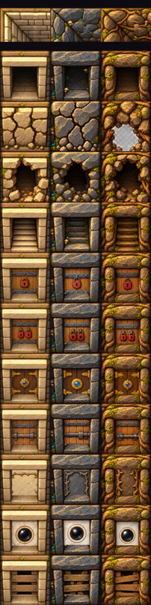
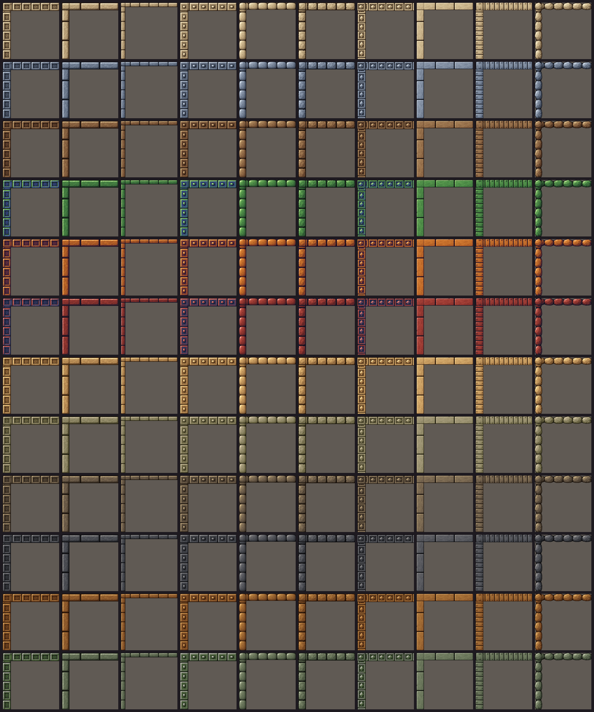
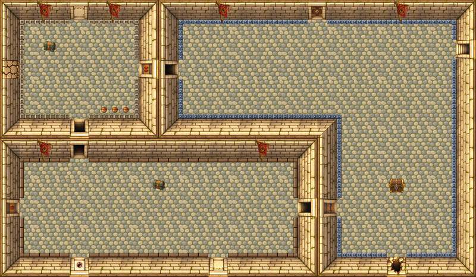

# Interior walls: Zelda's bevelled frame, painted cell by cell

> **Status:** 2026-10-18. The owner rejected the first look (walls with a top course, the south wall
> seen from behind) and approved Zelda's "cliff view of the 4 walls": the bevel, two cells deep. Three
> styles, each with its own plain floor: `lair-stone` (the fort's cream masonry), `cave-rock` (dark
> slate), `root-rock` (umber stone and roots); since 2026-11-19 a fourth, `cottage` (timber-framed
plaster, for the village houses' rooms: [The cottage](#the-cottage)), and a fifth, `mushroom` (a red
spotted cap rim, pale ribs, cream stem flesh), with **round and oval rooms** ([Round rooms](#round-rooms));
since 2026-11-20 a sixth, `crystal-cave` (dark blue slate packed with glowing blue and violet crystals,
for the Gloop Cavern: [Crystal cave](#crystal-cave)).
Since 2026-11-20 every West village house room (27) and Slimeshire's five C4 rooms have them instead
of their painted back wall ([The village's house rooms](#the-villages-house-rooms)), and the Gloop
Cavern ([The Gloop Cavern](#the-gloop-cavern)). The box-room lab and all of Fatty's Lair use them; the
> Hollow and the Mine still have elevation-cliff walls with `doorway_art.gd`'s frames. A painted
> [floor trim](#floor-trim) along the walls' foot since 2026-10-31 (painted in the lab; every room of
> Fatty's Lair has its empty `floor-trim` layer, for the owner to paint).

The owner (2026-10-17/18): doors must be part of the wall ("see in zelda how the door looks like
part of the map"); "remember how the sprite of zelda uses the cliff view of the 4 walls in
interiors? that is what i was hoping." His references: the Zelda sheet
`asset/Originals/dungeon-kit/doorways/reference/zelda-interior-walls-sheet.png` and its frames (the
session images 13 and 16). The plan: [the doorways design](../design/2026-10-17-doorways-in-walls.md).

An **InteriorWallLayer** (`game/world/interior/interior_wall_layer.gd`) draws a room's border as a
bevelled frame. Every side is the same kind of thing: a wall **face** seen from above, sloping up and
away from the floor, **two cells deep** on every side. A north face is horizontal courses seen from
the front; a south face the same, sloping the other way (toward the camera); east and west faces are
vertical courses. The faces meet on **45 degree mitres** at the corners: outer corners where the
floor turns convex, inner corners where it turns concave (an L's notch). The floor sits inside the
frame; the faces' foot lines are its edge. Doors and openings are cut **into** the face of their
side, and a door's leaf fills its opening exactly. Every opening is the **north** piece turned for
its side, as Zelda's sheet does (owner, 2026-10-18: the generated south and side doors came out as
perspective tunnels): south 180 degrees, west 90 counter-clockwise, east 90 clockwise, frame and
leaf (padlocks, bolt, the seal's pearl) turned together, each taking its side's light (a per-channel
gain from that side's run). It is separate from
the overworld's elevation cliffs and the fieldstone [WallLayer](WALLS.md).

## Painting a room

The palette (TileMap panel at the bottom, with the `interior-walls` layer selected) is a column per
style: **fort stone**, **cave rock**, **root rock**, **cottage**, **mushroom**, and a row per tile, each a small picture of its
piece cut from the packed sheet: the **wall**; the openings: **doorway**, **cracked** wall, **blown
hole**, **stairs**; the closed doors: **key door with one lock**, **with two locks**, **boss door**,
**bolted door**, **shutter**, **the seal**, **plank barricade**.

1. In the room scene (a dungeon room: [DUNGEON_ROOMS.md](DUNGEON_ROOMS.md)), **Add
   Node > InteriorWallLayer** beside the `ground` layer (same grid, position (0, 0)), named
   `interior-walls`; it takes `game/world/interior/interior_wall_tileset.tres` by itself. A room of a
   shell (the box-room lab): the shell needs an empty `interior-walls` InteriorWallLayer too
   (`room_scene_shell.gd` gathers every room's cells on it when the dungeon is built). Fatty's Lair's
   rooms are each their own world (since 2026-10-18): a room's layer is its world's walls.
2. Pick the style's **wall** tile (row 0) and paint the room's **rim, two cells thick**, any shape: an
   L, a cross, a long hall, a room bigger than a screen (the camera moves inside it). Floor is every
   cell the painted walls enclose. Two rooms side by side each paint their own rim, so a band of four
   cells parts them.
3. For an **open way**, paint its **two-by-two block** of the rim (two cells along the wall, both rows
   of the rim) with the **doorway**, **cracked**, **blown hole** or **stairs** tile. A doorway between
   two rooms is painted in both rims.
4. For a **closed door**, paint the block with the door's tile instead (key door 1 or 2 locks, boss
   door, bolted door, shutter, seal, plank barricade). The layer at once makes the door object under
   the room's `Objects` node (made when missing), on the floor line in the middle of the passage,
   with `wall` set for its side, `frame_drawn_by_wall` on, the style, and a unique `door_id`
   (`<room>-<kind>-<x>-<y>`); the wall draws the frame, the door its leaf. Then select the door and set
   only what is its own in the Inspector: a shutter's `fight_id` or `starts_shut`, a barricade's
   `flag_id`, a door's `locked_text`. A **bolted door** opens from the room its face looks into, the
   room it is painted in: paint it in the rim of the room the bolt is on. Painting another door tile
   over the block swaps a door the layer made; painting the doorway (or wall) over it removes it.
   Only a door the layer made and nobody has changed since goes this way
   (`game/world/painted_objects.gd`): a door with a setting of its own (its `door_id`, a shutter's
   `fight_id`, a line), or one placed by hand, is never removed. Its block erased or repainted, the
   layer lets go of it with a warning (it loses the meta `interior_door_block`) and adopts it again,
   settings and all, when the block is painted back, so an erase undone with Ctrl+Z keeps the door and
   its save records (2026-10-19: before, erasing a cell of the hub's boss door block and undoing it gave
   the door a new id). Delete such a door by hand when it should go. A door of the right kind already
   standing at the spot is adopted. Doors may be grouped under a plain node in `Objects` (say
   `Objects/Doors`): the layer finds them there too, so a door moved into a group keeps its block and
   gets no twin. The builder's
   doors in the Lair's rims are adopted this way (all but R5's way back, which stands in the lower
   hall's painted doorway as a placed door).
5. The camera room keeps its rect or outline; the rim is inside it (doors stay on the room's edge).
6. In Fatty's Lair, put a **room door** (`object.room-door`) in every doorway that leads to another
   room and pick its target in the Inspector (DUNGEON_ROOMS.md "Fatty's Lair: one world per room").

A pocket room of a shell (CameraRoom meta `walls_in`) keeps no walls of its own: paint them in the
room it is cut from. Fatty's Lair's pockets (Burr's cell, the store, the map nook)
are their own worlds and each paints its own full rim, the parent world painting rock behind its own
faces round the pocket, the door cut into them (2026-10-19; DUNGEON_ROOMS.md "The pockets"). R5's lower
hall and key alcove are rooms of R5's world again, behind dividers: R5 has one rim.

The layer draws the style's **floor** (`draw_floor`, on by default; each style its own plain floor;
`floor_style` names another) over the floor cells; off, the ground layer shows. Nothing the layer
draws is saved (faces, floor, fronts, collision): the scene keeps its cells, its own settings and the
door objects with theirs. The palette squares show in the editor only (`paint_opacity`): there the
layer is always enabled, whatever the scene says (17 of the Lair's rooms were saved by a headless tool
with `enabled = false` and the squares at alpha 0; the editor shows their squares again since
2026-10-19), and in the game it is disabled and see-through. A void or pit inside a room still uses
the `elevation` layer's holes and their edges. `tools/render_interior_palette_room.gd` renders a room
painted with every closed-door tile.

## Floor trim

> **Status:** 2026-10-31, built, awaiting the owner's verdict. He asked for "a bottom edge with the
> floor to soften the union", paintable, since not every edging suits every wall and floor (his
> references, Zelda-like floor borders: `asset/Originals/dungeon-kit/interior-walls/reference/floor-trim-ref-*.png`).
> He liked the first five shapes in six colours and asked the same day for "more shapes and colors
> that can blend on the existing interior walls and floors", and for the layer in each room of Fatty's
> Lair, which he paints himself: ten shapes in twelve colours then, the six new colours taken from the
> three styles' walls and floors; all 19 Lair rooms have an empty `floor-trim` layer.

A **floor trim** is a band of blocks laid on the floor along the foot of the walls, as Zelda borders
its dungeon floors. It is painted on its own layer, an **InteriorTrimLayer**
(`game/world/interior/interior_trim_layer.gd`), a trim per cell, so each stretch of wall gets the edging
that suits it, or none.

1. In the room scene, **Add Node > InteriorTrimLayer** beside `interior-walls` (same grid, position
   (0, 0)), named `floor-trim`; it takes `game/world/interior/interior_trim_tileset.tres` by itself. A
   room of a shell (the box-room lab): the shell needs an empty `floor-trim` InteriorTrimLayer too, as
   for the walls.
2. Pick a trim in its palette (TileMap panel, the `floor-trim` layer selected): a column per **shape**
   (framed blocks, bricks, slim bricks, studded tiles, cushion stones, cobble setts, diamond tiles,
   flagstones, planks, rubble, crystal studs), a row per **colour** (fort cream, slate, umber: the three wall styles'
   own; moss green with a blue inset, ember orange with plum joints, brick red with a navy inset: the
   owner's references; ochre, the lair stone's gold; khaki, the lair floor; taupe, the cave rock's
   brown; charcoal, the cave floor; clay, the root floor, tone on tone; lichen grey with a moss
   inset; crystal blue and amethyst, the crystal cave's). Rubble's gaps are see-through, so the floor
   shows between its stones.
3. Paint the floor cells along the walls (or the whole floor with the bucket: only the cells beside a
   wall or a level's face draw). A painted cell draws its trim's band on every side where a wall's
   face meets it, and a corner block where two bands meet: at the floor's corners and round a wall
   jutting into the room (an L's inner corner). Bands of different trims may meet; a corner takes the
   trim of the band along the north or south wall.
4. Erase a cell to end the band there.

**Doors and openings** are no exception (the owner, 2026-10-31: the paint decides): a cell painted in
front of a doorway, a door, stairs or a blown hole draws its band across it like any wall; leave the
cell unpainted to keep the opening clear. A cracked stretch is wall too.

**Levels in a room** (the owner, 2026-10-31: "why the trim is not being paint in lower levels?"): a
lower floor takes the trim along the foot of the faces its higher neighbours stand on it
([Pits and holes](#pits-and-holes), ELEVATION.md "Faces in rooms"), as along a wall: below a
front, the band lies at the top of the floor cell under it; beside a side face (24 units of the cell)
or above a back face (24 units, or the 7-unit cap without four visible walls), it starts where the
face ends, and the bands along the other sides stop there too, so no band covers a face (the faces
draw under the trim). A raised floor in a pit gets its corner blocks round it, the bands carried on
to them where the faces stand back from a cell's edge. `RoomFaces.feet` gives where each face's foot
lies, from the same neighbour rules that draw the faces. A cell a face covers whole (a front, a
stair) draws none. Every level's floor takes a trim; before, cells below level 0 drew none. A side
or back flight of stairs running down into a pit is drawn in 3D and reaches over the floor below its
cells (a level lower on screen): the bands are cut where each flight's drawing (its `silhouette`,
Elevation's `stairs`) lies on them, read again at each of the elevation's builds (its `built`
signal). Below level 0 the trim darkens as the floor does (`level_light`, 20% a level).

The band lies on the floor under every body (z -1, as the walls), the squares show in the editor only
(`paint_opacity`, 0.2), and it changes no collision. The trim follows the walls and the levels: it is
laid again whenever the wall layer is (its `rebuilt` signal) and whenever the `elevation` layer is
repainted.

**The art.** `python scripts/art/pack-floor-trims.py` cuts each shape from one Magnific render
(`asset/Originals/dungeon-kit/interior-walls/trims/<shape>-<a|b>.png`, GPT 2.5, neutral grey stone, a
straight strip of identical blocks; the `-b` or `-a` not used are the other tries): it finds the
strip's inner blocks, cut from joint to joint, and lays them again `blocks` to a cell at the shape's
`depth` (so every cell starts and ends on a joint and bands join without a seam; three variants per
trim take other blocks), and makes the corner block from a block's two ends; a `loose` shape (rubble)
keeps its alpha, so its gaps stay see-through. The sheet (`floor-trims.webp`, 664 x 1360, a line per
shape) holds each shape once, in grey: its own levels stretched to 0..1. Each colour is a gradient
map over that grey (the joints, the inset, the rim, its light; a shape without an inset takes the
colour's `solid` ramp), which the game lays on with `game/world/interior/interior_trim.gdshader`: the
layer gives each trim a material whose `ramp` is a GradientTexture1D of its stops
(`InteriorTrimLayer.material_of`), so a colour costs no sheet space (baked, eleven shapes in fourteen
colours would have been a 3320 x 3264 sheet). The sheet imports lossless: the ramp would show a lossy
sheet's noise as colour. The light stays on the upper left on every side: the west and east bands
are the north band transposed. `floor-trims.json`: `shapes` (per shape its `depth`, `variants` and
`pieces`: `h0`.. (128 px x depth, along a north or south wall), `v0`.. (depth x 128, along a west or
east wall), `c` (the corner)) and `trims` (per `<shape>-<colour>` its `shape`, `colour` and `ramp`).
**A new shape:** generate its strip (the prompts ask for "one long, perfectly straight horizontal strip
of N identical ... blocks ... plain neutral grey stone"), add it to `SHAPES` (its render, block count,
blocks per cell, depth, inset, `loose` when its stones are round with gaps, the next free `column`);
**a new colour:** add it to `COLOURS` (its stops and the next free `row`). Then run
`tools/pack_interior_palette.gd`.
`tools/render_floor_trim.gd -- --scene=<room> --out=<dir> [--trims=a,b]` renders a room with its
floor trimmed by each trim (the scene unchanged). `--painted` renders the room once with its own trim as painted.

## Editing rooms by hand

Fatty's Lair's rooms are the scenes to edit now: paint their `interior-walls`, place and move doors
in the editor. Its builder is retired and writes nothing (DUNGEON_ROOMS.md).

## How the pieces are laid

- **Faces:** behind every floor cell's wall side, a strip one cell along and two deep (`n0`..,
  `s0`.., `w0`.., `e0`..), the run's pieces alternating by the cell's place along the wall (the
  style's `run_period`: three), cut so they tile without a seam.
- **Outer corners:** at a vertex with one floor quadrant, the mitred 2 x 2 block (`nw`, `ne`, `sw`,
  `se`).
- **Inner corners:** at a vertex with three floor quadrants, the 2 x 2 block in the fourth (`in_se`,
  `in_sw`, `in_ne`, `in_nw`, named by the floor's side of the block): two faces folding round the
  floor's corner on a mitre; it replaces the strips over its cells.
- **Openings:** over the first strip of a painted block, `<side>_<kind>` (2 x 2: the north piece
  turned), its ends fading into the run under it.

The walls lie under every body (z -1): bodies walk over a face's foot, as in Zelda.

## Pits and holes

Paint them as outdoors ([ELEVATION.md](ELEVATION.md)): in the room scene, select the `elevation`
layer and paint the sunken cells with a hole level (-1 a spike or lava pit, -3 a void) and their
flights of stairs; the pit's rims, walls and stairs follow the paint by themselves and show in the
editor at once (the elevation layer's preview), as in the game. **Inside a room a level change is
drawn as the room's own wall face** (owner, 2026-10-19, after ALttP; ELEVATION.md "Faces in
rooms"): the faces looking down at the lower floor are the room style's bevel runs, one cell for
any drop, the sides the side wall's strip, mitred, their cap on the upper floor's edge; decks (slabs,
landings, drawbridges) draw over them. The collision, the ledge drops and the slabs are the
outdoor ones. The room's floor lies under the elevation's drawing (on the ground layer), so the
faces always show.

**A raised floor** (a room on two levels, 2026-11-13: the playground's cliff cave, below) is painted
the same way with a level above 0 (1 for one step up). The room's floor is drawn on it as on level 0
(the elevation's tops light it by its height), and on a flight of stairs leading down to level 0 or
higher, and on a front flight whatever it leads to (it covers its cell but for the strip above its
top step, the top's floor); only the holes, and the side and back flights into them, show the
`ground` layer's own tiles. Paint the **rim cells beside a raised floor at its level too**, and a
doorway's block that opens onto it: a level change between a floor and its wall would put a face,
and a ledge's rim and drop, along the wall's foot and across the doorway. A flight leaving a room's
floor draws no approach (the patch of its top's ground sheet that breaks an outdoor rim for the way
down): the faces leave the flight's cells open already.

**The cliff cave** (`world.playground-cliff-cave`,
`game/scenes/worlds/rooms/playground/playground-cliff-cave.tscn`, `?map=playground-cliff-cave`):
16 x 14 cells of cave rock, the upper floor (level 1) an L along the west wall and the north wall,
the lower floor (level 0) the south-east corner, a front flight two cells wide (cells 10-11 x 6)
between them. Its two doorways are in the south rim: the upper one (cells 4-5) to the playground's
`cave-mouth2` on the Feral lane's upper balcony, the lower one (cells 10-11) to `cave-mouth` on the
lower balcony (SKINS.md "The Skins corner"), so the slime goes from one balcony to the other
through the cliff. Its floor trim layer is empty, to paint.

After painting, the next F5/F6 run that builds the world saves its cache by itself (ELEVATION.md
"Baked cache"); bake it by hand (`tools/bake_elevation.gd -- --world=<world>`) only when you will not
run it.

What hurts is a hazard (`object.hazard`, DUNGEONS.md "The void, slabs and spikes"). **One hazard per
floor level; it hurts only on its level**: its `level` (the floor it covers; -99, the default, is
`rim_level` - `pit_depth`) picks the painted cells it works on, so its rectangle may be as big as the
room. It catches the slime only on the cells the `elevation` layer paints at that level (not on
stairs), never on the levels above inside its rectangle, and a slime that falls onto that level from
above lands in it. Its spikes or lava are drawn only on those cells, as the bottom of the pit: the
look is drawn inside the elevation's drawing, over the pit's ground and under every wall, rim, stair
and higher floor, so only the open part of the pit floor shows them, and slabs and bodies draw over
it (`Hazard._attach_look`, in the editor and the game). `tools/render_room_collision.gd` fills the
cells a hazard catches on in orange.

## Painting collision

A room's level changes (a pit, a raised floor) collide by their faces' footprint, square as the
faces are drawn (2026-10-30; [Faces in rooms](ELEVATION.md#faces-in-rooms)). A painted
**`level-collision`** layer changes that: in Replace mode exactly what is painted collides, in
Override mode its tiles are put over the footprint (open tiles take a tile of it away). Orange
**rims** sit on an upper floor's edge: they hold a body there, and pushing on drops it. Red
**bases** sit at a wall's foot: they block bodies of their level. Each tile acts on its own level, on
a 16-unit grid, whole or as a 45° half. The interior walls collide by themselves; leave them out. Step by step, with the
palette and a painted room: [ELEVATION.md "Painting collision"](ELEVATION.md#painting-collision).
To start from today's collision, press "Fill from the automatic collision" on the layer (save the
scene first).

## Bodies in a doorway

Zelda draws a doorway's frame tiles over the sprites (they have priority over Link), so Link walks
under the lintel and between the jambs. The layer does the same: each way-through opening (a
doorway, a closed door, a blown hole, stairs; not a cracked stretch) draws its **front** again among
the bodies: the sheet's `<side>_<kind>_front`, the opening piece without its passage (the passage
runs from the lintel to the room-side edge), y-sorted at the bottom edge of the opening's block. A
body whose feet are in the passage is drawn under it, on every side: under a north door's lintel,
between a south door's jambs with the face in front of it, under a side door's upper jamb. A body
south of a north door (in the room) is drawn over it, so it still covers the face behind it; plain
walls are unchanged (under every body). `tools/render_doorway_passes.gd` captures the slime halfway
through a doorway on each side of a room.

## Which room a wall faces

Floor is a room's own cells: inside one of the scene's camera rooms and enclosed by its walls,
never empty space beside a wall outside the room (a pocket room whose walls enclose none of its
cells, painted on two sides only like R1's store, takes all its cells). When the dungeon shell
gathers the room scenes, it records which room painted each wall cell (`cell_rooms`), and a wall
draws its faces and corners only toward the floor of that room (or of a pocket room whose walls it
holds, `walls_in`): a two-cell wall between two rooms shows its painting room's face, and from the
other room it reads as the top of a wall. A room that is its own world (Fatty's Lair) has no
`cell_rooms`: its walls face its floor on every side. `tools/render_room_scene.gd` renders one room
scene alone, as the editor shows it (`--hide=<node path>,...` leaves nodes out: a dark room's
`DarkRooms`).

## Collision

Every wall cell is solid but an opening's **passage**, through both rows of its block: in a north or
south block `interior.gapUnits` (64) wide in its middle, in an east or west block
`interior.sideGapUnits` (120) tall in its middle (taller than the drawn passage, about 64, as the
slime walks it at its feet); the jambs either side stay solid. A cracked stretch is solid until
blown. The door objects' bodies, on the floor line and turned with their `wall`, close the passage
while shut: a dungeon door's is 128 long, a plank barricade's 132 (it turns for an east or west wall
only while `frame_drawn_by_wall` is on; an old trunk or fence with the same script keeps the rotation
it was placed with). The overworld's `ArcadeMover` rules apply.

## The door objects in the opening

The door objects keep all their logic, exports, signals and records. Each has
**`frame_drawn_by_wall`** (default false: the dungeons look as before) and draws, when it is on, only
its **leaf**, a piece of the style's sheet cut from a render of the same frame with that door shut, so
it fills the opening exactly in its side's perspective (`InteriorWallLayer.leaf_at`):

| Object | Leaf (`leaf_kind`) |
|---|---|
| key door (`key_door.gd`) | `key2` while two padlocks are shut, `key1` with one (a keyhole opened swaps it) |
| boss door | `boss` (the gilded double door) |
| bolted door (`bolted_door.gd`) | `bolt` on the side the bolt slides from; on the far side (`bolt_here` off, R1's north door) `shutter`, the plain shut slab: the sheet has no wooden leaf without a bolt, and a door shut from the other side reads as a shutter, as in Zelda |
| shutter (`shutter.gd`) | `shutter` (the thorn-bordered block; it fades in and out as it rises and sinks) |
| the seal (`dungeon_seal.gd`) | `seal` (the white block with the dark pearl; its ring of light lies over the pearl) |
| plank barricade (`plank_barricade.gd`) | `barricade` (grey boards); smashed, nothing (the opening shows); the barricade turns with its `wall` like a door |
| cracked wall (`cracked_wall.gd`) | none: the wall's C block draws the crack; the blast turns every cracked block within three cells of it into H (`change_opening_at`; never a doorway or a door's block), which opens the passage; a wall already blown (its flag) is turned when the world is built |

The padlocks and the bolt are part of the leaf's picture (their old sprites hide); `interior_style`
names the sheet. Place a door object as today (DUNGEONS.md): on the floor line of the room its face
looks into, in the middle of the passage, `wall` that room's wall. With the rim two cells deep, for a
north opening whose block starts at column c on rows r, r + 1: (c + 1, r + 2) x 64; south (rows r,
r + 1): (c + 1, r) x 64; west (columns c, c + 1, from row r): (c + 2, r + 1) x 64; east: (c, r + 1) x 64.

## The sheet

`python scripts/art/pack-interior-walls.py [style]` cuts every piece from Magnific renders of whole
frames made from one reference frame, so their layouts match pixel for pixel and every piece shares
one stone, one scale and one light, and writes `godot/asset/MAPS/walls/interior/<style>.webp`,
`<style>-floor.webp`, `interior-walls.json` and the palette (`palette.png`, its tiles pictures of
the pieces, and `game/world/interior/interior_wall_tileset.tres`); then
`tools/pack_interior_palette.gd` saves the palette as `palette.res`, which the tileset uses (it needs
no editor import, so a repacked palette shows at once). 128 px per 64-unit cell, drawn at half size.
Each style has a fixed palette column (`column` in its `STYLES` entry: lair-stone 0, cave-rock 1,
root-rock 2, cottage 3, mushroom 4, crystal-cave 5), so a repack of one style never moves another's column (painted cells name their tile by
column), and the packer keeps the tileset's `uid`, so the room scenes that use it do not change.

The walls, the floor and every door's leaf share one read of each sheet (`InteriorWallLayer.picture`):
the packed file itself while it is newer than its import (an open editor imports it later), else the
import. In the editor the table and the sheets are read again once their files change (looked at
most once a second), so a repack shows on the layer's next redraw (paint a cell, or reopen the scene)
without restarting the editor; a door's leaf when the door is drawn again (reopen the scene). The
game reads them once.

`interior-walls.json`, per style: `model` ("bevel"), `texture`, `floor`, `floor_px`, `cell`,
`depth_cells` (2), `run_period` (per side), `pieces` (name -> sheet rect: the runs, the corners, the
inner corners, `<side>_<kind>` openings) and `leaves` (`<side>_<kind>` -> `region` and its top-left
inside its side's opening piece, `in_opening`).

**Cave rock and root rock** follow the same method: a doorway frame each made from the Lair's
(`cave-bevel-doorways-b`, `root-bevel-doorways-a`, with the style's elevation wall art as material
reference), one render per leaf and opening kind from it (`cave-bevel-*`, `root-bevel-*`), and a plain
floor each (`cave-floor.png`, `root-floor.png`; the busier first tries are `*-floor-busy.png`), which
keep their own colours (the Lair stone's cobble follows the Lair's ground). Root rock's cracked
render (`root-bevel-cracked.png`) came out with see-through gaps where the cracks should be; since
2026-11-25 its cracked pieces are cut from `root-bevel-cracked-made.png`, made by
`python scripts/art/make-root-cracked.py` from the plain frame (each face's middle filled with its own
plain stone, the Goo Bomb's crack decal laid over it), no generation.

**Lair stone** (GPT 2.5, `gpt-2-mini`, transparent, the Lili creation as style reference; the first
frame also took the owner's Zelda frame as structure reference), sources in
`asset/Originals/dungeon-kit/interior-walls/`:

| File | What | Used for |
|---|---|---|
| `lair-bevel-square-a`, `-b` | the plain bevel frame | the reference for the rest |
| `lair-bevel-doorways-b` (`-a` unused) | the frame with a doorway in each face | runs, outer corners, inner corners, doorways |
| `lair-bevel-doors-a` ... `-d` | first door trials | unused |
| `lair-bevel-leaf-key1`, `-key2`, `-boss`, `-bolt`, `-shutter`, `-seal`, `-barricade` | doorways-b with every doorway shut by one kind | the leaves |
| `lair-bevel-cracked`, `-blown`, `-stairs` | doorways-b with that opening in each face | those openings |
| `lair-floor-cobble` | a cobble texture | the floor (made seamless, colour-matched) |
| `lair-bevel-runs-wide`, `-runs-tall`, `-strip`, `-l`, `-plus-a`, `-plus-b` | long faces, an L and plus frames | unused: their blocks are another size, their inner corners too thin |

The earlier box-room renders (`lair-box-room-*`, `lair-l-room-*`, `lair-plus-room-*`) are the
rejected first look.

### The cottage

The village houses' rooms (owner, 2026-11-19: the side walls had to show, for a weak wall the Goo
Bomb opens on the snail house's west side). The material is the old house rooms' painted back wall:
cream plaster panels between dark posts, a beam along the top, a grey stone footing. Renders in
`asset/Originals/dungeon-kit/interior-walls/` (GPT 2.5, transparent; references: the plain frame,
the Lair's doorway frame for the layout, the interior mushroom furniture sheet for the style):

| File | What | Used for |
|---|---|---|
| `cottage-bevel-square-a`, `-b` | the Lair's plain frame in timber and plaster | `-b`: the reference for the rest |
| `cottage-bevel-door-south`, `-blown-west` | the mockup's takes (a door drawn upright in the south face, a hole in the west face) | unused: see below |
| `cottage-bevel-doorways-a` (`-b` had an opaque grey ground) | the frame with a doorway in each face, turned as the Lair's | runs, corners, the doorway |
| `cottage-bevel-cracked-a` (`-b`) | each doorway walled up again, the patch old and weak: hairline cracks, a stain, a chip | cracked |
| `cottage-bevel-blown-a` (`-b`) | each doorway blown open: broken laths, daylight and leaves | blown |
| `cottage-bevel-leaf-door-a` (`-b`) | each doorway shut by a plank door with strap hinges and a ring | the `door` leaf |

The `a` takes line up best with the doorway frame. How it differs from the stone styles:

- **Every face is the north face turned** (`turn_runs`), as the openings are: the render's posts lean
  with its perspective, so faces cut from it would tile with posts at every angle. The south, west
  and east runs are the north loop turned 180, 90 and 270 degrees, each shaded to its own face's
  light in the render; the outer corners are the two turned faces split on the mitre with the
  render's corner beam laid along it. The north loop is one stretch as it is (`exact_loop`: the post
  right of the doorway and the panel after it), two cells long: a post and a panel every two cells.
- **A south door is the north one turned 180 degrees**, threshold at the floor edge and its leaf
  upside down, as every opening in these rooms (owner, 2026-11-19: the mockup's upright south door
  "goes the other way").
- **No stairs and no dungeon doors**: its one leaf, `door`, is the house door, which no palette tile
  makes. A house's front door is a **doorway** block with a door node in it (`door.gd`, kind `door`,
  `side` the wall it is in, on the rim's outer row as the playground hut's) and a `Sprite2D` showing
  the leaf (`texture` the cottage sheet, `region_rect` the leaf's `region` from
  `interior-walls.json`, at the block's top-left plus `in_opening` / 2, scale 0.5) as its
  `house_art`, its `door_rect` that sprite's rect: the leaf swings open from it as in the old rooms.
- **No floor of its own**: the room's `ground` layer shows (the old rooms' plank tiles).

### The mushroom

For the mushroom houses' round rooms (2026-11-19): the cottage's doorway frame in mushroom stuff (GPT
2.5, references: `cottage-bevel-doorways-a`, the twin mushroom house's picture, the interior
mushroom furniture sheet), so its layout is the cottage's, measured again in its own render:
`mushroom-bevel-doorways-a` (`-b` drifted from the layout), `-cracked-a`, `-blown-a`, `-leaf-door-a`.
`-blown-a` came back opaque (a painted checkerboard round the frame, alpha about 245): it was made
fully opaque, as only its north face is cut. It packs as the cottage does (`turn_runs`,
`exact_loop`: a rib and a panel every two cells), and draws on square rims too.

**Adding a style** (the Hollow's roots and oak, the Mine's rock and timber): generate its plain
bevel frame, then from it the frame with a doorway in each face, then from that one render per leaf
and per opening kind (the prompts say "exactly the first reference image ... the only change"), and a
floor texture; add the style to `STYLES` in the packer (its band edges, plain stretches, doorway boxes
and passages: measure them in the doorways render, and its `column`: the next free palette column)
and run it.

## Round rooms

A round or oval room (owner, 2026-11-19: "some houses have circular or oval walls, like the
mushrooms") is a **RoundInteriorWalls** node (`game/world/interior/round_interior_walls.gd`), not a
painted rim: the same bevelled frame bent round an ellipse.

1. In the room scene, add a Node2D with the script at the room's middle, named `round-walls`, and
   set `style` (any style of the table: `mushroom`, `cottage` ...), `radii` (the outer edge's half
   width and height, world units: a 16 x 12 room fits (500, 376)) and `depth` (128: two cells, as the
   square rooms'). The ring draws in the editor at once: the faces round it, the dark beyond it
   (`void_extent` out); the floor inside is the room's `ground` layer.
2. For each opening add a Node2D child with `round_wall_opening.gd` (a yellow handle in the editor)
   and drag it onto the ring: `kind` doorway, cracked, blown or door (a closed house door). It is
   cut where the wall is nearest the handle, two cells along; a door goes to the nearest of the
   ring's top, bottom, left and right, where its leaf stands square. With `target_area_id` (and
   `door_id`, `target_door_id`) a doorway, a door or a blown hole is a door to that world: the ring
   makes its door node in the game (a door leaf that swings for a door, an opening for the others),
   `side` the way it faces; the crossings checker reads the opening's ids.
3. A weak wall: a **cracked** opening, and a `cracked-wall` on the floor in front of it with
   `frame_drawn_by_wall` on and its door settings, as on a square rim; the blast turns the opening
   into a blown hole (`change_opening_at`, from the cracked wall's `_blow_wall_opening`). Give the
   door to the `cracked-wall`, not to the opening: the wall makes its door as the world is built
   (its flag set), in time for a slime arriving through it, while the ring opens a blown wall a
   frame later. The first is level-1's mushroom-home, its back wall
   ([DUNGEONS.md](DUNGEONS.md#a-weak-wall-in-a-house)).

How it draws: the style's north run is wrapped round the ring a whole number of times, its top (the
wall's top) outward, so every part of the wall is the north face turned, as every face and opening
of the square rooms is (a door at the bottom is upside down, its threshold at the floor). The posts
or ribs come out radial. Each vertex takes the light of the face it looks like (the style's four
runs' mean colour over the north run's, mixed by the normal). The openings are their north pieces
bent onto the ring, their fronts (`n_<kind>_front`) drawn over the bodies in the passage from a
node at the opening's lowest point. In the game the ring is solid from the floor edge to the outer
edge, and a band past the outer edge, but for each opening's passage (the style's door leaf's span
in its piece); nothing it draws or builds is saved.

The round rooms are the village's round houses ([The village's house rooms](#the-villages-house-rooms));
not yet played.

### The village's house rooms

Owner, 2026-11-19/20: every house room gets the new walls, one room at a time, each checked by its
render. They were all 14 x 11 with their walls painted on an `old-props` layer and a timber double
door; each is now 16 x 12 cells (1024 x 768), the plank floor on its `ground` layer, its furniture,
villagers and animals moved with the floor, its spawn and south entry at the door:

- **Square, cottage** (a two-cell rim, the door in the south rim's middle block, cells 7-8, its
  closed leaf a `house-door-art` sprite as on the B5 snail house): the A4 barn, duplexes 1 and 2,
  flat, thatch cottage, triplexes 1 to 3; the B4 gatehouse and townhouse; the B5 thatch cottage,
  townhouse and snail house; the bakery, bathhouse, herbalist, inn, shop, tailor and town hall.
- **Round, mushroom** (`round-walls` at (512, 384), `radii` (500, 376), the door at the bottom):
  A4's twin mushroom rooms 1 and 2, the family home (in the twin mushroom house), the A5 mushroom
  farmhouse.
- **Round, cottage**: the A4 snail house, the A4 stump house, the A5 pumpkin farmhouse (a stump, a
  pumpkin or a shell style of their own would suit them better: none exists yet).

The lanterns of the round rooms stand by the side walls; the herbalist's and the shop's tall shelves
moved 50 units down to stay inside the room.

Slimeshire's rooms in `game/scenes/worlds/rooms/c4/` followed the same day (the sally port already
had cave-rock walls):

- **Square, cottage**: Burr's house (`slimeshire-burr-house`), the watchkeeper's storehouse
  (`watchkeeper-hideout`) and Yoi's home (`slimeshire-yoi-home`). Yoi's is a cellar under a hatch:
  its rim has **no door**, its way out stays the `cave-ladder` against the north wall (spawn and the
  ladder's arrival below it), and its Heavy statue maze was re-fitted to the new floor
  (SKINS.md "Yoi's statue maze").
- **Round, mushroom**: the slime's home (`slime-home`, behind the round red mushroom house) and the
  mushroom home (`mushroom-home`, the red mushroom house). Their old door, its `arrival` child and
  its picture are gone: the ring's `front-door` opening (`house-door`, to `level-1` `home-door` /
  `mushroom-home-door`) makes the door. The mushroom home keeps its own mushroom floor (filled out to
  16 x 12) and lost the old shell's two doorway-floor pieces; its cap bed and the slime home's beds
  moved in from the wall.

### The Gloop Cavern

Gloop Forest's small secret cave (`world.gloop-cavern`,
`game/scenes/worlds/rooms/gloop-forest-e5/gloop-cavern.tscn`, under the cracked ground's sinkhole),
converted on 2026-11-20. It keeps its size, 22 x 14 cells, two screens wide with the camera following:
a two-cell **crystal cave** rim round an 18 x 10 floor (cave rock at first, the same day; the owner
asked for a crystal style), in place of the crystal-cluster wall props on its old `large-props` layer. The rim has no opening: the `cave/ladder` against the north wall is still
its only way in and out (its arrival and the spawn at (704, 260)). The layer's `draw_floor` is off, so
the cavern's own floor shows (dark cavern stone, the crystal floor round the chest in the south-east
corner); on, it would draw the style's floor (the cave rock floor). The chest, the three crystal
shards and the heart quarter moved with the floor.

### Crystal cave

`crystal-cave` (owner, 2026-11-20: the Gloop Cavern's look), palette column 5: dark blue slate packed
with glowing icy-blue and violet crystals growing up and away from the floor. Made like the other
styles, from one frame: `crystal-bevel-doorways-b` (GPT 2.5, `gpt-2-mini`, transparent; references:
`cave-bevel-doorways-b` for the layout, word for word "exactly the first reference image ... the only
change is the material", and a crop of the cavern's old crystal-cluster walls for the look; `-a` is
the other take), in `asset/Originals/dungeon-kit/interior-walls/`. Its band edges measured again in
its own render (`n` 15-224, `s` 800-1006, `w` 19-220, `e` 803-1005); the plain stretches, doorway
boxes and passage are the cave rock's. Its openings: the plain doorway, and (2026-11-25, the rebuilt
Crystal Mine's cracked wall, no new render) the **cracked** stretch and the **blown** hole made from
the plain frame by `scripts/art/make-crystal-openings.py` (`crystal-bevel-cracked-made.png`: the
doorway box filled with the face's own stone, the joins feathered, the Goo Bomb's crack decal over it;
`crystal-bevel-blown-made.png`: the doorway as it is, the crack decal round its jambs and lintel, its
passage clear; the decal toned to the wall, 2026-11-25: its lines thinned, in the frame's dark blue
with a pale blue edge below, laid once, as strong at game size as the root rock's crack); no stairs opening. It borrows the cave rock floor (`cave-floor.png`). **Its leaves** (2026-11-25, for the rebuilt Crystal
Mine, no new render): the cave rock's, cut from the cave rock's shut frames (`cave-bevel-leaf-*.png`)
with this style's measures, each side in this style's light: the crystal frame was made from the cave
rock's layout, so its doorway boxes and passage are the same and the leaves fit (a wooden key door with
its padlocks, the gilded boss door, the seal's pearl, grey barricade boards, the thorn-bordered shutter,
the bolted door). The repack changed no other piece (`crystal-cave.webp` encoded again: every old
piece within the lossy encoding's noise, a mean of 1.2 levels in 255). A crystal set of its own is the
same seven renders as another style's, if wanted.

**Its floor trim** (owner, 2026-11-21: "a floor trim for crystal interior walls that matches the
art"): **crystal studs** (palette column 10), dark blue slate blocks each set with a cluster of
crystal points, as the style's door frames (`trims/crystal-b.png`, GPT 2.5, `studded-b.png` as the
layout reference and a crop of the crystal-cave frames for the look; `-a` the other take), in two
new colours: **crystal blue** (row 12, the strip's own colours: its pixels binned by the sheet's
grey, the mean colour of each bin) and **amethyst** (row 13, the same light in violet). Both colours
serve every shape. Crystal studs in crystal blue is painted along the walls of every crystal-cave
room: the Gloop Cavern, the silk nook's cave, and the Crystal Caverns' dark nook, corner cave,
under-line tunnel, bay cave and smith cave. `python scripts/maps/paint-crystal-trim.py <room.tscn>`
painted them: a small text edit that adds the `floor-trim` layer and its two resource lines and
nothing else. It paints the floor cells beside a wall, never in front of an opening or under a
ladder, and leaves a room that already has a trim layer alone. `tools/build_silk_nook_cave.gd`
paints its room the same way.

## The box-room lab

`game/dev/interior/box-room-lab.tscn` (`world.box-room-lab`; `?map=box-room-lab`), built by
`tools/build_box_room_lab.gd [-- --force]`: a shell with three room scenes in
`game/dev/interior/rooms/` (`a-square` 16 x 14; `b-l-room`, an L bigger than a screen with an
outline; `c-hall`, a long hall), every opening kind and door object, the Dungeon node, camera rooms,
the room mask, and a floor trim along each room's walls (framed cream, studded slate, umber bricks). F6 on a room runs it. `tools/render_box_room_lab.gd -- --out=<dir> [--collision]`
(windowed) renders the whole lab, each room and close-ups.

## Fatty's Lair

The Lair is converted (2026-10-18; its scenes are edited in the editor since, the builder retired as a
writer: DUNGEON_ROOMS.md "Editing rooms by hand"): `tools/build_fattys_lair.gd` painted every room's rock (its
two-cell rim, R10's rock, the pockets of the map nook, the sally port and the bolt-hole) on the
`interior-walls` layer in the room's style, its doorways as opening blocks (`_opening`: both rooms'
rims, two along by two deep), the sally port's crack as a cracked block in both rims, and fits the
doors in the rims to the new floor lines (`_fit_doors_to_walls`: key, boss and bolted doors,
shutters, the seals, the Larder's and the Postern's plank barricades, R9's stone door with the
style's shutter as its slab). Since each room is its own world, the crack's two blocks are in two
worlds (R5's west rim, the sally port's east rim), each with its cracked wall on the one flag
(`fatty-lair.sally-port-open`): blown in one, the other is turned when its world is built (both
gone 2026-10-19: the sally port moved under C4, DUNGEONS.md "Secrets"). The Lair
has no latch doors left in built walls: R5's, R7's, C2's and the Old Armoury's became dividers
(FENCES.md "Dungeon dividers"), and R9's stone door, a latch door, is drawn by the room's wall (its
own frame hidden, its slab the style's shutter leaf: `sliding_slab.gd` `wall_leaf_style`). Burr's cell
door in the hub is a key2 block of the hub's rim (2026-10-19), its door drawn by the wall. Wall cells no piece covers
draw as the dark beyond the frame (`interior_wall_fill.gd`). Rooms grew to 18 x 16 cells rather than
shrinking their floors (DUNGEONS.md "Fatty's Lair (built)"). A side door's passage is
`interior.sideGapUnits` (120) tall, as the slime walks it at its feet; a north or south door's
`interior.gapUnits` (64) wide. Every room has an empty `floor-trim` layer beside its `interior-walls`
(2026-10-31), for the owner to paint ([Floor trim](#floor-trim)).

`test_interior_walls.gd` holds the Lair's rooms to their paint: every painted closed-door block has
exactly one door tagged with it, of its kind, wall and style, on its spot, and no opening cell lies
outside an opening block (the layer makes doors in the editor only, so a block a tool painted would
show a door and leave the passage open). Its `KNOWN_STALE_PAINT` is empty since R5 is one world
again (its rows 9-15 are its lower hall's and alcove's rim).

**Pits.** A spike or lava hazard draws its spikes only on the pit's visible floor
(`hazard.gd` `_pit_floor_cells`): under the far rim the wall hangs over the floor, beside a side rim
its strip; before 2026-10-18 the spikes covered the pit's walls and the pit read as flat floor.

## Limits

- The drawbridge and the Lair's drop gate do not draw wall leaves yet. A latch door takes the
  style's shutter leaf only through its slab's `wall_leaf_style`, its own frame hidden by hand (R9).
- A run's pieces under an opening show faintly through the opening's faded ends.
- The floor's quilting leaves a few joined stones where the texture wraps.
- Each floor cell takes the style of the nearest wall straight out from it (`floor_style` sets one
  for the whole layer), so a room painted in two styles shows two floors, parted where the nearest
  wall changes.

## Files

| Path | What |
|---|---|
| `godot/game/world/interior/interior_wall_layer.gd` | The layer: faces, corners, openings, floor, collision, leaves |
| `godot/game/world/interior/round_interior_walls.gd`, `round_wall_opening.gd` | A round or oval room's walls and their openings ("Round rooms") |
| `godot/game/world/interior/interior_wall_tileset.tres` | The palette (packer output) |
| `godot/asset/MAPS/walls/interior/` | The sheet, the floor, `interior-walls.json`, `palette.png` (packer output), `palette.res` (`pack_interior_palette.gd`); the floor trims' `floor-trims.webp`, `floor-trims.json`, `trim-palette.png`, `trim-palette.res` |
| `scripts/art/pack-interior-walls.py` | Builds them from the renders |
| `godot/tools/pack_interior_palette.gd` | Saves the packed `palette.png` and `trim-palette.png` as `palette.res` and `trim-palette.res`, the textures the tilesets use (no editor import) |
| `asset/Originals/dungeon-kit/interior-walls/` | The renders (the cottage's: `cottage-bevel-*`; the mushroom's: `mushroom-bevel-*`) |
| `godot/tools/build_box_room_lab.gd`, `render_box_room_lab.gd` | The lab and its pictures |
| `godot/tools/render_interior_palette_room.gd` | A room painted with every closed-door tile, its doors made by the layer |
| `godot/tools/render_room_scene.gd` | One room scene alone, as the editor shows it |
| `godot/tools/render_doorway_passes.gd` | The slime halfway through a doorway on each side of a room, in the game |
| `godot/tools/render_room_collision.gd` | A room world in the game with its collision, decks and hazards drawn over it |
| `godot/game/world/interior/interior_wall_fill.gd` | The dark over wall cells no piece covers |
| `godot/game/world/interior/interior_trim_layer.gd`, `interior_trim_tileset.tres` | The floor trim layer and its palette ("Floor trim") |
| `godot/game/world/interior/interior_trim.gdshader` | Colours a trim's grey pieces with its ramp, darker below level 0 as the floor |
| `scripts/art/pack-floor-trims.py` | Builds `floor-trims.webp` (grey), `floor-trims.json`, `trim-palette.png` and the trim tileset from the renders in `asset/Originals/dungeon-kit/interior-walls/trims/` |
| `godot/tools/render_floor_trim.gd` | A room with its floor trimmed by each trim |
| `godot/game/world/painted_objects.gd` | What the layer may remove by itself: a door it made and nobody changed |
| `godot/tools/render_lair_room.gd` | In-game captures of a dungeon's rooms at a 16:9 window (`--all-rooms`) |
| `godot/tests/test_interior_walls.gd` | Faces and corners (the outer corners' fill and order), collision and passages, cracked to blown (every cracked block in reach), framed doors (the bolted door's far side, the barricade turned for a side wall), painted doors (also grouped under `Objects`), the Lair rooms' doors against their paint, the lab's assembly |
