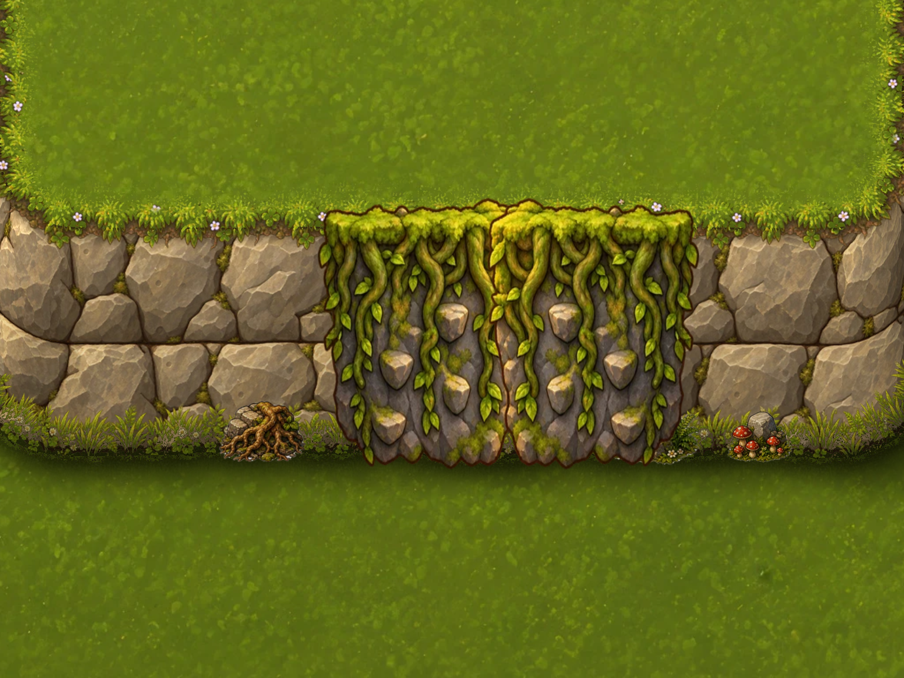
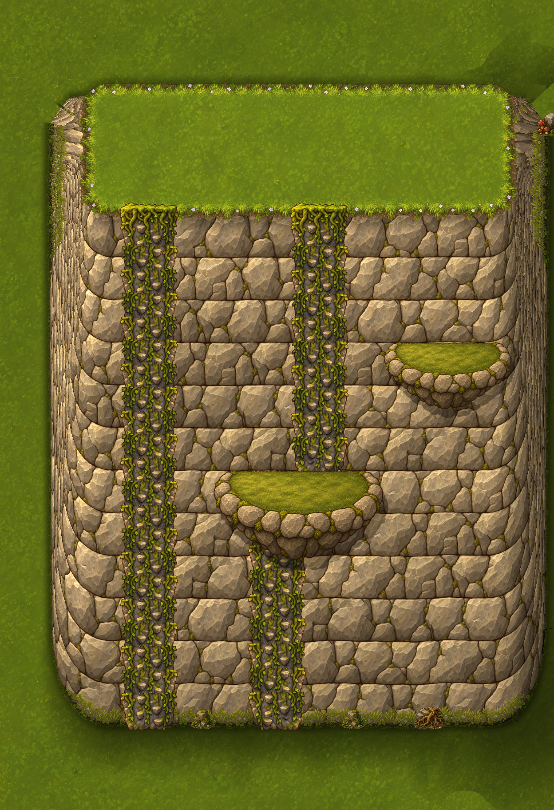
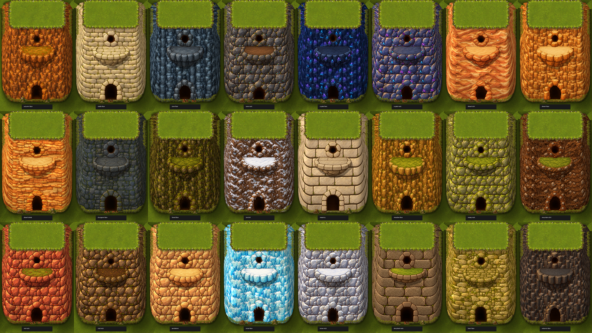

# Skins (roadmap 7.8)

The three Release 1 skins, built for real on 2026-10-17: **Heavy** (Pearl 1, Fatty One Eye),
**Silk** (Pearl 2, the Matron) and **Feral** (Pearl 3, the Crystal Colossus). Each dungeon's
Pearl is found inside it, before its boss, and the dungeon's second half teaches its skin
([the plan](../design/2026-10-17-pearl-mid-dungeon.md#the-skins-for-real-roadmap-78)). The rules
are the owner's ([Direction "The skins"](../story/01-direction.md#the-skins)):

- **Always on once won.** A skin is never put on, taken off or switched. Every won skin works at
  once and they stack; none has a downside (Heavy does not slow the slime). No keys: the Feral
  climb is an interact press (a toggle: a second press lets go) and the movement keys. Skins cost
  no energy.
- **Contextual.** Each skin acts in its own places (its gate) and changes one move.
- **It shows while it works:** stony on a heavy plate, a grab or a Heavy Roll; silvery in a web,
  a web wall or a cut; furry with claws as it climbs or strikes. Otherwise the slime wears its
  **everyday look**, picked in the bag's Skins row (cosmetic only), else its own green goo: winning
  or lending a skin never changes it (owner, 2026-10-18: a skin shows only while its power works).
- **The Pearl grants its skin** and, the first time, shows the skin's
  short ceremony line (its name, big, and one line) over the slime, after the Pearl's card.
  *Since 2026-11-21 (owner, question 141): not when the Pearl's card shows (the card holds the
  skin's description, and the line ran on under the boss's roar after it); `SkinState.grant(id,
  announce)` takes `announce` false then. Without a card (ceremonies off) the line still shows.*

The Gulp's Stone and Silk forms no longer count as the Heavy and Silk checks. The forms themselves
stay until roadmap 7.11 removes them (the Swim form's mechanics stay for the later Swim skin);
nothing in the dungeons needs a form.

## The API

`game/player/skins/skin_state.gd` (class `SkinState`; preload it) is the one way to ask:

| Call | What it does |
|---|---|
| `SkinState.is_on(player, SkinState.HEAVY / SILK / FERAL)` | True once the skin is won or lent. `player` may be null (skins belong to the run). Every lock asks this |
| `SkinState.grant(id, announce := true)` | A Pearl's grant: won for good, the ceremony line the first time unless `announce` is false (the Pearl's card shows instead; the look stays as it was). True when new |
| `SkinState.lend(id)` / `give_back(id)` | For this session only (dev powers, playground pedestals, `?skins=`); no save carries it |
| `SkinState.is_won(id)`, `on_ids()`, `order()` | Won for good (not lent); the skins on; every skin in `skins.order` |
| `SkinState.look()` / `set_look(id)` | The everyday look (`&""` = the goo) |
| `SkinState.show(player, id)` | A lock tells the slime its skin works now (player.gd `show_skin`) |
| `SkinState.definition(id)`, `display_name`, `look_index`, `color`, `setting(path, fallback)` | `skins.defs.<id>` and the skins' numbers |
| `SkinState.text(id, "line" / "how")` | The skin's texts with their keys named from the bindings: a `{<action>}` in the data reads as that action's key (`ControlLabels.with_keys`: "holding {interact}" is "holding W" with the keys-only layout, "holding right click" with project.godot's own bindings). The bag card and the ceremony line read them so |

player.gd keeps the old hooks, now on the skins: `presses_plates()` is the Heavy skin (heavy
plates, pressure plates, heavy blocks, a slam's Heavy impact on cracked ground), `crosses_webs()`
the Silk skin (every web rule). The Heavy Roll check is `game/fattys_lair/heavy_check.gd`
(`is_heavy_roll`: the Roll's bonk carries the `heavy` tag while the Heavy skin is on).

### The record

`RunState` keeps `story.skin_ids` (won and lent skins, in the order they came) and
`story.skin_look`, and `session_skin_ids` (the lent ones). `serialize` leaves the lent skins out,
and a lent look with them; `new_run` and `install` forget the lent list. A save from before
2026-10-17, whose Pearls set the story flags `skin.heavy`, `skin.silk` and `skin.feral`, wins those
skins when it loads. Signal: `skins_changed` {"skin_id", "reason": won, lent, returned or look}.

### Dev aids

- `?skins=heavy,silk,feral` (desktop `-- --skins=...`) lends those skins in any world, the last one
  (main.gd `lend_launch_skins`); the look stays the goo.
- `dungeon.devPowers.<world>` (game-constants.json) entries `skin.<id>` lend that skin to an F6 run
  of the world (main.gd `start_rework`); the look stays the goo.

## Looks

`game/player/skins/skin_look.gd` (owned by player.gd, real time) paints the Visual's material
(`game/player/gulp/form_skin.gdshader`, `skin` 4 Heavy, 5 Silk, 6 Feral, and `skin_amount`): first a
Gulp form's own skin, else a skin that works now (for `skins.lookShowMs` after the last
`SkinState.show`), else the everyday look, else the goo; a change fades out over `lookFadeOutMs`
and in over `lookFadeInMs`. With its painted texture (`asset/player/skins/<skin>-look.webp`, tiled
mirrored over the body, lit by the frame's own shading) the skin replaces its code pattern; the
Silk skin adds a drifting sheen. The shape weapons wear the look shown as their strike starts
(shape_visuals.gd). The Feral claws are `game/player/skins/feral_claws.gd`, a child of the body
made by the climb.

Who calls `SkinState.show`: heavy plates and pressure plates (the Heavy slime on them), the heavy
grab (pushing or pulling), the Heavy Roll (rolling, the bonk, what it breaks or shakes loose); the
floor webs (the Silk slime's feet in one), web walls (passing, cut), silk parcels (freed), web
barriers (crossed); the climb; the Spear's fast steps.

## Heavy

- **Its gate:** heavy plates (`object.heavy-plate`: only the Heavy slime or a heavy block sinks
  them; a light slime on one hears `refusal_text`, "It does not budge under you."), the old
  pressure plates (`object.pressure-plate`, Gloop Forest's iron hollow plate), and heavy blocks
  (`object.heavy-block`, `object.heavy-statue`, `heavy-ore-crate`: a held interact grabs, walking
  pushes or pulls; without the skin "Too heavy to move.").
- **Push and pull poses** (owner, 2026-10-19: approved from a mockup, side view first): while the
  slime holds a heavy block it shows the grab's pose instead of its walk (heavy_grab.gd `pose`, played
  by player.gd `_step_grab` in the grab's direction): `grab-<direction>`, the mouth latched on, while it
  only holds; `push-<direction>`, its front pressed flat on the block, eyes squeezed (four poses, once
  per 640 ms cell); `pull-<direction>`, its mouth stretched into a snout on the block while its body
  heaves back (two poses), whenever a walk key pushes or pulls past `startDelayMs`: the block moving,
  knocking or (without the skin) too heavy, where the strain also wobbles it. The pull's body is drawn
  away from the block (the side view's `pull-left` mirrors it); the front view's slime stays hidden
  behind a tall block, as it always was. Art: page 7 of the slime, below.
- **It says so** (owner, 2026-10-19): the skin's texts name the held key. Its `line` (the bag's
  Skins card and the ceremony line over the slime) reads "Heavy as stone: heavy plates sink, and
  holding W pushes or pulls heavy blocks and statues."; Pearl 1's card (pearl.gd `card_line`, also
  through `ControlLabels.with_keys`) "Fatty's weight is yours: you sink heavy plates, and holding W
  you push or pull heavy statues and blocks." The data keeps the key as `{interact}`, so the words
  follow the bindings.
- **The touch hint:** while the Heavy slime faces and touches a heavy block (heavy_grab.gd
  `block_in_reach`, the grab's own test) or holds one, the control hints' pill shows "Hold W to push
  or pull" (game/hints/control_hints.gd `heavy-grab`, the interact key's label), ahead of the other
  hints but the move hint. It stays while the slime holds the block and is learned only once the slime
  has both pushed and pulled a block (story flags `hint.heavy-grab.push` and `.pull`, then
  `hint.heavy-grab`; owner, 2026-10-19: learned on the first move it flashed away before it could be
  read); then it never shows again in that run. Without the skin it never shows (the strain line says
  "Too heavy to move."), nor while the mouth holds something (the grab does not start then). Rework mode only, as the grab.
- **Yoi's statue maze** (owner, 2026-11-20: reaching Yoi's chest needs pulling statues with the
  Heavy skin, so his Roll Fragment always comes after Burr's): in Yoi's home
  (`slimeshire-yoi-home`, 16 x 12 cells with cottage walls since 2026-11-20), stone dividers on
  the room's `fences` layer close the south-east corner: a north line on row 5 (cells 9-12) and a
  west line down column 9 to the south wall. The line's one-cell gap is its east end against the
  east wall, cell (13, 5): `maze-statue-door` stands in it and `maze-statue-inner` right behind it
  at (13, 6), between the wall and a spur (12, 6) hanging from the line (a north-arrow tile, so it
  joins only the line). Pushing the door statue jams on the inner one; pushing the inner one jams
  on the inner line (row 7, cells 11-13), so both must be pulled out north. Then the way runs down
  the gap, west under the spur, round the inner line's west end and back east to the chest
  (`yoi-home-chest`, a Roll Fragment: quests spec 14.8) in the corner, cell (13, 9), out of a
  chest's reach (112 units) from anywhere the slime gets before both statues are out (255 units
  with both in, 214 with only the door statue out). A statue plugs a gap only in an east-west line:
  between two posts of a north-south line it leaves 41 units above it and 29 below, and the slime
  is 26 tall (the first maze, a gap in a north-south line, could be walked round that way).
- **The Heavy Roll:** every Roll with the skin on. Its bonk carries `heavy`, its screen shake is
  strong (`skins.heavy.rollBonkShakeMs` 420, `rollBonkShakeIntensity` 0.02, `rollBonkHitStopMs`
  90; a plain bonk keeps `character.player.movement.rollBonkShake*`), and its ground shake reaches
  `skins.heavy.looseRadiusPx` (200), heavy. It pushes no enemy away (a later upgrade). It **crushes
  tiny enemies** (reaction weight `tiny`: the Matron's Broodlings, the Colossus's Crystal Mites;
  the owner, 2026-11-24, "crush them"): a tiny one's hurtbox within
  `character.player.movement.rollHeavyCrushRadiusPx` (30) of the ball's front
  (`rollHeavyCrushAheadPx` 14 past the bonk's point) takes `rollHeavyCrushDamage` (99, tags `roll`
  and `heavy`, weapon `roll-crush`) before the ball touches it, pops flat (a tiny enemy's kill),
  `BreakSoft` and a `rollHeavyCrushHitStopMs` (40) hit-stop, and the ball rolls on: no bonk
  (`player_roll.gd` `_crush_ahead`). Filmed in the Matron lab (`film-matron.sh <name>
  --film=crush`: three Broodlings in a row, all popped, no bonk). It **breaks light things to throw**
  the same way (the owner, the same day: "it make no sence that light throwables make you bounce
  back on roll, you should be able to breake them with heavy roll, so they break with the same
  animation as when throw"): a liftable of weight `light` (a pot, a rock, a web ball) whose feet lie
  within `rollHeavyBreakRadiusPx` (34) of the ball's front bursts into its own picture's shards with
  its material's particles and sound (a thrown thing's break: `break_burst.gd`, `thrown_object.gd`
  `BREAK_PARTICLES`, `break_cue`) and goes as if sucked up, so what it hid is left where it stood
  (`pot_loot.gd`); the ball rolls on (`_break_ahead`). A medium or heavy one (a crate, a keg) still
  bonks, and a plain Roll bonks on everything as before. Filmed (`film-matron.sh <name>
  --film=smash`: three clay pots burst, no bonk; then a crate: a bonk, the crate whole).
- **What it breaks** (the look book: old, grey, dead or built things lying or leaning in the way):

| Object | Script | Notes |
|---|---|---|
| `object.plank-barricade`, `object.rotten-timbers`, `object.old-trunk`, `object.old-fence`, `object.fallen-tree`, `object.fallen-tree-ns` | `game/scripts/plank_barricade.gd` | Wood: blocks as a wall, a Heavy Roll smashes it (a heap that no longer collides, lying under the bodies; the plank barricade's smashed picture keeps its standing arch, so it stays sorted with the bodies from its heap's back edge, `heap_reach` 80 units north of the root: what stands behind the arch, a chest, is drawn behind it, owner 2026-11-01), `flag_id` keeps it smashed; anything else clinks with `refusal_text`. Exports `smash_text`, `smash_cue`, `splinter_rise`, `heap_reach` |
| `object.rubble-heap`, `object.loose-rock` | `game/scripts/rubble_heap.gd` | Rocks: the same, with pebbles (`rock_tint`) and `break_text`. Rubble heaps break under a Heavy Roll, no longer a Goo Bomb (owner, 2026-10-16); `breaks_by_blast` keeps the old blast heap, used only on the playground Bomb corner's islet until its cracked rock face (question 72) |
| `object.loose-prize` | `game/scripts/loose_prize.gd` | A prize caught up high (a coin pouch in a tree) `hang_height` over its root: a heavy shake within reach knocks it down, it pays `coins` and spills `contents`, `flag_id` keeps it taken; a plain bonk only makes it sway with `hint_text`, unless `any_bonk` is on |
| `object.loose-wood` | `game/scripts/loose_prize.gd` (`any_bonk` on) | Dead sticks snagged in a tree, 110 over its root at the tree's foot: **any** Roll's bonk within reach knocks them down and they spill 3 wood; no flag, so they hang there again when the chunk is built again (owner, 2026-11-20: wood is found and shaken from trees, not sold). Placed in Slimeshire (C4, C5, D4, under `Wood`, with a small wood pile of 3 each); the Scenery dock lists it under **Any Roll** |

Place a breakable across the way, its root on the ground line under it; a loose prize with its
root at the foot of the tree or wall it hangs on, where it lands. The Popworm and the Thorn Guard
listen to the same heavy shake (BESTIARY.md "Hooks").

**The fallen trees** (2026-11-20; owner, 2026-11-19, question 163: physical barriers, not gates):
a long grey dead tree across a road, smashed into a splintered heap by a Heavy Roll. Two scenes on
`plank_barricade.gd`, both in the Scenery dock's Heavy skin category: `object.fallen-tree` lies east
to west (about 260 units long; its root on the ground line under the trunk, the body 272 × 24 and
the hurtbox 280 × 56 just above it), `object.fallen-tree-ns` north to south (about 180 units; its
root at the south end, the body 26 × 188 and the hurtbox 44 × 196 running north from it). The
bodies reach a little past the art so a lane closed by trees on both sides stays closed. A plain
Roll, a throw or a bonk hears "An old dead tree. It would take real weight to break it." Placed:

| Where | Node | Flag |
|---|---|---|
| The Verdant Gate, `level-1-d4` (1728, 752): across the lane between the gate's banners and the trees, where the gate stood (the place keeps its name) | `Chapter1/verdant-tree` | `level-1.verdant-tree-smashed` |
| The Market Hill road, `level-1-c4` (112, 1132): north to south a little inside C4's west edge, so the slime crossing from Glimmerhill's Market Hill (64 units in) lands west of it; a forest cell at (1, 14) closes the gap north of it, the rim's fence the south | `Chapter1/market-hill-tree` | `level-1.market-hill-tree-smashed` |

A save from before the trees that had the Verdant Gate open (its gate id
`level-1-east-verdant-gate` unlocked in any map record) gets `level-1.verdant-tree-smashed` quietly
when it loads (`RunState.install`). Plop's talk after Pearl 1 comes home says the tree lies across
the Verdant Gate's road and that it takes real weight to move it.

## Silk

- Floor webs (painted on a `webs` WebLayer, `object.floor-web`, the Matron's patches) no longer slow
  the slime or stick a Roll; spit webs no longer root it; web barriers (`object.spider-web`) tear as
  it crosses them.
- Web walls (`object.web-wall`) are passed at `webs.wallPassMultiplier` (half speed).
- **The cut:** a shape's hit (the Spear in Release 1) cuts a web wall open for good and frees what
  is wrapped in silk (`object.silk-parcel`, the Matron's thread). The War Axe will cut webs without
  the skin (question 135).
- The rules and their numbers are [WEBS.md](WEBS.md)'s; the skin is `player.crosses_webs()`.

## Feral

- **The climb** (`game/player/skins/feral_climb.gd`, player-owned; reworked on 2026-11-12, the owner:
  "with W it sticks to the wall and then you move with the arrows in the direction you want", as the
  push and pull of a heavy block, so that a mountain can carry many climbs): an interact press where
  the slime can take hold of a climbable surface (at its foot facing up, on its lip facing down; or a
  placed wall's prompt, "Climb"; "Climb (hold)" until 2026-11-24) takes hold, and the slime glides onto it. **The cling is a
  toggle since 2026-11-24** (the owner: "i cant use e while climbing since W have to be press ... i
  can't neither use spear while climbing"): the slime clings until the next interact press lets go
  (player.gd `_step_climb`), so no key has to be held; on the wall the attack key (A) strikes with
  the current weapon and E switches it (one combat, 2026-11-25; before, the Gulp's key and the Spear's
  box power struck there and E opened the ability carousel). **The movement keys move it over the surface, any way,** at
  `skins.feral.climbSpeed` (150 px/s), sliding along its edges, except the open sides of vines: moved
  off those it falls ([No limit at the sides](#painting-vines), the owner, 2026-11-13); with no
  movement key it stays where it is. Its body does not collide on the face and is drawn in front of it; claws show; it faces
  the wall the whole climb, its back to the camera, whichever way it moves (the owner, 2026-11-12).
  **Pushing on past an edge with ground beyond** (up
  over the rim, down at the foot) it gets off there and takes that level (Elevation `track`).
  Letting go, or a hit, drops it to the foot under it over `skins.feral.dropMs` with a landing
  squash: no damage (already standing by its landing, it just lets go). **A catch:** the key
  pressed while it drops (a fall starts let go) takes hold right where the slime is, where the surface allows a cling
  (vines under it; a drop past bare rock catches nothing; after a hit's drop the key must be let go
  and pressed again). **No Roll off a wall** (2026-11-24: a roll off the Colossus's roots left the
  slime inside the rock, behind the wall): while it climbs or drops off a wall a Roll press is
  dropped (player.gd), so none fires as the climb ends, and `_try_dodge` refuses. Without the skin
  nothing is offered, and pushing up at the foot says the refusal (at most every
  `skins.feral.refusalEveryMs`).
- **Climbable surfaces** (feral_climb.gd `WALL_GROUP`): **painted vines** (a `vines` VineLayer,
  [Painting vines](#painting-vines): the way to make a climb) and the **placed climbable wall**
  (`object.climb-wall`, below: a climb that leads out of a world or ends on the face). Each answers
  the climb where the slime takes hold (`can_grab`, `climb_start`), where it may cling
  (`climb_allows`), where it gets off (`climb_exit`) and where it lands (`climb_landing`); vines also
  where the slime has left them and falls (`climb_lets_go`), the placed wall holds it on.
- **Climb monsters** (the owner, 2026-11-13): the Rock Chucker's boulders bouncing down a face, the
  Spiny Caterpillar crawling the vines, the Ledge Raven looping round its balcony; each knocks a
  climbing slime off the wall ([BESTIARY.md](BESTIARY.md#the-climb-monsters-rows-34-to-36)).
- **A wall that ends on the face** (`holds_at_top`; added by the dungeons for the Crystal Colossus's
  arena, [DUNGEONS.md](DUNGEONS.md#the-crystal-colossus-roadmap-124)): at the far end there is nothing
  to stand on, so the slime clings there (`hold_text` shows once each time it gets there) until it
  lets go or moves away (feral_climb.gd `is_holding`).
- **The strike while clinging** (the plan's proposal, built by the dungeons on 2026-10-17 for the
  Colossus's claws): in the body-shapes mode an attack press while the slime climbs or clings (not
  while it drops) gives the current shape a press aimed along the face, left or right: the left or
  right movement key held, else toward the nearest standing enemy within `skins.feral.strikeSeekPx`
  (240), else the way the last one went (feral_climb.gd `strike_side`; player.gd `_climb_strike`). It
  strikes on the release as every press (the Spear at the Feral tempo, its hits through the shape
  controller as on the ground); the slime holds still on the face while the strike runs
  (`hold_still`), then moves on. The left or right key that aims the strike also moves the slime
  along the wall until the strike begins. A hit still knocks it off. The classic game drops the press.
- **The Spear hits twice as fast:** while the skin is on, every Spear chain step runs its own
  timeline at `skins.feral.spearTempo` (2): wind-up, active window, recovery, cancel point, lunge
  and the finisher's rest take half as long (shape_controller.gd `_tempo`). The link window, the
  holds, the damage and the charged Lunge stay as they are.
- **Placing a climbable wall** (`object.climb-wall`, game/scenes/objects/climb-wall.tscn, script
  `game/scripts/climb_wall.gd`; for a climb that leads out of a world, `exit_area_id`, or ends on
  the face, `holds_at_top`: every other climb is painted, below; the rebuilt
  Mine's are painted vines but for M15's, its lab's roots and the climb out): put its root where the slime's feet
  stand at the wall's foot, about
  20 px below the face's foot line, and set `top` to where the slime's centre ends (on the ledge,
  about 40 px inside the rim). `art_size` sizes the roots' picture over the face; `grab_width` the
  zone across (default: the picture's width). The slime moves in the strip that wide between the
  root and `top` (from where it stood as it took hold), and gets off at either end by pushing on.
  To climb back down, place a second one on the lip
  facing down: its root about 20 px inside the rim, `top.y` > 0 ending about 30 px below the
  face's foot line, `show_art` off. A climbable wall never stands beside a heavy block or the
  root-rock wall style (questions 91 and 129). In the Scenery dock's **Feral skin** category.
  Its picture (2026-11-21, owner: "I don't want you to stretch the vine"): `art_size` sizes the
  roots, and one much taller than wide is drawn in pieces as painted vines draw a tall wall
  (`VineLayer.pieces`: the cap at the top, the roots' ends at the foot, the middle repeated), never
  stretched; the Colossus arena's five tall root walls show so too. `art_offset` moves the picture
  off the node (the node stays where the slime stands at the foot, which is also where the climb
  lets it off). A climb down from a lip with `show_art` on hangs its picture from the node over the
  rim (for a face whose foot is in another world). **An arrival end** (`door_id`, group `door`): a
  climb out of another world whose `exit_door` names it lands the slime clinging at this climb's
  far end (`play_arrival`), the keys still held down counting as held
  (player.gd `hold_keys_still_down`: the input is cleared as the slime leaves a world), so a climb
  goes on across a chunk line while W is held, and a let-go drops (no placed climb uses it yet: a
  climb between two chunks is painted, [Across a chunk line](#across-a-chunk-line)). The placed
  climb out of a world so far: the Colossus arena's way out to the Lookout. Testing one by script: lend the skin, tap
  interact once (the climb is a toggle since 2026-11-24: the next tap lets go), then hold the way, as
  `tests/test_skins.gd` does with a placed wall and `tests/test_crystal_mine.gd` with painted vines.

### Painting vines

Climbs are painted (owner, 2026-11-12: "how do I paint those vines on a wall?"): a **VineLayer**
(`game/world/vines/vine_layer.gd`, tile set `vine_tileset.tres`, one tile).

1. In the world scene: Add Node > **VineLayer**, name it `vines`, beside the ground and `elevation`
   layers (same grid, position (0, 0)). It takes its tile set by itself.
2. Select it and paint its tile **on the cells of the wall's face**: the rows under a raised edge, one
   row per level of the drop (a two-level wall is two rows tall). What is painted is what is
   climbed, and the vines are drawn over the painted cells at once.
3. Paint as many cells as the climb is to cover: a column, a band along the wall, an L, a zigzag up
   a tall wall. The slime moves over them cell to cell, any way.

The rules the paint follows:

- **Getting on** needs vines that reach the wall's **foot** (the slime takes hold there, facing up)
  or its **rim** (from the ledge above, facing down, within `lipStandPx` + `grabReachPx` of the rim).
- **Getting off** is pushing up at the rim or down at the foot. A column that stops short of the rim
  has no way off at its top: the slime moves on sideways, or lets go.
- **No limit at the sides** (owner, 2026-11-13: "if the player body abandons the vine it should
  fall"): moved off the vines' open side, or down past a column that stops short of the foot, the
  slime falls as from a hit (to a balcony under it, else the wall's foot, unhurt); the interact key
  let go and pressed again catches vines on the way down. It falls once its centre is
  `letGoPastPx` (12, the drawn vines' overhang) past their painted cells.
- **Letting go** drops the slime before the wall's foot under it (`landBelowFootPx`), unhurt, from
  any height.
- The slime takes hold `sideInsetPx` (14) inside the vines' open sides, and stays that far under the
  top of a column that stops short of the rim.
- The wall is read from the `elevation` paint: the nearest raised edge above a painted cell (found
  beside the layer or beside any node above it, so a layer in a corner scene reads its world's).
  **Front walls only** (the south faces): a cell painted anywhere else (flat ground, a side wall, a
  45° face) shows a warning on the node and is not a way on or off. With no elevation paint at all
  each painted column is taken as a wall from its top cell to its bottom one.
- Without the Feral skin, pushing up at the vines' foot says the layer's `refusal_text`.

The picture is the root wall's (`asset/MAPS/props/mine/256x256-root-wall.webp`), one per painted
rectangle and repeated across a wide one (about as wide as tall each, two cells at most, every
other one mirrored): a patch two cells wide on a two-level wall shows it as painted, other sizes
stretch it. **On a tall wall** (a rectangle over 1.4 times as tall as the picture at its width) it
is drawn in pieces instead: the picture's mossy top at the rim, its bottom at the foot, and its
middle repeated between them. Walls go up to nineteen courses
([High levels](ELEVATION.md#high-levels)); the climb lab (`?map=climb-lab`) has twelve-course ones
to try. The palette
squares show at `paint_opacity` in the editor and never in the game. `tools/render_vines.gd` renders
the playground's painted plateau (`--scene`, `--cells` for another world) and, with `--probe`, prints
where the slime takes hold, gets off and lands on every painted rectangle.

### Across a chunk line

A wall on a chunk line (its top in the chunk world north of it) is climbed from one chunk into the
other (owner, 2026-11-21: the mushroom yard's wall in level-1-c4 up into North Wilds C3, "a both
way entrance"). Paint the wall's part in each chunk on that chunk's own `vines` layer, and paint
each on **past the chunk's edge** (rows above its top edge, or under its bottom one): that says the
vines go on there. Climbing toward the edge, the slime crosses when its centre is `CROSS_PX` (12)
from it: the world changes and it comes in on the other chunk's vines, `CROSS_IN_PX` (28) inside
its edge, at the same x, or on the nearest painted column within three cells
(`vine_layer.gd` `climb_crosses`, `arrival_point`). It comes in **still clinging**: the keys still
held down through the crossing count as held (player.gd `hold_keys_still_down`), so with the
interact key held it climbs on, and let go, it drops. Getting off at the far rim or foot is the
other layer's, as anywhere. Only up and down cross (the chunks north and south); a chunk with no
vines there brings the slime in at its spawn. The first is level-1-c4's back yard
([DUNGEONS.md](DUNGEONS.md#a-weak-wall-in-a-house)).

### Balconies

A rock ledge that steps out of a tall wall part-way up, to stand on (the owner, 2026-11-13, after A
Link to the Past's ledges on its mountain walls: "a step out balcony where the slime can fall from
above"; the wall runs on unchanged behind it). It is **painted with the vines' layer**: the
palette's second tile.

1. Select the world's `vines` VineLayer and pick the **balcony** tile (the stone-coloured square).
2. Paint it **in one row of the wall's face**, as many cells side by side as the balcony is wide
   (three to five look as painted; the picture is scaled to the width, so a wider one is deeper
   too). The balcony's back edge lies on the top of that row; its rim and underside hang into the
   row below.
3. Paint vines right **under** it (their top cell in the row below it) for a way up to it from the
   ground, and right **over** it (their bottom cell in the row above it) for a way on up.

What a balcony does:

- **Landing.** A drop off the rim above it lands on it instead of the wall's foot, and so does a
  let-go from vines over it: a mountain's balconies are where a fall stops. No damage.
- **Standing.** Its grass is a floor: the slime walks on it as on ground, kept on it by its edge
  (half an ellipse, `FLOOR_HALF` 0.34 of the width each way, `FLOOR_DEPTH` 0.2 deep). No skin is
  needed to stand on one. Wherever the slime's feet come to be on a floor, it stands on it (so a
  door or an arrival placed there works).
- **Leaving.** Pushing on against the floor's edge for `elevation.dropPushMs`, forward or sideways,
  drops the slime to the next balcony under it, else to the wall's foot. With the Feral skin, an
  interact press under vines takes hold of them from the floor (facing up), and at its front over
  vines that hang under it (facing down).
- **Doors** go on the wall at its back edge: the cave mouth and the wall hole made for these walls
  (`object.cave-mouth`, `object.wall-hole`, the Scenery dock's Holes & hatches tab;
  [DUNGEONS.md](DUNGEONS.md)), or any other door object. The slime goes in by pushing up into one
  from the floor, as into any door.

**Its look follows its wall** (2026-11-14): each wall style has its own balcony picture, its rim
made of that wall's stones and its floor of what lies on such walls (grass, snow, sand, flagstones),
and a balcony shows the one of the style its face is drawn in: the `cliffs` layer's paint over the
top above it, else its ground's default ([Wall styles](ELEVATION.md#wall-styles)). Nothing is set by
hand: repaint the wall's style and its balconies follow. Every one of the 25 wall styles has its
picture; a style added later shows the meadow rock's until its picture is made.

How it is built: the layer draws the picture (`asset/MAPS/objects/balcony-<style>.webp`, 512 px
wide, cropped to its art; sources in `asset/Originals/elevation/balcony/`, packed by
`scripts/art/pack-wall-pictures.py`) as wide as the painted cells, its straight back edge (the row
`game/world/elevation/wall_pictures.gd` BALCONY_BACKS keeps per style) on the top of their row,
with a faint shadow on the wall. It asks the elevation for the style of the face in the middle of
the painted row (Elevation `wall_style_at`) and draws again whenever the elevation is built (the
`wall_pictures` group). It answers `game/player/balcony_stand.gd`
(`balcony_holds`, `balcony_step`, `balcony_catch`, `balcony_drop`, `balcony_depth`), which
player.gd asks every step. The slime is drawn before the wall at the depth of the wall's foot
(Elevation `set_flight`) and moves with no collision up there. `tools/pack_vine_tileset.gd`
writes the palette (vines at (0, 0), the balcony at (1, 0)). The climb lab's sheer wall has two
(`?map=climb-lab`); `tests/test_balcony.gd` plays them. `tools/build_climb_lab.gd -- --styles=<style>,...`
builds a separate lab of one wall per style, each with a balcony, a wall hole and a cave mouth, to
render with `tools/render_vines.gd` (the builder's header has the commands).

Not built yet: a wide balcony drawn in pieces instead of scaled, a door on a balcony played through both ways (going in
and coming out onto it), attacks and throws from a balcony checked (they are not blocked), and
enemies or objects standing on one.

## The bag's Skins row

In the body-shapes mode the bag's band shows a Skins row beside the Shapes (inventory_screen.gd,
body_cards.gd `skin_card`): the goo and every skin on, with its icon (`asset/UI/skins/<skin>-icon.webp`).
A click picks the everyday look; its card says what the skin does and that it is always on. The row
hides until a skin is on. The bag pauses the game, as always.

## The Skins corner

The playground grew east by 20 columns (to 124) for it: `game/dev/corners/skins_corner.tscn`
(`skins_corner.gd`), x 6656 to 7936, `?map=playground&spawn=6800,1240`. A rework-mode testbed (the
classic playground drops it; its plateau stays painted). Three lanes, each with a skin pedestal
(`game/dev/corners/skin_pedestal.gd`: interact lends the skin for the session, again gives it back):

- **Heavy** (y 720 to 1200): a heavy plate, a heavy statue, a plank barricade, a loose rock, a
  rubble heap, an old fence, an old trunk, rotten timbers, a coin pouch in a tree.
- **Silk** (y 1330 to 1700): twelve floor webs, a web wall between stone walls hiding a silk parcel,
  a silk parcel in the open.
- **Feral** (y 1800 to 2500): a level-2 plateau painted on the playground's elevation (cells 110-117
  x 30-33) with vines painted on its face (the playground's `vines` VineLayer, a layer of the world
  scene beside `elevation`, not of the corner's scene, so it is painted with the wall in view; cells
  113-115 x 34-35:
  clung to from its foot or its lip and crossed any way), and a training dummy for the fast Spear.
  The tall wall east of it has two balconies, each with a cave mouth (`cave-mouth`, lower;
  `cave-mouth2`, upper, under `Objects`) into the cliff cave, a room on two levels whose lower
  doorway leads to the lower balcony and upper doorway to the upper one
  ([INTERIOR_WALLS.md "Pits and holes"](INTERIOR_WALLS.md#pits-and-holes)).

None of its breakables keeps a flag: they come back with the world. The Heavy corner and the Webs
corner have a pedestal each too (their stone and silk essences went).

## Art

Generated with Magnific GPT 2.5 (`gpt-2-mini`, transparent background, the Lili creation as style
reference) on 2026-10-17; sources in `asset/Originals/skins/generated/`, packed by
`python scripts/art/pack-skin-art.py` ([TOOLING.md](../TOOLING.md)): the loose rock, the old trunk
and the old fence (each whole and broken, `asset/MAPS/props/heavy-skin/`), the coin pouch, the
three Skins row icons (`asset/UI/skins/`) and the three looks' textures (`asset/player/skins/`).
The fallen trees (2026-11-20, Magnific GPT 2.5; sources in `asset/Originals/props/heavy-skin/`,
`fallen-tree-ew.png` and `fallen-tree-ns.png`) are two-cell sheets in `asset/MAPS/props/heavy-skin/`:
`fallen-tree-ew-2x1.webp` (528 × 186 cells: whole, splintered heap) and `fallen-tree-ns-2x1.webp`
(114 × 364 cells), drawn at 0.5.
The claws are drawn by code. Pictures not imported yet load through `sheet_sprite.gd`
(`SheetSprite.load_picture`).

The Heavy grab's push and pull poses (2026-10-19): Magnific GPT 2.5 pose sheets in
`asset/Originals/characters/slime-v2/heavy-grab/` ([README](../../asset/Originals/characters/slime-v2/heavy-grab/README.md)),
packed by `python scripts/characters/pack-slime-heavy-grab.py` into page 7 of the slime
(`asset/characters/256x256-tile_8x8-slime-v2-page-7.webp`, `slime-v2/page-7.json`) and built into
the player scene by `tools/build_player_clips.gd -- --only=push-,pull-,grab-`; recorded in the game by
`tools/render_heavy_grab.gd` ([TOOLING.md](../TOOLING.md)).

## Files

| File | What |
|---|---|
| `game/player/skins/skin_state.gd` | The API |
| `game/player/skins/skin_look.gd`, `feral_claws.gd` | The looks; the claws |
| `game/player/skins/feral_climb.gd`, `game/scripts/climb_wall.gd` | The climb; the climbable wall |
| `game/world/vines/vine_layer.gd`, `vine_tileset.tres`, `tools/render_vines.gd`, `tools/pack_vine_tileset.gd` | The painted vines and balconies; their render and probe; the palette's packer |
| `game/player/balcony_stand.gd` | The slime on a balcony: landing on it, kept on its floor, dropping off it |
| `game/autoload/run_state.gd` | The record (`skin_ids`, `skin_look`, lending, the old flags) |
| `game/fattys_lair/heavy_check.gd`, `game/player/roll/player_roll.gd` | The Heavy Roll |
| `game/scripts/plank_barricade.gd`, `rubble_heap.gd`, `loose_prize.gd` | The Heavy Roll's locks |
| `game/scripts/pearl.gd` (`skin_id`) | The grant |
| `game/shapes/shape_controller.gd` (`_tempo`) | The Feral Spear |
| `game/ui/screens/inventory_screen.gd`, `game/ui/body_cards.gd` | The Skins row |
| `game/hints/control_hints.gd` (`heavy-grab`), `game/shell/control_labels.gd` (`with_keys`) | The Heavy touch hint; key names in the skins' texts |
| `game/player/heavy_grab.gd` (`pose`), `game/scripts/player.gd` (`_step_grab`), `scripts/characters/pack-slime-heavy-grab.py`, `tools/render_heavy_grab.gd` | The push and pull poses |
| `game/dev/corners/skins_corner.*`, `skin_pedestal.gd` | The playground corner |
| `tests/test_skins.gd` | The record, the grant, stacking and the look, the Heavy Roll and the prize, the climb (a placed wall, painted vines), the Spear's tempo, the Skins row |

Numbers: game-constants.json `skins` (`order`, `defs`, `lookShowMs`, `lookFadeInMs`,
`lookFadeOutMs`, `ceremonyTextMs`, `heavy`, `feral` with the vines' `feral.vines`).

## Not built yet

- Vines on side walls, 45° faces and back edges (front walls only), and across a chunk line.
- Vine art that joins: one picture is repeated, so a wide band shows where each begins.
- A prompt on painted vines (a placed wall shows "Climb"; vines show nothing until the press).
- The Heavy Roll knocking the grey, leaning old tree over the river as a bridge (question 101).
- The Swim, Polar, Sand, Cloud and Lava skins (later releases); the Swim form stays as it is.
- Removing the Gulp forms, essences and Swallow (roadmap 7.11).
