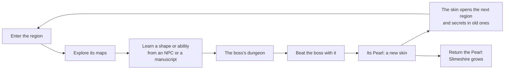

# Direction

The game's backbone: what the game is, where the slime's powers come from, and
how a region plays. The dated decisions behind it are in [History](#history).
Story details are in [Premise](./02-premise.md); every permanent item and where
it is earned is in the [Unlock map](./05-unlock-map.md).

> **Status words.** *Built* is in the game. *Rework* is built in the **rework
> mode** (merged 2026-10-15): on in the playground, and in any world with
> `?shapes`; with it off the classic game runs unchanged
> ([BODY_SHAPES.md](../godot/BODY_SHAPES.md)). *Planned* is decided but not
> built. *Open* is not decided.

## The game in one line

Slime Isa is a top-down adventure in the spirit of Zelda. Gorge broke the
Wellspring's heart, the source of every new slime, into eight Pearls and gave
them to his eight vassals. The last slime born explores a growing world, wins
the Pearls back from those bosses and, with them, the powers that open new
places. Crafting stays, but it is small: it makes supplies and materials, and it
is not a survival game ("the adventure version, with a little bit of crafting",
owner, 2026-10-02).

## The rule behind every chapter

> **Permanent things are earned and celebrated. Consumable things are crafted
> and farmed.**

| Permanent: earned once, kept forever, celebrated | Consumable: crafted or farmed, used up |
|---|---|
| Skins (from the Pearls) | Potions and food |
| Shapes (spear, axe, hammer, ...) | Energy shards |
| Abilities (Roll, Stretch Lash, Bomb, ...) | Charcoal, iron bars and other materials |
| Evolutions of shapes and abilities | Anything that stacks in the bag |
| Bags and vaults | |
| Heart quarters and energy upgrades | |
| Keys and story items (Pearls, manuscripts) | |

Earning any permanent thing is a moment: the game pauses, the item rises out of
the slime with light rays and a fanfare, and a card shows its name, one line of
text and how to use it.

## The slime's powers

The slime has three kinds of power. Each has one source and one job.

| System | What it is | Where it comes from | Its job | Energy |
|---|---|---|---|---|
| **Skins** | A Pearl's power that becomes part of the slime: always on once learned, with no key. Each one works by itself when the place calls for it. | One per **Pearl**: each of the eight bosses holds one | Open the next region, reach secrets in old ones, and beat later bosses | Free |
| **Shapes** | The slime shapes itself into a weapon or tool: spear, axe, hammer, ... They replace crafted weapons. Each has a combo chain and a hold-to-charge attack. | **NPCs** teach them, or **old manuscripts** the slime finds, whole or in pieces | Fight, chop, mine, break | Free; a charged attack costs energy |
| **Abilities** | Moves the slime uses at will: Roll, Stretch Lash, Goo Bomb, Lantern, ... All but the Roll share one key: the player picks which one it fires in the bag (the Ability Box). | **NPCs** (taught, or rescued) and **manuscripts** | Movement, puzzles and the tools a boss needs | Every use costs energy |

- **The Slime Forge** (a new building) evolves shapes and abilities. The slime
  stays at the Forge while it evolves, and it ends in the full ceremony.
- **The Gulp** only grabs light objects (pots and the like, never a live enemy)
  and throws them.
- **Energy does not refill on its own.** Only potions and energy shards restore
  it (a kill drops a shard now and then), so the player has to choose when a
  power is worth it. Max energy grows over the game.

### The skins

Like Zelda's flippers and gloves or Super Metroid's suits, a skin is never put
on or switched: once the Pearl is won, its power is part of the slime for good
(owner, 2026-10-15). The rules:

- **Contextual.** A skin acts only when the place calls for it, and shows
  while it does: the slime turns stony as it grabs a block or stands on a
  plate, and silky in a web. The rest of the time the slime looks and moves
  as itself.
- **Pure additions.** A skin never has a downside (Heavy does not slow the
  slime down) and never clashes with another: each answers its own kind of
  place (webs, plates, water, lava, ...), so all of them stack.
- **No keys.** The controls stay attack, shape, mouth, ability, roll and
  interact, whatever the slime has learned.
- **Depth from combos.** The choices are in shapes × abilities × energy, and
  every skin is always there to combine with them: the Hammer's Quake goes
  deeper with Heavy, the Roll glides through webs with Silk. Players discover
  these combos; no ability is locked to a skin.
- **Gated by region.** Each region's places need its own skin, as Zelda gates
  with items, so having every skin on does not make later regions easy; their
  challenge is in fights and energy.
- **A look of one's own.** The player may pick a learned skin as the slime's
  everyday look (cosmetic only).

Why always on: no switching key or skin-ability key, no wrong-skin mistakes
that waste energy, every combo available at once, and backtracking that just
works. What it could cost, and the rule that answers it:

| Risk of always-on skins | Answered by |
|---|---|
| Skins lose their trade-offs (the old Stone form was slow) | Contextual: a skin acts only in its moment, so it never slows or limits the slime elsewhere |
| Skins clash when all are on (Heavy sinks, Cloud floats) | Pure additions: each answers its own kind of place, so they stack like Super Metroid's suits |
| Puzzles lose "which skin do I need?" | Depth from combos, and the energy budget with no regeneration |
| Power creep late in the game | Gated by region: each region's places need its own skin; challenge stays in fights and energy |
| The transformation fantasy fades | A skin shows while it works, and the player can pick one as the everyday look |

| Skin | Pearl | Natural ability | Status |
|---|---|---|---|
| **Heavy** | 1, Fatty One Eye | Moves big statues, pedestals and some blocks; holds down gate openers by standing on them. It shows only while it works | Planned as a skin. Rework: the heavy plates and the pushable pedestal and statue work, but for the Stone form, still swallowed from a stone essence (and slower) |
| **Silk** | 2, the Matron | Walks through webs at full speed and passes web walls at half speed | Planned. Web walls and the 80% slowdown are not built; today the Silk form, from a silk essence, passes webs |
| Aquatic, acid, lava, cloud, ... | 3 to 8 | Open | Idea |

### Webs (Chapter 2)

| | Webs | Web walls |
|---|---|---|
| **Without the Silk skin** | Speed −80% | Cannot pass |
| **With the Silk skin** | Full speed | Pass at −50% speed |

No web wall blocks the way to the Matron. The slime meets her without the Silk
skin, so her web attacks hit it with their full effect. Her Pearl grants the
Silk skin, which then opens the web walls all over the forest and in the maps
already visited.

## How a region plays

**The tool you find beats the boss; the skin the boss gives opens the world.**

## How it borrows from Zelda

- **A big world.** Many regions, and each region can span several maps. A
  chapter can span several maps but stays within one region. Some maps have no
  boss; each region has exactly one, placed on whichever map suits the
  adventure (Fatty One Eye could move to his own cavern map, for example).
  Release 1 (Chapters 1 and 2) is only the opening of that world.
- **Key tools per region.** Each region teaches one or more shapes or
  abilities, and its boss needs them.
- **One skin per boss**, always on once won. The skin opens the next region
  and secrets in places the player has already visited, which rewards going
  back.
- **Bosses live in their dungeons.** Once the slime enters a boss's chamber it
  cannot leave until the boss is beaten.
- **Growth through exploration.** Max health and max energy grow through
  secrets and bosses, never through levels.
- **Movement in order.** Basic moves come early and powerful ones later.
- **Secrets spread over the whole game.** They are not packed into the first
  maps.

## Decisions in effect

| Topic | Decision | The game today |
|---|---|---|
| **Getting an item** | The full ceremony for every permanent thing the first time; a smaller sting for new recipes; nothing for materials. | Built 2026-10-09 for abilities, permanent items and Goo Hearts (owner's playtest open); the recipe sting is not built |
| **Bags** | The slime starts with no bag. Elder Plop gives a **10-slot bag** with the first quest. A **20-slot bag** waits in a coffer in the Gloop Cavern. A new bag replaces the old one. | 20 slots from the start |
| **Vault** | Found inside a house during a quest that also teaches sleeping to recover. **50 slots.** The vault screen shows the bag on the left and the vault on the right, with drag and drop both ways. | Chests are take-only |
| **Crafting time** | Forge materials (charcoal, iron bars) cook in the background with a progress bar, and the player claims them later. Shapes and abilities evolve at the Slime Forge. Quick recipes stay instant. | Every recipe is instant |
| **Shapes** | Replace crafted weapons and tools. Learned from NPCs or manuscripts. | Rework: the Spear, the War Axe and the Hammer, each with a 3-step chain and a charge (Lunge, Spin, Quake); E switches. Nothing teaches them yet (the rework lends them all). The classic game still crafts weapons |
| **Skins** | Two systems: shapes, and skins from the Pearls. Swallowing essences no longer gives forms. Skins are always on and contextual, with no key ([The skins](#the-skins)). | Not built as skins: the Stone and Silk forms still come from swallowed essences, held by a Q hold |
| **Gulp** | Grab and throw only. | Built. Rework: Q is the whole mouth: hold to suck, tap to throw, hold 2 s to swallow an essence |
| **Swallow and essences** | **Marked for deletion.** The code stays in case it is needed later, but the game does not use it: no Swallow lesson from Tom, no essence drops. | Built 2026-10-09 (Tom in the Web teaches it; the Clod Stomper drops stone essences, spiders drop silk) |
| **Roll** | The Dodge became the Roll: a Pegasus-boots dash that goes straight, bonks off walls, and drains energy while held. Who teaches it is Open (a manuscript, or an NPC the slime rescues). | Built 2026-10-09. Rework: on Space; a tap rolls a quick roll, and the `roll-charge` upgrade adds the held, charged roll |
| **Goo Bomb** | An ability that costs energy. It breaks cracked walls and cracked ground. | Rework: 20 energy, a 2 s cast, then a 3 s fuse; Q can suck it up and throw it. It blows cracked walls (a blown wall can be a door) and rubble heaps, and hurts the slime too. Cracked ground still breaks under a Squash Slam in the Stone form |
| **Lantern** | An ability: an ember lights the slime in dark rooms, and a short flame hurts, lights candles and burns dry things (hedges, hay). | Rework: 10 energy a flame; dark rooms, candles and deadthorn hedges are built |
| **Energy** | Every ability costs energy, per use (Goo Bomb, Lantern, Squash Slam, Stretch Lash) or over time (the Roll). Skins and shapes are free, except a shape's charged attack. No regeneration: only potions and energy shards refill it. Max energy grows over the game. | Classic: it refills by itself. Rework: no refill; a kill drops an energy shard (+15) one time in five; max 100 |
| **Life and energy display** | A bottom console, from the approved [mockup](../design/2026-10-07-hud-console-mockup.md): numbers show only when a value changes, and the ring shows each heart quarter. The boss bar is at the top. | Built 2026-10-08 (owner's playtest open); the heart quarter pips wait for the quarters |
| **Hearts** | Four heart quarters make one heart, worth **+20 max HP**. A quarter adds nothing on its own, and the slime starts with no hearts. | Five Goo Hearts of +10 each |
| **Bosses** | One per region, inside its dungeon; the slime cannot leave the chamber until the boss is beaten. A beaten boss never comes back. | Bosses live in the open world, heal after 60 s with the slime outside their arena (their bar hides meanwhile), and respawn |
| **The Matron** | New art. Her normal attack is a Stretch Lash in three directions: a hit deals damage, pulls the slime toward her, and traps it. The slime has no Silk skin yet, so it takes the full effect. Her Pearl grants the Silk skin. | One web spit; placeholder art |
| **Stretch Lash** | Learned from manuscripts. | Mossy teaches it in Chapter 2 |
| **Squash Slam** | Stays in the game. Where it is learned is Open, decided with the main story. | Finishing The One-Eyed Guardian teaches it. Rework: an improved Slam whose outer ring bounces enemies in place for a follow-up |
| **Jump** | Removed (2026-10-08): it hopped over walls and gates and misbehaved around hills. The code stays; nothing teaches it. | Removed |
| **Keys** | Left click attacks with the shape (hold to charge); E switches shapes; Q is the mouth; F uses the ability chosen in the bag; Space rolls; right click interacts, and held on a heavy block grabs it to push or pull. Keys-only: A, E, Q, S, D, W. | Rework. The classic game keeps 1 Swallow, 2 Roll, and 3 to 5 for Lash, Slam and Teleport |

The roadmap carries these as Release 1 tasks:
[2026-10-02 decisions](../GAME_ROADMAP.md#the-2026-10-02-decisions),
[2026-10-08 decisions](../GAME_ROADMAP.md#the-2026-10-08-decisions). The
2026-10-15 decisions (skins, shapes, the Goo Bomb, Swallow marked for deletion,
no energy regeneration) are not in the roadmap yet. The rework's own plan for
Release 1 ([dungeons plan](../design/2026-10-11-release-1-dungeons-plan.md),
not built) predates them: it has Old Veteran Yoi teach the Spear, the War Axe
found in the Weaver Hollow, and Pearls that give abilities.

## Open

- **Chapter 2's key item.** Swallow was Chapter 2's key item. The candidates
  are the Goo Bomb, the Lantern (both built), the War Axe (the dungeons plan's
  choice), or something new.
- **Skins 3 to 8**, and which boss holds each.
- **The Roll's teacher**, and where Squash Slam, Teleport and each shape are
  learned.
- **The skins' triggers.** For each skin, exactly when it acts and how it
  shows (Heavy: on a grab and on a plate; Silk: in a web or a web wall), and
  its combos with the shapes and abilities.

More questions are in [Open questions](./06-open-questions.md).

## History

- **2026-10-02:** adventure first, with a little crafting. Item ceremony, bags,
  vault, timed crafting, heart quarters, the orb HUD, webs that trap the slime.
  Sprint becomes a mid-game power. Gulp forms become armors the slime keeps.
- **2026-10-07:** the HUD becomes a bottom console (mockup approved 10-08).
- **2026-10-08:** Jump removed. Sprint removed; the Dodge becomes the Roll.
  Armors replaced by **essences**: Gulp sucks an essence, Swallow turns it into
  a form; Tom teaches Swallow in Chapter 2. Cracked ground breaks under a Squash
  Slam in the Heavy form.
- **2026-10-09:** Gulp and essences, the Roll and the new keys built.
- **2026-10-15:** forms become **skins**, earned from the **Pearls**, permanent
  and free. **Shapes** replace crafted weapons and are learned from NPCs and
  manuscripts. The **Bomb** (an energy ability) breaks cracked walls and ground.
  Swallow and essences are marked for deletion; Gulp only grabs and throws.
  Energy no longer refills on its own. The Slime Forge evolves shapes and
  abilities. Webs slow the slime by 80% and web walls stop it without the Silk
  skin. Bosses keep the slime in their chamber until beaten.
- **2026-10-15 (merge):** the rework mode reached main: shapes, the Ability
  Box on F, the Goo Bomb, the Lantern, heavy plates and blocks, energy without
  regeneration and energy shards, the quick roll, and doors entered by walking
  into them.
- **2026-10-15 (later):** skins are **always on** once won, like Zelda's
  flippers or Super Metroid's suits: contextual, pure additions, no keys. The
  idea of up to three abilities locked to each skin is dropped; skin × shape ×
  ability combos take its place.
