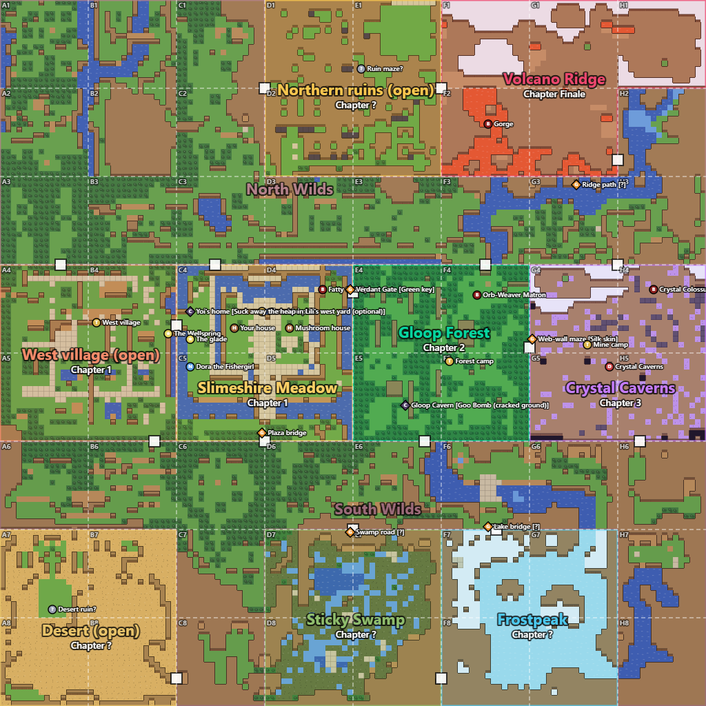

# World

Release 1's three regions (Chapters 1 to 3, owner, 2026-10-15), with part of
the West village and the Wilds that connect them (owner, 2026-10-16), are only
the beginning. To feel like a Zelda world,
the game needs many more regions, and inside them dungeons, castles and mazes,
each with its own boss. This page lists what exists, what is sketched, and the
empty slots still to fill.

## Regions in order

| # | Region | Maps | Chapter | What has gone wrong (story) | Boss | Status |
|---|---|---|---|---|---|---|
| 1 | **Slimeshire Meadow** | `level-1`, `slime-home`, `mushroom-home` | 1 | Worms moved in, the smith fled, the Forge is cold and the Workshop is a ruin | Fatty One Eye | Built |
| 2 | **Gloop Forest** | `gloop-forest`, `gloop-hut`, `gloop-cavern` | 2 | The forest is choked with webs; the Matron's brood spreads | Orb-Weaver Matron | Built, in progress |
| 3 | **Crystal Caverns** | `crystal-caverns` (exists; open without a key for now) | 3 | Crystal grows over everything in the caves; the Colossus has blocked the smith's crystal mine | Crystal Colossus; his Pearl grants the Feral skin (owner, 2026-10-16) | In Release 1 since 2026-10-15; the chapter is a [sketch](chapters/chapter-3-crystal-caverns.md) (Idea), with Planned beats of 2026-10-16 |
| 4 | **Sticky Swamp** | `sticky-swamp` (placeholder) | ? | Slow mud, poison, rain, spider-slimes | ? | Idea |
| 5 | **Frostpeak** | `frostpeak` (placeholder); `icege` is a candidate | ? | Ice physics and snow | ? | Idea |
| 6 | **Volcano Ridge** | `volcano-ridge` (placeholder); `hot` and `emberleef` are candidates | Finale | Gorge's prison; the rumbling comes from here | Gorge | Idea / Proposal |

The first map of each row is the region's world scene in the layout,
`godot/game/data/world-map.json`. A placeholder world is generated from the
layout by `godot/tools/build_region_worlds.gd` and stands in until the region
is built ([WORLD_ATLAS.md](../godot/WORLD_ATLAS.md)). The layout's other
regions are open slots with placeholder worlds too: West village
(`west-village`), Northern ruins (`northern-ruins`), Desert (`desert`), and
the North and South Wilds (`north-wilds`, `south-wilds`) between the regions.
Part of the West village joins Release 1 ([below](#the-west-village)).

**Release 1's map (Planned, owner, 2026-10-16).** Release 1's content ends
when the Crystal Colossus falls, but the game goes on: the player explores the
first three chapters' regions, the West village and the Wilds that connect
them with the new powers, and the game says that from here on it is
exploration and that more areas come in later releases. Barriers in the world
close the ways to the regions that are not in Release 1 (a fallen bridge, a
landslide, a Thorn Guard post), and each says that more lies beyond (owner,
2026-10-16,
[question 73](06-open-questions.md#contradictions-left-after-the-review-2026-10-15)).
From the Wilds, the Crystal Caverns are reached up a hill that only the Feral
skin climbs, so that way opens once Feral is won, and Gloop Forest through a
second web maze that only the Silk skin passes (owner, 2026-10-16,
question 87). So the Wilds never skip the Verdant Gate or the web-wall maze.

**The prologue (Planned, owner, 2026-10-16,
[question 97](06-open-questions.md#contradictions-left-after-the-review-2026-10-15)).**
Before Chapter 1 a short, closed place in the south, between chunks B4 and
C4, ringed by forest: the Wellspring in B4, where the slime is born, and the
glade on C4's south-west edge, where it saves Yoi. Its barred gate opens into
Slimeshire. Chunk content may move to fit it; if it does not fit naturally, it
can be an underground cavern. After the prologue a short forest path from
Slimeshire's south-west leads back to the Wellspring (question 98). The
[prologue design](../design/2026-10-16-prologue.md) has the screens.

**Proposal: "What has gone wrong" always traces back to a Pearl.** It swelled
the boss, or it drove creatures out of their homes. This gives every region a
problem that the slime can actually fix.

**Open:** the order of regions 4 and 5, how many more regions the world needs,
and where castles and mazes fit. Zelda games have eight or more dungeons; at one
region per chapter, the world needs eight or more chapters.

## World size and screen

**Decided (2026-10-07):** the world is built on the grid of Zelda: A Link to
the Past's overworld (the reference is in `asset/Originals/MAPS/Maps/`:
`maps.md`, `zelda map.png` and `regions.png`). That world is 256 × 256 tiles,
cut into **8 × 8 chunks of 32 × 32 tiles**, and its regions are groups of
chunks: Kakariko Village, Hyrule Castle and the Lost Woods are 2 × 2 chunks
each, Death Mountain about 4 × 2.

| Unit | Tiles | Pixels (64 px tiles) |
|---|---|---|
| Tile | 1 | 64 × 64 |
| Screen (play area) | 16 × 14 | 1024 × 896 |
| Chunk | 32 × 32 (2 × 2.3 screens) | 2048 × 2048 |
| Region, usual size | 64 × 64 (2 × 2 chunks, 4 × 4.6 screens) | 4096 × 4096 |
| Whole overworld | 256 × 256 (8 × 8 chunks) | 16384 × 16384 |

Rules for every map:

1. **One tile is 64 × 64 px, and everything is sized in tiles.** The slime is
   about one tile, a tree 2 tiles wide and about 2.7 tall, a house 5 × 5.
2. **The screen shows 16 × 14 tiles**, as Zelda does. The play area is
   1024 × 896 px, and under it the HUD console takes a 128 px strip (2 tiles,
   since 2026-10-08), so the game's base view is 1024 × 1024 px. Godot scales
   it to fit the window: the play area is never smaller than 16 × 14 tiles,
   and a wider window shows more columns (a 16:9 window shows about 28 × 14).
   The menus and the HUD scale with it.
3. **An overworld map is a whole number of chunks**: its columns and rows are
   multiples of 32. A small area is one chunk (32 × 32), a region is usually
   2 × 2 chunks (64 × 64), and a large one, like Death Mountain, 4 × 2
   (128 × 64).
4. **The whole overworld is at most 8 × 8 chunks.** Each overworld map takes
   a place on that grid, and maps that touch on the grid connect through their
   shared edge.
5. **Interiors are not on the grid.** Houses, huts, caves and dungeons are their
   own maps. A room fits on one screen (16 × 14 tiles at most), as
   `slime-home` (14 × 11) and `mushroom-home` (16 × 12) already do; bigger
   caves and dungeons are made of whole screens.
6. **A map's edge is a wall** (forest, cliff or water, two or three tiles
   thick), broken only where an exit leads to the next map.

| Map | Size (tiles) | Chunks | Status |
|---|---|---|---|
| `level-1` (Slimeshire Meadow) | 64 × 64 | 2 × 2 | Cut into four chunk scenes on 2026-10-14 (`level-1-c4` the village … `-d5`) |
| `gloop-forest` | 64 × 64 | 2 × 2 | Grown from 54 × 54 on 2026-10-12: its east and south strips are a tree wall (a ForestLayer), the river and the east road run on to the new edge, its camp moved 4 tiles west into chunk E4 |
| `crystal-caverns` | 64 × 64 | 2 × 2 | Grown from 54 × 54 on 2026-10-12: its east and south strips are cavern floor |
| Placeholder regions: `west-village`, `northern-ruins`, `desert`, `sticky-swamp`, `frostpeak` | 64 × 64 | 2 × 2 | Built from the sketch by `godot/tools/build_region_worlds.gd` ([WORLD_ATLAS.md](../godot/WORLD_ATLAS.md)) |
| Placeholder regions: `volcano-ridge` (L-shaped), `north-wilds`, `south-wilds` | 96 × 64, 256 × 96, 256 × 96 | their block | Only their own chunks are walkable |
| `icege`, `hot`, `emberleef` and the other dev candidates | 54 × 54 | not whole | Not on the map |
| `slime-home`, `mushroom-home`, `gloop-hut` | 14 × 11, 16 × 12, 14 × 11 | interior | Fit on one screen |
| `gloop-cavern` | 22 × 14 | interior | Two screens wide |

Each region's chunks (A1 in the north-west to H8 in the south-east) are in the
world map below, and the layout itself is the game's
`godot/game/data/world-map.json`. Slimeshire Meadow holds C4, D4, C5 and D5,
so `level-1`'s 64 × 64 tiles are exactly those four chunks.

## World map

A rough sketch of the whole world: which region sits where, its ground and
hills, and what connects to what. It is drawn with the world map tool
(`pnpm story:map`, then open http://127.0.0.1:3210; see
[TOOLING](../TOOLING.md#story)).

The tool saves three things:

- the drawing to
  [`godot/game/data/world-map.json`](../../godot/game/data/world-map.json);
- the picture to `world-map.png`;
- the block below, which it rewrites on each save.

That file is also the game's world layout. Each region names its overworld
scene (`world`) and its interiors. The in-game world map and the Godot world
atlas read the file. The region builder (`godot/tools/build_region_worlds.gd`)
makes the placeholder regions from it and writes back the openings between
touching regions. The tool's layout tools move whole regions or blocks of
chunks with everything on them.

The sketch is 128 × 128 cells, so one cell is 2 × 2 tiles and one chunk is
16 × 16 cells. Its ground, water and cliffs were traced from the A Link to the
Past reference, and its regions started in the reference's places. On
2026-10-10 the middle row was laid out as in the game, from west to east:

1. a west village;
2. Slimeshire Meadow;
3. Gloop Forest, through the Verdant Gate on `level-1`'s east edge;
4. the Crystal Caverns.

The other regions:

- Northern ruins and Volcano Ridge are on the great mountain to the north.
- Sticky Swamp and a frozen-lake Frostpeak are to the south.
- A desert is in the south-west.
- The **North Wilds** and **South Wilds** are the connecting zones between
  them all.

The ruins and the desert are empty slots, and part of the village joins
Release 1 (owner, 2026-10-16; [The West village](#the-west-village)). The
layout is a **Proposal**.

<!-- world-map:start -->
<!-- Generated by the world map tool (pnpm story:map) from godot/game/data/world-map.json. Draw on the map instead of editing this block. -->

The map is cut into 8 × 8 chunks, A1 in the north-west; a region's chunks are those where it holds most of the ground.

| Region | Chapter | Status | Chunks | Borders | World | Interiors | Boss | Notes |
|---|---|---|---|---|---|---|---|---|
| **Slimeshire Meadow** | 1 | Built | C4, D4, C5, D5 | North Wilds, West village (open), Gloop Forest, South Wilds | level-1 | slime-home, mushroom-home | Fatty One Eye | The hub, in the middle of the world (the castle's place in the reference): the plaza ringed by water. Worms moved in, the smith left for his crystal mine, the Forge is cold until Pearl 2 comes home. The prologue (the Wellspring and the glade) lies in the south-west, between B4 and C4, and teaches the Spear; Yoi's home lies under Lili's west yard; Fatty's Lair, the worms' burrow, is shut by the old Thorn Guard gate, which only a Roll beats. Release 1. |
| **Gloop Forest** | 2 | In progress | E4, F4, E5, F5 | North Wilds, Slimeshire Meadow, Crystal Caverns, South Wilds | gloop-forest | gloop-hut, gloop-cavern | Orb-Weaver Matron | East of the hub, as in the game (moved 2026-10-10): the Verdant Gate on level-1's east edge leads in. Choked with webs; the Matron's brood spreads. A maze of web walls on its east side, which only the Silk skin (the Matron's Pearl) passes, leads to the Crystal Caverns. Release 1. From the Wilds a second web maze leads in, which only the Silk skin passes. |
| **Crystal Caverns** | 3 | Planned | G4, H4, G5, H5 | North Wilds, Gloop Forest, South Wilds | crystal-caverns |  | Crystal Colossus | East of Gloop Forest, as in the game (moved 2026-10-10; open without a key in the game for now). The west half of the great mountain: caves through the rock. The smith runs the crystal mine, which the Crystal Colossus has blocked; at his mine camp he gives the Lantern. A dark maze the Lantern lights, and the Colossus's arena ringed by four braziers. Pearl 3 grants the Feral skin. Reached from Gloop Forest through the web-wall maze (the Silk skin). Release 1 ends when the Colossus falls. From the Wilds a hill leads in, which only the Feral skin climbs, so that way opens once Feral is won. |
| **Volcano Ridge** | Finale | Idea | F1, G1, H1, F2, G2 | Northern ruins (open), North Wilds | volcano-ridge (placeholder) |  | Gorge | The east half of the great mountain, around the crater. Gorge's prison; the rumbling comes from here. |
| **Frostpeak** | ? | Idea | F7, G7, F8, G8 | South Wilds, Sticky Swamp | frostpeak (placeholder) |  |  | Proposal: the great lake in the south-east, frozen, with snowy cliffs: ice physics and snow. |
| **Sticky Swamp** | ? | Idea | D7, E7, D8, E8 | South Wilds, Frostpeak | sticky-swamp (placeholder) |  |  | South of the hub (the Great Swamp's place). Slow mud, poison, rain, spider-slimes. Proposal: Old Gullet, the catfish, holds the Swim skin's Pearl. |
| **West village (open)** | 1 | Planned | A4, B4, A5, B5 | North Wilds, Slimeshire Meadow, South Wilds | west-village (placeholder) |  |  | A second town (Kakariko's place). Its first part joins Release 1: the house of Burr the gatekeeper, where young Burr teaches the Roll, three or four more houses, a shop and a game to play. The rest comes in later releases. |
| **Northern ruins (open)** | ? | Idea | D1, E1, D2, E2 | North Wilds, Volcano Ridge | northern-ruins (placeholder) |  |  | Moved north 2026-10-10 (Crystal Caverns took the east). Empty slot: a ruin maze on a plateau (the Eastern Palace's place). A dungeon region. |
| **Desert (open)** | ? | Idea | A7, B7, A8, B8 | South Wilds | desert (placeholder) |  |  | Empty slot: a desert walled by cliffs (the Desert of Mystery's place). |
| **North Wilds** | ? | Idea | A1, B1, C1, A2, B2, C2, H2, A3, B3, C3, D3, E3, F3, G3, H3 | Northern ruins (open), Volcano Ridge, West village (open), Slimeshire Meadow, Gloop Forest, Crystal Caverns | north-wilds (placeholder) |  |  | The connecting fields north of the middle row (the Wilds split in two 2026-10-10). The connecting zones: the fields, roads, rivers and ledges between the regions. Every region opens onto them, so the hub reaches all of them. Open to explore in Release 1 after the Crystal Colossus; the ways to the regions that are not in Release 1 are closed in the world (a fallen bridge, a landslide, a Thorn Guard post), each saying that more lies beyond. |
| **South Wilds** | ? | Idea | A6, B6, C6, D6, E6, F6, G6, H6, C7, H7, C8, H8 | West village (open), Slimeshire Meadow, Gloop Forest, Crystal Caverns, Desert (open), Sticky Swamp, Frostpeak | south-wilds (placeholder) |  |  | The connecting fields south of the middle row: roads to the swamp, the desert and Frostpeak. Open to explore in Release 1 after the Crystal Colossus; the ways to the regions that are not in Release 1 are closed in the world (a fallen bridge, a landslide, a Thorn Guard post), each saying that more lies beyond. |

**Connections**

| Passage | Kind | Connects | Needs | Notes |
|---|---|---|---|---|
| Opening | Opening (generated) | Northern ruins (open) ↔ North Wilds | nothing | Cut by the region builder |
| Opening | Opening (generated) | Volcano Ridge ↔ Northern ruins (open) | nothing | Cut by the region builder |
| Ridge path | Gate / passage | Volcano Ridge ↔ North Wilds | ? |  |
| Opening | Opening (generated) | Volcano Ridge ↔ North Wilds | nothing | Cut by the region builder |
| Opening | Opening (generated) | West village (open) ↔ North Wilds | nothing | Cut by the region builder |
| Opening | Opening (generated) | Slimeshire Meadow ↔ North Wilds | nothing | Cut by the region builder |
| Opening | Opening (generated) | Gloop Forest ↔ North Wilds | nothing | Cut by the region builder |
| Opening | Opening (generated) | Crystal Caverns ↔ North Wilds | nothing | Cut by the region builder |
| Opening | Opening (generated) | Slimeshire Meadow ↔ West village (open) | nothing | Cut by the region builder |
| Verdant Gate | Gate / passage | Slimeshire Meadow ↔ Gloop Forest | Green key | level-1's east exit into Gloop Forest (the gate object stands at (3776, 768)) |
| Verdant Gate | Opening (generated) | Slimeshire Meadow ↔ Gloop Forest | nothing | Cut by the region builder |
| Web-wall maze | Gate / passage | Gloop Forest ↔ Crystal Caverns | Silk skin | gloop-forest's east way into the Crystal Caverns: a maze of web walls only the Silk skin passes (owner, 2026-10-16); open without a key in the game for now |
| Web-wall maze | Opening (generated) | Gloop Forest ↔ Crystal Caverns | nothing | Cut by the region builder |
| Opening | Opening (generated) | West village (open) ↔ South Wilds | nothing | Cut by the region builder |
| Plaza bridge | Gate / passage | Slimeshire Meadow ↔ South Wilds | nothing | The way out of Slimeshire into the Wilds |
| Plaza bridge | Opening (generated) | Slimeshire Meadow ↔ South Wilds | nothing | Cut by the region builder |
| Opening | Opening (generated) | Gloop Forest ↔ South Wilds | nothing | Cut by the region builder |
| Opening | Opening (generated) | Crystal Caverns ↔ South Wilds | nothing | Cut by the region builder |
| Opening | Opening (generated) | Desert (open) ↔ South Wilds | nothing | Cut by the region builder |
| Swamp road | Gate / passage | Sticky Swamp ↔ South Wilds | ? |  |
| Swamp road | Opening (generated) | Sticky Swamp ↔ South Wilds | nothing | Cut by the region builder |
| Lake bridge | Gate / passage | Frostpeak ↔ South Wilds | ? |  |
| Lake bridge | Opening (generated) | Frostpeak ↔ South Wilds | nothing | Cut by the region builder |
| Opening | Opening (generated) | Frostpeak ↔ Sticky Swamp | nothing | Cut by the region builder |
| Gloop Cavern | Cave / stairs | Gloop Forest → gloop-cavern | Goo Bomb (cracked ground) |  |
| Yoi's home | Cave / stairs | Slimeshire Meadow → interior | Suck away the heap in Lili's west yard (optional) | Old Veteran Yoi's hideout, his home after the prologue: Lili's tip finds it; a heart quarter, his tips, later the Spear's upgrades |

**Places on the map**

| Place | Kind | Region | Chunk | Needs | Notes |
|---|---|---|---|---|---|
| Crystal Caverns | Dungeon | Crystal Caverns | G5 |  |  |
| Crystal Colossus | Boss | Crystal Caverns | H4 |  | Four braziers ring his arena; Pearl 3, the Feral skin |
| Mine camp | Town / hub | Crystal Caverns | G4 |  | The smith runs the crystal mine; he gives the Lantern |
| Desert ruin? | Note / idea | Desert (open) | A7 |  | Empty slot |
| Forest camp | Town / hub | Gloop Forest | F5 |  |  |
| Orb-Weaver Matron | Boss | Gloop Forest | F4 |  |  |
| Ruin maze? | Note / idea | Northern ruins (open) | E1 |  | Empty slot: a dungeon |
| Slimeshire plaza | Town / hub | Slimeshire Meadow | C4 |  | The middle of the world |
| Your house | House / interior | Slimeshire Meadow | C4 |  |  |
| Mushroom house | House / interior | Slimeshire Meadow | D4 |  |  |
| Dora the Fishergirl | NPC | Slimeshire Meadow | C5 |  | At the water around the plaza (renamed from Lily on 2026-10-11; the game still says Lily) |
| Fatty One Eye | Boss | Slimeshire Meadow | D4 |  | In Fatty's Lair, the worms' burrow: the Thorn Guard gate drops shut too fast to walk, and falling slabs over spikes or the void need the Roll. Burr waits in a cell. Guards the chest with the green key |
| The glade | Landmark | Slimeshire Meadow | C4 |  | The prologue: Yoi falls to four worms; the slime saves him by throwing things and learns the Spear. A barred gate (the Spear's lock) opens into Slimeshire |
| Gorge | Boss | Volcano Ridge | F2 |  | Finale, in the crater |
| The Wellspring | Landmark | West village (open) | B4 |  | The prologue's lake, where the slime is born (owner, 2026-10-16): a pool of glowing goo ringed by forest in the south between B4 and C4. A forest path from Slimeshire's south-west reaches it later; each Pearl comes home here |
| West village | Town / hub | West village (open) | B4 |  | Burr's house (young Burr teaches the Roll), a few houses, a shop and a game: Release 1's part |
<!-- world-map:end -->

## Slimeshire: the hub

Slimeshire is home. The slime comes back to it between chapters, and the town
grows as Pearls return.

| Place | What happens there | Status |
|---|---|---|
| The clearing | The slime's first steps; the first quests (Planned: NPCs give tips, and the journal keeps one main quest, question 60). *Since 2026-10-16 the first steps are the prologue's, and the slime comes out of the forest at the town's edge, where Plop meets it (questions 97 and 100)* | Built |
| **The Wellspring** | The prologue's lake, where the slime is born, between chunks B4 and C4 (owner, 2026-10-16, questions 97 and 98). After the prologue a short forest path from Slimeshire's south-west reaches it. Each Pearl's homecoming is a short scene here, and it brightens; each returned Pearl restores a building (question 60). A campfire stands by it (question 104) | Planned (until 2026-10-16: its own map east of level-1, the game's first map) |
| **The glade**, C4's south-west edge | The prologue: Yoi falls to four worms, and the slime saves him by throwing things and learns the Spear. An old Thorn Guard gate, its lever behind bars, opens into Slimeshire with a Spear thrust ([prologue](../design/2026-10-16-prologue.md)) | Planned (owner, 2026-10-16, question 97) |
| **Slimeshire's well** | Pearl 1 restores it when it comes home, and from then on it refills the slime's energy (owner, 2026-10-16, question 90). After Fatty, the freed Burr and the journal send the slime home, and the well comes back when the slime brings the Pearl to it (question 103); it gives a full refill, a drink in town (question 105) | Planned |
| **The town's campfire** | It makes Chapter 1's one or two recipes; campfires also stand by the Wellspring and at each camp, so a fresh save can always heal (owner, 2026-10-16, question 104). Potions and food are both crafted at a campfire (question 66) | Planned |
| Elder Plop's path | The main-line giver for Chapter 1. Planned: he hands over the 10-slot bag (question 74), and after the Spear he sends the slime to Burr in the West village (owner, 2026-10-16). *Changed 2026-10-16 (sixth round, question 100): he meets the slime at the town's edge as it comes out of the forest, gives it the bag and its first tips, with the exclamation mark, and later sends it to Burr* | Built |
| **Your house** (the red forge house, its door leading to the Slime Home) | Bed: sleep to recover (it heals today), and wake here after a defeat. Planned: a bed gives a full refill and restores life (questions 62 and 105); there are no save points, and the slime saves anywhere outside dungeons (question 62) | Built house; how it is given Planned; the vault waits for a later release (owner, 2026-10-16, question 53) |
| Mushroom house | A furnished room with a bed and a chest | Built (role Open) |
| **Yoi's home**, under Lili's west yard | An optional secret: Lili's tip finds it, and the slime sucks away a heap of bricks and crates to open its hatch. Inside are a heart quarter, Yoi's tips, and later the Spear's upgrades (owner, 2026-10-16, question 99) | Planned. *Until 2026-10-16 it was Yoi's Hideout, a war hideout whose water maze led to Yoi, who taught the Spear (owner, 2026-10-11; confirmed in question 50; [dungeons plan](../design/2026-10-11-release-1-dungeons-plan.md#4-yois-hideout))* |
| Forge yard, beside your house | The Forge, relit in Chapter 2: Pip's story is relighting it (question 59). Planned: Pearl 2, the Matron's, relights it when it comes home, and Pip and the slime light it. From then on it brews the potions and knows their recipes (owner, 2026-10-16, questions 79 and 82), until evolutions arrive (question 51); its smelting timer leaves Release 1 with the materials | Built (smelting; the quest Rekindle the Forge restores it for ore); Planned: Pearl 2 relights it (question 79) |
| Workshop ruin, north of the plaza | Rebuilt after Chapter 2. The smith comes home once the Crystal Colossus falls (question 59), and teaches the Hammer shape there in Chapter 5 or 6, after Release 1 (question 51) | Built and parked; what it does in Release 1 is Open (question 51) |
| The lake | Lily the Fishergirl | Built |
| Worm camp, south-east | Worm Trouble | Built |
| Fatty One Eye's camp, east | The guarded chest with the green key | Built |
| **Fatty's Lair**, the worms' burrow | The old Thorn Guard gate, which a worm lever lifts and which drops shut too fast to walk through; falling slabs over holes; Burr in a cell; Fatty One Eye and Pearl 1 ([Chapter 1](chapters/chapter-1-the-clearing.md#fattys-lair-the-gate-the-slabs-and-burrs-cell-planned-owner-2026-10-16)) | Planned (owner, 2026-10-16): the slabs cross the void and spikes, and a slab falls a set time after it is touched (questions 70 and 71) |
| The Verdant Gate, east | The way into Gloop Forest | Built |

## The West village

Planned in part (owner, 2026-10-16): part of the West village joins Release 1,
with more NPCs, houses and things to do, like Zelda's town. It lies west of
Slimeshire Meadow (`west-village`, a placeholder world today). Its Release 1
part is a small town, like Kakariko
([question 73](06-open-questions.md#contradictions-left-after-the-review-2026-10-15)).

| Place | What happens there | Status |
|---|---|---|
| **Burr's house** | Empty when the slime first comes: Burr, the gatekeeper, went to fight Fatty One Eye. His son, young Burr, teaches the Roll here ([Chapter 1](chapters/chapter-1-the-clearing.md#the-west-village-young-burrs-roll-planned-owner-2026-10-16)). Once freed, Burr waits here to thank the slime: he gives the Bow (question 80) when the slime comes back after Chapter 2, in Chapter 3 (owner, 2026-10-16, questions 85 and 94). *Changed 2026-10-16 (sixth round, questions 102 and 106): a visit before Pearl 2 gets his thanks and a tip ("I am making you something, come back when the forest is free"); he builds the Bow from the Matron's thread, a spool from her nest, with the other things already in his workshop, and teaches it once the slime brings the thread and Pearl 2 is home* | Planned |
| **The town** | Three or four more houses, a shop and a game to play (owner, 2026-10-16, question 73). The shop sells potions and food ingredients, so coins have a use (question 88). Which game it is, is not decided yet | Planned |
| **A secret** | It teaches a simpler potion (owner, 2026-10-16, question 89). Where it is and which potion are not decided yet | Planned |
| The rest of the village | It comes in later releases | Planned |

## Gloop Forest

| Place | What happens there | Status |
|---|---|---|
| Forest camp (the walled clearing at the forest's heart) | Mossy, Sunny, a workbench, and the hut with a bed | Built |
| Weaver thickets | Orb-weavers and weaver fangs | Built; the weaver fangs go (owner, 2026-10-16, question 63) |
| **Tom's maze** | The way to Tom, who teaches the Goo Bomb: a maze with several secrets and tests, solved with the Spear, the Roll, the Heavy skin and the Gulp. Its webs slow the slime and cannot be cut before the Silk skin (owner, 2026-10-16, question 95) | Planned; where it lies is not decided (today Tom's web hangs in the south-west spider thicket) |
| Iron hollow, south-east of the camp | Iron ore behind a gate opened by the Heavy skin standing on its plate (Planned; today a swallowed stone essence) | Built; its iron goes with harvesting (none in Release 1), and what the hollow holds instead is not decided yet. *Answered 2026-10-16 (owner, question 63): heart quarters, potions, coins or a piece of the story, such as a piece of Kiri's note (the 2026-10-11 plan's)* |
| Silk nook, north-west | A walled nook behind a web wall; it opens once the Silk skin is earned | Built; web wall Planned |
| Cracked clearing, south-west of the camp | Planned: the Goo Bomb breaks the ground (today a Squash Slam in the Stone form, and the Slam is removed; the Goo Bomb blows cracked walls, not ground yet); it drops into the Gloop Cavern | Built |
| **Gloop Cavern** | Today a chest, a Goo Heart and a ladder. The coffer with the 20-slot bag was Planned; Release 1 has one bag, Plop's 10-slot bag, and the 20-slot bag waits for the next release (owner, 2026-10-16, questions 53 and 74), so what the coffer holds is question 63. *Answered 2026-10-16 (owner, question 63): heart quarters, potions, coins or a piece of the story* | Built; the coffer Planned |
| North stream | Sunny's basket and the lash bell post | Built; Stretch Lash waits for the next release, so they become come-back secrets (owner, 2026-10-16, question 94) |
| **The Matron's nest**, north-east | The boss arena; no web wall blocks the way in. Planned: after she falls, the slime takes the **Matron's thread**, a spool in her web, with the Silk skin; Burr builds the Bow from it (owner, 2026-10-16, question 106) | Built; the thread Planned |
| Crystal Caverns exit, east | Planned: a maze of web walls that only the Silk skin passes leads to the caverns, so the Silk skin opens Chapter 3 (owner, 2026-10-16, question 81). Today the exit is open without a key (the crystal-key gate was removed 2026-10-10) | Built; the web-wall maze Planned |
| The way in from the Wilds | A second web maze that only the Silk skin passes, so the Wilds do not skip the Verdant Gate (owner, 2026-10-16, question 87) | Planned |

## Crystal Caverns

Planned in part (owner, 2026-10-16); the rest of the chapter is a
[sketch](chapters/chapter-3-crystal-caverns.md).

| Place | What happens there | Status |
|---|---|---|
| The dark maze | Dark caves that the Lantern lights | Proposal |
| **The smith's mine camp** | The smith runs the crystal mine, which the Crystal Colossus has blocked. The slime finds him safe here, and he gives it the Lantern, the Forge's ember | Planned (question 59) |
| The mine's chasm | On the main path: a far eye switch across the chasm, which only the Bow's arrow reaches (owner, 2026-10-16, question 102) | Planned |
| **The Colossus's arena** | Four braziers ring it. With all four lit, a weak spot is bared on his armour at a random place; his stomps blow them out one at a time. He climbs out of reach to throw some of his minions down, and killed, they can drop energy shards. His Pearl grants the Feral skin, and Release 1's content ends when he falls | Planned (questions 56, 58, 59 and 69) |
| The hill from the Wilds | A way into the caverns up a hill that only the Feral skin climbs, so it opens once Feral is won (owner, 2026-10-16, question 87) | Planned |

## Webs (Planned)

The forest has two kinds of web (2026-10-15):

| | Webs | Web walls |
|---|---|---|
| **Without the Silk skin** | Speed −50% | Cannot pass |
| **With the Silk skin** | Full speed | Pass at −50% speed |

- The slowdown was 80% until the review of 2026-10-15; the Matron's fight is
  played with it before the number is fixed.
- The shapes cut webs only with the Silk skin (owner, 2026-10-15). A cut opens
  a web wall for good and frees things wrapped in silk (owner, 2026-10-16,
  question 55). In Release 1 the Spear, the only shape, does the cutting
  (question 94).
- No web wall blocks the way to the Matron. Her Pearl grants the Silk skin.
- A maze of web walls on the forest's east side leads to the Crystal
  Caverns, so the Silk skin opens Chapter 3 (owner, 2026-10-16, question 81).
- A second web maze, which only the Silk skin passes, leads into the forest
  from the Wilds (owner, 2026-10-16, question 87).
- Web walls are good places to hide secrets: they open on the way back,
  in Gloop Forest and in the maps already visited.

## Dungeons

None are built yet. Chapter 1's is **Fatty's Lair**, the worms' burrow, with
its fast gate, falling slabs and Burr's cell (Planned, owner, 2026-10-16).
Chapter 2's is the **Weaver Hollow** of the
[2026-10-11 dungeons plan](../design/2026-10-11-release-1-dungeons-plan.md),
whose big chest holds a heart or the dungeon's big key instead of the War Axe
(owner, 2026-10-16, question 95). The slime cannot save inside a dungeon
(question 62). Each dungeon has two or three enemies of its own and a
mini-boss, which teach its tool before its boss needs it: Release 1's 29
enemies are in the [bestiary](../design/2026-10-16-bestiary.md), accepted by
the owner on 2026-10-16 (question 107).
**Proposal:** from Chapter 3 on, every region has at least one dungeon (a
cave, a castle or a maze) with three parts:

1. A first half that the slime can reach with what it already has.
2. The region's **key tool** in the middle: a shape or an ability.
3. A second half and a boss that both need that tool. The boss's Pearl then
   grants a skin.

The Crystal Caverns are a natural dungeon: a dark maze that the Lantern (an
ability, built in the rework mode) lights, given by the smith at his mine camp
(owner, 2026-10-16).

## Secrets per map (Planned)

- **Four heart quarters per map** for now, and four quarters make one heart.
  **Open:** does the Gloop Cavern count as its own map, or does it share Gloop
  Forest's four?
- Some secrets should only open with powers from later chapters, such as the
  Silk skin, the Feral skin's climbing (walls with thick roots and rocky
  handholds, question 86), the Heavy skin's Roll (old dead or built things
  lying or leaning in the way: loose rocks, rubble heaps, rotten trunks
  across a path, grey leaning old trees, old fences, plank barricades,
  rotten mine timbers, question 93; the grey, leaning old tree it knocks over
  the river as a bridge, question 101), the Goo Bomb, the Lantern or later
  skins, so that going back pays off. A few optional secrets may combine a
  skin and an ability, each clearly different (owner, 2026-10-16,
  question 84). The War Axe's and Stretch Lash's locks (leafy vines, bushes,
  trees in leaf; Sunny's basket and the Lash's other uses) are come-back
  secrets for the next release (owner, 2026-10-16, question 94). The water secrets wait for the Swim skin (owner,
  2026-10-15), which comes from a later Pearl, after Release 1 (owner,
  2026-10-16, question 56): the deep-water secrets are come-back secrets
  (owner, 2026-10-16, question 75).
